# App Packager Desktop

[](https://github.com/jasonulbright/app-packager-desktop/actions/workflows/ci.yml)
[](https://github.com/jasonulbright/app-packager-desktop/actions/workflows/release.yml)
[](https://github.com/jasonulbright/app-packager-desktop/releases/latest)
[](https://github.com/jasonulbright/app-packager-desktop/releases)
[](#requirements)
[](#build-from-source)
[](LICENSE)

App Packager Desktop packages third-party Windows applications and publishes them to ConfigMgr, Intune and WSUS. It is a Windows desktop application. It is free and MIT licensed.


## What it does

For each application in its catalog, App Packager Desktop does these steps:

1. It reads the current version from the vendor.
2. It downloads the installer of that version.
3. It stages the installer and writes the install and uninstall scripts.
4. It builds a detection rule from the installer.
5. It publishes to the destination you select: an application in ConfigMgr, a Win32 app in Intune, or a locally published update in WSUS.

The catalog has 319 application definitions. A definition is one JSON file. You can add your own definitions.

## Requirements

- Windows 10, Windows 11 or Windows Server, 64-bit.
- Windows PowerShell 5.1.
- For ConfigMgr: the Configuration Manager console on this computer and an account with rights to create applications.
- For WSUS: the WSUS console or the RSAT WSUS tools on this computer, at the version of the server, and an account in the WSUS Administrators group.
- For Intune: an app registration with a client secret. App Packager Desktop downloads the Microsoft Win32 Content Prep Tool when it is necessary.
- 7-Zip, for applications whose installer is an archive.
- For the suite tool entries in the sidebar: the App Packager Suite, installed for the current user.

The release is self-contained. A separate .NET runtime is not necessary.

## Install

1. Download the release.
   - The installer `AppPackagerDesktop-Setup-<version>.exe` installs for the current user without elevation and adds a Start Menu shortcut. `/S` installs silently.
   - The zip `AppPackagerDesktop-<version>.zip` is the same build without an installer. Extract it and run `ApplicationPackagerUI.exe`.
2. Close the application before you install an update. The installer does not replace an executable that is in use.

## First use

1. On the first start, the Setup window asks which systems you use: ConfigMgr, Intune, WSUS. It then asks only for the settings that those systems need. All settings are also on the **Settings** page.
2. On the **Packages** page, select one or more applications. Select **Check Latest** to read the current vendor version.
3. Select **Stage** to download and prepare the content.
4. Select **Publish to ConfigMgr**, **Publish to Intune** or **Publish to WSUS**. A button is disabled while its system is not set up. Its tooltip names the setting that is missing.

In **Settings**, ConfigMgr can request content distribution and then create an Available deployment to a test collection. Select **Use a user collection** to target users; leaving it cleared targets devices. Collection type is independent of the application's install context. If you enable collection creation, the new collection starts empty; add pilot members in ConfigMgr. See [deployment behavior](docs/deployment-behavior.md) for outcomes and validation limits.

## Sidebar

The sidebar on the left lists the pages and tools. **Packages** is the main page. The application always starts on it.

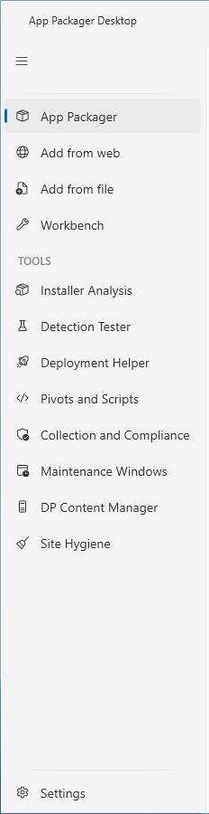

You control the sidebar:

- **Reorder:** drag an entry to a new place in the list. Press Alt+Up or Alt+Down on a selected entry to move it with the keyboard. Press Escape during a drag to cancel it.
- **Hide:** right-click an entry and select **Hide**. The entry leaves the sidebar. Its settings and data stay.
- **Show again:** right-click the empty area of the sidebar, or any entry, and select **Show tool**. Then select a hidden entry. It returns to the place it had.
- **Reset:** right-click and select **Reset sidebar** to restore the default order and show every entry.
- **Settings:** the Sidebar section of the **Settings** page lists every entry with a check box and Up and Down buttons. It makes the same changes without the mouse.

Packages cannot be hidden or moved, and no entry can be dropped above it. **Settings** stays at the bottom. The order and the hidden entries are saved for the current Windows user.

The eight entries after the Application Workbench are Detection Tester, Maintenance Windows, Collection and Compliance, Installer Analysis, Deployment Helper, DP Content Manager, Pivots and Scripts and Site Hygiene. Detection Tester, Maintenance Windows and Collection and Compliance are part of App Packager Desktop; see [Detection Tester](#detection-tester), [Maintenance Windows](#maintenance-windows) and [Collection and Compliance](#collection-and-compliance). The other five start tools of the App Packager Suite. Each of these tools opens in its own window. App Packager Desktop does not include these five tools. It starts them from the suite installation of the current user and never changes the suite files.

- App Packager Desktop finds the suite in this order: the `InstallLocation` value under `HKCU\Software\Microsoft\Windows\CurrentVersion\Uninstall\AppPackagerSuite`, then `%LOCALAPPDATA%\AppPackagerSuite`.
- To find a tool, App Packager Desktop first uses `ToolsRoot` from the `suite.settings.json` file of the suite, when that value is set. It then uses the tool folders of the suite installation.
- If the suite or a tool is not installed, a message names what is missing and where App Packager Desktop looked.
- A second click on a tool that is open brings its window to the front.
- App Packager Desktop passes the ConfigMgr site code and provider to the tool in the environment variables `SUITE_CM_SITECODE` and `SUITE_CM_PROVIDER`. It passes the site code you saved. When you did not save one, it passes only a site code that the environment already holds from the suite launcher. It passes the provider only when it is set. A tool uses these values only when its own settings are empty.
- If a tool stops right after it starts with a non-zero exit code, a message names the tool and its exit code.

## Detection Tester

The **Detection Tester** page writes ConfigMgr detection clauses and tests them on this computer. It makes no ConfigMgr connection and no network request.

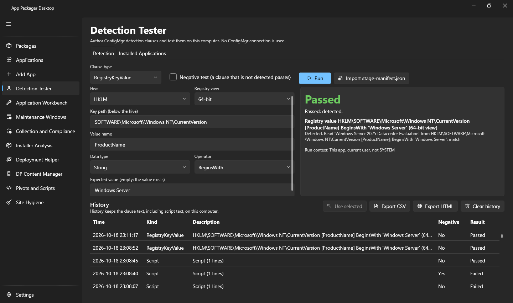

The **Detection** tab:

- **Clause types:** a registry value, a registry key, a file and a script. A compound clause (And, Or) appears after you import one.
- **Registry:** choose the hive (HKLM or HKCU) and the registry view (64-bit or 32-bit). The key path accepts a prefix such as `HKLM\`. A prefix that names another hive than the clause is an error.
- **File:** the rule checks that the file exists or compares its version. A 32-bit rule reads the 32-bit folders.
- **Script:** the script runs in a child Windows PowerShell, as the current user, not as SYSTEM, with a limit of 30 seconds. **Cancel** stops it. The script counts as detected when it prints output. The result shows the output, the error output and the exit code. ConfigMgr runs a detection script as SYSTEM and also reads the exit code, so a script can give another result in ConfigMgr. A script that leaves a child process running does not keep the page waiting, and the child process ends with the script.
- **Negative test:** a clause that is not detected passes.
- **Import:** **Import stage-manifest.json** loads the detection of a staged build, with compound clauses. Nothing runs until you press **Run**. A manifest without a detection shows a message and changes no input.
- **History:** every test adds a row. **Use selected** fills the inputs from a row. **Export CSV** and **Export HTML** write a report. **Clear history** asks first. History keeps the clause text, including script text, on this computer. A CSV cell that starts with `=`, `+`, `-` or `@` is written as text, and the HTML report encodes all text.

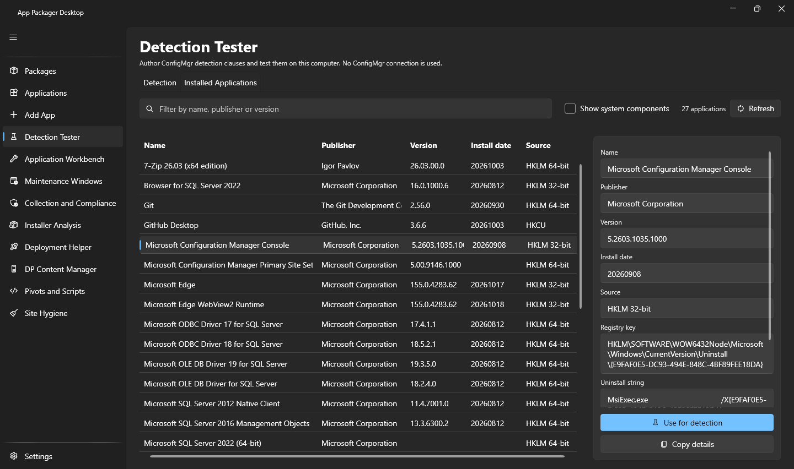

The **Installed Applications** tab lists the applications from the three uninstall registry locations (HKLM 64-bit, HKLM 32-bit and HKCU). It has a filter, a detail panel and **Copy details**. **Show system components** adds the entries that Windows marks as system components. **Use for detection** fills a clause for the selected application.

The history and the reports are in the `DetectionTester` folder of the data folder (see [Data and network](#data-and-network)). A history file that cannot be read stays in place until the next save. A folder that is a junction or a symbolic link is refused.

## Maintenance Windows

The **Maintenance Windows** page shows, creates, edits and removes the maintenance windows of the ConfigMgr device collections. It connects to the SMS Provider through the ConfigMgr session of the application. It makes no other network request. Every change shows a plan first. Nothing changes until you read the plan, select the confirmation box and select the action button.

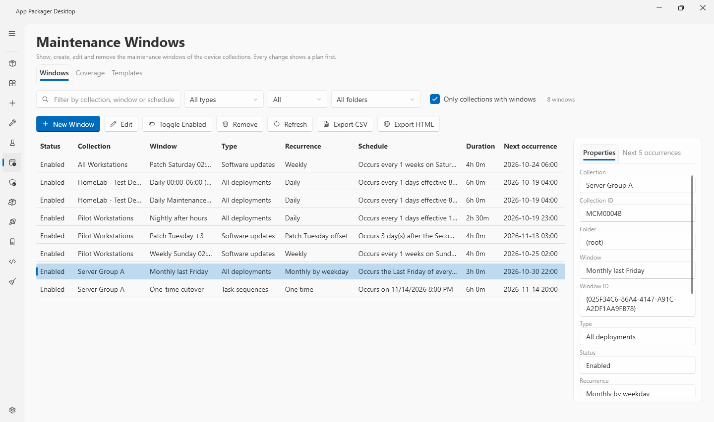

The **Windows** tab:

- **List:** one row for each window. The filters are the text filter, the window type, the state (enabled or disabled) and the collection folder. **Only collections with windows** hides the collections that have none. The detail panel shows the properties of the selected window and its next five occurrences. The panel shows the description of a window only when a person wrote it.
- **Schedule kinds:** one time, daily, weekly, monthly by date, monthly by weekday and Patch Tuesday with an offset. Window types are all deployments, software updates and task sequences. The page reads each schedule from the stored ConfigMgr schedule and shows the same schedule text as ConfigMgr.
- **New Window, Edit:** the editor shows the schedule text and the next five occurrences while you type. Edit keeps the ID, the enabled state and the description of the window. The editor shows the description and does not change it.

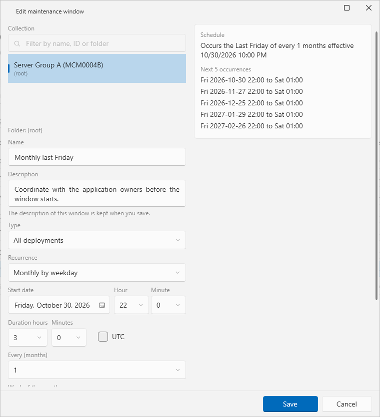

- **Rename:** the page creates the window with the new name first. It removes the old window only after the new window exists. If the create fails, the old window stays unchanged.
- **Toggle Enabled:** enables or disables the selected windows.
- **Remove, Undo:** Remove deletes the exact windows that you selected, not other windows with the same name. **Undo** reverses the last run. Undo of a removal creates the window again with the same values and a new ID. A run that stops part way keeps the Undo data of the changes it made.
- **Not stored by ConfigMgr:** ConfigMgr stores no end date for a window. A window with an end date is refused. A window with a schedule that the page cannot represent is read-only: you can enable or disable it, and you cannot edit, rename or remove it. A window with a description is refused when the ConfigMgr module cannot write a description. The message names the reason.
- **Stale plans:** the page checks the window again when it writes. A window that another person changed after the plan was shown is skipped, and the result says so. ConfigMgr has no conditional write, so a change made in the short time between this check and the write can still be lost.
- **Export CSV, Export HTML:** write a report of the shown windows. A CSV cell that starts with `=`, `+`, `-` or `@` is written as text. The HTML report encodes all text.

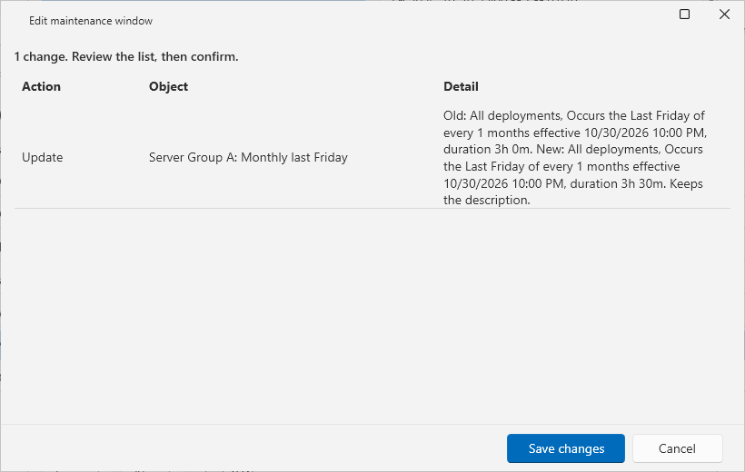

The **Coverage** tab lists every device collection with its member count and its number of windows. A green mark means the collection has a window. An orange mark means it has none. **Only collections without a window** shows the gaps. Select collections and **Apply template** to give them a window.

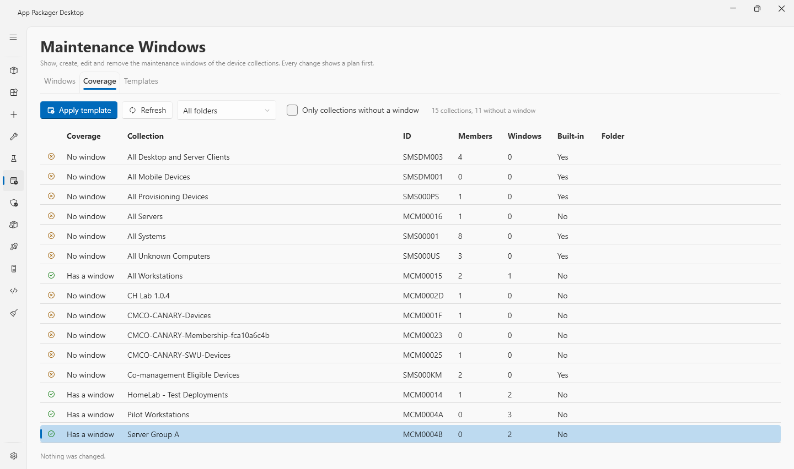

The **Templates** tab lists five shipped templates and your own templates. **New Template**, **Edit** and **Delete** change your own templates only. A shipped template cannot be changed or deleted. **Apply** opens the Apply template dialog.

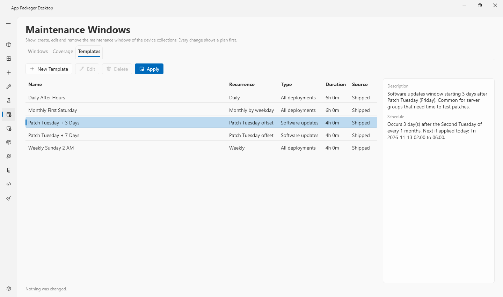

In the Apply template dialog, choose the template and the collections. You choose what happens when a collection already has a window with the template name: skip it, or create the window with a new name, for example `Name (2)`. The plan lists every collection and marks each skipped collection. **Cancel** during a run stops the run. The changes already made stay, and **Undo** reverses them.

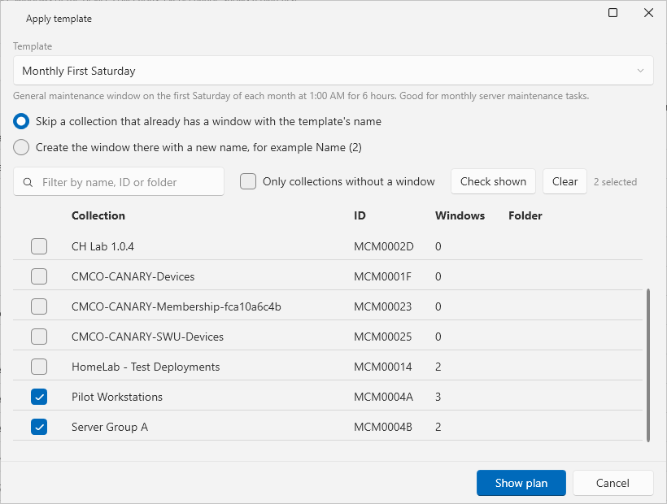

The page follows the light and the dark theme. You can create a window with the keyboard only.

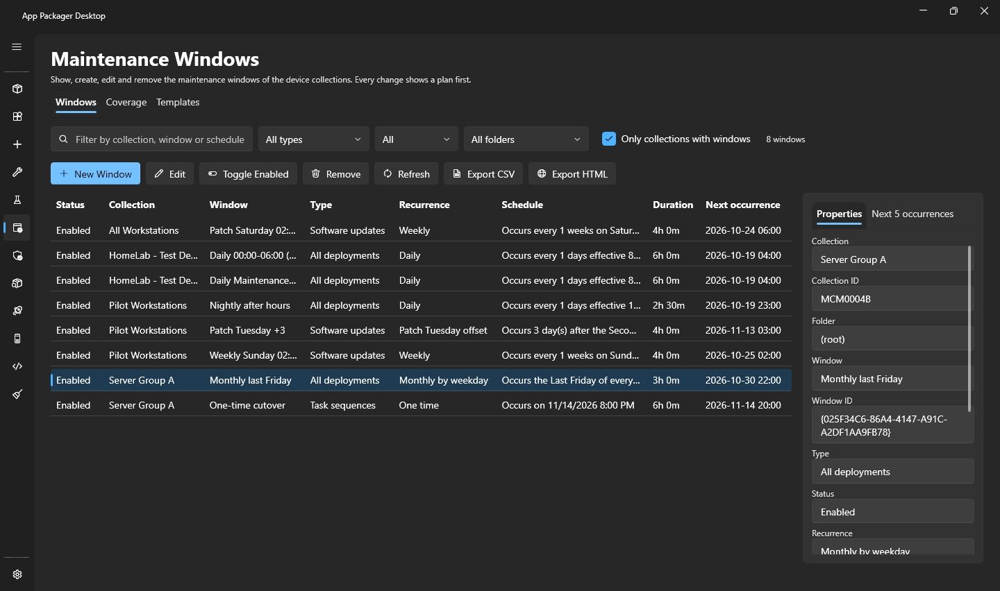

Your templates and the exported reports are in the `MaintenanceWindows` folder of the data folder (see [Data and network](#data-and-network)). The page saves the selected tab and the filters for the current Windows user. A folder or a template file that is a junction or a symbolic link is refused. Each completed run adds one line to the operation history. The line holds counts and no window names.

## Collection and Compliance

The **Collection and Compliance** page shows and changes the device collections of the ConfigMgr site, their membership rules, query templates and saved site queries. It connects to the SMS Provider through the ConfigMgr session of the application and makes no other network request. Every change shows a plan first. Nothing changes until you read the plan, select the confirmation box and select the action button. The configuration item and baseline functions of the suite tool Collection and Compliance Manager are not part of this page yet. The **Compliance baselines** button starts that suite tool.

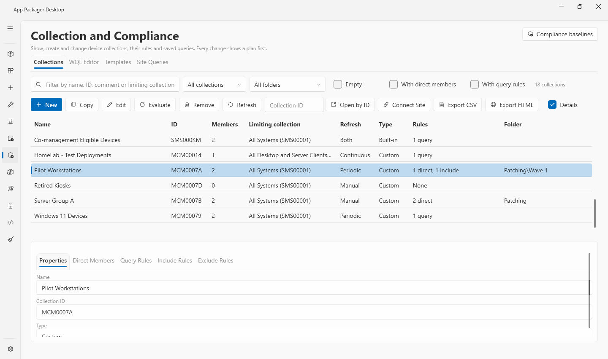

The **Collections** tab:

- **List:** one row for each device collection, with members, limiting collection, refresh type, type (built-in or custom), rules and folder. The filters are the text filter, the folder, **Empty**, **With direct members** and **With query rules**. A folder that has sub-folders shows as `Folder (and sub-folders)` and covers everything below it. **Details** shows or hides the detail panel. Its tabs are Properties, Direct Members (paged), Query Rules, Include Rules and Exclude Rules.
- **Open by ID:** loads one collection without loading the list. **Refresh** loads the whole list. **Connect Site** tests the connection and loads no inventory. After Open by ID, changes that need the whole list ask you to select Refresh first.
- **New, Copy, Edit:** the dialog sets the name, the comment, the refresh type, the refresh interval and the limiting collection. The interval is 1 to 59 minutes, 1 to 23 hours or 1 to 31 days. A new collection with no interval refreshes every 7 days. An existing collection keeps its schedule when you leave the interval empty. The page reads the stored schedule back after the write and reports a failure when ConfigMgr stored another schedule.

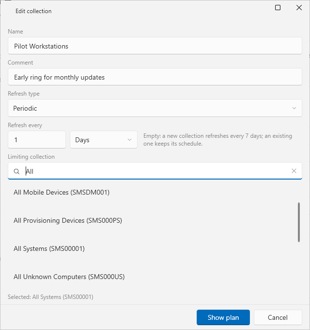

- **Evaluate:** starts a membership update. It cannot be undone.
- **Remove:** a built-in collection cannot be removed. A collection that limits another collection, or that another collection includes or excludes, cannot be removed. The plan shows the member count, the deployments, the maintenance windows and the references, read from the site when the plan opens. ConfigMgr removes the deployments and the maintenance windows with the collection. If a count or a property changes after the plan opened, the collection is not removed. **Undo** creates the collection again with its properties and rules. The new collection has a new ID. Deployments and maintenance windows are not restored.

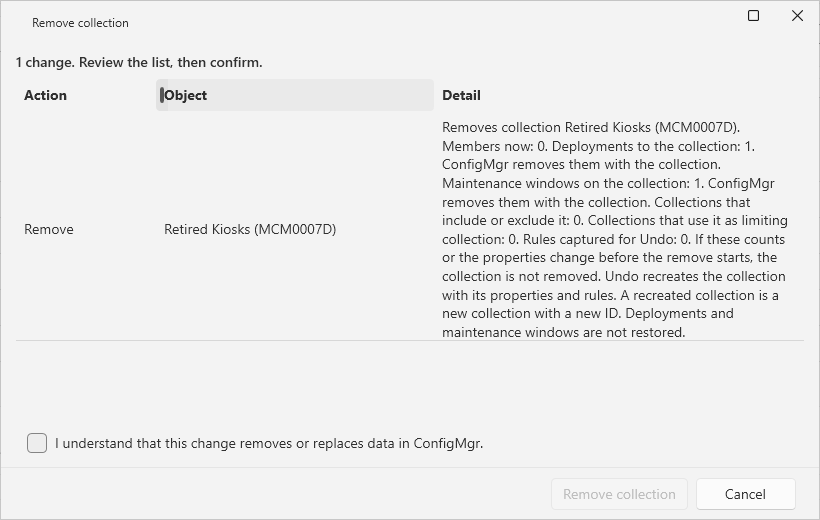

- **Undo:** reverses the last run. A run that stops part way keeps the Undo data of the changes it made. A write that may have changed ConfigMgr but whose result is unknown gives no Undo, and the message says to check ConfigMgr.
- **Stale plans:** the page checks the collection again when it writes. ConfigMgr has no conditional write, so a change made in the short time between this check and the write can still be lost.
- **Export CSV, Export HTML:** write a report of the shown collections. A CSV cell that starts with `=`, `+`, `-` or `@` is written as text. The HTML report encodes all text.

The **WQL Editor** tab changes the query rules of one collection.

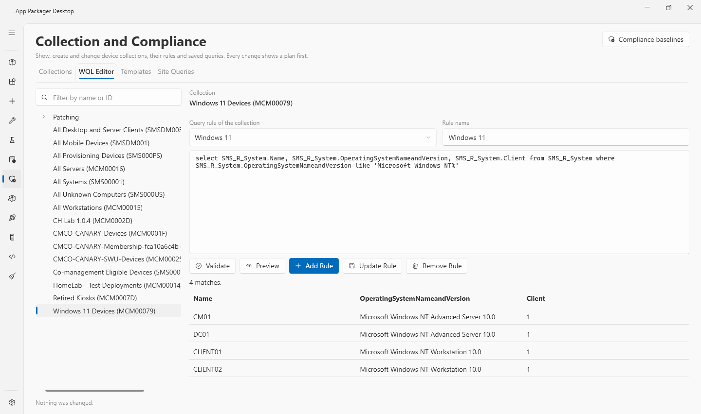

- **Validate, Preview:** the page accepts one `select` statement. It refuses a comment, a semicolon and a second statement before the query reaches the provider. Preview shows the match count and the first rows in the order of the select list. Cancel stops it. A preview stops reading after 10,000 rows and says "or more".
- **Add Rule, Update Rule, Remove Rule:** each shows a plan with the query. Update adds the new rule first, checks it, and then removes the old rule. The collection never has fewer rules than before. When a step fails, the old rule stays and the message names the rules that exist.
- **Rule names:** ConfigMgr stores `*`, `?`, `[` and `]` in a rule name. The page accepts them and matches names exactly.

The **Templates** tab lists 245 query templates, with a category filter.

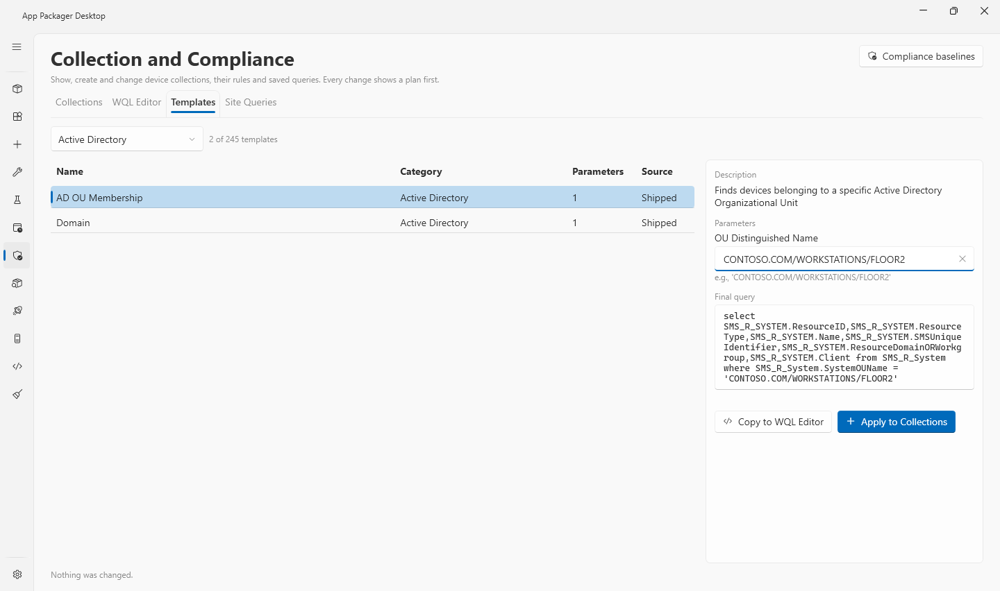

A parameterized template shows an input for each value and the final query before you use it. A value inside quotes is escaped with a backslash. A value outside quotes must be a whole number. A value for a `like` comparison cannot contain `%`, `_` or `[`. **Copy to WQL Editor** loads the final query. **Apply to Collections** adds it as a query rule to the collections you select. The plan marks a collection that already has a rule with that name, and skips it. Undo removes the rules that the run added.

The **Site Queries** tab lists the saved queries of the site: **Refresh**, **Load to Editor**, **Save as New**, **Update Saved** and **Delete**. Each write shows a plan. Undo of a delete creates the query again with a new ID.

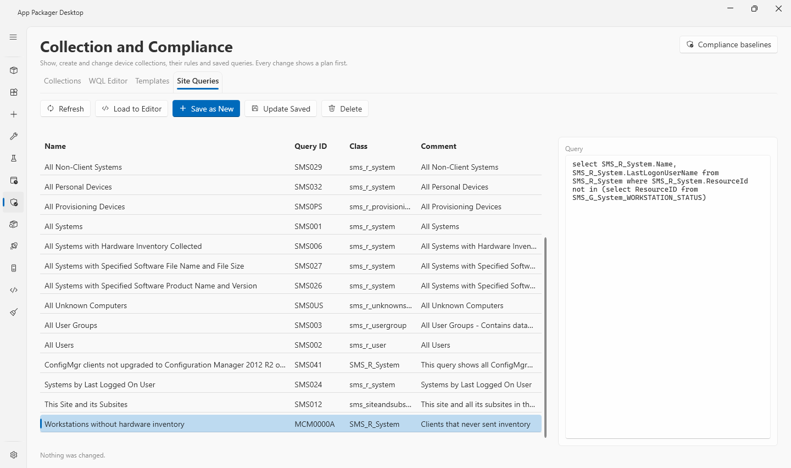

The page follows the light and the dark theme.

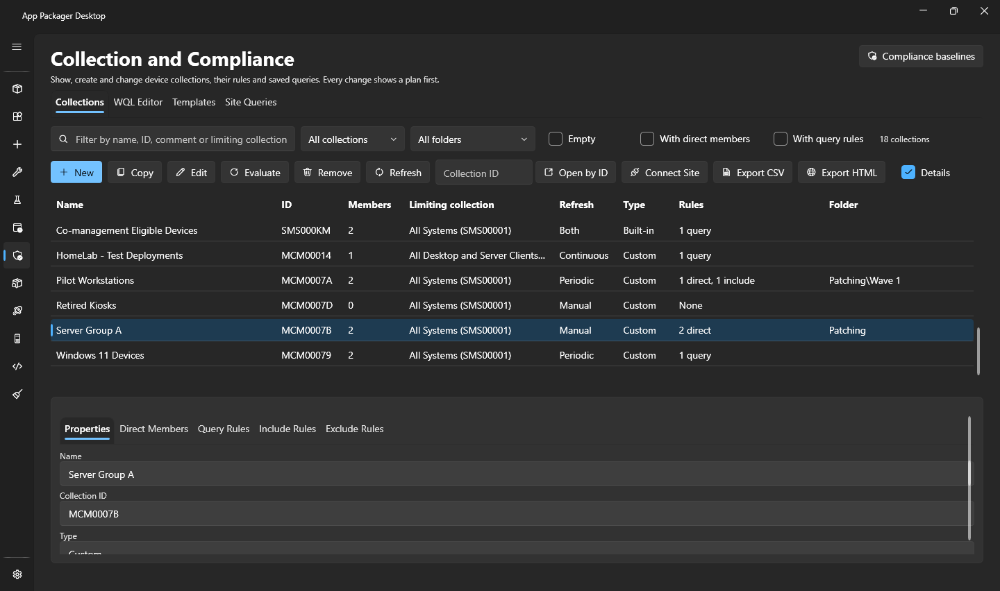

The exported reports are in the `Collections` folder of the data folder (see [Data and network](#data-and-network)). The page saves the selected tab and the filters for the current Windows user. A folder that is a junction or a symbolic link is refused. Each completed run adds one line to the operation history. The line holds counts and no names or queries.

## Application Workbench

The Workbench is the editor for one application. A definition supplies the defaults. A profile holds your changes. Each field shows the inherited value and shows if the profile overrides it. **Reset** returns a field to the inherited value.

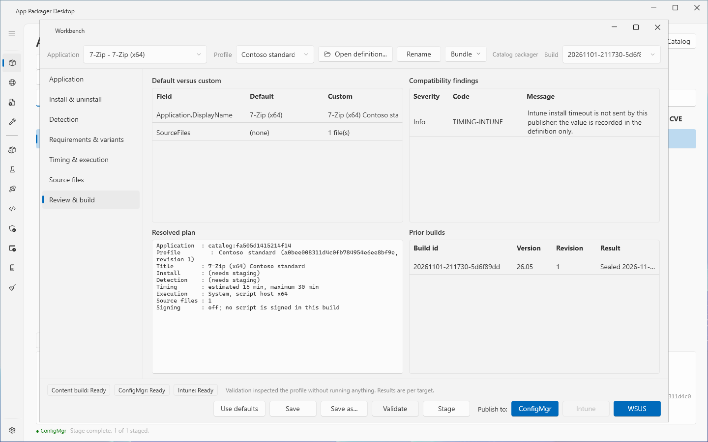

- **Application**: display name, publisher, description, application title, icon.
- **Install & uninstall**: the generated script, the generated script with a before hook and an after hook, or a custom script.
- **Detection**: the inherited rule, a rule that you enter, or a PowerShell detection script with parse diagnostics.
- **Requirements & variants**: requirement rules, variant split, install mode.
- **Timing & execution**: run times, install context, logon requirement.
- **Source files**: more files that are staged with the installer.
- **Review & build**: the differences from the defaults, the compatibility findings, the plan, the earlier builds.

**Save** stores the profile and makes it active. **Stage** and **Publish** on the Packages page then build from the active profile. You can export an application and its profiles as a bundle and import the bundle on a different computer.

## Bring your own installer

Drop an installer on the Packages page. App Packager Desktop analyzes it and shows the installer type, the silent arguments and a detection rule. **Save as Application** keeps it as an application with numbered installer revisions.

## Script signing

**Settings**, **Script Signing** signs the scripts that a build generates: detection scripts, requirement scripts and deployment scripts. Each category has a Sign switch and a Require switch. With Sign, App Packager Desktop signs the scripts when it can. With Require, App Packager Desktop refuses a build or a publish when a script in that category has no valid signature. You select the certificate by thumbprint from the current user store or the local machine store. When deployment scripts are signed, the launchers run without an execution-policy argument, and the policy of the endpoint applies.

## WSUS publishing

**Publish to WSUS** publishes the installer as a locally published update. The rules of the update come from the detection of the application: WSUS offers the update only to a computer that has an older version. **WSUS Updates** lists the published updates. It can approve, decline, expire and remove an update, and it can import an update from the Microsoft Update Catalog.

App Packager Desktop refuses an application that installs for the signed-in user, and an application whose install script does more than run the installer. The refusal gives a code and the reason.

## One Click

One Click checks the applications that you track. It stages and publishes each application that has a new version, to the destinations of that application. The plan window shows the work before it starts. After you select **Run**, One Click asks no more questions. When a destination refuses an application, One Click remembers the refusal until the version changes. Each run writes a report with a rollback section.

The plan shows `WSUS: not supported` for an application whose definition declares that WSUS cannot take it. One Click does not publish to a destination that holds a newer version than the vendor reports. One Click publishes again when the Workbench profile or the signing policy changed after the last publish.

## Discover unmanaged software

**Discover unmanaged software** finds hidden applications that your clients run and that ConfigMgr does not manage. It reads the Add/Remove Programs inventory in the site database. A hidden application is offered when at least one client reports it and the site has no ConfigMgr application for it.

The prompt reads "Discovered N apps. Enable console view?". The checklist shows each application and the number of clients that report it.

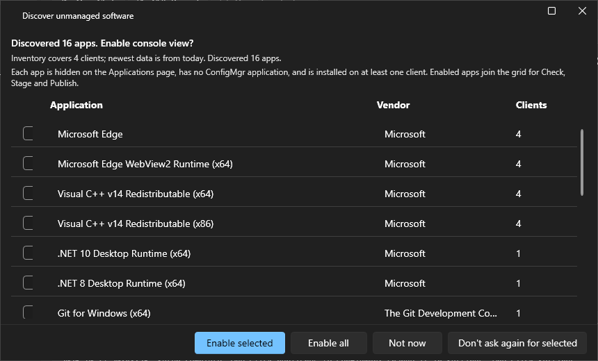

- **Enable selected** and **Enable all** show the applications in the Packages grid.
- **Not now** closes the prompt and changes nothing.
- **Don't ask again for selected** stops Discover from offering the checked applications. With no application checked, the button changes nothing. **Settings** shows the list as **Not offered by Discover**. **Clear list** empties it when you select **Save**.

How the match works:

- A definition names its Add/Remove Programs entry with `ArpName`: one or more wildcard patterns, separated by ` | `. The value `none` means that the application has no stable entry. The optional `ArpVersion` and `ArpArch` fields narrow the match by version and by architecture. 295 of 319 definitions carry a pattern.
- Some applications share one name with a sibling: Citrix Workspace CR and LTSR, QGIS and QGIS LTR, NVIDIA GeForce and RTX Enterprise, and the Microsoft 365 Apps x64 and x86 editions with Project and Visio. Discover cannot tell which variant a client runs. It offers one application of each group and never offers its siblings. Enabling an application only shows its row. Check ConfigMgr then shows its real state.
- An application counts as managed when a current ConfigMgr application title starts with its ConfigMgr name and the rest is a version or a detail in parentheses. A title with another installer method (EXE or MSI) or another architecture does not count. Check ConfigMgr uses the same rule.

Requirements and limits:

- Run App Packager Desktop as a domain account on a domain-joined computer. A computer outside the domain cannot sign in to the database, and Discover shows a plain message.
- The account needs `db_datareader` on `CM_<site code>`. Discover uses Windows authentication only.
- Discover reads the SQL Server name and the database name from the SMS Provider, over DCOM first and WinRM second. **Settings**, **Discovery SQL Server** and **Discovery Database** replace both values. With a site code missing, enter both fields.
- Discover reads inventory that clients have reported. It shows the age of the newest inventory and the number of clients. When the inventory has no rows, it reports "no inventory data". Hardware inventory must collect the Add/Remove Programs classes.
- The database views bypass ConfigMgr role-based access. The scan counts all clients, whatever scope your console role has. Discover shows counts only. It never shows or stores a client name.
- A scan stops after 600 seconds, when you select **Cancel**, and when you close the main window.

## CVE lookup

**Check CVEs** looks up the CVEs that an update fixes. It applies to each checked application whose ConfigMgr version is older than the vendor version. A definition names its product with a `Cpe` value; 294 definitions have one.

- The grid shows the count, the highest CVSS score, the CISA KEV flag, the count that the latest release fixes, and the date of the newest CVE.
- Select a count to open the CVE window. It lists each CVE with its fix version, published date, modified date, and links to NVD, CVE.org, EUVD, OpenCVE, cvedetails and OSV.
- **CVE Report** writes the checked applications as HTML, CSV, XLSX, Markdown and JSON.
- **Settings** holds the NVD API key and the switch **Look up CVEs after Check ConfigMgr**. A key is optional. Without a key, NVD permits 5 requests in 30 seconds; with a key, 50.

The data comes from NVD. When NVD does not answer, the lookup uses Shodan CVEDB and marks the result. EPSS scores come from FIRST. A lookup that fails shows an error; it does not show a count of 0.

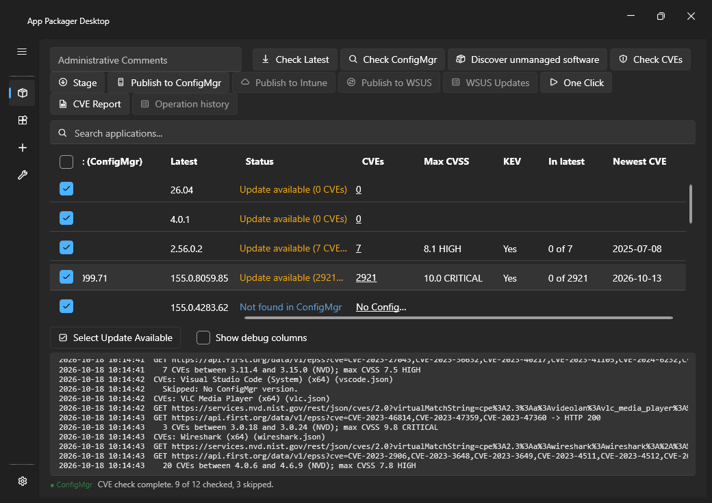

## Command-line build

`AppPackagerBuild.exe` stages or publishes one application through a profile, without the window. Use it in scripts and scheduled tasks. It uses the same settings and the same Workbench data as the window.

```
AppPackagerBuild --application <id> [--profile <name or id>] (--stage | --package | --stage --package) [options]
```

`--target` takes `ContentOnly`, `MECM` (default), `MECMAndIntune`, `IntuneOnly`, `MECMAndWSUS` or `WSUSOnly`. `--on-existing` takes `Skip` (default), `Overwrite` or `Fail`. `--help` lists all options. The command does not prompt: an option or a saved setting supplies each decision.

| Exit code | Meaning |
|---|---|
| 0 | Success |
| 1 | Failure or refusal, or a WSUS warning after a successful publish |
| n | The non-zero exit code of a PS1 packager |

### CVE report run

`AppPackagerBuild --cve-report` checks the vendor version, reads the ConfigMgr version, looks up the CVEs and writes the reports, without the window. Use it in a scheduled task.

```
AppPackagerBuild --cve-report [--apps <id,id,...>] [--report-folder <path>] [--report-formats <list>] [options]
```

| Option | Function |
|---|---|
| `--apps` | Limits the run to these application ids |
| `--skip-latest`, `--skip-mecm`, `--skip-cve` | Omits the vendor check, the ConfigMgr query or the CVE lookup. The report then shows stored versions and cache results, and marks them |
| `--report-folder`, `--report-formats` | Report location and formats (`Html`, `Csv`, `Json`, `Xlsx`, `Markdown`) |
| `--drop-folder` | Copies the reports to a second folder |
| `--webhook-url`, `--notify-always` | Posts the run summary as JSON to an https address when an update exists, or after each run |
| `--keep-report-days` | Deletes reports of this command that are older (default 90; 0 keeps all) |
| `--config` | Path of `monitor-config.json`, which holds the report and notification defaults |

The exit code is 1 when a vendor check, a ConfigMgr query or a CVE lookup failed. The NVD API key comes from Settings or from the `NVD_API_KEY` environment variable.

## Application definitions

A definition is one JSON file. Shipped definitions are in the installation's `Definitions` folder. **Add New App** and **Save as definition** write your definitions into the per-user Workbench `definitions` folder, by default `%LOCALAPPDATA%\AppPackager\Workbench\definitions`. A user definition with the same `Id` overrides the shipped definition.

```json
{
  "Schema": 1,
  "Id": "unique-opaque-id",
  "Vendor": "Google",
  "Application": "Google Chrome",
  "InstallerType": "MSI",
  "VersionScraper": {
    "Type": "HttpRegex",
    "Url": "https://api.example.com/versions",
    "Pattern": "\"version\":\"(\\d+\\.\\d+\\.\\d+\\.\\d+)\""
  },
  "DownloadUrl": "https://example.com/installer-{version}.msi",
  "Detection": {
    "Type": "RegistryKeyValue",
    "RegistryKeyTemplate": "SOFTWARE\\Microsoft\\Windows\\CurrentVersion\\Uninstall\\{ProductCode}"
  }
}
```

The scraper reads the current version from the vendor. Each definition names its scraper type.

| Scraper type | Method |
|---|---|
| `HttpRegex` | Gets a page or an API response and matches the version with a regular expression |
| `ChainedHttpRegex` | Follows a sequence of pages, each matched with a regular expression |
| `JsonQuery` | Reads the version from a JSON API |
| `FileVersion` | Downloads the installer and reads the version from its properties |
| `HeadProbe` | Probes the download host for the newest build number |
| `CdnCab` | Reads the Office CDN version descriptor |
| `DellCatalog` | Reads the Dell update catalog |

About one third of the definitions read `api.github.com`. Without a token, GitHub permits 60 requests each hour. Set `GITHUB_TOKEN` or run `gh auth login` to check the full catalog in one pass.

## Data and network

- Settings are in `%LOCALAPPDATA%\AppPackager`. Workbench profiles, builds and drafts are in `%LOCALAPPDATA%\AppPackager\Workbench`. Staging defaults to `%LOCALAPPDATA%\AppPackager\Staging`. An `APP_PACKAGER_DATA_ROOT` override places settings and these default data folders under `<override>\Users\<Windows SID>`; an explicitly configured staging folder stays configured.
- Session logs, downloaded tools and the shared application inventory (`history.db`) normally live under `%LOCALAPPDATA%\SRLPackr`. With a data-root override they live under `<override>\Users\<Windows SID>\SRLPackr`. **Operation History** on the Packages page shows the selected application's latest 100 operations.
- App Packager Desktop has no telemetry. It connects to vendor sites for version checks and downloads, to GitHub for the icon pack and for definitions that read GitHub releases, and to the systems that you set up.
- The Intune client secret and the NVD API key are stored encrypted for the current Windows user.
- CVE data: the cache is `Vulnerability\vuln-cache.json` and the KEV copy is `Vulnerability\kev-catalog.json` under the settings folder. Reports are in `Reports`. A cache entry is used for 360 minutes, or 60 minutes for a Shodan result. Entries older than 14 days are deleted.

The CVE lookup sends these requests. The window or `AppPackagerBuild.exe` sends them over https; no other process does.

| Host | Request | When |
|---|---|---|
| `services.nvd.nist.gov` | CVE query for one product and version range | One query for each application with an update and no current cache entry |
| `cvedb.shodan.io` | CVE query for one product version | Only when the NVD query failed |
| `api.first.org` | EPSS scores for the CVE ids found | One request for each 100 ids |
| `www.cisa.gov` | Known Exploited Vulnerabilities catalog | One time in 24 hours |
| The webhook host you set | Run summary | `--cve-report` only |

Discover unmanaged software sends no request to the internet. It connects to the SMS Provider (CIM over DCOM, then WinRM) and to the site database (SQL Server, Windows authentication, read-only). It reads these views: `v_GS_ADD_REMOVE_PROGRAMS`, `v_GS_ADD_REMOVE_PROGRAMS_64`, `v_R_System`, `v_Applications` and `v_ConfigurationItems`. The settings file stores the two lists (`DiscoveryDismissed`, `DiscoveryEnabled`) and the two optional override fields. It stores no credential.

A link in the CVE window opens in your browser. App Packager Desktop sends no request to the linked site. The log shows each request address. It does not show the API key, and it shows only the host of the webhook address.

## Validation

ConfigMgr packaging and deployment, WSUS publishing with a client update, and signed builds on a client that enforces AllSigned are validated on a lab site with client computers. Intune publishing is tested against simulated Graph responses only.

The CVE lookup, the CVE reports, the command-line CVE report run, the ConfigMgr title lookup and the One Click skip and republish rules are validated on the lab site. The user-collection option and the publication failure handling have automated tests only; they are not validated against live ConfigMgr, Intune or WSUS.

## Relationship to app-packager

App Packager Desktop is the C# counterpart of [app-packager](https://github.com/jasonulbright/app-packager), the PowerShell packager. The two products are MIT licensed.

## Build from source

Prerequisites: the .NET 10 SDK. NSIS (`makensis`) is necessary only for the installer.

```powershell
dotnet test tests\ApplicationPackagerEngine.Tests\ApplicationPackagerEngine.Tests.csproj -c Release
tools\build-release.ps1
```

`tools\build-release.ps1` publishes self-contained single-file win-x64 builds of the window and of the command-line build. It compiles the installer when NSIS is installed. It writes `AppPackagerDesktop-Setup-<version>.exe`, `AppPackagerDesktop-<version>.zip` and `checksums.txt` into `publish\`.

| Project | Content |
|---|---|
| `src\ApplicationPackagerUI` | The window (WPF, WPF-UI, CommunityToolkit.Mvvm) |
| `src\ApplicationPackagerBuild` | The command-line build; it uses the same services as the window |
| `src\ApplicationPackagerEngine` | Scrapers, staging, the ConfigMgr, Intune and WSUS targets, Workbench, signing, One Click, and the definitions |
| `tests\ApplicationPackagerEngine.Tests` | The tests |

The Release workflow makes a release. Run it manually from `main`. It runs the tests, publishes and signs the executables, compiles and signs the installer, creates the tag `v<version>` and publishes the GitHub release. Before you run it, set `<Version>` in the UI project and add a section for that version to `CHANGELOG.md`. A version has the form `YYYY.MDD.N`: the year, then the month and day as one number without a leading zero (October 3 is `1003`), then the release number, which is the number of the last release plus one. `tools\test-release-version.ps1` checks the version. [RELEASING.md](RELEASING.md) gives the full procedure.

## License

MIT. See [LICENSE](LICENSE).
