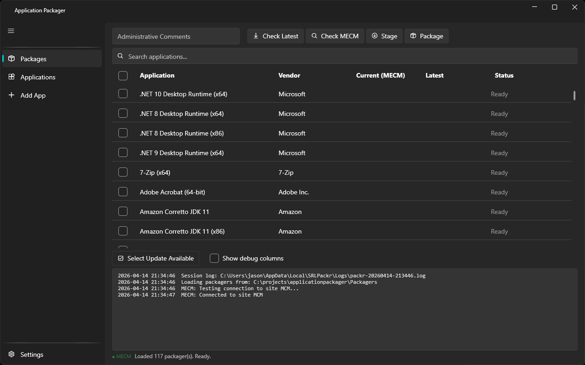

# Packr

**Keeps third-party Windows applications packaged and up to date in MECM and Intune — without hand-building each one.**

Free, MIT-licensed, and free forever.



## What it does

Packaging an application for enterprise deployment normally means doing the same chore over and over: find the vendor's current version, download the installer, work out the silent install switches, work out how a management system can tell whether the app is already installed, then create the application record by hand. Every app, every update.

Packr does that chore for you. For each application it knows about, it:

1. Checks the vendor for the current version.
2. Downloads that version's installer.
3. Stages the installer and generates install and uninstall scripts.
4. Works out a detection rule — the check that tells MECM or Intune whether the app is present on a machine — by reading the installer itself.
5. Creates the application in MECM (or an Intune Win32 app), with the deployment type, detection rule, and content already filled in.

You pick applications from a list and press a button. 295 applications ship with it already described, so common software is covered out of the box.

## Who it's for

Windows administrators who maintain third-party software in MECM (Configuration Manager) or Intune. You do not need to write scripts to use it — the application definitions are plain data files, and the day-to-day workflow is a normal desktop window with a list and buttons.

If you do want to add your own applications, you can: definitions are single JSON files, and there is a guided "Add New App" flow in the application.

## Quickstart

1. Download the release. The installer (`AppPackagerDesktop-Setup-<version>.exe`) installs for the current user with no elevation and puts a Start Menu shortcut in place; `/S` installs silently. The zip is the same build without an installer: extract it anywhere and run `ApplicationPackagerUI.exe`. Both are self-contained and need no separate .NET runtime.
2. Close the application before installing an update; the installer refuses to replace a running executable.
3. On first launch a short setup window asks where you deploy — MECM only, MECM + Intune, or Intune only — then asks only for the fields that choice needs. Everything it sets is also on the **Settings** page, so you can skip it and fill in the site code, site server, and network share there instead. For MECM targets the application tests the connection on launch and shows the result; an Intune-only setup skips that test and relabels **Package** to **Publish**.
4. On the **Packages** page, tick one or more applications and press **Check Latest** to see the current vendor version alongside what your environment already has.
5. Press **Stage** to download and prepare, then **Package** to create the application in MECM or Intune.

Nothing is sent anywhere. Version checks go directly from your machine to the vendor.

## Relationship to app-packager

Packr is the C# sibling of [app-packager](https://github.com/jasonulbright/app-packager), the PowerShell/WPF packager. Features are proven in app-packager first and then ported here, so app-packager is generally ahead on new capability while Packr is the faster, compiled implementation with the pluggable engine. Both are MIT licensed and free.

## Status

**v2.2.0-alpha9** — 296 application definitions, all version scrapers passing the live check-only sweep. Engine features: multi-deployment-type applications with requirement rules (architecture, OS language, network), per-app command overrides, Intune Win32 publishing via Graph, MSIX provisioned packages with signature verification, SHA256 installer verification, script and compound detection rules, chained and version-max scrapers, bootstrapper layout staging, extract-then-setup installers, drop-to-package analysis, SQLite version history, PSADT wrapper generation. 90 of the original 116 definitions are install-and-detection signed off on a lab site; the 2026 additions are stage-verified and awaiting the lab pass. See [REGRESSION-STATUS.md](REGRESSION-STATUS.md) for per-application pipeline status.

## Stack

- .NET 10, WPF-UI 4.2.0, CommunityToolkit.Mvvm 8.4.2
- ApplicationPackagerEngine class library (scraper plugins, staging pipeline, MECM target)
- PowerShell 5.1 subprocess for ConfigurationManager cmdlets

## Architecture

```
ApplicationPackagerUI (WPF)          ← user interface (WPF-UI 4.2.0 Fluent)
  └─ ApplicationPackagerEngine (DLL) ← core logic (portable .NET 10)
       ├─ Scrapers/                  ← IVersionScraper plugins (HttpRegex, JsonQuery, FileVersion, CdnCab)
       ├─ Services/                  ← Download, MSI inspection, 7z extraction, installer ID,
       │                                staging, MECM packaging, PSADT wrappers, SQLite history
       ├─ Models/                    ← AppDefinition, StageManifest, InstallerMetadata, InstallerParameter
       └─ Definitions/              ← JSON app definitions (295 apps, one per file)
```

## Scraper Types

A scraper is the part that finds out what version a vendor currently ships. Each application definition names the one it uses.

| Scraper | Method | Apps |
|---------|--------|------|
| `HttpRegexScraper` | Fetch page/API, pattern-match the version out of the text | 50+ |
| `JsonQueryScraper` | Read the version from a vendor JSON API | 35+ |
| `FileVersionScraper` | Download installer, read EXE/MSI/MSIX properties | 10 |
| `CdnCabScraper` | Office CDN CAB/VersionDescriptor.xml | 6 |
| `WingetScraper` | Winget package manager (stub) | — |

## JSON App Definition

One file per application. `Pattern` below is a text-matching expression (a regular expression); the guided "Add New App" flow builds it for you if you would rather not write one.

```json
{
  "Schema": 1,
  "Id": "unique-opaque-id",
  "Vendor": "Google",
  "Application": "Google Chrome",
  "InstallerType": "MSI",
  "VersionScraper": {
    "Type": "HttpRegex",
    "Url": "https://api.example.com/versions",
    "Pattern": "\"version\":\"(\\d+\\.\\d+\\.\\d+\\.\\d+)\""
  },
  "DownloadUrl": "https://example.com/installer-{version}.msi",
  "Detection": {
    "Type": "RegistryKeyValue",
    "RegistryKeyTemplate": "SOFTWARE\\Microsoft\\Windows\\CurrentVersion\\Uninstall\\{ProductCode}"
  }
}
```

## Building a release

```powershell
tools\build-release.ps1
```

Publishes a self-contained single-file win-x64 build, compiles the per-user installer from it when NSIS (`makensis`) is installed, and writes `AppPackagerDesktop-Setup-<version>.exe`, `AppPackagerDesktop-<version>.zip` and `checksums.txt` into `publish\`. `-PublishOnly` and `-PackageOnly` run the two halves separately; `tools\build-installer.ps1` compiles the installer from a stage on its own.

Releases are cut by the Release workflow (Actions, run manually from `main`). It runs the engine tests, publishes, signs the executable with Azure Artifact Signing, compiles the installer from the signed files and signs it too, verifies both signatures, tags `v<version>` from the csproj and publishes the GitHub release with the matching `CHANGELOG.md` section as its notes. Before running it, set `<Version>` in the UI project and give the changelog a section for that version.

## License

MIT. See [LICENSE](LICENSE).
