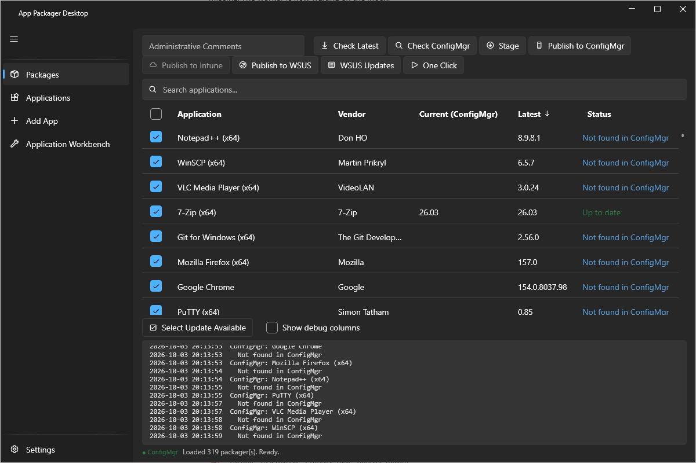

# App Packager Desktop

[](https://github.com/jasonulbright/app-packager-desktop/actions/workflows/ci.yml)
[](https://github.com/jasonulbright/app-packager-desktop/actions/workflows/release.yml)
[](https://github.com/jasonulbright/app-packager-desktop/releases/latest)
[](https://github.com/jasonulbright/app-packager-desktop/releases)
[](#requirements)
[](#build-from-source)
[](LICENSE)

App Packager Desktop packages third-party Windows applications and publishes them to ConfigMgr, Intune and WSUS. It is a Windows desktop application. It is free and MIT licensed.



## What it does

For each application, App Packager Desktop does these steps:

1. It reads the current version from the vendor.
2. It downloads the installer of that version, or uses an installer file that you added.
3. It stages the installer and writes the install and uninstall scripts.
4. It builds a detection rule from the installer.
5. It publishes to the destination you select: an application in ConfigMgr, a Win32 app in Intune, or a locally published update in WSUS.

The catalog has 319 application definitions. A definition is one JSON file. You can add your own definitions from the web (**Add from web**) or from an installer file on this computer (**Add from file**).

## Documentation

The user guide is in [docs/index.md](docs/index.md). It has a page for each feature, a reference for every setting, folder, network call and message, and a [troubleshooting](docs/troubleshooting.md) page.

## Requirements

- Windows 10, Windows 11 or Windows Server, 64-bit.
- Windows PowerShell 5.1.
- For ConfigMgr: the Configuration Manager console on this computer and an account with rights to create applications.
- For WSUS: the WSUS console or the RSAT WSUS tools on this computer, at the version of the server, and an account in the WSUS Administrators group.
- For Intune: an app registration with a client secret. App Packager Desktop downloads the Microsoft Win32 Content Prep Tool when it is necessary.
- 7-Zip, for applications whose installer is an archive.
- A window of at least 1024 by 720 pixels. The window opens at 1200 by 800. A smaller size can work and is not supported.

The release is self-contained. A separate .NET runtime is not necessary.

## Install

1. Download the release from the [releases page](https://github.com/jasonulbright/app-packager-desktop/releases).
   - The installer `AppPackagerDesktop-Setup-<version>.exe` installs for the current user without elevation and adds a Start Menu shortcut. `/S` installs silently.
   - The zip `AppPackagerDesktop-<version>.zip` is the same build without an installer. Extract it and run `ApplicationPackagerUI.exe`.
2. Close the application before you install an update by hand. The installer does not replace an executable that is in use.
3. The app checks GitHub for a newer release at start and in **Settings**, **Check for updates**. It downloads the installer, checks the checksum and the signature, and starts it only after you select **Install and close**. See [Updates](docs/core/updates.md).

## First run

1. On the first start, the Setup window asks which systems you use: ConfigMgr, Intune, WSUS. It then asks only for the settings that those systems need. All settings are also on the **Settings** page.
2. On the **App Packager** page, select one or more applications. Select **Check Latest** to read the current vendor version.
3. Select **Stage** to download and prepare the content.
4. Select **Publish to ConfigMgr**, **Publish to Intune** or **Publish to WSUS**. A button is disabled while its system is not set up. Its tooltip names the setting that is missing.

[Getting started](docs/getting-started.md) shows these steps in detail.

## Features

The sidebar lists the pages. The first group holds **App Packager**, **Add from web**, **Add from file** and **Workbench**. The **TOOLS** group holds eight tools.

Packaging:

- [App Packager page](docs/core/packages.md): the grid, the version checks, Stage and the publish buttons. The [grid reference](docs/core/packages-grid.md) lists the columns, the status values and the context menu.
- [Catalog](docs/core/applications.md): show or hide applications in the grid.
- [Add from web](docs/core/add-app.md): a seven-step wizard that writes a definition with a version source, an installer analysis and a detection rule.
- [Add from file](docs/core/add-from-file.md): analyzes an installer file (`.msi`, `.exe`, `.msp`, `.msix`, `.appx`, `.msixbundle`, `.appxbundle`) and saves it as a definition. Each proposed value shows its evidence level.
- [Workbench](docs/core/workbench.md): edits one application through profiles, validates it, and builds and publishes from sealed builds.
- [Stage and publish](docs/core/stage-and-publish.md), [Publish to ConfigMgr](docs/core/publish-to-configmgr.md), [Publish to Intune](docs/core/publish-to-intune.md), [WSUS publishing](docs/core/wsus-publishing.md) and [WSUS Updates](docs/core/wsus-updates.md).
- [One Click](docs/core/one-click.md): checks the tracked applications and stages and publishes the ones with a new version.
- [Discover unmanaged software](docs/core/discover-unmanaged-software.md): finds applications that clients run and that ConfigMgr does not manage.
- [CVE lookup](docs/core/cve-lookup.md): looks up the CVEs that an update fixes.
- [Script signing](docs/core/script-signing.md), [Definitions](docs/core/definitions.md), [Settings](docs/core/settings-page.md) and the [command-line build](docs/core/command-line-build.md).

Tools:

- [Installer Analysis](docs/tools/installer-analysis.md): reads an installer on this computer without starting it.
- [Detection Tester](docs/tools/detection-tester.md): writes ConfigMgr detection clauses and tests them on this computer.
- [Deployment Helper](docs/tools/deployment-helper.md) and [deployment rings](docs/tools/deployment-rings.md): create a deployment, or a series of deployments, after a plan that you confirm.
- [Pivots and Scripts](docs/tools/pivots-and-scripts.md): runs a CMPivot query or an approved script on client devices.
- [Collection and Compliance](docs/tools/collection-and-compliance.md): shows and changes device collections, query rules, configuration items and baselines.
- [Maintenance Windows](docs/tools/maintenance-windows.md): shows, creates, edits and removes the maintenance windows of device collections.
- [DP Content Manager](docs/tools/dp-content-manager.md): shows which content is on which distribution point and repairs it.
- [Site Hygiene](docs/tools/site-hygiene.md) and [live views](docs/tools/site-hygiene-live.md): scan a site for clutter and drift, and fix a finding after a plan.

Every tool that changes a site shows a plan first. Nothing changes until you read the plan and confirm it.

## Validation

ConfigMgr packaging and deployment, WSUS publishing with a client update, and signed builds on a client that enforces AllSigned are validated on a lab site with client computers. Intune publishing is tested against simulated Graph responses only. [Deployment behavior](docs/deployment-behavior.md) lists the outcomes and the limits.

## Build from source

Prerequisites: the .NET 10 SDK. NSIS (`makensis`) is necessary only for the installer.

```powershell
dotnet test tests\ApplicationPackagerEngine.Tests\ApplicationPackagerEngine.Tests.csproj -c Release
tools\build-release.ps1
```

`tools\build-release.ps1` publishes self-contained single-file win-x64 builds of the window and of the command-line build. It compiles the installer when NSIS is installed. It writes `AppPackagerDesktop-Setup-<version>.exe`, `AppPackagerDesktop-<version>.zip` and `checksums.txt` into `publish\`.

| Project | Content |
|---|---|
| `src\ApplicationPackagerUI` | The window (WPF, WPF-UI, CommunityToolkit.Mvvm) |
| `src\ApplicationPackagerBuild` | The command-line build; it uses the same services as the window |
| `src\ApplicationPackagerEngine` | Scrapers, staging, the ConfigMgr, Intune and WSUS targets, Workbench, installer analysis, signing, One Click, and the definitions |
| `tests\ApplicationPackagerEngine.Tests` | The tests |

The Release workflow makes a release. [RELEASING.md](RELEASING.md) gives the procedure and the version format.

App Packager Desktop is the C# counterpart of [app-packager](https://github.com/jasonulbright/app-packager), the PowerShell packager. The two products are MIT licensed.

## Support

Open an issue in the [GitHub repository](https://github.com/jasonulbright/app-packager-desktop/issues) for a defect or a question. Include the version from **Settings**, **About** and the lines from the log pane. The release notes are in [CHANGELOG.md](CHANGELOG.md).

## Security

Do not open a public issue for a vulnerability. [SECURITY.md](SECURITY.md) shows how to report it.

## Third-party notices

The release contains third-party components. [THIRD-PARTY-NOTICES.md](THIRD-PARTY-NOTICES.md) lists them. The license texts are in the `licenses` folder.

## License

MIT. See [LICENSE](LICENSE).
