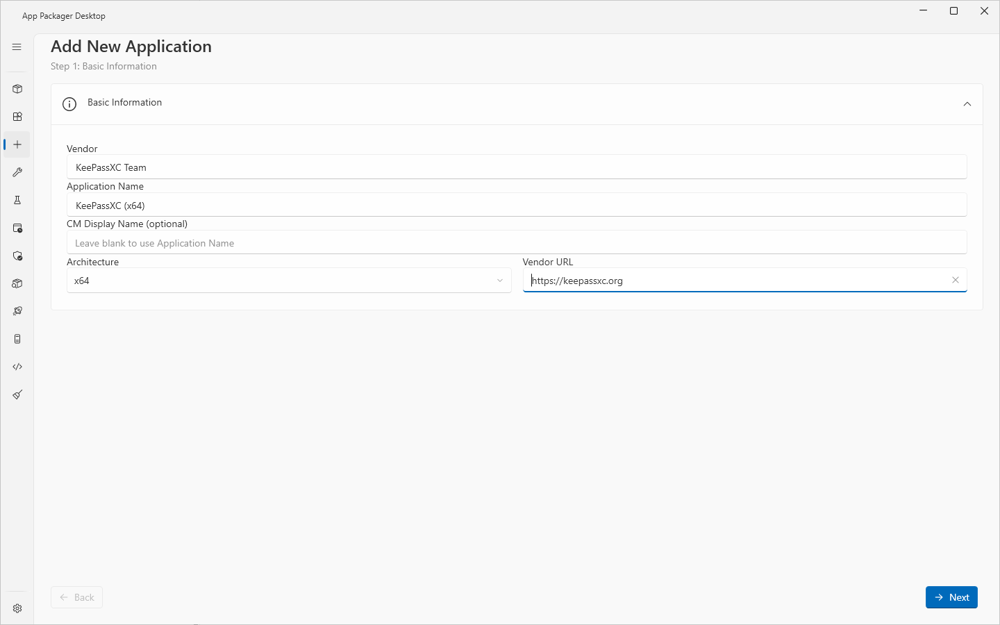
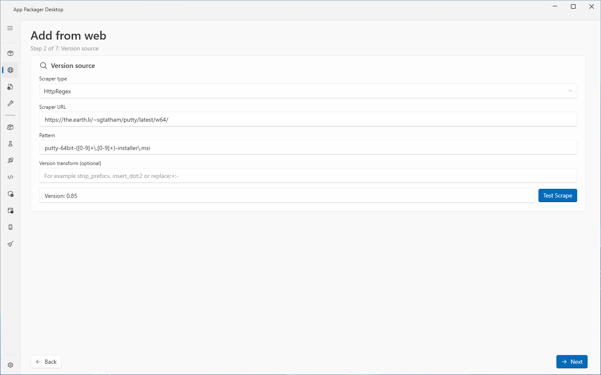
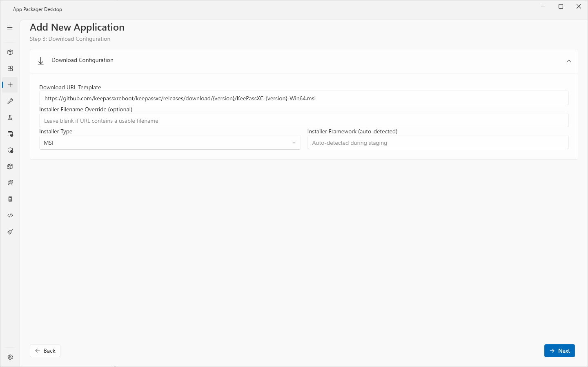
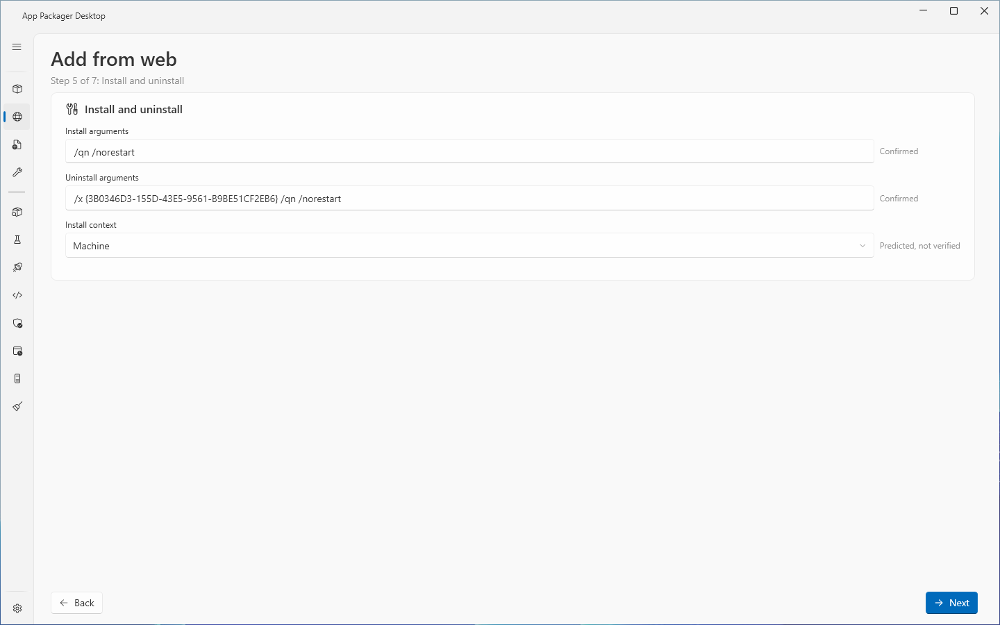
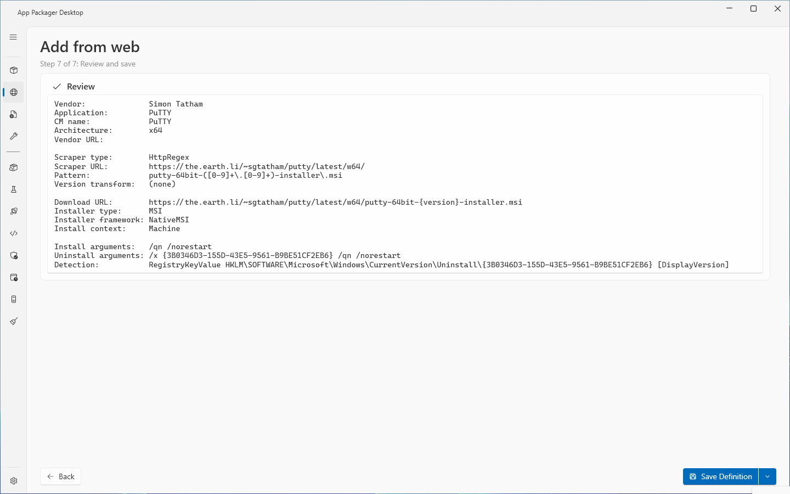

# Add from web

## What it does

The **Add from web** page is a wizard with seven steps. It writes a new application [definition](definitions.md) as a JSON file in your user definitions folder. The definition has a version source and a download address, so Check Latest and Stage work on it like on a shipped application.

Step 4 is optional. It downloads the installer one time, analyzes it, and proposes the install arguments, the uninstall arguments, the install context and a detection rule. Each proposed value shows its evidence level: **Confirmed**, **Predicted, not verified**, **Manual** or **No value**. See [Evidence levels](#evidence-levels).

After the save, the page shows the [result panel](#the-result-panel). The panel has the buttons **Open in Workbench**, **Stage now** and **Done**. Nothing is staged until you select **Stage now**.

## When to use it

- To package an application that is not in the catalog of 319 definitions, and that has a download address and a version source on the web.
- To package an application whose installer is an MSI or an EXE with a version that a web page, a JSON API or the installer itself reports.

If you have the installer file already, use [Add from file](add-from-file.md). That page takes `.msi`, `.exe`, `.msp`, `.msix`, `.appx`, `.msixbundle` and `.appxbundle` files, and it needs no download address.

## Requirements

- Write access to the user definitions folder. By default it is `%LOCALAPPDATA%\AppPackager\Workbench\definitions`.
- Network access from this computer to the version source, for **Test Scrape**, and to the download address, for step 4.
- For step 4: **Download Root (local staging)** in [Settings](settings-page.md). The page downloads the installer to a folder under it.

The page needs no ConfigMgr site, no Intune tenant and no WSUS server.

## Steps

1. Select **Add from web** in the sidebar. The page title shows the step, for example `Step 1 of 7: Basic information`.
2. Complete step 1, **Basic information**. Select **Next**.
3. Complete step 2, **Version source**. Select **Test Scrape**. Select **Next**.
4. Complete step 3, **Download configuration**. Select **Next**.
5. Do step 4, **Installer analysis**, or skip it. Select **Next**.
6. Check step 5, **Install and uninstall**. Select **Next**.
7. Check step 6, **Detection**. Select **Next**.
8. Read step 7, **Review and save**. Select **Back** to change a value.
9. Select **Save Definition**. The arrow on the button opens **Save and open in Workbench**.
10. On the result panel, select **Open in Workbench**, **Stage now** or **Done**.

The wizard does not check a step when you select **Next**. It checks the required fields when you select **Save Definition**. **Back** is disabled on step 1. **Next** is hidden on step 7. **Save Definition** shows on step 7 only.

### Step 1: Basic information

| Field | What to enter | Default |
|---|---|---|
| **Vendor** | The publisher name, for example `Mozilla`. The name is used for the folder structure of the content share and for the Publisher field of the ConfigMgr application. Required. | Empty |
| **Application name** | The full name with the bitness, for example `Mozilla Firefox (x64)`. The name is the main identifier in the UI and in the file name. Required. | Empty |
| **ConfigMgr display name (optional)** | The name in the ConfigMgr console and in Software Center. | Empty. An empty field uses the **Application name**. |
| **Architecture** | `x64` or `x86`. | `x64` |
| **Vendor URL** | The web site of the vendor. For reference only. The scraper does not use it. The context menu entry **Open Vendor URL** on the [App Packager page](packages.md) opens it. | Empty |

### Step 2: Version source

A scraper reads the current version from the vendor.

| Field | What to enter | Default |
|---|---|---|
| **Scraper type** | `HttpRegex`, `JsonQuery` or `FileVersion`. | `HttpRegex` |
| **Scraper URL** | The address to read. Example: `https://api.github.com/repos/owner/repo/releases/latest`. | Empty |
| **Pattern** | See the table below. | Empty |
| **Version transform (optional)** | A change to the version after the scraper read it. Chain steps with `\|`. Steps: `strip_prefix:X`, `insert_dot:N`, `replace:X:Y`, `regex_replace:pattern:replacement`. | Empty |

| Scraper type | Pattern |
|---|---|
| `HttpRegex` | A regular expression with one capture group for the version. Example: `version-(\d+\.\d+)\.exe`. |
| `JsonQuery` | A path in the JSON answer. Example: `tag_name`. |
| `FileVersion` | The property to read: `FileVersion`, `ProductVersion` or `MsiProductVersion`. The scraper downloads the installer and reads this property. |

To test the settings:

1. Select **Test Scrape**.
2. Read the result box. A good result is `Version: <version>`. When the transform changed the version, the box also shows `(raw: <version>)`.

**Test Scrape** needs a **Scraper URL** and a **Pattern**. The page keeps the raw version and the transformed version of the last good test. Step 3 and step 4 use them to fill `{version}` and `{display_version}`.

The scrapers are explained in [Definitions](definitions.md#version-sources-scrapers).

### Step 3: Download configuration

| Field | What to enter | Default |
|---|---|---|
| **Download URL template** | The address of the installer. `{version}` is the version as the scraper read it. `{display_version}` is the version after the transform. Example: `https://example.com/download/app-{version}-x64.msi`. | Empty |
| **Installer file name (optional)** | A file name for the downloaded installer. Use it when the address has no usable file name, for example a redirect. The field accepts `{version}`. | Empty. An empty field uses the file name in the address. |
| **Installer type** | `MSI`, `EXE`, `ZIP`, `MSIX`, `MSP` or `ODT`. | `EXE` |
| **Installer framework** | The installer technology: `NativeMSI`, `NSIS`, `InnoSetup`, `WixBurn`, `InstallShield`, `Squirrel`, `Velopack`, `MSIX` or `ZIP`. Leave the field empty when you do not know it. The analysis on step 4 proposes it. | Empty |

### Step 4: Installer analysis

This step is optional. The text on the page reads: "Downloads the installer one time to the download root and reads it. Nothing in the installer is started."

1. Select **Download and analyze**. **Cancel** shows while the step runs and stops the download or the analysis.
2. Read the proposed values. Each row has a check box, the value and an evidence marker. A row with a value and an evidence level other than **No value** is checked at first.
3. Clear the check box of a value that you do not want. Edit a value if it is wrong. An edited value shows **Manual**.
4. Read the check box **Use the proposed detection** and the notes below the list.
5. Select **Use selected values**. The values go into step 3 (installer type and framework), step 5 (install arguments, uninstall arguments, install context) and step 6 (detection). The status line reads: "The selected values are in steps 5 and 6. Review them there."

The rows are **Installer type**, **Framework**, **Install arguments**, **Uninstall arguments** and **Install context**. If the analysis needs review, a caution box reads `This installer needs review.` and gives the reason.

The page downloads the installer to a folder `AddFromWeb\<8 characters>` under the download root. The folder is deleted when you save, when a new analysis starts, when an analysis fails and when you select **Done**. The analysis reads the file only. It never starts the installer or a file taken out of it. The limits are those of [Installer Analysis](../tools/installer-analysis.md#limits-of-one-analysis): a download over 8 GiB is refused.

| Message | Cause |
|---|---|
| Set the download root in Settings. The installer is downloaded to the download root. | **Download Root (local staging)** is empty. |
| Type the download URL on step 3. | The **Download URL template** is empty. |
| Select Test Scrape on step 2 first. The download URL needs the version. | The address or the file name has `{version}` or `{display_version}` and no test ran. |
| The analysis was cancelled. | You selected **Cancel**. |

### Step 5: Install and uninstall

| Field | What to enter | Default |
|---|---|---|
| **Install arguments** | The silent install arguments. The tooltip gives these examples: MSI `/qn /norestart`, NSIS `/S`, Inno Setup `/VERYSILENT /NORESTART /SP-`. | Empty |
| **Uninstall arguments** | The silent uninstall arguments. Use `{ProductCode}` for an MSI, for example `/x {ProductCode} /qn /norestart`. | Empty |
| **Install context** | `Machine` installs for all users: Program Files and HKLM. `User` installs for the current user: AppData and HKCU. | `Machine` |

A value from step 4 shows an evidence marker at the right of the field. Edit the value and the marker changes to **Manual**.

### Step 6: Detection

The detection rule tells ConfigMgr and Intune that the application is installed. The panel has the same controls as the detection section of [Add from file](add-from-file.md#detection).

| Control | Meaning |
|---|---|
| **Rule** | `Registry value (version)`, `MSI product code`, `File version`, `File exists`, `Registry key exists` or `None`. A rule that step 4 proposes and that you cannot edit here appears as an extra entry: `Compound rule (edit in the Workbench)`, `MSI patch code` or `MSIX package identity`. |
| Evidence chip | The evidence level of the rule. |
| **Hive**, **Key**, **Value name**, **Expected value** | For a registry rule. Default hive `HKLM`. Default value name `DisplayVersion`. An empty expected value compares the staged version. |
| **Product code** | For an MSI product code rule. |
| **Folder**, **File name**, **Version** | For a file rule. An empty version compares the staged version. |
| **64-bit registry and file view** | On by default. Clear it for a 32-bit application on a 64-bit computer. |

If the rule is still the default, a caution box reads that the definition has no registry key or file to detect, or that the version rule has no expected version. A definition with no detection rule is saved. The result panel then reports `Detection needs review.`

### Step 7: Review and save

The page shows the values of the steps in a read-only box: vendor, application, ConfigMgr name, architecture, vendor URL, scraper values, download URL, installer type and framework, install context, install and uninstall arguments, and the detection rule. The detection reads `(default, needs review)` when the rule gives no detection. **Version transform** reads `(none)` when the field is empty.

## Evidence levels

Step 4 gives each proposed value one of these levels.

| Marker | Meaning |
|---|---|
| **Confirmed** | The analysis read the value from the installer. |
| **Predicted, not verified** | The analysis took the value from a table or from documentation. It did not read the value from the installer. Test the value on a test device before you deploy. |
| **Manual** | You typed or changed the value. |
| **No value** | The analysis could not derive a value. Type one. |

The tooltip of a marker names the source of the value.

## What the wizard writes

- A file in the user definitions folder. The file name is the **Application name** reduced to its letters and digits in lowercase, plus `.json`. For `Contoso Tool (x64)` the file name is `contosotoolx64.json`. A name that Windows reserves, such as `con`, `nul`, `com1` or `lpt1`, gets the prefix `app-`.
- A new `Id` of 16 characters.
- `Schema` 1, and the values of the steps. `CMName` takes the **ConfigMgr display name (optional)**, or the **Application name** when that field is empty.
- The detection rule of step 6, or an empty default rule.
- When you selected values on step 4: the analysis result is the base of the definition. A wizard value that you set wins over the same analysis value.

The field list of the file is in [Definition format](../reference/definition-format.md).

## The result panel

After a good save, the page shows the panel **Added**. The panel is the same on [Add from file](add-from-file.md#the-result-panel).

| Element | Meaning |
|---|---|
| Summary | `<name> was added to the App Packager as a user definition.` |
| Path | The path of the definition file. |
| Caution box | Shows when the definition needs review, with the reasons. |
| Warnings | Notes about values that are not verified. |
| **Open in Workbench** | Opens the [Workbench](workbench.md) with the new definition loaded. |
| **Stage now** | Runs Stage on the new row of the App Packager grid. The status shows the result. |
| **Done** | Closes the panel and starts a new wizard. |

The panel also reads: "The new row is selected in the App Packager. Nothing is staged until you select Stage now." The default button is **Open in Workbench** when the definition needs review. Otherwise it is **Done**.

## Limits

- The wizard offers three of the seven scraper types: `HttpRegex`, `JsonQuery` and `FileVersion`. It does not write hops, request headers, retry settings, hash checks or a download address query. To use these, edit the JSON file.
- The wizard offers the architectures `x64` and `x86`.
- The wizard writes no `Odt` section. The installer type `ODT` needs that section.
- The wizard never overwrites a file. A second save with the same **Application name** is refused.
- The wizard does not check the URLs and the regular expression before it saves. Use **Test Scrape**.
- A `FileVersion` scraper downloads the installer and keeps it in `%TEMP%\SRLPackr-FileVersionCache`. **Test Scrape** with this type leaves the file there.
- A user definition that is not valid JSON, or that has no `Id`, does not appear in the App Packager grid.

## Troubleshooting

| Message | Cause | Fix |
|---|---|---|
| Type the vendor and the application name on step 1. | **Vendor** or **Application name** is empty when you select **Save Definition**. | Fill both fields. |
| A user definition named `<file>` already exists. Existing definitions are never overwritten. | A file with that name exists in the user definitions folder. | Use another **Application name**. |
| A definition file named `<file>` already exists. Change the application name and save again. | The same cause, when you saved with the values of step 4. | Use another **Application name**. |
| Type the scraper URL and the pattern. | **Test Scrape** with an empty **Scraper URL** or **Pattern**. | Fill both fields. |
| No version was found. Check the URL and the pattern. | The scraper returned no version. | Check the **Scraper URL** and the **Pattern**. |
| Error: `<message>` | The scrape failed. | Read the message. |
| The application name contains no letters or numbers for a definition filename. | The **Application name** has no letter and no digit. | Use a name with letters or digits. |
| Enter the version. | You used **Use selected values**, the analysis found no version, and no test scrape ran. | Select **Test Scrape** on step 2, then save again. |
| Enter the silent install arguments. No silent switch could be derived. | The installer is not an MSI, and the install arguments are empty. | Type the arguments on step 5. |
| The analysis failed: `<message>` | The download or the analysis failed. | Read the message. |
| The new application is not in the App Packager grid. | The grid reads the definitions at start and on reload. | Select **Done** or **Open in Workbench**, or press F5 on the App Packager page. |

## Links

- [Create applications in Configuration Manager](https://learn.microsoft.com/intune/configmgr/apps/deploy-use/create-applications): Describes how to create an application with deployment types, detection methods and dependencies.
- [Create Windows applications in Configuration Manager](https://learn.microsoft.com/intune/configmgr/apps/get-started/creating-windows-applications): Lists the Windows application types and their options.
- [ProductCode property](https://learn.microsoft.com/windows/win32/msi/productcode): Describes the product code that identifies an installed product.
- [Windows Installer Properties for the Uninstall Registry Key](https://learn.microsoft.com/windows/win32/msi/uninstall-registry-key): Lists the Uninstall registry values that Windows Installer writes.
