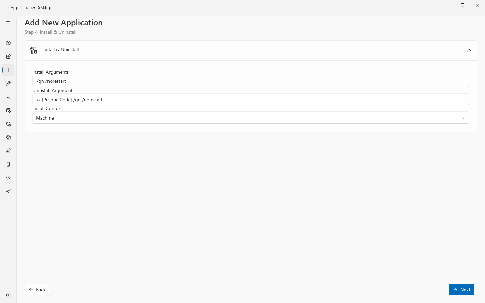
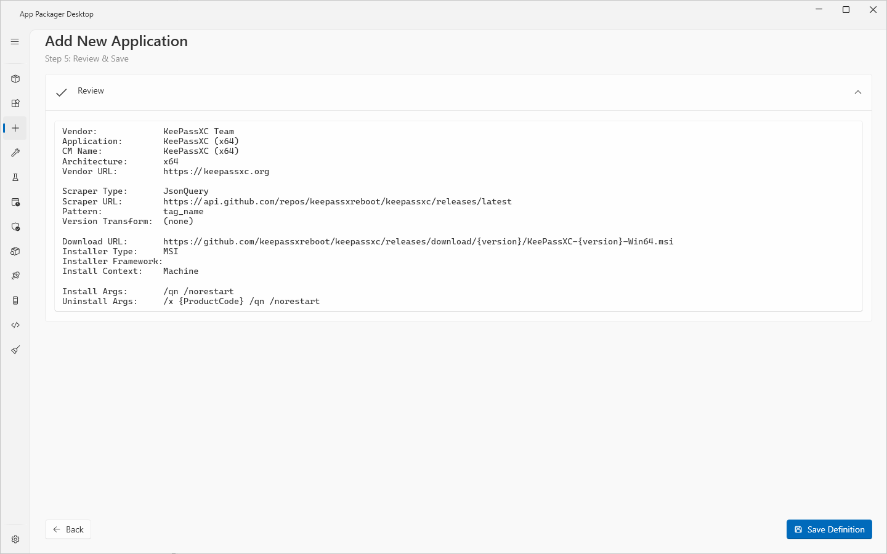

# Add App page

## What it does

The Add App page is a wizard with five steps. It writes a new application [definition](definitions.md) as a JSON file in your user definitions folder. After you reload the Packages page, the application appears in the grid.

The page title is **Add New Application**. The wizard sets the fields that a simple application needs: name, version source, download address, install arguments and install context. It does not set the detection rule. See [Limits](#limits).

## When to use it

- To package an application that is not in the catalog of 319 definitions.
- To package an application whose installer is an MSI or an EXE with a version that a web page, a JSON API or the installer itself reports.

If you have the installer file already, use the drop on the Packages page instead. See [Bring your own installer](bring-your-own-installer.md).

## Requirements

- Write access to the user definitions folder. By default it is `%LOCALAPPDATA%\AppPackager\Workbench\definitions`.
- Network access from this computer to the version source, for **Test Scrape**.

The page needs no ConfigMgr site, no Intune tenant and no WSUS server.

## Steps

1. Select **Add App** in the sidebar.
2. Complete step 1, **Basic Information**.
3. Select **Next**.
4. Complete step 2, **Version Source**. Select **Test Scrape**.
5. Select **Next**.
6. Complete step 3, **Download Configuration**.
7. Select **Next**.
8. Complete step 4, **Install & Uninstall**.
9. Select **Next**.
10. Read step 5, **Review & Save**. Select **Back** to change a value.
11. Select **Save Definition**.
12. Select **Packages** in the sidebar and press F5.

The wizard does not check a step before you select **Next**. It checks the required fields when you select **Save Definition**.

### Step 1: Basic Information

| Field | What to enter | Default |
|---|---|---|
| **Vendor** | The publisher name, for example `Mozilla`. The name is used for the folder structure of the content share and for the Publisher field of the ConfigMgr application. Required. | Empty |
| **Application Name** | The full name with the bitness, for example `Mozilla Firefox (x64)`. The name is the main identifier in the UI and in the file name. Required. | Empty |
| **CM Display Name (optional)** | The name in the ConfigMgr console and in Software Center. | Empty. An empty field uses the **Application Name**. |
| **Architecture** | `x64` or `x86`. | `x64` |
| **Vendor URL** | The web site of the vendor. The wizard does not use it to read versions. The context menu entry **Open Vendor URL** on the Packages page opens it. | Empty |

### Step 2: Version Source

The title of the card is **Version Scraper**. A scraper reads the current version from the vendor.

| Field | What to enter | Default |
|---|---|---|
| **Scraper Type** | `HttpRegex`, `JsonQuery` or `FileVersion`. | `HttpRegex` |
| **Scraper URL** | The address to read. Example: `https://api.github.com/repos/owner/repo/releases/latest`. | Empty |
| **Pattern** | See the table below. | Empty |
| **Version Transform (optional)** | A change to the version after the scraper read it. Chain steps with `\|`. Steps: `strip_prefix:X`, `insert_dot:N`, `replace:X:Y`, `regex_replace:pattern:replacement`. | Empty |

| Scraper Type | Pattern |
|---|---|
| `HttpRegex` | A regular expression with one capture group for the version. Example: `version-(\d+\.\d+)\.exe`. |
| `JsonQuery` | A path in the JSON answer. Example: `tag_name`. |
| `FileVersion` | The property to read: `FileVersion`, `ProductVersion` or `MsiProductVersion`. The scraper downloads the installer and reads this property. |

To test the settings:

1. Select **Test Scrape**.
2. Read the result box. A good result is `Version: <version>`. When the transform changed the version, the box also shows `(raw: <version>)`.

**Test Scrape** needs a **Scraper URL** and a **Pattern**. The status line shows `Testing version scrape...` while the test runs.

The scrapers are explained in [Definitions](definitions.md#version-sources-scrapers).

### Step 3: Download Configuration

| Field | What to enter | Default |
|---|---|---|
| **Download URL Template** | The address of the installer. `{version}` is the version as the scraper read it. `{display_version}` is the version after the transform. Example: `https://example.com/download/app-{version}-x64.msi`. | Empty |
| **Installer Filename Override (optional)** | A file name for the downloaded installer. Use it when the address has no usable file name, for example a redirect. The field accepts `{version}`. | Empty |
| **Installer Type** | `MSI`, `EXE`, `ZIP`, `MSIX` or `ODT`. | `EXE` |
| **Installer Framework (auto-detected)** | The installer technology, for example `NSIS` or `InnoSetup`. Leave the field empty when you do not know it. App Packager Desktop then tries to identify the installer. | Empty |

### Step 4: Install & Uninstall

| Field | What to enter | Default |
|---|---|---|
| **Install Arguments** | The silent install arguments. The tooltip gives these examples: MSI `/qn /norestart`, NSIS `/S`, Inno Setup `/VERYSILENT /NORESTART /SP-`. | Empty |
| **Uninstall Arguments** | The silent uninstall arguments. Use `{ProductCode}` for an MSI, for example `/x {ProductCode} /qn /norestart`. | Empty |
| **Install Context** | `Machine` installs for all users: Program Files and HKLM. `User` installs for the current user: AppData and HKCU. | `Machine` |

### Step 5: Review & Save

The page shows the values of steps 1 to 4 in a read-only box. **CM Name** shows the **Application Name** when **CM Display Name (optional)** is empty. **Version Transform** shows `(none)` when the field is empty. The buttons are **Back** and **Save Definition**.

## What the wizard writes

- A file in the user definitions folder. The file name is the **Application Name** reduced to its lowercase letters and digits, plus `.json`. For `Contoso Tool (x64)` the file name is `contosotoolx64.json`. A name that Windows reserves, such as `con` or `nul`, gets the prefix `app-`.
- A new `Id` of 16 characters.
- `Schema` 1, and the values of the five steps. `CMName` takes the **CM Display Name (optional)**, or the **Application Name** when that field is empty.
- A default detection rule and an empty `RunningProcess` list.

After a successful save, a notification titled **Saved** shows `Definition saved: <file name>`. The status line shows `Saved to <path>`. The wizard keeps the values in its fields.

The field list of the file is in [Definition format](../reference/definition-format.md).

## Limits

- The wizard offers three of the seven scraper types: `HttpRegex`, `JsonQuery` and `FileVersion`. It does not write hops, request headers, retry settings, hash checks or a download address query. To use these, edit the JSON file.
- The wizard offers the architectures `x64` and `x86`.
- The wizard writes the default detection rule. The rule has no registry key. The wizard has no detection step. To review the detection, open the application in the [Application Workbench](workbench.md) with **Edit application...** on the Packages page.
- The wizard writes no `Odt` section. The installer type `ODT` needs that section.
- The wizard never overwrites a file. A second save with the same **Application Name** is refused.
- The wizard does not check the URLs and the regular expression before it saves. Use **Test Scrape**.
- A user definition that is not valid JSON, or that has no `Id`, does not appear in the Packages grid.

## Troubleshooting

| Message | Cause | Fix |
|---|---|---|
| `Vendor and Application Name are required.` | **Vendor** or **Application Name** is empty when you select **Save Definition**. | Fill both fields. |
| `A user definition named <file> already exists. Existing definitions are never overwritten.` | A file with that name exists in the user definitions folder. | Use another **Application Name**. |
| `URL and Pattern are required.` | **Test Scrape** with an empty **Scraper URL** or **Pattern**. | Fill both fields. |
| `No version found. Check URL and Pattern.` | The scraper returned no version. | Check the **Scraper URL** and the **Pattern**. |
| `Error: <message>` | The scrape failed. | Read the message. |
| `The application name contains no letters or numbers for a definition filename.` | The **Application Name** has no letter and no digit. | Use a name with letters or digits. |
| The new application is not in the Packages grid. | The grid reads the definitions at start and on reload. | Press F5 on the Packages page. |

## Links

- [Create applications in Configuration Manager](https://learn.microsoft.com/intune/configmgr/apps/deploy-use/create-applications): Describes how to create an application with deployment types, detection methods and dependencies.
- [Create Windows applications in Configuration Manager](https://learn.microsoft.com/intune/configmgr/apps/get-started/creating-windows-applications): Lists the Windows application types and their options.
- [ProductCode property](https://learn.microsoft.com/windows/win32/msi/productcode): Describes the product code that identifies an installed product.
- [Windows Installer Properties for the Uninstall Registry Key](https://learn.microsoft.com/windows/win32/msi/uninstall-registry-key): Lists the Uninstall registry values that Windows Installer writes.
