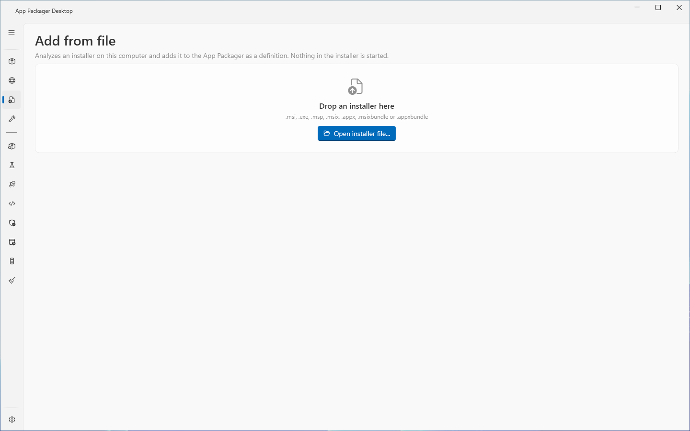
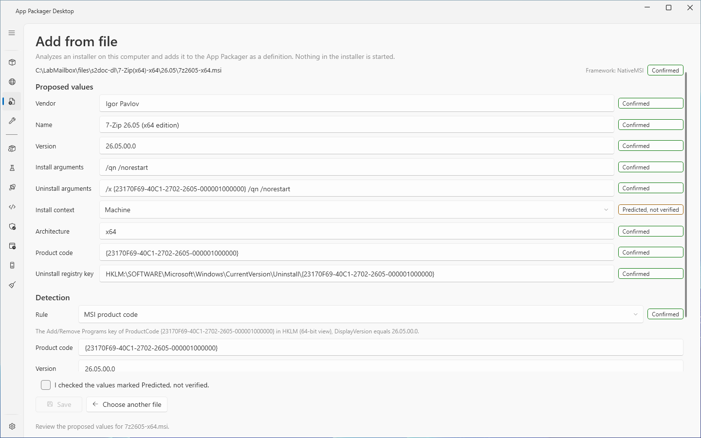
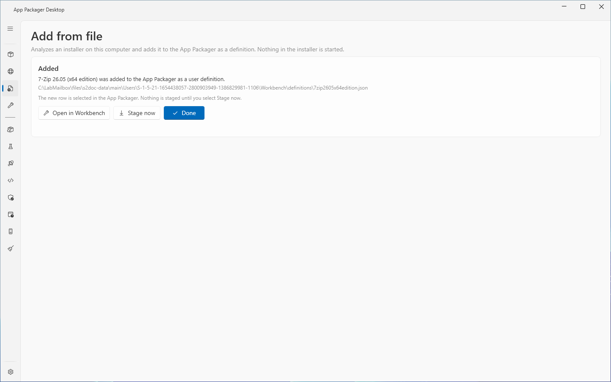

# Add from file

## What it does

The **Add from file** page analyzes an installer file on this computer and saves it as an application [definition](definitions.md). You drop the file on the page or choose it with a button. The page proposes the application name, the vendor, the version, the silent install and uninstall arguments, the install context and a detection rule. You review each value, edit it if it is wrong, and save.

The page reads the file. It never starts the installer or a file taken out of it. The reader has limits for size, entry count, depth and time. A damaged or hostile file gives a plain message.

Each proposed value shows its evidence level: **Confirmed**, **Predicted, not verified**, **Manual** or **No value**. See [Evidence levels](#evidence-levels).

After the save, the page shows the [result panel](#the-result-panel) with the buttons **Open in Workbench**, **Stage now** and **Done**. Nothing is staged until you select **Stage now**.

## When to use it

- To package an application from an installer file that you already have.
- To package an application that has no download address, for example an internal build.
- To package a patch (`.msp`) or a Windows app package (`.msix`, `.appx`, `.msixbundle`, `.appxbundle`).

To package an application from a download address and a version source, use [Add from web](add-app.md). To only read an installer, use [Installer Analysis](../tools/installer-analysis.md).

## Requirements

- Write access to the user definitions folder. By default it is `%LOCALAPPDATA%\AppPackager\Workbench\definitions`.
- An installer file with one of these extensions: `.msi`, `.exe`, `.msp`, `.msix`, `.appx`, `.msixbundle` or `.appxbundle`.
- 7-Zip, optional. The analysis of some `.exe` installers lists the payload with 7-Zip. See [Installer Analysis](../tools/installer-analysis.md#requirements).
- Do not run the app as administrator if you drop a file from Explorer. Windows blocks a drag from Explorer to an elevated window. Use the button instead.

The page needs no ConfigMgr site, no Intune tenant and no WSUS server.

## Steps

1. Select **Add from file** in the sidebar. You can also drop a file on the [App Packager page](packages.md). The app then opens **Add from file** and starts the analysis.
2. Drop one installer on the page, or select **Open installer file...** and choose a file. The dialog is titled `Open an installer file`.
3. Wait while the page shows the file name, a progress line and **Cancel**.
4. Review the page. See [Review](#review).
5. If the page shows the check box **I checked the values marked Predicted, not verified.**, read each value with that marker. Then select the check box. **Save** stays disabled until you do.
6. Select **Save**.
7. On the result panel, select **Open in Workbench**, **Stage now** or **Done**.

Select **Choose another file** to leave the review without a save.

The page takes one file at a time. After a save, the result panel stays open until you select **Done**. A drop while the panel is open gives the status `The result of the last added file is open. Select Done, then add the next file.`

### Review

The review shows these parts from the top.

| Part | Content |
|---|---|
| File path and **Framework** | The path of the file. The installer technology, for example `NSIS`, with an evidence chip. |
| Caution box | `This definition needs review.` and the reasons. |
| Silent switch box | Shows when a non-MSI installer has no install arguments: `No silent switch could be derived. Type the silent install arguments of this installer. Test them on a test device before you deploy.` |
| **Package** | For `.msix`, `.appx`, `.msixbundle` and `.appxbundle` files. The facts of the package and its signature. |
| **Patch** | For `.msp` files. The facts of the patch. |
| **Proposed values** | The rows in the next table. |
| **Detection** | The detection rule. See [Detection](#detection). |
| **Notes** | Plain sentences that say what the analysis could not read, and what to test. |

The **Proposed values** rows:

| Row | Meaning |
|---|---|
| **Vendor** | The publisher. An empty vendor is saved as `Unknown`. |
| **Name** | The application name. It names the definition file. Required. |
| **Version** | The version. It names the staged folder. Required. |
| **Install arguments** | The silent install arguments. |
| **Uninstall arguments** | The silent uninstall arguments. |
| **Uninstall command** | A full uninstall command, when the analysis found one. |
| **Install context** | `Machine` or `User`. |
| **Install for** | The install mode, when the installer has more than one. |
| **Architecture** | Read-only. Shows when the analysis read an architecture. |
| **Product code** | Read-only. The MSI product code, the patch target or the package identity name. |
| **Uninstall registry key** | Read-only. The Add/Remove Programs key that the installer writes. |

Edit a value and its marker changes to **Manual**. A read-only row shows the evidence of the value and cannot be edited.

The **Package** facts are **Identity name**, **Publisher**, **Publisher name**, **Version**, **Architecture**, **Dependencies**, **Kind** (`Bundle` or `Package`), **Signature** and **Signer**. The **Signature** row reads one of these texts:

| Text | Meaning |
|---|---|
| Signed and trusted on this computer | The chain is trusted here. |
| Signed, not trusted on this computer | Each target device must trust the certificate, or the install fails. |
| Not signed | Windows does not install an unsigned package. Sign the package before you deploy it. |
| The signature is not valid | Do not deploy the package. |
| Signed, the certificate expired and has no valid timestamp | Windows does not install the package. Sign it again. |
| Not known | The signature could not be checked. |

A package with a signature that is not trusted shows a warning box above the facts.

The **Patch** facts are **Patch code**, **Title**, **Target product codes**, **Target product**, **Version after the patch** and **Classification**. A warning box reads that the patch applies only to an installed base product. Deploy it only to devices that have the base product.

### Detection

The detection panel is the same panel as step 6 of [Add from web](add-app.md#step-6-detection). The panel shows an evidence chip and one description line. These rules come from the analysis:

| Installer | Proposed rule | Evidence |
|---|---|---|
| MSI | The Add/Remove Programs key of the product code, with `DisplayVersion` equal to the version. | Confirmed |
| Other `.exe` | A registry value (version) rule on the Add/Remove Programs key that the installer writes, or a key-exists rule when no version is known. | Confirmed when the key and the version are read from the installer, Predicted otherwise |
| MSP | A PowerShell rule that asks Windows Installer whether the patch is applied to the product. | Predicted |
| MSIX, APPX and bundles | The provisioning key of the package. | Confirmed |
| No rule can be derived | `None`. The caution box reads that the definition has no detection rule. | No value |

A definition with no detection rule is saved with a warning. Add a rule in the [Workbench](workbench.md) before you deploy.

## Evidence levels

| Marker | Meaning |
|---|---|
| **Confirmed** | The analysis read the value from the installer. |
| **Predicted, not verified** | The analysis took the value from a table or from documentation, for example the silent switches of an installer type. It did not read the value from the installer. Test the value on a test device before you deploy. |
| **Manual** | You typed or changed the value. |
| **No value** | The analysis could not derive a value. Type one. |

The tooltip of a marker names the source of the value. A value with **Predicted, not verified** blocks **Save** until you select the check box.

## What the page saves

- A definition file in the user definitions folder. The file name is the **Name** reduced to its letters and digits in lowercase, plus `.json`.
- A new `Id` of 16 characters.
- A saved installer record: the full path of the file, its SHA-256 and the reviewed version. The definition has no download address and no version scraper.

The installer stays where you chose it. The page does not copy it. Later:

- **Check Latest** shows the reviewed version. It sends no request.
- **Stage** checks that the file exists and has the saved SHA-256. It then copies the file into the staging folder and checks the hash of the copy.
- A file that is moved, deleted or changed fails the stage. The message gives the path and the step to take. See [Troubleshooting](#troubleshooting).

A definition that was saved before this record existed has no saved installer. Its stage says to add the installer again.

## The result panel

The panel **Added** is the same on [Add from web](add-app.md#the-result-panel).

| Element | Meaning |
|---|---|
| Summary | `<name> was added to the App Packager as a user definition.` |
| Path | The path of the definition file. |
| Caution box | Shows when the definition needs review, with the reasons. |
| **Open in Workbench** | Opens the [Workbench](workbench.md) with the new definition loaded. |
| **Stage now** | Runs Stage on the new row of the App Packager grid. The status shows the result, and the first line of a failure reason. |
| **Done** | Closes the panel and shows the drop zone again. |

The page selects the new row of the App Packager grid and clears the search box. The default button is **Open in Workbench** when the definition needs review. Otherwise it is **Done**.

## Limits

- An `.exe` that wraps an MSI (some Advanced Installer and InstallShield installers) gets no ProductCode detection rule. The analysis reads only the stub of the file. The review marks the definition as needing review.
- An unknown `.exe` gets no silent switch and no uninstall. The generated uninstall script uninstalls nothing and exits with code 1 until you enter an uninstall command or arguments.
- The generated uninstall of an `.exe` looks up the Add/Remove Programs entry by the product name of the installer. If the entry has another display name, the script writes `No Add/Remove Programs entry of this product was found; nothing was uninstalled.` and exits with code 1. Enter an uninstall command to avoid this.
- The installer file is not copied. A file that moves breaks the stage.
- Two stages of the same application and version that run at the same time can delete each other's folder.
- A prediction of a command is not a test of the command.

## Troubleshooting

| Message | Cause | Fix |
|---|---|---|
| `<n>` files were dropped. Drop one installer at a time. | You dropped several files. | Drop one file. |
| The path is a folder. Add from file takes one installer file. | You dropped a folder. | Drop a file. |
| Add from file does not take `<ext>` files. Use an .msi, .exe, .msp, .msix, .appx, .msixbundle or .appxbundle file. | The extension is not supported. | Use a supported file. For other types, use [Installer Analysis](../tools/installer-analysis.md). |
| The analysis failed: `<message>` | The reader could not read the file. | Read the message. Check that the file is an installer. |
| The analysis was cancelled. | You selected **Cancel**. | Open the file again. |
| Type the application name. | The **Name** row is empty. | Fill the row. |
| Enter the version. | The **Version** row is empty. | Fill the row. |
| Enter the silent install arguments. No silent switch could be derived. | A non-MSI installer has no install arguments. | Type the arguments. |
| A definition file named `<file>` already exists. Change the application name and save again. | Another definition has this file name. | Change the **Name**. |
| The installer file changed after the analysis: `<path>`. Open the installer file again. | The file changed between the analysis and the save. | Open the file again. |
| The definition was not saved: `<message>` | The write failed. | Read the message. |
| The installer that Add from file saved for `<name>` is not found: `<path>`. Put the file back in that folder, or add the installer again with Add from file. | The file moved or was deleted. | Do as the message says. |
| The installer `<path>` changed after Add from file saved it: its SHA-256 is `<a>`, the saved SHA-256 is `<b>`. Nothing was staged. Add the installer again with Add from file. | The file changed. | Do as the message says. |
| `<name>` has no download source and no saved installer. Add the installer again with Add from file, or set a version source and a download URL in the Workbench. | The definition has no saved installer record. | Do as the message says. |
| The installer file name has characters other than ASCII. Rename the file, then add it again with Add from file. | The file name has a non-ASCII character. | Rename the file. |

## Links

- [Create applications in Configuration Manager](https://learn.microsoft.com/intune/configmgr/apps/deploy-use/create-applications): Describes how to create an application with deployment types, detection methods and dependencies.
- [ProductCode property](https://learn.microsoft.com/windows/win32/msi/productcode): Describes the product code that identifies an installed product.
- [Windows Installer Properties for the Uninstall Registry Key](https://learn.microsoft.com/windows/win32/msi/uninstall-registry-key): Lists the Uninstall registry values that Windows Installer writes.
- [msiexec](https://learn.microsoft.com/windows-server/administration/windows-commands/msiexec): Documents the msiexec command line.
