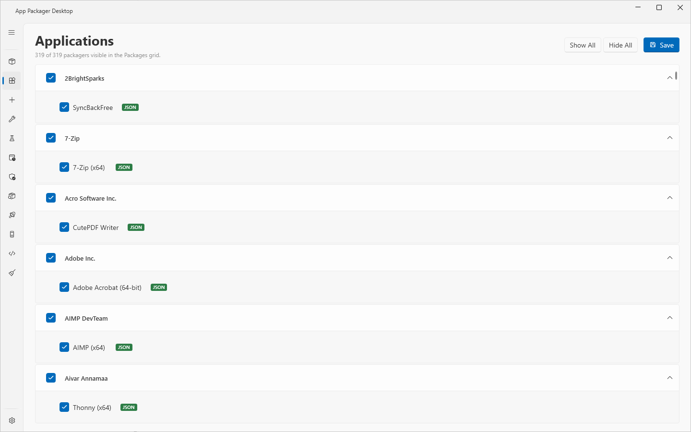

# Applications page

## What it does

The Applications page lists every application that App Packager Desktop finds, grouped by vendor. You choose which applications the [Packages page](packages.md) shows. The page does not delete or change a definition. It only stores which applications are hidden.

The page lists each application, including the hidden ones. The text under the title shows how many applications are visible: `N of M packagers visible in the Packages grid.`

## When to use it

- To remove applications from the Packages grid that you never package.
- To bring back an application that you hid earlier, or that [Discover unmanaged software](discover-unmanaged-software.md) hid.
- To reduce the grid to the applications of a few vendors.

## Requirements

None. The page works without a ConfigMgr site, without Intune and without WSUS.

## Steps

### Hide an application

1. Select **Applications** in the sidebar.
2. Find the vendor group of the application. Select the arrow of the group to expand it when it is collapsed.
3. Clear the check box of the application.
4. Select **Save**.
5. Read the message `Saved. N of M visible.`

The Packages grid reloads when you select **Save**. The reload clears the check boxes and the statuses of the Packages grid. The grid no longer lists the hidden application.

### Show an application again

1. Select **Applications** in the sidebar.
2. Select the check box of the application.
3. Select **Save**.

### Show or hide all applications of a vendor

1. Select the check box in the header of the vendor group.
2. Select **Save**.

The check box of a vendor shows the mixed state when only some of its applications are visible.

### Show or hide all applications

1. Select **Show All** or **Hide All**.
2. Select **Save**.

**Show All** and **Hide All** change only the check boxes on the page. Nothing is stored until you select **Save**.

## Reading the page

| Element | Meaning |
|---|---|
| Vendor header | One group for each vendor. The groups are in alphabetical order, and the applications in each group are in alphabetical order. The groups are expanded when the page opens. |
| Check box of an application | Selected: the Packages grid lists the application. Cleared: the Packages grid does not list it. |
| Badge `JSON` | The application comes from a JSON [definition](definitions.md). |
| Badge `PS1` | The application comes from a PS1 packager script. |
| Count text | `N of M packagers visible in the Packages grid.` N is the number of selected check boxes, M is the number of applications. |

## Options and settings

| Item | Effect |
|---|---|
| **Show All** | Selects every check box. |
| **Hide All** | Clears every check box. |
| **Save** | Stores the hidden applications, reloads the Packages grid and shows `Saved. N of M visible.` |

App Packager Desktop stores the hidden applications in the setting `HiddenApplications` of the file `settings.json`. The value is the list of definition ids of the cleared applications. The Settings page has no control for this setting. A new installation hides nothing.

**Discover unmanaged software** can change the list too. After a discovery, the Applications page reloads its list. See [Discover unmanaged software](discover-unmanaged-software.md).

## Limits

- The page has no search box.
- A change applies only after **Save**. If you leave the page without **Save**, the Packages grid keeps the old list.
- The page does not delete a definition and does not change one. See [Definitions](definitions.md).

## Troubleshooting

| Message | Cause | Fix |
|---|---|---|
| `All applications are hidden. Show applications on the Applications page.` (Packages page) | Every application is hidden. | Select **Show All**, then **Save**. |
| `Applications page: the list could not be reloaded. Open the page again to retry.` (log pane of the Packages page) | The page could not read the definitions. | Do as the message says. |

## Links

- [Introduction to application management in Configuration Manager](https://learn.microsoft.com/intune/configmgr/apps/understand/introduction-to-application-management): Explains how applications, deployment types and deployments relate.
- [Create applications in Configuration Manager](https://learn.microsoft.com/intune/configmgr/apps/deploy-use/create-applications): Describes how to create an application with deployment types, detection methods and dependencies.
