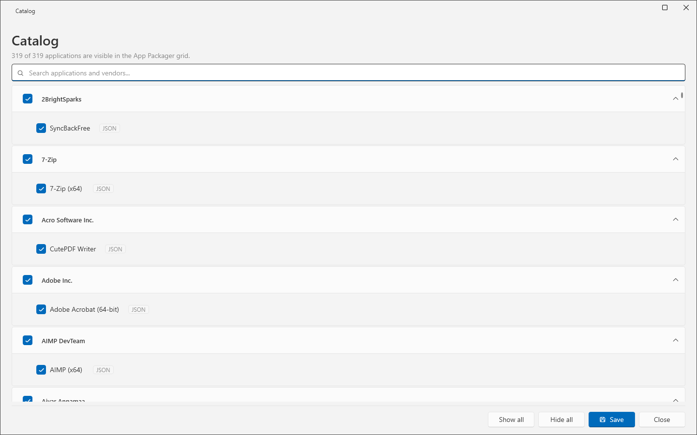

# Catalog

## What it does

The Catalog is a window that lists every application that App Packager Desktop finds, grouped by vendor. You choose which applications the [App Packager page](packages.md) shows. The Catalog does not delete or change a definition. It only stores which applications are hidden.

The Catalog is not a sidebar page. It opens from the **Catalog** button at the top right of the App Packager page.

The text under the title shows how many applications are visible: `N of M applications are visible in the App Packager grid.`

## When to use it

- To remove applications from the App Packager grid that you never package.
- To bring back an application that you hid earlier, or that [Discover unmanaged software](discover-unmanaged-software.md) hid.
- To reduce the grid to the applications of a few vendors.

## Requirements

None. The window works without a ConfigMgr site, without Intune and without WSUS.

## Steps

### Open the Catalog

1. Select **App Packager** in the sidebar.
2. Select **Catalog**. The tooltip reads `Show or hide applications in this grid.`

The window is not modal. You can use the App Packager page while it is open. A second selection of **Catalog** brings the open window to the front. The search box has the focus when the window opens.

### Hide an application

1. Open the Catalog.
2. Find the vendor group of the application. Select the arrow of the group to expand it when it is collapsed.
3. Clear the check box of the application.
4. Select **Save**.
5. Read the message `Saved. N of M visible.` in the notification titled **Catalog**.

The App Packager grid reloads when you select **Save**. The reload clears the check boxes and the statuses of the grid. The grid no longer lists the hidden application.

### Show an application again

1. Open the Catalog.
2. Select the check box of the application.
3. Select **Save**.

### Find an application

1. Type text in the box **Search applications and vendors...**.
2. The window lists the applications whose name or vendor contains the text. A vendor group shows while one of its applications matches. The comparison ignores case.
3. The text under the title adds `M match the search.`

### Show or hide all applications of a vendor

1. Select the check box in the header of the vendor group.
2. Select **Save**.

The check box of a vendor shows the mixed state when only some of its applications are visible. With a search text, the check box changes only the applications that match.

### Show or hide all applications

1. Select **Show all** or **Hide all**.
2. Select **Save**.

**Show all** and **Hide all** change the applications that match the search, or every application when the search box is empty. They change only the check boxes in the window. Nothing is stored until you select **Save**.

## Reading the window

| Element | Meaning |
|---|---|
| Vendor header | One group for each vendor. The groups are in alphabetical order, and the applications in each group are in alphabetical order. The groups are expanded when the window opens. |
| Check box of an application | Selected: the App Packager grid lists the application. Cleared: the grid does not list it. |
| Badge `JSON` | The application comes from a JSON [definition](definitions.md). |
| Badge `PS1` | The application comes from a PS1 packager script. The tooltip of the badge shows the script. |
| Count text | `N of M applications are visible in the App Packager grid.` With an unsaved change: `N of M applications are selected to show. The App Packager grid changes when you select Save.` |

## Options and settings

| Item | Effect |
|---|---|
| **Show all** | Selects the check box of every application that matches the search. |
| **Hide all** | Clears the check box of every application that matches the search. |
| **Save** | Stores the hidden applications, reloads the App Packager grid and shows `Saved. N of M visible.` |
| **Close** | Closes the window. A change that you did not save stays in the Catalog until you save it. The next time you open the Catalog, it shows that change. The grid does not change. |

App Packager Desktop stores the hidden applications in the setting `HiddenApplications` of the file `settings.json`. The value is the list of definition ids of the cleared applications. The Settings page has no control for this setting. A new installation hides nothing.

[Discover unmanaged software](discover-unmanaged-software.md) can change the list too. After a discovery, the Catalog reloads its list.

## Limits

- A change applies only after **Save**. If you close the window without **Save**, the App Packager grid keeps the old list.
- The window does not delete a definition and does not change one. See [Definitions](definitions.md).
- A definition that you add with [Add from web](add-app.md) or [Add from file](add-from-file.md) is visible at once. It appears in the Catalog after the grid reloads.

## Troubleshooting

| Message | Cause | Fix |
|---|---|---|
| All applications are hidden. Select Catalog to show applications. (App Packager page) | Every application is hidden. | Select **Catalog**, then **Show all**, then **Save**. |
| Catalog: the list could not be reloaded. Open Catalog again to retry. (log pane of the App Packager page) | The window could not read the definitions. | Do as the message says. |

## Links

- [Introduction to application management in Configuration Manager](https://learn.microsoft.com/intune/configmgr/apps/understand/introduction-to-application-management): Explains how applications, deployment types and deployments relate.
- [Create applications in Configuration Manager](https://learn.microsoft.com/intune/configmgr/apps/deploy-use/create-applications): Describes how to create an application with deployment types, detection methods and dependencies.
