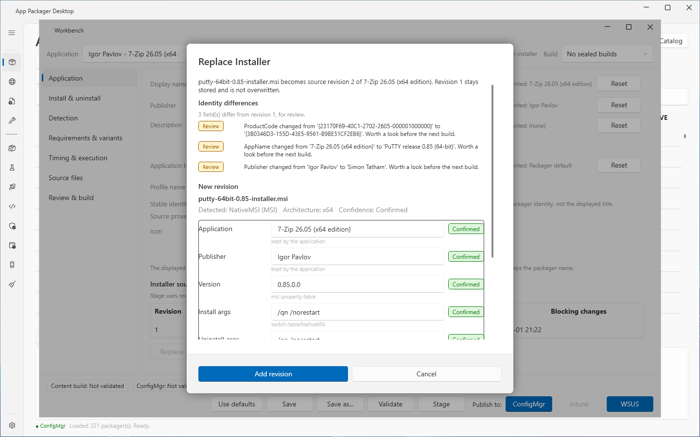

# Bring your own installer

## What it does

A bring-your-own application is an application that has numbered installer revisions and no download script. Its updates are manual: you add a new revision with **Replace installer...** in the [Workbench](workbench.md).

To add an installer file as a new application, use [Add from file](add-from-file.md). A file that you drop on the [App Packager page](packages.md) opens that page. Add from file saves a definition that keeps the path, the SHA-256 and the reviewed version of the file. It does not make a bring-your-own application.

This page describes the bring-your-own applications that already exist, for example applications that an earlier version of App Packager Desktop saved from a drop. It also describes the older **Installer drop** dialog, which a start argument still opens.

## When to use it

- Use it to stage and publish an existing bring-your-own application.
- Use it to add a new installer revision to such an application.
- Use [Add from file](add-from-file.md) for a new installer file.
- Use [Installer Analysis](../tools/installer-analysis.md) to read an installer without staging it.

## Requirements

- For **Stage**: **Download Root (local staging)** in Settings.
- For publishing: the settings of the target. See [Stage and publish](stage-and-publish.md).
- For **Replace installer...**: a file with the extension `.msi` or `.exe`.

## Steps: stage and publish a bring-your-own application

1. Select **Workbench** in the sidebar, or select **Open definition...** in the Workbench. Choose the application. Its **Source** is `Local file`.
2. Change the profile if you need to. See [Workbench](workbench.md).
3. Select **Stage**. The Workbench stages the newest installer revision. The log shows `Stage: <name> <version> (source revision <n>, <file>)`.
4. Choose the build in **Build**.
5. Under **Publish to:**, select **ConfigMgr**, **Intune** or **WSUS**.

A bring-your-own application has no row in the App Packager grid until a stage adds one.

## Steps: add a new installer revision

1. Open the application in the Workbench.
2. In the section **Application**, select **Replace installer...**.
3. Choose the new `.msi` or `.exe` file. A file of another type gives the dialog `Replace Installer`: "A replacement installer must be an .msi or an .exe file. Add other installer types with Add from file."
4. In the dialog **Replace Installer**, read **Identity differences**. The app compares the installer type, the architecture, the product code, the application name and the publisher with the newest revision.
   - A difference in installer type or architecture is `Blocking`. The existing package does not match the new installer.
   - A difference in product code, name or publisher is `Review`.
5. Check the values under **New revision**. The application name and the publisher stay as they are (`kept by the application`).
6. Select **I confirmed the predicted values** if the box is visible.
7. Select **Add revision**.
8. The dialog **Installer Replaced** reports `Source revision <n> added for <name>.` If a field was Blocking, the dialog names it. Stage again before the next publish.

The app keeps the earlier revisions. The list **Installer source** shows **Revision**, **Installer**, **Version**, **Type**, **Architecture**, **SHA-256**, **Added** and **Blocking changes**.

## The Installer drop dialog

The start argument `--analyze-drop <path>` opens the dialog **Installer drop** for one file after the list loads. The log shows `Startup: analysing installer from --analyze-drop: <path>`. A drop in the window does not open this dialog.

1. Read the line under the file name: `Detected: <engine> (<type>)   Architecture: <architecture>   Confidence: <confidence>`.
2. If the box **Install for** is visible, choose `System` or `User`. The arguments, the uninstall command and the detection rule change together with this choice.
3. Check each value. Each row has a badge, `Confirmed` or `Predicted`, and a line that names the source of the value. The rows **Application**, **Publisher**, **Version**, **Install args**, **Uninstall args** and **Uninstall command** are editable. The row **Detection** is read-only.
4. If a row has the badge `Predicted`, select **I confirmed the predicted values**. Until you select it, the buttons **Stage**, **Save as definition** and **Save as Application** are disabled.
5. Select a button.

| Button | Result |
|---|---|
| **Stage** | Stages the dropped installer. The row appears in the grid with the status `Staged`. Select the row and a publish button to continue. |
| **Save as definition** | Writes a JSON definition in the user definitions folder. The definition has no download address and no version scraper. The app never overwrites an existing definition. |
| **Save as Application** | Keeps the installer as source revision 1 of a bring-your-own application. It stages and deploys nothing. The log shows `Saved as application <id>. It appears in the workbench with manual updates; nothing was staged or deployed.` The dialog **Saved** asks whether to open the application in the Workbench. |
| **Cancel** | Closes the dialog. The log shows `Drop cancelled.` |

## Options and settings

| Item | Effect |
|---|---|
| Download Root (local staging) | Folder for staged content. |
| Workbench data folder | The app stores installer revisions in `Workbench\applications\<key>\sources\<revision>`. The variable `APP_PACKAGER_WORKBENCH_ROOT` replaces the Workbench folder. |
| Bundle export | Includes the installer files only if you answer `Yes` to `Include the installer binaries?`. See [Workbench](workbench.md). |

The identifier of a bring-your-own application starts with `byo:`. Use it as `--application byo:<id>` in the [command-line build](command-line-build.md).

## Limits

- A predicted value is a guess. A wrong silent switch produces a package that fails on every target device. Check each predicted value before you confirm it.
- Updates are manual. The app has no update source for a bring-your-own application.
- The lab validated **Save as Application**, stage and publish to ConfigMgr and WSUS for an MSI installer.
- An Explorer drop does nothing when the app runs as administrator. Start the app without elevation.

## Troubleshooting

| Message | Cause | Fix |
|---|---|---|
| `Drop analysis failed: <reason>` | The analysis of the **Installer drop** dialog could not read the file. | Read the reason. Check that the file is an installer. |
| `Drop refused: <reason>` | The analysis refused the file. | Read the reason. |
| `Application name is required.` | The row **Application** is empty. | Enter a name. |
| `Version is required.` | The row **Version** is empty. | Enter a version. |
| `Install args are required for a non-MSI installer.` | The row **Install args** is empty for an EXE. | Enter the silent switches. |
| `Stage: DownloadRoot is not configured. Open Settings.` | **Download Root (local staging)** is empty. | Set the folder in Settings. |
| `Save as definition refused: <file> already exists. Existing definitions are never overwritten.` | A definition with that file name exists. | Change the application name. |
| `Save as Application failed: <reason>` | The app could not write the application. | Read the reason. |
| `Stage refused: <reason>` | The stage plan of the application failed. The reason follows the message. | Read the reason. If the installer revision is missing, select **Replace installer...** and add a revision. |

See [Error messages](../reference/error-messages.md).

## Links

- [Windows Installer](https://learn.microsoft.com/windows/win32/msi/windows-installer-portal): Gives the entry point to the Windows Installer documentation.
- [Installer Database](https://learn.microsoft.com/windows/win32/msi/installer-database): Explains the structure of an installer database.
- [msiexec](https://learn.microsoft.com/windows-server/administration/windows-commands/msiexec): Documents the msiexec command line.
- [Prepare Win32 App Content for Upload](https://learn.microsoft.com/intune/app-management/deployment/create-win32-package): Shows how the Content Prep Tool makes an intunewin file.
