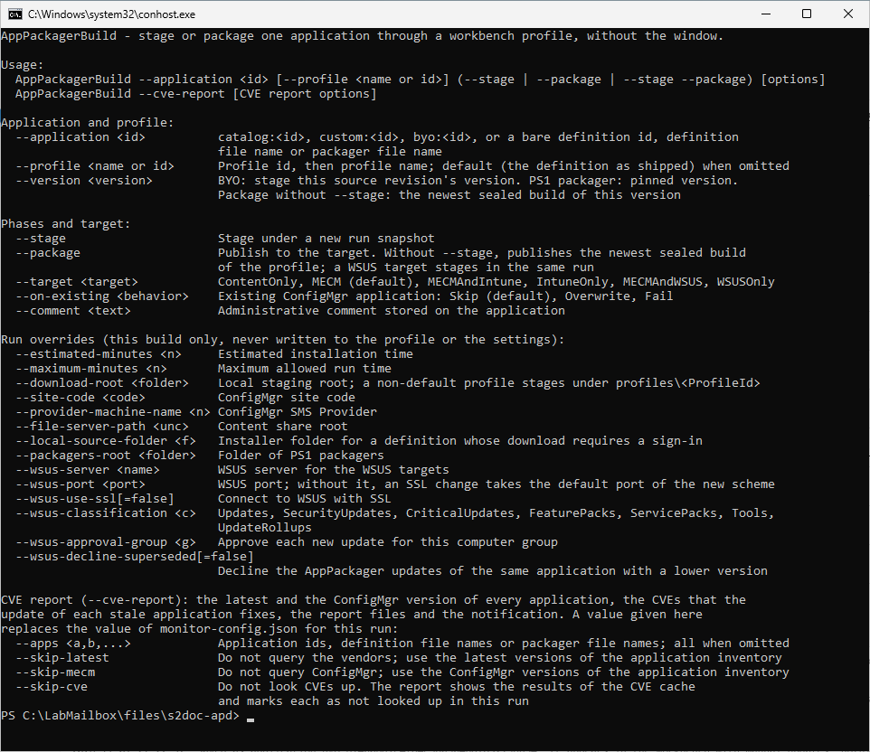

# Command-line build

## What it does

`AppPackagerBuild.exe` stages or publishes one application through a profile, without the window. It uses the same `settings.json` and the same Workbench data as the window. It does not prompt. An option or a saved setting supplies each decision, or the run stops with a message that names the option.

`AppPackagerBuild --cve-report` checks the vendor version, reads the ConfigMgr version, looks up the CVEs and writes the reports. See [CVE lookup](cve-lookup.md) for the same function in the window.

## When to use it

- Use it in scripts and scheduled tasks.
- Use it to publish the same profile again to a different target.
- Use `--cve-report` for a scheduled CVE report.

## Requirements

- The settings of the targets that the run uses. The run applies the same checks as the publish buttons. See [Stage and publish](stage-and-publish.md).
- **Download Root (local staging)** in Settings, or `--download-root`.
- The application and the profile exist. Create a profile in the [Workbench](workbench.md).

## Syntax

```
AppPackagerBuild --application <id> [--profile <name or id>] (--stage | --package | --stage --package) [options]
AppPackagerBuild --cve-report [options]
AppPackagerBuild --help
```

- Write `--name value` or `--name=value`. Option names ignore case.
- A switch takes an optional `=true` or `=false`.
- `-h`, `-?` and `/?` mean `--help`.
- An option given twice is an error.
- These options refuse an empty value: `--data-root`, `--download-root`, `--packagers-root`, `--log-folder`, `--local-source-folder`, `--file-server-path`, `--site-code`, `--provider-machine-name`, `--wsus-server`, `--report-folder`, `--drop-folder`, `--webhook-url`, `--config`, `--apps`, `--report-formats`. An unset variable in a scheduled task would otherwise fall back to the saved setting.
- An option that overrides a setting applies to that run only. The run never writes `settings.json`.

## Steps: stage and publish one application

1. Find the application id. In the Workbench, the field **Stable identity** shows `Application id <id>`.
2. Open a command prompt.
3. Run the command. For example:

```
AppPackagerBuild --application catalog:<id> --profile Pilot --stage --package --target MECM --on-existing Overwrite --comment "work order 1234"
```

4. Read the summary at the end of the output.
5. Check the exit code.

Press Ctrl+C to cancel. The run writes `Cancelled.` and returns exit code 1.

## Build options

| Option | Meaning | Default |
|---|---|---|
| `--application <id>` | Required. `catalog:<id>`, `custom:<id>`, `byo:<id>`, or a bare definition id, definition file name or packager file name. | none |
| `--profile <name or id>` | The profile. The app looks for an id first, then a name. | The default profile (the definition as shipped) |
| `--version <version>` | Bring-your-own: stage this source revision. PS1 packager: pinned version. With `--package` alone: the newest sealed build of this version. Refused with `--stage` for a definition. | none |
| `--stage` | Stages under a new run snapshot. | off |
| `--package` | Publishes to the target. Without `--stage`, it publishes the newest sealed build of the profile. | off |
| `--target <target>` | `ContentOnly`, `MECM`, `MECMAndIntune`, `IntuneOnly`, `MECMAndWSUS` or `WSUSOnly`. | `MECM` |
| `--on-existing <behavior>` | `Skip`, `Overwrite` or `Fail` for an existing ConfigMgr application. | `Skip` |
| `--version-rule <rule>` | `minimum` or `exact`: the operator of the version clause in the detection. It outranks the title override and the site default. | The setting |
| `--supersedence <mode>` | `off`, `replace` or `replace-uninstall`. `replace-uninstall` needs `exact`. It outranks the title override and the site default. | The setting |
| `--comment <text>` | Administrative comment stored on the application. | empty |
| `--estimated-minutes <n>`, `--maximum-minutes <n>` | Timing for this build only. A package of a sealed build refuses them. | profile or Settings |
| `--download-root <folder>` | Local staging root. A non-default profile stages under `profiles\<ProfileId>`. | Settings |
| `--site-code`, `--provider-machine-name`, `--file-server-path` | ConfigMgr site, SMS Provider and content share root. | Settings |
| `--local-source-folder <folder>` | Installer folder for a definition whose download needs a sign-in. | Settings |
| `--packagers-root <folder>` | Folder of PS1 packagers. | Settings |
| `--wsus-server`, `--wsus-port`, `--wsus-use-ssl`, `--wsus-classification`, `--wsus-approval-group`, `--wsus-decline-superseded` | WSUS values for this run. The port is 1 to 65535. Without a port, a change of SSL takes the default port of the new scheme. The classification is one of `Updates`, `SecurityUpdates`, `CriticalUpdates`, `FeaturePacks`, `ServicePacks`, `Tools`, `UpdateRollups`. | Settings |
| `--data-root <folder>` | Data root of settings and Workbench for this run. It sets `APP_PACKAGER_DATA_ROOT`. | none |
| `--log-folder <folder>` | Folder of the run log. | `%LOCALAPPDATA%\SRLPackr\Logs` |

Rules:

- Specify `--stage`, `--package`, or both.
- `--target MECMAndWSUS` with `--package` needs `--stage` in the same run.
- A WSUS target stages in the same run.
- `--target ContentOnly` publishes to no destination. The output shows `Package skipped: target ContentOnly publishes to no destination.`
- The destinations run in this order: `MECM` publishes to ConfigMgr. `MECMAndIntune` publishes to ConfigMgr, then Intune. `IntuneOnly` publishes to Intune. `MECMAndWSUS` publishes to ConfigMgr, then WSUS. `WSUSOnly` publishes to WSUS. The run stops at the first destination that fails.
- The Intune destination always uses `Skip`.
- Every destination is checked before anything stages. The checks are the same as the checks of the publish buttons. The WSUS check also needs the WSUS administration API on this computer.

## The output

The run ends with these lines:

```
ApplicationId : <id>
ProfileId     : <id>
BuildId       : <id>
Snapshot      : <path>
Target        : <target>
DownloadRoot  : <path>
Phases        : Stage exit 0; Package ConfigMgr exit 0
Wsus          : not run
ExitCode      : 0
```

The first line of the output names the run log: `Run log: <path>`. The file is `build-yyyyMMdd-HHmmss-<pid>.log`.

## Exit codes

| Exit code | Meaning |
|---|---|
| 0 | Success |
| 1 | Failure or refusal. Also a WSUS approval or decline that failed after a successful publish. For `--cve-report`: a vendor query, a ConfigMgr query or a CVE lookup that failed. |
| n | The non-zero exit code of a PS1 packager. |

When WSUS accepted the package and a later lookup, approval or decline gave a warning, the update is published and the exit code is 1. Read the `Wsus` line and the package id before you try again.

## CVE report run

`AppPackagerBuild --cve-report` accepts these options. A value on the command line replaces the value of `monitor-config.json` for this run.

| Option | Meaning | Default |
|---|---|---|
| `--apps <a,b,...>` | Application ids, definition file names or packager file names. | all |
| `--skip-latest`, `--skip-mecm`, `--skip-cve` | Omit the vendor query, the ConfigMgr query or the CVE lookup. The report uses stored values and marks them. | off |
| `--report-folder <folder>` | Folder of the report files. | `Reports` in the data folder |
| `--report-formats <f,...>` | `Html`, `Csv`, `Json`, `Xlsx`, `Markdown`. | all five |
| `--drop-folder <folder>` | Copies the report files to this folder. | none |
| `--webhook-url <https url>` | Posts the run summary as JSON. The URL must be https. | none |
| `--notify-always[=false]` | Notifies also when no application has an update. | off |
| `--keep-report-days <n>` | Deletes the report files of this command that are older than n days. 0 keeps all files. | 90 |
| `--config <file>` | The monitor configuration. | `monitor-config.json` in the data folder |
| `--site-code`, `--provider-machine-name`, `--packagers-root`, `--data-root`, `--log-folder` | As for a build. | Settings |

A CVE report run refuses build options such as `--application`, and a build refuses the CVE report options.

If `monitor-config.json` does not exist, the run writes it with default values. The file allows comments and trailing commas.

| Key | Default |
|---|---|
| `SchemaVersion` | 2 |
| `Report.OutputFolder` | empty (the `Reports` folder) |
| `Report.Formats` | all five formats |
| `Report.KeepReportDays` | 90 |
| `Notifications.Enabled` | `false` |
| `Notifications.DropFolder` | empty |
| `Notifications.WebhookUrl` | empty |
| `Notifications.OnlyOnStale` | `true` |

The notification keys apply only when `Notifications.Enabled` is `true`. A section with another name gives a `WARNING` line, and the run ignores it. The NVD API key comes from Settings, or from the `NVD_API_KEY` environment variable.

The run ends with the lines `Applications`, `Updates`, `LookedUp`, `FromCache`, `CVEs`, `KEV`, `Failed` and `ExitCode`.



## Limits

- The lab validated the command line with a scheduled task on a lab computer.
- The lab did not verify `--skip-mecm` together with other switches.
- A run that overrides a setting does not write settings.
- A PS1 packager cannot publish to Intune.

## Troubleshooting

| Message | Cause | Fix |
|---|---|---|
| `--application is required. Run AppPackagerBuild --help for usage.` | The build has no `--application`. | Add `--application`. |
| `Specify --stage, --package, or both.` | The build has no phase switch. | Add a switch. |
| `A MECMAndWSUS package publishes the build staged in the same run; pass --stage together with --package.` | `--package` without `--stage` for `MECMAndWSUS`. | Pass both. |
| `Unknown target '<x>'; expected ContentOnly, MECM, MECMAndIntune, IntuneOnly, MECMAndWSUS, WSUSOnly.` | The target name is wrong. | Use a listed target. |
| `Option '--<x>' was given an empty value; pass a value or leave the option out.` | A path, server or site option is empty. | Pass a value or remove the option. |
| `Option '--<x>' needs a value.` | A valued option has no value. | Add the value. |
| `Unknown option '--<x>'. Run AppPackagerBuild --help for usage.` | The option name is wrong. | See `--help`. |
| `DownloadRoot is not configured: pass --download-root or set it in Settings.` | No staging root. | Pass `--download-root`. |
| `--version does not apply to staging a definition: a definition stages its latest version. Use --version with --package alone to publish the sealed build of that version.` | `--version` with `--stage` for a definition. | As the message says. |
| `No sealed build exists for this profile. Stage it first; Package consumes an exact build id, not the newest manifest on disk.` | `--package` without `--stage` and no build. | Stage first. |
| `No sealed build of version '<v>' exists for this profile. Stage it first; ...` | No build of that version. | Stage first. |
| `--estimated-minutes and --maximum-minutes do not apply to build <id>: ...` | Timing options with a package of a sealed build. | Stage with them, or leave them out. |
| `No definition or packager script for application '<id>' under <paths>.` | The application id is unknown. | Check the id. |
| `<application> stages from a local installer folder, and no folder exists for it: pass --local-source-folder <folder>, or set the folder in Settings.` | A definition needs a local installer. | Pass the folder. |
| `No WSUS server: pass --wsus-server or set the server in Settings, WSUS Publishing.` | A WSUS target has no server. | Pass `--wsus-server`. |
| `Option '--webhook-url' takes an https URL.` | The webhook is not https. | Use https. |
| `The monitor configuration is not valid JSON: <path>: <detail>` | `monitor-config.json` cannot be parsed. | Correct the file. |

See [Error messages](../reference/error-messages.md).

## Links

- [Known Exploited Vulnerabilities Catalog](https://www.cisa.gov/known-exploited-vulnerabilities-catalog): Lists the CVEs that attackers are known to use.
- [FIRST.Org REST API: GET /epss](https://api.first.org/epss/): Documents the API call that returns EPSS scores.
- [Common Vulnerability Scoring System SIG](https://www.first.org/cvss/): Describes CVSS, the base of the severity score.
