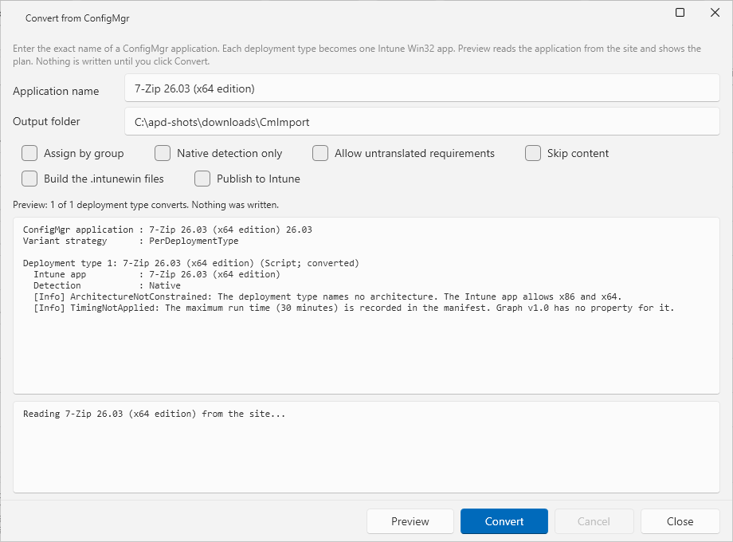

# Convert from ConfigMgr

BLUF: **Convert from ConfigMgr** reads one ConfigMgr application from the site and turns each deployment type into one Intune Win32 app. It can build the `.intunewin` files and publish the apps. **Preview** writes nothing.

## What it does

- It reads the stored document of the application from the site. The read is read-only. The site does not change.
- It plans one Intune Win32 app for each deployment type that it can convert. The plan holds the install and uninstall commands, the detection rule, the requirement rules, the return codes and the restart behavior.
- It copies the content of each deployment type, and writes a manifest for each app and three reports for the application.
- When you ask for it, it builds the `.intunewin` files and publishes the apps with the Intune values from Settings.

### What converts

- **Technology.** A deployment type of the technology Windows Installer (MSI) or Script converts. Another technology is not converted. The report names it as `TechnologyNotConverted`.
- **Detection.** A flat list of file, folder and registry rules, all joined with AND, becomes native Intune detection rules. Any other detection (OR, groups, a comparison that no native rule carries) becomes one PowerShell detection script. A stored detection script is kept when its language is PowerShell. A detection script in another language blocks the deployment type.
- **Requirements.** Architecture, memory and processor rules go to the matching Intune properties. A rule that a script can check becomes part of a requirement script. A rule with no Intune equivalent is reported as `RequirementsNotTranslated`. It blocks the deployment type unless you select **Allow untranslated requirements**.
- **Variants.** An application with more than one deployment type becomes more than one Intune app. ConfigMgr installs the first deployment type whose requirements match. With the default strategy, a requirement script on each lower-priority app keeps that rule: the app does not apply where a higher-priority deployment type applies. When the conversion cannot prove that the variants exclude each other, it blocks the deployment type. Select **Assign by group** to convert it, and assign each app to its own device group.
- **Relationships.** Dependencies and supersedence are listed in `relationships.json`. The conversion does not create them. App Packager calls Microsoft Graph v1.0 only, and v1.0 has no resource for them. Create them in the Intune admin center.

## When to use it

- Use it to move a ConfigMgr application to Intune without packaging it again.
- Use **Preview** first. It shows which deployment types convert and what needs a review.

## Requirements

- A working site connection: the **Site Code** and the **Site Server / SMS Provider Host** in Settings, ConfigMgr Site Settings. The window reads the application through the same ConfigMgr session as the other pages. See [Permissions](../reference/permissions.md).
- The exact name of the application, as the console shows it. A wildcard is not accepted. A name that matches no application, or more than one, is an error.
- For the content copy: read access to the content source of each deployment type, and write access to the output folder.
- To build the `.intunewin` files: the Win32 Content Prep Tool. The first build downloads it. See [Publish to Intune](publish-to-intune.md).
- To publish: **Intune** selected under **Systems in use** and **Tenant ID**, **Client ID** and **Client Secret** saved in Settings, Intune. See [Publish to Intune](publish-to-intune.md).

## Steps

1. Select **App Packager** in the sidebar.
2. Select **Convert from ConfigMgr** in the page header.
3. Enter the application name in **Application name**.
4. Check the **Output folder**. The default is the folder `CmImport` in your download folder. Each application gets its own folder inside it.
5. Set the options (table below).
6. Select **Preview**. The report shows the plan. The status line shows how many deployment types convert, for example `Preview: 1 of 1 deployment type converts. Nothing was written.`
7. Read the report. Fix what blocks a deployment type, or accept what is marked for review.
8. Select **Convert**. The log shows each step. Select **Cancel** to stop. Closing the window also stops the run. The content copy does not stop at once: the copy of the deployment type that is running can finish before the run stops.
9. Read the status line. It shows `Done: <N> app(s) staged in <folder>`, with the number of packages built and published when you asked for them.

## Options

| Option | Default | Effect |
|---|---|---|
| **Assign by group** | off | Still makes one app for each convertible deployment type. It does not add the requirement script that keeps a lower-priority app off devices where a higher-priority deployment type applies. Assign each app to its own device group. Overlapping assignments can install more than one variant. |
| **Native detection only** | off | Refuses a deployment type whose detection needs a generated script. It keeps a stored PowerShell detection script. |
| **Allow untranslated requirements** | off | Converts a deployment type although a requirement has no Intune equivalent. The report lists each one. |
| **Skip content** | off | Writes the plan and the reports without copying the content. |
| **Build the .intunewin files** | off | Builds one `.intunewin` file for each converted app. It needs the content, so it cannot be used with **Skip content**. |
| **Publish to Intune** | off | Publishes each built app with the Intune values from Settings. It needs **Build the .intunewin files**. |

**Preview** and **Convert** are disabled while a run is active. The Enter key starts **Preview**, never **Convert**.

## What it writes

In the output folder, the application gets a folder. It holds:

- One folder for each converted deployment type, with `Content` (the copied files), `stage-manifest.json` and, when the application has an icon, `app-icon.png`.
- `conversion-report.txt`: the same text as the report in the window.
- `conversion-plan.json`: a summary of the plan.
- `relationships.json`: the dependency and supersedence relationships.

A second conversion of the same application into the same output folder mirrors the source into each `Content` folder. It deletes files in `Content` that the source does not hold. Keep your own files outside `Content`. The run resolves the content prep tool before it copies anything. When the tool cannot be found or downloaded, the output folder stays unchanged.

## Report findings

Each finding has a severity and a code.

| Severity | Meaning |
|---|---|
| Blocking | The deployment type is not converted. |
| Review | The deployment type converts. Check the point before you use the app. |
| Info | A fact about the conversion. |

Examples: `DetectionMissing`, `InstallCommandMissing`, `SetupFileNotFound` and `ArchitectureConflict` block. `NoUninstallCommand`, `UserInteractionPossible`, `LogonRequirementNotMapped` and `RelationshipsNotCreated` ask for a review. `TimingNotApplied` is information: Graph v1.0 has no property for the maximum run time, so only the manifest records it.

## Errors and limits

| Message | Cause | Action |
|---|---|---|
| `Enter the name of the ConfigMgr application.` | The name box is empty. | Enter the name. |
| `Choose an output folder.` | The folder box is empty. | Enter a folder. |
| `ConfigMgr application '<name>' was not found.` | No application has this exact name. | Copy the name from the console. |
| `More than one ConfigMgr application is named '<name>'.` | The name is not unique. | Rename one application in the console. |
| `Publishing needs the .intunewin files. Turn on Build the .intunewin files.` | **Publish to Intune** without a build. | Turn on the build option. |
| `Publishing needs the tenant ID, the client ID and the client secret. Enter them in Settings, Intune.` | An Intune value is missing. | Enter the values in Settings, Intune. Nothing was written. |
| `Building the .intunewin files needs the content. Turn off Skip content.` | Both options are on. | Turn off **Skip content**. |

## Limits

- The conversion reads from the site. It writes only to the output folder, to the Intune tenant when you publish, and to the tool folder when it downloads the content prep tool.
- It does not create assignments, dependencies or supersedence.
- **Preview** ran against the lab ConfigMgr site and read a real application. **Convert**, the build and the publish ran only against fixtures and fake sessions. None of them ran against a production site or an Intune tenant. Run **Preview** first and check each published app.
- The conversion uses Microsoft Graph v1.0 only. The `arm64` architecture value goes through `allowedArchitectures`. The report asks you to check the app on an ARM64 device (`Arm64ValueUnverified`).

## Links

- [Publish to Intune](publish-to-intune.md): the build and publish steps and the Graph permission.
- [Stage and publish](stage-and-publish.md): the stage manifest that each converted app uses.
- [Win32 app management in Microsoft Intune](https://learn.microsoft.com/intune/intune-service/apps/apps-win32-app-management): Explains Win32 apps and the `.intunewin` format.
