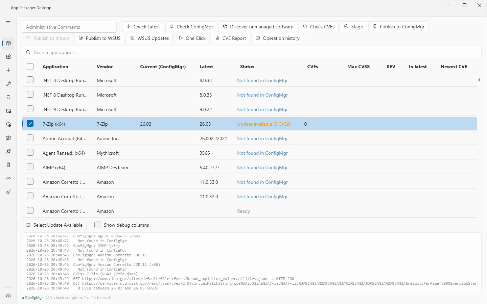
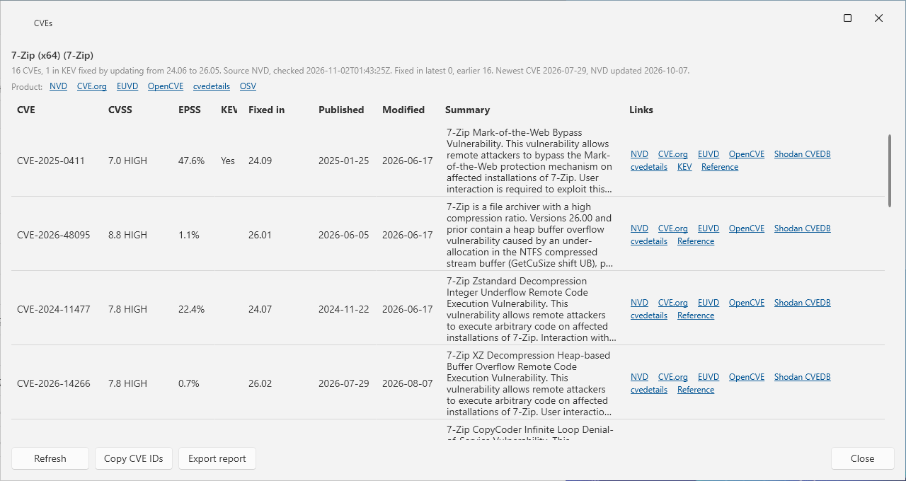
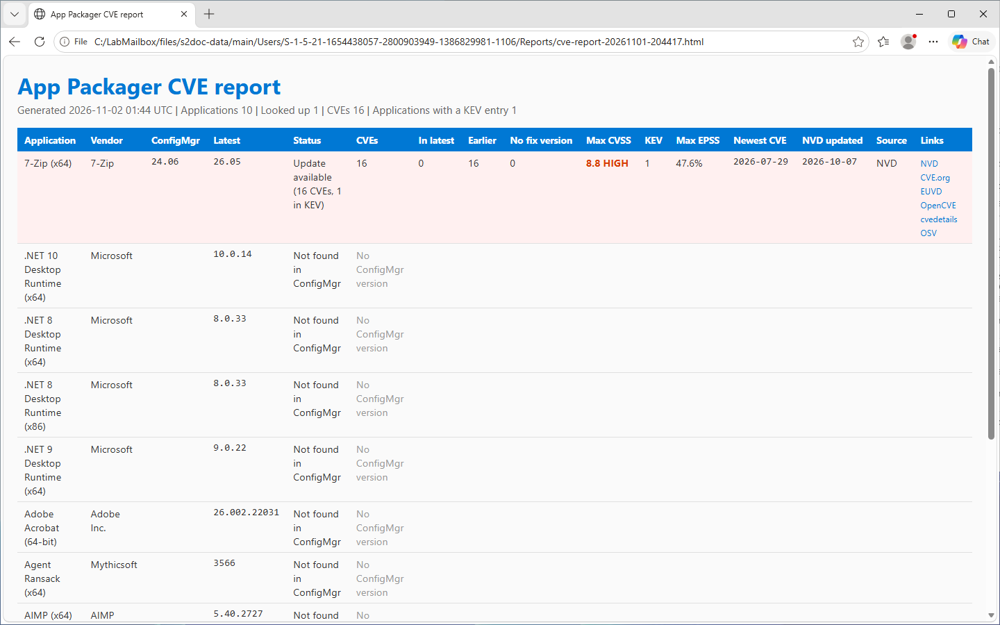

# CVE lookup

## What it does

**Check CVEs** looks up the CVEs that an update fixes. For each checked application, it takes the version in ConfigMgr and the latest vendor version. It lists the CVEs that affect the ConfigMgr version and do not affect the latest version.

The result shows in the App Packager grid, in the **CVEs** window, and in reports (**CVE Report**).

The data comes from NVD. When NVD does not answer, the lookup uses Shodan CVEDB and marks the result. EPSS scores come from FIRST. The CISA Known Exploited Vulnerabilities (KEV) catalog marks the CVEs that attackers use.

## When to use

- Use it to decide which application updates to package first.
- Use **CVE Report** to give a list of the CVEs to other people.
- Use the command line (`--cve-report`) to write the same reports from a scheduled task. See [Command-line build](command-line-build.md).

## Requirements

- A `Cpe` value in the definition of the application. 294 of the 319 shipped definitions have one. A row without a CPE shows `CPE missing`.
- The ConfigMgr version of the application. Run **Check ConfigMgr** first. See [App Packager page](packages.md).
- The latest vendor version. Run **Check Latest** first.
- A connection over https to `services.nvd.nist.gov`, `cvedb.shodan.io`, `api.first.org` and `www.cisa.gov`.
- Optional: an NVD API key.
- No local rights beyond write access to the data folder. The ConfigMgr rights are those of **Check ConfigMgr**. See [Permissions](../reference/permissions.md).

## Steps

### Look up the CVEs

1. Select **App Packager** in the sidebar.
2. Check the applications to look up.
3. Select **Check Latest**.
4. Select **Check ConfigMgr**.
5. Select **Check CVEs**.
6. Watch the progress. The status line shows `CVEs: <N> of <M> — <application>`. Select **Cancel** to stop.
7. Read the columns **CVEs**, **Max CVSS**, **KEV**, **In latest** and **Newest CVE**.

Instead of steps 4 and 5, you can select **Look up CVEs after Check ConfigMgr** in **Settings**, **CVE lookup**. **Check ConfigMgr** then starts the lookup for the checked applications when it ends.

A row gets a lookup only when it has a CPE, a ConfigMgr version and a latest version, and the ConfigMgr version is older than the latest version. Other rows show the reason in the **CVEs** cell and the log shows `Skipped: <reason>.`

### Read the grid

| Column | Content |
|---|---|
| **CVEs** | The number of CVEs that the update fixes, or the reason that there is none: `CPE missing`, `No ConfigMgr version`, `No latest version`, `No update`, `Error`. |
| **Max CVSS** | The highest CVSS score and its severity, for example `7.8 HIGH`. |
| **KEV** | `Yes` when at least one CVE is in the KEV catalog. |
| **In latest** | `<N> of <M>`. N is the number of CVEs whose fix version is the latest version. |
| **Newest CVE** | The publication date of the newest CVE. |
| **Max EPSS**, **NVD updated**, **CVEs Checked (UTC)** | Hidden by default. Select **Show debug columns** to show them. |

The **Status** column shows `Update available (<N> CVEs)` or `Update available (<N> CVEs, <M> in KEV)`. A column sorts by its number, not by its text.

A lookup that fails shows `Error`. It never shows a count of 0.

## Open the CVE window

1. Select the number in the **CVEs** cell of a row. Or right-click the row and select **Show CVEs...**.
2. Read the heading. It shows `<application> (<vendor>)`, the count, the version range, the source, the time of the check and the counts by fix version.
3. Read the list. The columns are **CVE**, **CVSS**, **EPSS**, **KEV**, **Fixed in**, **Published**, **Modified**, **Summary** and **Links**. KEV entries come first. Then the list is sorted by CVSS score, highest first.
4. Select a link to open it in your browser.
5. Select **Close**.

The window opens beside the main window. Each application has one window. A summary is cut after six lines. The tooltip shows the full text.

| Button | Effect |
|---|---|
| **Refresh** | Looks the CVEs up again and bypasses the cache. Needs a CPE, a ConfigMgr version and a latest version. |
| **Copy CVE IDs** | Copies the CVE IDs to the clipboard, one for each line. |
| **Export report** | Writes the report for this application and opens the HTML page. |
| **Close** | Closes the window. |

**Fixed in** is the end of the affected range that NVD records for the product. It is usually the vendor fix version. The vendor has not confirmed it.

### Links

The product links above the list are NVD, CVE.org, EUVD, OpenCVE, cvedetails and OSV. A **Vendor advisory** link shows when the definition names a security advisory page. The links of one CVE are NVD, CVE.org, EUVD, OpenCVE, Shodan CVEDB and cvedetails. A **KEV** link shows for a CVE in the catalog. A **Reference** link shows the first https reference of the CVE.

A link opens in your browser. App Packager Desktop sends no request to the linked site. Only an https address opens.

### Row menu

Right-click a row in the App Packager grid.

- **Show CVEs...** opens the window.
- **Open CVE Sources** shows a submenu with the product links.
- **Copy CVE IDs** copies the IDs of the last lookup. When no lookup exists, the log shows `No CVE lookup for this row yet. Run Check CVEs first.`

**Open CVE Sources** and **Copy CVE IDs** are disabled for a row without a CPE.

## CVE Report

1. Select **App Packager** in the sidebar.
2. Check the applications for the report. When no row is checked, the report covers all rows of the grid.
3. Select **CVE Report**.
4. The HTML page opens in your browser. The log shows the path of each file.

One run writes these files to the folder `Reports` in the data folder:

- `cve-report-<yyyyMMdd-HHmmss>.html`
- `cve-report-<yyyyMMdd-HHmmss>.json`
- `cve-report-<yyyyMMdd-HHmmss>.xlsx`
- `cve-report-<yyyyMMdd-HHmmss>.md`
- `cve-report-<yyyyMMdd-HHmmss>-applications.csv`
- `cve-report-<yyyyMMdd-HHmmss>-cves.csv`

The title of the report is `App Packager CVE report`. A row whose lookup failed, or whose lookup is not in the cache, carries a note. See [Data folders](../reference/data-folders.md).

## Options and settings

| Setting | Default | Effect |
|---|---|---|
| **NVD API key** (**Settings**, **CVE lookup**) | none | Optional. With a key, NVD allows 50 requests in 30 seconds. Without a key, NVD allows 5. The key is stored encrypted for the current Windows user. Leave the box empty to keep the saved key. |
| **Remove the saved key on Save** | off | Deletes the saved key when you select **Save Settings**. The box is disabled when no key is saved. |
| **Look up CVEs after Check ConfigMgr** | off | Starts the lookup after **Check ConfigMgr**. |

Without a saved key, the lookup uses the environment variable `NVD_API_KEY`. The key is never in a URL, a command line or a log.

The setting `Vulnerability.CacheTtlMinutes` has no control. The default is 360. See [Settings](../reference/settings.md).

## Requests and cache

The lookup sends these requests. The window or `AppPackagerBuild.exe` sends them over https. No other process does.

| Host | Request | When |
|---|---|---|
| `services.nvd.nist.gov` | CVE query for one product and version range | One query for each application with an update and no current cache entry. A page holds 2000 records. The lookup reads at most 10 pages. |
| `cvedb.shodan.io` | CVE query for one product version | Only when the NVD query failed. One query for the installed version and one for the latest version. |
| `api.first.org` | EPSS scores for the CVE IDs found | One request for each 100 IDs |
| `www.cisa.gov` | KEV catalog | One time in 24 hours |
| The webhook host that you set | Run summary | `--cve-report` only |

- NVD answers 403, 429 or 503 when it limits the rate. The lookup waits and tries again, up to two more times. The log shows `WARNING: NVD answered <code>; retry <N> of 2`.
- When NVD holds more than 10 pages for a product, the source text reads `NVD (incomplete: ...)`.
- A cache entry answers for 360 minutes, or 60 minutes for a Shodan result. **Refresh** bypasses the cache. Entries older than 14 days are deleted. A failed lookup is not cached.
- The cache file is `Vulnerability\vuln-cache.json`. The KEV copy is `Vulnerability\kev-catalog.json`. Both are in the data folder.
- A response larger than 64 MiB fails. A request follows at most 3 redirects.

## Command line

`AppPackagerBuild.exe --cve-report` checks the vendor versions, reads the ConfigMgr versions, looks up the CVEs and writes the reports. It uses the same cache.

| Option | Effect |
|---|---|
| `--apps <a,b,...>` | Application IDs or file names. The default is all. |
| `--skip-latest`, `--skip-mecm`, `--skip-cve` | Omit the vendor query, the ConfigMgr query, or the CVE lookup. The report shows the stored values and marks them. |
| `--report-folder`, `--report-formats`, `--drop-folder` | Folder, formats (`Html`, `Csv`, `Json`, `Xlsx`, `Markdown`) and a second folder for copies. |
| `--webhook-url <https url>` | Posts the run summary. An http address is refused. |
| `--notify-always`, `--keep-report-days <n>`, `--config <file>` | Notification, report retention (default 90 days) and the monitor configuration. |

The exit code is 1 when a vendor query, a ConfigMgr query or a CVE lookup failed. See [Command-line build](command-line-build.md).

## Limits

- The lab validated the CVE lookup, the CVE reports, the command-line CVE report run and the ConfigMgr title lookup.
- In the lab, **Open CVE Sources** opened the NVD, CVE.org, EUVD, OpenCVE, cvedetails and OSV pages in a browser. The lab read the first screen of each page only.
- In the lab, the columns **CVEs** and **Max CVSS** sorted by number. The lab did not verify the order of 10.0 against 9.8.
- `--skip-mecm` with other switches was not verified.
- The lookup counts a CVE only when the NVD record affects Windows. It ignores records for other platforms.

## Troubleshooting

| Message | Cause | Fix |
|---|---|---|
| `No packagers selected.` | No row is checked. | Check a row. |
| `Skipped: CPE missing.` | The definition has no `Cpe`. | Use another application, or add a `Cpe` to a user definition. See [Definitions](definitions.md). |
| `Skipped: No ConfigMgr version.` or `Skipped: No latest version.` | **Check ConfigMgr** or **Check Latest** found no version. | Run the check. |
| `Skipped: No update.` | The ConfigMgr version is not older than the latest version. | None. No update exists. |
| `ERROR: NVD and Shodan CVEDB both failed: ...` | Both sources failed. | Read the rest of the message. Check the internet access. Run the lookup again. |
| `ERROR: NVD failed and Shodan CVEDB has no record of the product at <version>: ...` | NVD failed, and Shodan has no record. | Run the lookup again later. |
| `Request failed: HTTP <code>: <url>` | A source refused the request. | For 403 or 429, wait or enter an **NVD API key**. |
| `Request failed: no answer in <N>s: <url>` | A source did not answer in time. | Check the internet access. |
| `Request refused: not an https URL: <url>` | A request used a URL that is not https. | None. The lookup refuses it. |
| `Refresh needs a CPE, a ConfigMgr version and a latest version.` | The row lacks a value. | Run **Check ConfigMgr** and **Check Latest**. |
| `Another run is in progress. Wait for it to finish.` | Another operation runs. | Wait. |
| `The lookup failed; the last good result is shown. See the log.` | **Refresh** failed. | Read the log. |
| `Not checked. Run Check ConfigMgr, Check Latest and Check CVEs for this application.` | The window has no result for this version pair. | Run the three checks. |
| `Link not opened (not https): <url>` | The link is not https. | None. |
| `CVE report failed: <message>` | The report folder is not writable. | Check the data folder. |
| `CVE report not opened: <message>` | Windows could not open the HTML file. | Open the file from the folder. |

## Links

- [Known Exploited Vulnerabilities Catalog](https://www.cisa.gov/known-exploited-vulnerabilities-catalog): Lists the CVEs that attackers are known to use.
- [Exploit Prediction Scoring System (EPSS)](https://www.first.org/epss/): Describes EPSS and the meaning of its scores.
- [FIRST.Org REST API: GET /epss](https://api.first.org/epss/): Documents the API call that returns EPSS scores.
- [Common Vulnerability Scoring System SIG](https://www.first.org/cvss/): Describes CVSS, the base of the severity score.
- [OpenCVE Documentation](https://docs.opencve.io/): Documents the OpenCVE service that the CVE window links to.
- [Introduction to OSV](https://google.github.io/osv.dev/): Introduces the OSV vulnerability database that the CVE window links to.
