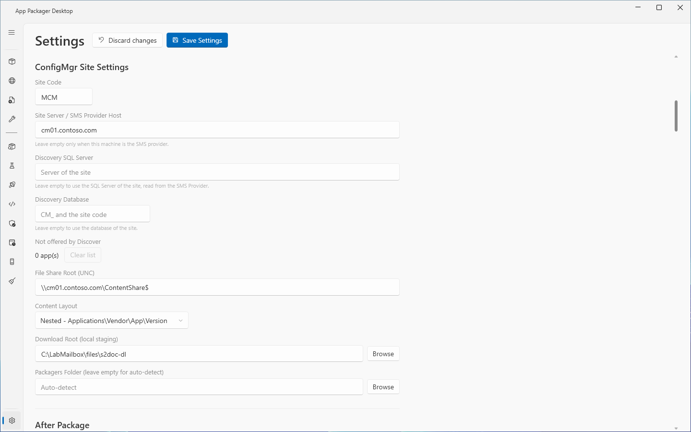

# Discover unmanaged software

## What it does

**Discover unmanaged software** finds applications that your clients have installed and that ConfigMgr does not manage. It reads the Add/Remove Programs inventory in the ConfigMgr site database. It offers an application when at least one client reports it and the site has no ConfigMgr application for it.

An application that you accept appears in the App Packager grid. You can then use **Check Latest**, **Check ConfigMgr**, **Stage** and the publish buttons on it.

Discover shows counts only. It never shows or stores a client name.

## When to use

- Use Discover to find the software that clients run and that nobody has packaged for ConfigMgr yet.
- Use it after hardware inventory ran on new clients.
- Discover considers only applications that are hidden in the [Catalog](applications.md). Hide the applications that you want Discover to consider.

## Requirements

- ConfigMgr selected under **Systems in use** in Settings.
- A **Site Code** in **ConfigMgr Site Settings**, or both **Discovery SQL Server** and **Discovery Database**. The default Site Code is `MCM`. Save your own Site Code before you use Discover.
- Windows PowerShell 5.1. Discover runs its query through `powershell.exe`.
- A domain account on a domain-joined computer. A computer outside the domain cannot sign in to the database.
- The role `db_datareader` on the site database `CM_<site code>` for that account. Discover uses Windows authentication only.
- Hardware inventory that collects the Add/Remove Programs classes.
- The ConfigMgr console is not needed. Discover reads the database over SQL.

The rights of each page are in [Permissions](../reference/permissions.md).

The database views bypass the role-based access of ConfigMgr. The scan counts all clients, whatever scope your console role has.

## Steps

### Set up Discover

1. Select **Settings** in the sidebar.
2. Go to **ConfigMgr Site Settings**.
3. Check **Site Code** and **Site Server / SMS Provider Host**.
4. Optional: enter **Discovery SQL Server**. Enter the SQL Server instance of the site database, for example `sqlserver.example.com` or `server\instance`.
5. Optional: enter **Discovery Database**, for example `CM_MCM`.
6. Select **Save Settings**.

With both optional boxes empty, Discover reads the SQL Server name and the database name from the SMS Provider. It uses DCOM first and WinRM second. When you fill both boxes, Discover needs no site code and no provider. When a site code is missing, fill both boxes.

### Find the applications

1. Select **App Packager** in the sidebar. Select **Catalog**. Clear the check box of each application that Discover must consider. Select **Save**.
2. Close the Catalog.
3. Select **Discover unmanaged software**.
4. Wait for the scan. The status line shows `Reading Add/Remove Programs inventory from the ConfigMgr site database...`. Select **Cancel** to stop the scan.
5. Read the status line and the log. They show the number of clients, the age of the newest data and the number of applications that Discover found.
6. If Discover found applications, read the prompt. The prompt title is **Discover unmanaged software**. The text is `Discovered <N> apps. Enable console view?`.
7. Check the applications in the list. The columns are **Application**, **Vendor** and **Clients**. The list is sorted by the number of clients, highest first. Press Space to check or clear the selected row.
8. Select one of the four buttons.

| Button | Effect |
|---|---|
| **Enable selected** | Shows the checked applications in the App Packager grid. |
| **Enable all** | Shows every application of the list in the App Packager grid. |
| **Not now** | Closes the prompt and changes nothing. The next scan offers the applications again. |
| **Don't ask again for selected** | Keeps the checked applications hidden. Later scans leave them out. |

When you select **Enable selected** or **Don't ask again for selected** and no row is checked, the prompt stays open and changes nothing. The note line shows `Check at least one app, or click Enable all.` or `Check the apps to leave out of later discoveries. Nothing changed.`

After **Enable selected** or **Enable all**, the log shows `<N> app(s) added to the grid. Show or hide them with Catalog on the App Packager page.` Enabling an application only shows its row. Select **Check ConfigMgr** to see its real state.

### Offer the dismissed applications again

1. Select **Settings** in the sidebar.
2. Go to **ConfigMgr Site Settings**.
3. Read **Not offered by Discover**. It shows `<N> app(s)`.
4. Select **Clear list**. The text changes to `0 app(s) after Save`.
5. Select **Save Settings**.

## How the match works

- A definition names its Add/Remove Programs entry with `ArpName`. The value is one or more wildcard patterns, separated by ` | `. The value `none` means that the application has no stable entry. The optional `ArpVersion` and `ArpArch` fields narrow the match by version and by architecture. 295 of the 319 shipped definitions carry a pattern.
- Discover reads these database views: `v_GS_ADD_REMOVE_PROGRAMS`, `v_GS_ADD_REMOVE_PROGRAMS_64`, `v_R_System`, `v_Applications` and `v_ConfigurationItems`. It ignores obsolete and decommissioned clients.
- Some applications share one name with a sibling: Citrix Workspace CR and LTSR, QGIS and QGIS LTR, NVIDIA GeForce and RTX Enterprise, and the Microsoft 365 Apps x64 and x86 editions with Project and Visio. Discover cannot tell which variant a client runs. It offers one application of each group and never offers its siblings.
- An application counts as managed when a current ConfigMgr application title starts with its ConfigMgr name, and the rest is a version or a detail in parentheses. A title with another installer method (EXE or MSI) or another architecture does not count. **Check ConfigMgr** uses the same rule.
- Discover offers an application only when it is hidden, not dismissed, has an `ArpName` other than `none`, and matches at least one inventory row.

## Options and settings

| Setting | Default | Effect |
|---|---|---|
| **Discovery SQL Server** | empty | Empty means the SQL Server of the site, read from the SMS Provider. |
| **Discovery Database** | empty | Empty means the database of the site, `CM_<site code>`. |
| **Not offered by Discover** | empty | The applications that Discover no longer offers. **Clear list** empties it when you select **Save Settings**. |

Discover also changes two lists in `settings.json`: `DiscoveryDismissed` and `DiscoveryEnabled`. The settings file stores no credential. See [Settings](../reference/settings.md).

The SMS Provider for the site lookup comes from these places, in this order: **Site Server / SMS Provider Host**; the environment variable `SUITE_CM_PROVIDER`; the CMSite drive that has the name of the site code; the first CMSite drive.

## Limits

- A scan stops after 600 seconds, when you select **Cancel**, and when you close the main window. The connection to SQL Server has a limit of 30 seconds.
- Discover sends no request to the internet. It connects to the SMS Provider (CIM over DCOM, then WinRM) and to the site database (SQL Server, Windows authentication, read only).
- Discover reads inventory that clients have reported. When the inventory has no rows, it reports `No inventory data`.
- Discover offers one application of each sibling group. See above.
- Discover reports the inventory of all clients, not only the clients in your security scope.

## Troubleshooting

All messages in the log and in the status line start with `Discover unmanaged software:`.

| Message | Cause | Fix |
|---|---|---|
| The button is disabled. The tooltip reads `ConfigMgr is not in use...` or `Set the site code, or the SQL server and database, in Settings, ConfigMgr Site Settings.` | ConfigMgr is not in use, or the site code and the SQL boxes are empty. | Fix the setting that the tooltip names. |
| `A site code or SQL overrides are required...` | No site code and no SQL override. | Enter a site code, or both SQL boxes. |
| `The site code <x> is not three letters or digits...` | The site code is not three characters. | Correct the **Site Code**. |
| `The SQL Server for site <x> is not known (<reason>). Enter the SQL Server name in Settings, ConfigMgr Site Settings.` | The provider did not return the site definition, or no provider is set. | Enter **Discovery SQL Server** and **Discovery Database**. |
| `Windows PowerShell could not start. Discover needs Windows PowerShell 5.1 (powershell.exe).` | `powershell.exe` is not available. | Install or repair Windows PowerShell 5.1. |
| `SQL Server on <s> denied the Windows login. The account needs the db_datareader role on <db>.` | SQL Server refused the login. | Give the account `db_datareader` on the database. |
| `Windows authentication to SQL Server <s> failed. Run the app as a domain account on a domain-joined computer...` | Windows authentication failed. | Run the app as a domain account on a domain-joined computer. Check the service principal name of the SQL Server. |
| `SQL Server on <s> received an anonymous login...` | The credentials did not pass a second remoting hop. | Run the scan from a session that holds your own logon. |
| `Cannot reach SQL Server <s>. Check the server name, the network path and the SQL Server firewall port.` | No connection. | Check the name, the network path and the firewall. |
| `Database <db> does not exist on SQL Server <s>, or the Windows login cannot open it. Check the database name.` | Wrong database name or no access. | Correct **Discovery Database**. |
| `The Windows login cannot read the inventory views in <db> on <s>...` | The account cannot read the views. | Give the account `db_datareader` on the database. |
| `SQL Server <s> did not answer within <N> seconds.` | The query timed out. | Check the load of the SQL Server. Run Discover again. |
| `The scan stopped after <N> seconds.` or `the query did not finish within 600 seconds and was stopped.` | The scan reached its time limit. | Run Discover again. |
| `No inventory data: the site database has no Add or Remove Programs rows...` | Hardware inventory does not collect Add/Remove Programs. | Enable the Add/Remove Programs classes in hardware inventory. |
| `the settings could not be saved. Nothing changed.` | `settings.json` could not be written. | Check the data folder. See [Data folders](../reference/data-folders.md). |

## Links

- [Introduction to hardware inventory](https://learn.microsoft.com/intune/configmgr/core/clients/manage/inventory/introduction-to-hardware-inventory): Explains hardware inventory.
- [How to configure hardware inventory in Configuration Manager](https://learn.microsoft.com/intune/configmgr/core/clients/manage/inventory/configure-hardware-inventory): Shows how to configure hardware inventory.
- [Introduction to software inventory in Configuration Manager](https://learn.microsoft.com/intune/configmgr/core/clients/manage/inventory/introduction-to-software-inventory): Explains software inventory.
- [Windows Installer Properties for the Uninstall Registry Key](https://learn.microsoft.com/windows/win32/msi/uninstall-registry-key): Lists the Uninstall registry values that Windows Installer writes.
