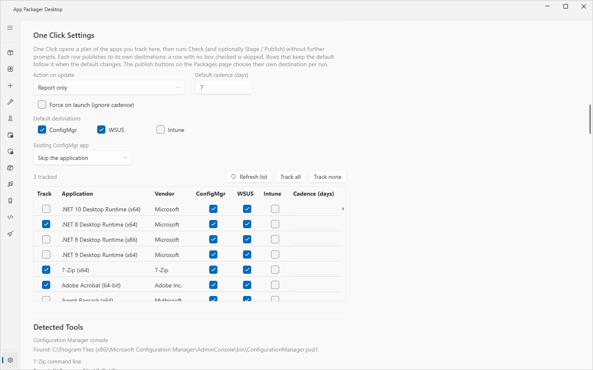
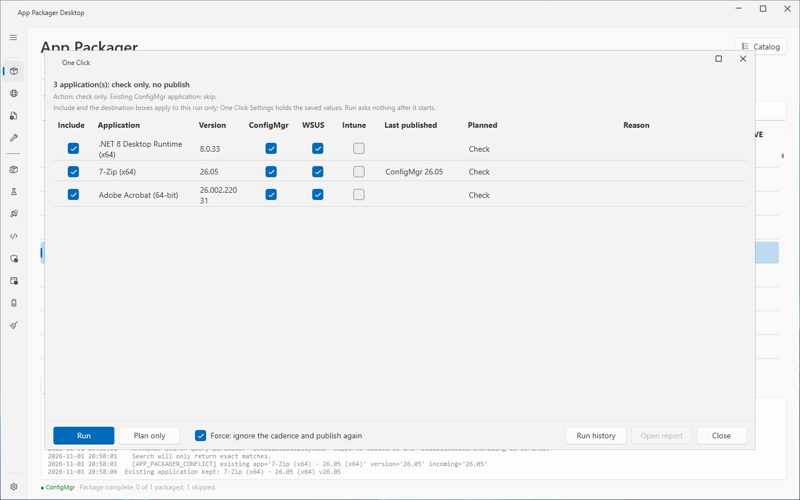

# One Click

## What it does

One Click checks the applications that you track. For each application with a new version, it does the action that you set: **Report only** lists the new version, **Stage** stages the application, and **Stage and Publish** stages the application and publishes it to the destinations of that application (ConfigMgr, WSUS and Intune). The plan window shows the work before it starts. After a run, One Click writes a report with a rollback section.

You set the tracked applications, the action and the default destinations once in Settings. Each later run needs one window.

## When to use

- Use One Click to keep a fixed set of applications current with one operation.
- Use the action **Report only** to find out which tracked applications have a new version. Nothing is staged or published.
- Use the publish buttons of the [App Packager page](packages.md) to publish a single application or a one-time selection.

## Requirements

- At least one tracked application. See the first steps below. A tracked application must be visible in the App Packager grid.
- For **Stage** and **Stage and Publish**: a **Download Root** in Settings.
- For each publish destination: the destination must be in use and set up. The plan names a destination that is not ready.

| Destination | Ready when |
|---|---|
| ConfigMgr | ConfigMgr is under **Systems in use**, the ConfigMgr console is on this computer, and **Site Code** and **File Share Root** are set. |
| WSUS | WSUS is under **Systems in use** and **WSUS server** is set. See [WSUS publishing](wsus-publishing.md). |
| Intune | Intune is under **Systems in use** and **Tenant ID**, **Client ID** and **Client Secret** are set. |

The rights of each destination are in [Permissions](../reference/permissions.md).

## Steps

### Set up One Click

1. Select **Settings** in the sidebar.
2. Go to the section **One Click Settings**.
3. Select the **Action on update**: **Report only**, **Stage** or **Stage and Publish**.
4. Check **Default destinations**: **ConfigMgr**, **WSUS** and **Intune**.
5. Select **Existing ConfigMgr app**: **Skip the application** or **Overwrite it**.
6. In the grid, check **Track** for each application to track. Use **Track all** or **Track none** to change all rows. Use **Refresh list** to rebuild the list from the applications that the App Packager page shows.
7. Optional: change the check boxes **ConfigMgr**, **WSUS** and **Intune** of one row. A row with its own choice does not follow the default. A row with no box checked is skipped.
8. Optional: enter **Cadence (days)** for one row.
9. Select **Save Settings**.

### Plan and run

1. Select **App Packager** in the sidebar.
2. Optional: enter text in **Administrative Comments**. A publish to ConfigMgr uses this comment.
3. Select **One Click**. The **One Click** window opens.
4. Read the summary line, the action line, the scope line and the grid. A line that starts with `Not ready:` names a destination that cannot take a publish.
5. Optional: clear **Include** for a row, or change the destination boxes of a row. These changes apply to this run only.
6. Optional: select **Plan only** to write the plan as a report without a run.
7. Select **Run**.
8. Wait for the run. The summary line shows `Running: <N> application(s)`. Select **Cancel** to stop the run.
9. Read the result columns. The summary line ends with `Complete: <N> published, <N> failed. Report: <file>`.
10. Select **Open report** to open the report. Select **Run history** to open the folder of all reports.
11. Select **Close**.

After a run, **Run** and **Plan only** stay disabled in that window. Close the window and open it again for the next run.

## What the plan shows

| Column | Content |
|---|---|
| **Include** | Whether the row takes part in the run. |
| **Application**, **Version** | The application and the latest version that the app knows. |
| **ConfigMgr**, **WSUS**, **Intune** | The destinations of the row for this run. |
| **Last published** | The version last published to each destination, for example `ConfigMgr 26.03`. |
| **Planned** | The steps: `Check`, `Stage`, `Publish to <destinations>`, or `Skip`. |
| **Reason** | Why the plan leaves a row or a destination out. |

During a run the columns change. The destination boxes, **Last published** and **Planned** give way to **Step** and one result column for each destination in use: **ConfigMgr result**, **WSUS result**, **Intune result**.

The plan leaves a row or a destination out for these reasons:

- `no destination selected`.
- `checked within the <N>-day cadence`. Only a **Report only** run without Force applies this rule.
- `<destination>: <reason>`. The destination is not ready.
- `<destination>: not supported`. The definition declares that WSUS cannot take the application, or the destination refused this version before.
- `<destination>: published <version> is newer than <latest>` or `site version <version> is newer than <latest>`. One Click does not publish an older build over a newer one.
- `<destination>: <version> already published`.

## Rules of a run

- After you select **Run**, One Click asks no more questions. The exception is the local installer source below.
- For each application, One Click checks the vendor version first. A failed check gives the status `Check error` and the outcome `Failed`.
- When the vendor reports an older version than the one seen before, the row gets the status `Vendor older than last seen` and the outcome `Skipped`.
- **Report only** ends with the outcome `Checked`. The reason is `update available` or `up to date`.
- **Stage** and **Stage and Publish** stage the application with the saved install parameters. They show no review dialog.
- A publish goes to ConfigMgr first, then to WSUS, then to Intune.
- When a destination refuses an application, One Click remembers the refusal until the version changes.
- When the ConfigMgr application was created but the content distribution or the test deployment failed, the row is Failed and the inventory records the ConfigMgr destination as Partial. The application exists, so the version counts as published and the next run skips it. To run the steps again, select **Force** together with **Existing ConfigMgr app** set to Overwrite, or distribute the content in the ConfigMgr console.
- One Click publishes again when the Workbench profile or the signing policy changed after the last publish.
- **Force: ignore the cadence and publish again** ignores the cadence, the refusal memory and the already-published guard. It does not override **Existing ConfigMgr app**. It does not override a destination that is not ready.
- When an application needs a local installer folder and none is set, a prompt asks for the folder before the run starts. The prompt text is `Choose the folder that holds the <application> installer. Its download requires a sign-in, so it stages from a local copy.` A cancelled prompt removes the row from the run with the reason `no local source folder`.
- The Workbench profile of an application decides the build. See [Workbench](workbench.md).

### Outcomes

| Outcome | Meaning |
|---|---|
| `Published` | At least one destination published and none failed. |
| `Staged` | The application is staged. No destination took a publish. |
| `Checked` | A **Report only** run checked the version. |
| `Skipped` | Nothing was published and nothing failed. |
| `Not supported` | Nothing was published and WSUS refused the application. |
| `Failed` | A step failed. |
| `Planned` | The row is in a plan report only. |

The status of the row in the App Packager grid shows `Published`, `Published, partial`, `Publish error`, `WSUS: not supported` or `Skipped`.

## The report

Each run and each **Plan only** writes two files: `one-click-<yyyyMMdd-HHmmss>.md` and `one-click-<yyyyMMdd-HHmmss>.json`. A name clash adds `-2`, `-3` and so on. The folder is `Logs\OneClick` under `%LOCALAPPDATA%\SRLPackr`. See [Data folders](../reference/data-folders.md).

The Markdown report has these parts: a table with Started, Ended, Operator, Computer, Action, the counts of applications, published, not supported, skipped and failed; `## Scope`; `## Applications`; `## Details` with the full refusal and failure text; `## Rollback`.

The scope text of each destination:

- ConfigMgr: `application only, no distribution, no deployment`. With **Distribute content after Package** and a **Distribution point group**, it names the group. With a test collection, it names the collection.
- WSUS: `published, not approved`, or `approved for group <group>`.
- Intune: `app created, not assigned`.

The rollback text of each destination:

- ConfigMgr: `retire the application named in the ConfigMgr column.`
- WSUS: `expire the package ID in the WSUS column from WSUS Updates.`
- Intune: `unassign the app ID in the Intune column in the Intune admin center.`

## Options and settings

All settings are in **Settings**, **One Click Settings**. See [Settings](../reference/settings.md).

| Control | Default | Effect |
|---|---|---|
| **Action on update** | **Report only** | **Report only** lists newer versions. **Stage** downloads and prepares them. **Stage and Publish** also publishes to the destinations. |
| **Default cadence (days)** | 7 | The days a version check stays fresh. The control accepts 1 to 365. A **Report only** run skips a tracked application that was checked more recently. |
| **Force on launch (ignore cadence)** | off | The plan opens with Force set. |
| **Default destinations** | **ConfigMgr** | The destinations of every tracked application that has no choice of its own. Rows that keep the default follow it when the default changes. |
| **Existing ConfigMgr app** | **Skip the application** | What a run does when the ConfigMgr application exists with another version. |
| **Track** grid | no application | The tracked applications. |
| **Cadence (days)** (row) | empty | Days for this application only. Empty uses the default cadence. |

In the plan window, **Include** and the destination boxes apply to this run only.

## Limits

- The lab validated the skip and republish rules on a lab site. A second run without a change skipped every application. A new profile revision made the next run stage the application again.
- In the lab, a run with Force on sent every row to its destinations again. The ConfigMgr policy **Skip the application** and the state of the WSUS server still decided the result. Nothing new was published.
- One Click publishes to Intune through the same service as **Publish to Intune**. Intune publishing is tested against simulated Graph responses only.
- The plan does not show a pending change of the Workbench profile. It can show `ConfigMgr: <version> already published` for a row that the run then stages again.
- The lab did not verify a run with Force on that publishes to a real WSUS server.

## Troubleshooting

| Message | Cause | Fix |
|---|---|---|
| Dialog **One Click Not Configured**: `No apps are tracked yet.` | No application is tracked. | Track applications in **Settings**, **One Click Settings**. Select **Save Settings**. |
| `Download Root is required for action '<action>'. Open Settings.` | The action stages, and **Download Root** is empty. | Set **Download Root** in Settings. |
| `No tracked apps are visible in the grid.` | The tracked applications are hidden in the [Catalog](applications.md). | Show the applications. |
| `Not ready: <destination>: <reason> (<N> application(s) select it)` | A destination is not in use or not set up. | Set up the destination. See the table under Requirements. |
| `WSUS: not supported` in the **Reason** column | The definition declares that WSUS cannot take the application. | See [WSUS publishing](wsus-publishing.md). Clear the **WSUS** box of the row. |
| `skipped: application <name> already exists` with `ConfigMgr: application exists, policy Skip` | The ConfigMgr application exists and **Existing ConfigMgr app** is **Skip the application**. | Select **Overwrite it** to replace the deployment types. |
| `One Click skipped: another operation is running.` | Another operation of the App Packager page is running. | Wait for it. Run One Click again. |
| `failed: WSUS rejected the package: Execution Timeout Expired...` | The WSUS database did not answer in time. | Run the database maintenance of the server. See [WSUS publishing](wsus-publishing.md). |
| `run snapshot not created` or `run snapshot refused: <reason>` | The Workbench cannot resolve the application or the profile. | Open the application in the [Workbench](workbench.md). Read the findings. |

## Links

- [Create applications in Configuration Manager](https://learn.microsoft.com/intune/configmgr/apps/deploy-use/create-applications): Describes how to create an application with deployment types, detection methods and dependencies.
- [Deploy applications with Configuration Manager](https://learn.microsoft.com/intune/configmgr/apps/deploy-use/deploy-applications): Shows how to deploy an application to a collection and set the purpose.
- [Deploy and manage content for Configuration Manager](https://learn.microsoft.com/intune/configmgr/core/servers/deploy/configure/deploy-and-manage-content): Explains how to distribute, update, redistribute and validate content.
- [Add, Assign, and Monitor a Win32 App in Microsoft Intune](https://learn.microsoft.com/intune/app-management/deployment/add-win32): Shows how to add a Win32 app, set its detection rules and assign it.
