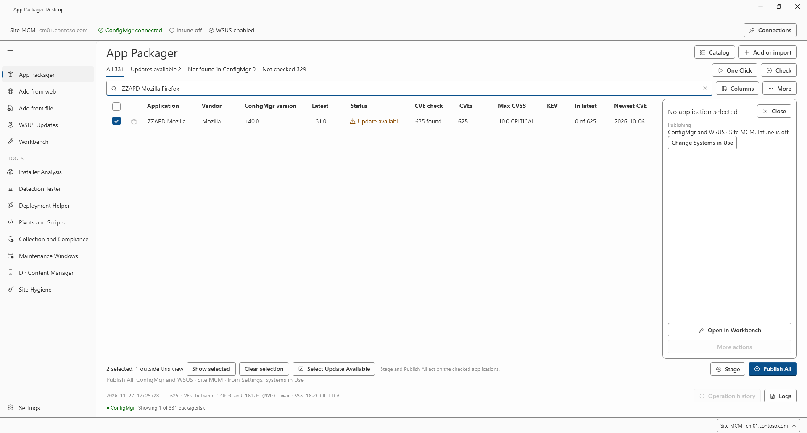
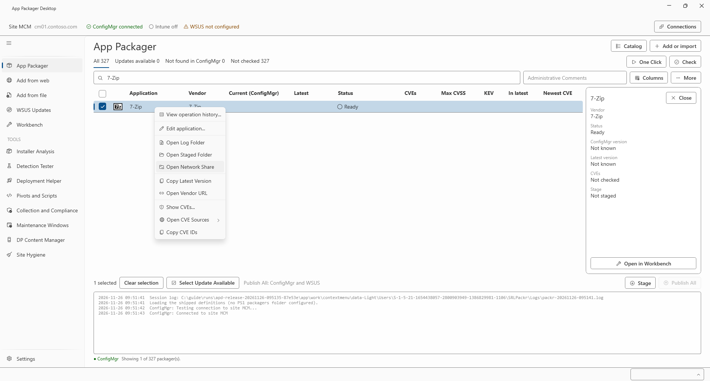
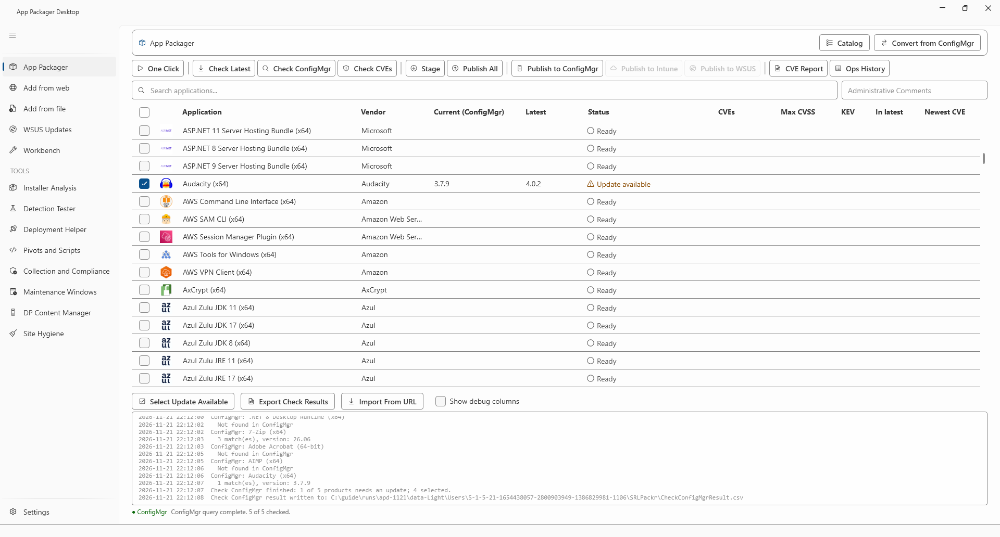
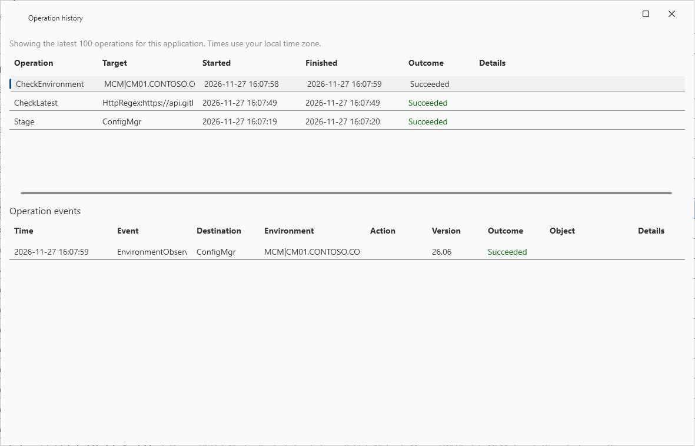
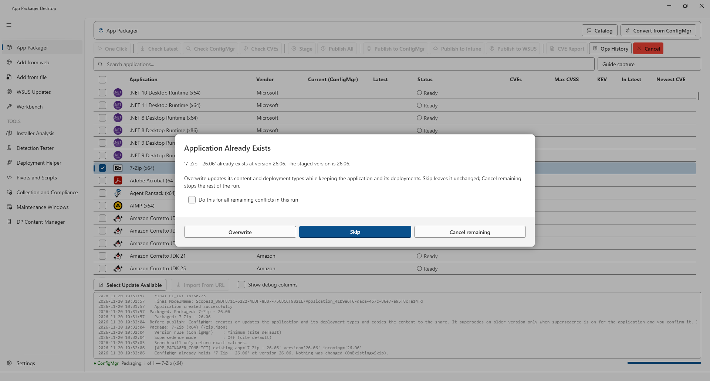
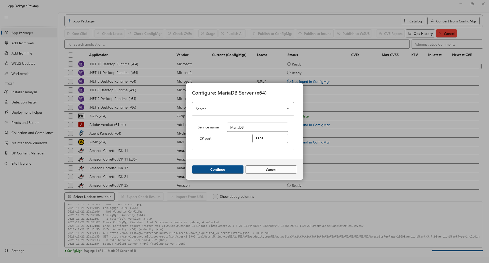

# App Packager grid reference

## What it does

This page describes the parts of the [App Packager page](packages.md): the grid columns, the **Status** values, the row context menu, the log, the status line, the **Operation history** window and the dialogs that the page opens.

## When to use it

Use this page to find the meaning of a column, a status, a menu entry or a log line.

## Requirements

None. Some entries need the settings that [App Packager page](packages.md) names.

## Grid columns

Select a column header to sort the grid. Drag a column header to move the column, or drag its edge to change its width. The first column stays in place when the grid scrolls sideways. The app saves the column order, the widths that you set and the sort. The menu **Columns** hides and shows every column except the check box, the icon and **Application**. A new installation shows **ConfigMgr version**, **Latest**, **Status** and **CVE check**. An installation from an earlier version keeps the columns that it showed. **Compact view** shows the columns of a new installation and keeps your order, widths and sort. **Reset columns** shows the columns of a new installation, in the first order, with the first widths and no sort.

| Column | Content | Shown |
|---|---|---|
| (check box) | Marks the row for the next operation. The header check box cycles each time you select it: it checks every visible row, then shows a dot and leaves only the visible rows that have an update checked, then unchecks the visible rows. A checked row that the view hides stays checked. Each step writes a line to the log. | Always |
| **Application** | Name of the application. | Always |
| **Vendor** | Vendor name. | **Columns** |
| **ConfigMgr version** | Version in ConfigMgr from the last **Check ConfigMgr**. After a reload, the last stored version. | New installations, **Columns** |
| **Latest** | Vendor version from the last **Check Latest**. After a reload, the last stored version. | New installations, **Columns** |
| **Status** | Result of the last operation on the row. A tooltip can hold more text. | New installations, **Columns** |
| **CVE check** | The CVE state in one text: `<N> found`, `Not checked`, `CPE missing`, `No site version`, or the reason why the last lookup gave no number. | New installations, **Columns** |
| **CVEs** | Number of CVEs, or `CPE missing`, `Error` or `No update`. Select the cell to open the CVE list with links. | **Columns** |
| **Max CVSS** | Highest CVSS score of the CVEs. | **Columns** |
| **KEV** | `Yes` when at least one CVE is in the CISA KEV catalog. | **Columns** |
| **In latest** | `N of M`: the number of CVEs that NVD places at the latest version, out of all CVEs. | **Columns** |
| **Newest CVE** | Publication of the newest CVE. | **Columns** |
| **Max EPSS** | Highest EPSS value. | **Columns**, or **More**, **Show debug columns** |
| **NVD updated** | Time of the last NVD update. | **Columns**, or **More**, **Show debug columns** |
| **CVEs Checked (UTC)** | Time of the CVE lookup, in UTC. | **Columns**, or **More**, **Show debug columns** |
| **CMName** | Name that **Check ConfigMgr** uses to find the application. | **Columns**, or **More**, **Show debug columns** |
| **Script** | File name of the definition, or of the PS1 packager. | **Columns**, or **More**, **Show debug columns** |
| **Intune** | Outcome of the Intune build and publish in the last publish run. | **Columns**, while Intune is selected under Systems in Use |

The columns **CVEs**, **Max CVSS**, **In latest** and **Max EPSS** sort by number. The CVE columns are explained in [CVE lookup](cve-lookup.md).

The check box in the first column and the highlighted row are two states. The check box marks a row for an operation. The highlighted row is the row you selected. The detail pane, **More**, **Operation history...**, **Edit application...** and the other context menu entries act on the highlighted row.

The status tabs, the selection line and the detail pane are described in [App Packager page](packages.md).

## Status values

The color of the status text follows the value. Green: **Staged**, **Packaged**, **Up to date**, **Latest retrieved**, **ConfigMgr version retrieved**. Amber: **Update available**. Blue: **Not found in ConfigMgr**, **Current newer**. Red: a value that contains `error`. Gray: all other values.

| Status | Meaning |
|---|---|
| **Ready** | Start value of a row. |
| **Cached** | The list loaded and a vendor version is stored for the row. |
| **Checking latest...** | **Check Latest** is working on the row. |
| **Latest retrieved** | **Check Latest** found a vendor version. |
| **Querying ConfigMgr...** | **Check ConfigMgr** is working on the row. |
| **Up to date** | The ConfigMgr version equals the vendor version. |
| **Current newer** | The ConfigMgr version is newer than the vendor version. |
| **Update available** | The ConfigMgr version is older than the vendor version. After a CVE lookup the text is `Update available (N CVEs, M in KEV)`. |
| **ConfigMgr version retrieved** | ConfigMgr has the application, and no vendor version is known. |
| **Not found in ConfigMgr** | ConfigMgr answered, and the application is not there. |
| **Error** | **Check Latest** found no version or failed, or **Check ConfigMgr** failed. The log holds the reason. |
| **Cancelled** | You cancelled the operation while the row was working. |
| **Staging...**, **Staged** | **Stage** is working, or **Stage** succeeded. |
| **Stage error** | **Stage** ended with an exit code other than 0. The row stays checked. |
| **Skipped** | The row was left out. The reason is a canceled **Configure** dialog, an existing application that you kept, or a local source folder that you did not choose. |
| **Packaging...**, **Packaged** | A **Publish All** run with ConfigMgr in use is working, or it succeeded. |
| **Package error** | The ConfigMgr publish ended with an exit code other than 0. |
| **Published**, **Publish error** | The Intune-only publish succeeded, or the Intune-only or WSUS-only publish failed. A WSUS-only success reads **Published (updates only)**. |
| **Published (updates only)**, **Already on the server (updates only)**, and the same with **, warning** | The WSUS publish succeeded, the WSUS update for this version existed already, or a follow-up step gave a warning. A WSUS update applies only where the detection finds an older version of the application, so WSUS cannot give a first install of it. |
| `not supported: <codes>` | WSUS refused the application. See [WSUS publishing](wsus-publishing.md). |
| **Applying supersedence...**, **Supersedence applied**, **No older version**, **Supersedence not applied**, **Supersedence not run** | A [One Click](one-click.md) run does the supersedence pass for a version that is on the site: it is working, it set the relations, it found no older version, the step failed (the version stays pending), or the mode is `Off`. |

A WSUS run that follows a ConfigMgr publish adds a suffix such as `, WSUS not supported`, `, WSUS failed` or `, WSUS warning`. The One Click statuses are in [One Click](one-click.md). **Check Latest** sets no tooltip. A WSUS publish sets the tooltip text of the **Status** cell. The spelling **Canceled** (one l) also appears in a publish status. It comes from the internal name of the outcome.

## Row context menu

A right-click selects the row and opens the menu. The button **More actions** in the detail pane opens the same menu for the row of the pane.

| Entry | Effect |
|---|---|
| **View operation history...** | Opens the **Operation history** window for the row. |
| **Edit application...** | Opens the [Workbench](workbench.md) for the row. A double-click on a row and **Open in Workbench** in the detail pane do the same. The sidebar entry **Workbench** opens it for the highlighted row. |
| **Open Log Folder** | Opens the `Logs` folder in the **Download Root**. The folder holds the log files of the Stage and Publish runs. Nothing happens when the folder does not exist. |
| **Open Staged Folder** | Opens the first folder in the **Download Root** whose name contains the file name of the definition without its extension. Opens the **Download Root** when no folder matches. |
| **Open Network Share** | Opens the **File Share Root** in Explorer. |
| **Copy Latest Version** | Copies the **Latest** value to the clipboard. |
| **Open Vendor URL** | Opens the vendor URL of the definition in the default browser. |
| **Show CVEs...** | Opens the CVE list of the row. |
| **Open CVE Sources** | Lists links to CVE sources. The entry is enabled when the definition has a CPE. |
| **Copy CVE IDs** | Copies the CVE IDs of the stored lookup. The entry is enabled when the definition has a CPE. The log shows `No CVE lookup for this row yet. Run Check CVEs first.` when no lookup exists. |

A double-click on the check box or on a column header does not open the Workbench.

## Check ConfigMgr result file

Each **Check ConfigMgr** run writes the result to two files in the legacy data folder, `%LOCALAPPDATA%\SRLPackr` by default: `CheckConfigMgrResult.csv` and `CheckConfigMgrResult.json`. The next run overwrites them. The log shows the path. The files hold one row for each application the run checked, except a row that ended in **Error** or **Cancelled**, or that has no vendor version. The Update rollout view of [Deployment Helper](../tools/deployment-helper.md) reads the file to list the applications that are behind. The PowerShell App Packager writes the same format.

**More**, **Export Check Results...** saves the result of the last run to a file that you choose. The entry is disabled until a **Check ConfigMgr** run ends. The **Save as type** list in the dialog chooses the format and the filter: CSV or JSON, all checked applications or only the applications with an update available.

The CSV is UTF-8 with a byte order mark. Every field is in quotes. The columns:

| Column | Content |
|---|---|
| **Application**, **Vendor**, **CMName** | The definition of the row. |
| **InstalledSoftwareName** | The Add/Remove Programs name patterns of the definition, joined with ` \| `. Empty when the definition has none. |
| **Architecture** | `x64`, `x86` or `arm64`. |
| **ConfigMgrVersion** | The version in ConfigMgr. Empty for **NotFound**. |
| **LatestVersion** | The vendor version. |
| **Status** | `UpdateAvailable`, `UpToDate` (also **Current newer**) or `NotFound`. |
| **Source** | `APD` here, `AppPackager` in the PowerShell app. |
| **CheckedAtUtc** | The end of the run, `yyyy-MM-ddTHH:mm:ssZ`. |

## Log

The line under the grid shows the newest log line. The button **Operation history** beside it opens the history of the selected row. The button **Logs** opens the window **Log**. The window shows the newest 2000 lines of the session; the log files hold every line. Each line starts with the date and the time. The window scrolls to a new line while the view is at the end of the log. **Copy** copies the selected lines, or every line. **Open Log Folder** opens the folder of the log files.

- At the start, the log shows `Session log: <path>` and the source of the list. The source line is `Loading the shipped definitions (no PS1 packagers folder configured).` or `Loading packagers from: <folder>`.
- The log is also written to two files in the `Logs` folder of the legacy data folder, `%LOCALAPPDATA%\SRLPackr` by default: one file per session named `packr-<yyyyMMdd>-<HHmmss>.log`, and one rolling file `packr.log` in the legacy data folder. App Packager Desktop keeps the newest 30 session files.
- The log files of the child runs of Stage and Publish are in the `Logs` folder of the **Download Root**.

The paths with a data root override are in [Data folders](../reference/data-folders.md).

## Status line

The bottom line of the page has three parts.

- The text `● ConfigMgr` shows the state of the ConfigMgr connection by color. Green: connected. Red: the connection failed. Amber: the test is running. Gray: **Site Code** is empty. The default color shows when **ConfigMgr** is not in use. The log gives the text of the state, for example `ConfigMgr: Connected to site <code>`.
- The middle text shows the progress, for example `Latest check: 2 of 10 — <application>`, or the result of the run.
- The progress bar shows while an operation runs.

After the list loads, the page tests the ConfigMgr connection once. When **ConfigMgr** is not in use, the test is skipped and the log shows `ConfigMgr: pre-flight version query skipped; ConfigMgr is not in use (Settings, Systems in Use).`

## Operation history window

Select a row, then select **More**, **Operation history...**, or right-click the row and select **View operation history...**. The **More** entry is disabled until a row is highlighted. The title bar shows `Operation history`. The window name, which the taskbar and screen readers use, is `Operation history — <application>`.

The upper grid lists the latest 100 operations of the application, with local times. A new window selects the first operation.

| Column | Content |
|---|---|
| **Operation** | Kind of operation, for example `CheckLatest` or `CheckEnvironment`. |
| **Target** | Target of the operation. |
| **Started**, **Finished** | Start and end time. |
| **Outcome** | Result. |
| **Details** | Text of the result. |

The grid **Operation events** lists the events of the selected operation: **Time**, **Event**, **Destination**, **Environment**, **Action**, **Version**, **Outcome**, **Object** and **Details**.

- With no recorded operation, the window shows `No operations have been recorded for this application.`
- With no event for the selected operation, it shows `No detailed events were recorded for this operation.`

App Packager Desktop stores the history in the SQLite file `history.db` in the legacy data folder.

## Dialogs that the page opens

### Publish review and publish results

**Publish All** opens the window **Review Publish All** before a run, and the window **Publish results** after it, also for a publish to WSUS only. [Stage and publish](stage-and-publish.md#publish-all) describes both.

### Application Already Exists

A ConfigMgr publish run shows this dialog when ConfigMgr holds an application with the same title at any version. The text names the version in ConfigMgr and the staged version.

| Control | Effect |
|---|---|
| **Overwrite** | Updates the content and the deployment types. Keeps the application and its deployments. |
| **Skip** | Leaves the application unchanged. This is the default button: the Enter key selects it. |
| **Cancel remaining** | Stops the rest of the run. |
| **Do this for all remaining conflicts in this run** | Applies your choice to the other applications of the run. |

The dialog draws **Overwrite** in the accent color, as a primary button. The Enter key still selects **Skip**. Check the button text before you select it.

### Configure

**Stage** shows the dialog `Configure: <application>` for a definition that has install parameters. The dialog shows the saved values. **Continue** stages with the values in the dialog. **Cancel** skips the application and sets the status **Skipped**.

The dialog shows when the definition has install parameters and one of two conditions holds. Either the definition sets `ReviewBeforeStage`, or the check box **Skip the review dialog before staging and use the saved values** is cleared under Settings, Install Parameters. The 14 definitions with install parameters are listed in [Definition format: sections](../reference/definition-format-sections.md#install-parameters-in-shipped-definitions).

## Limits

- The columns **CVEs** to **Newest CVE** describe one pair of versions. When the **ConfigMgr version** value or the **Latest** value of a row changes, the CVE cells of that row clear.
- The version lookup of a PS1 packager ends after 30 seconds.
- A row that [Add from file](add-from-file.md) made has no version source. **Check Latest** shows the version that you reviewed and sends no request.

## Troubleshooting

| Message | Cause | Fix |
|---|---|---|
| `No CVE lookup for this row yet. Run Check CVEs first.` | **Copy CVE IDs** found no stored lookup for the row. | Run **Check CVEs**. |

More messages are on [App Packager page](packages.md) and in [Error messages](../reference/error-messages.md).

## Links

- [Introduction to application management in Configuration Manager](https://learn.microsoft.com/intune/configmgr/apps/understand/introduction-to-application-management): Explains how applications, deployment types and deployments relate.
- [Create applications in Configuration Manager](https://learn.microsoft.com/intune/configmgr/apps/deploy-use/create-applications): Describes how to create an application with deployment types, detection methods and dependencies.
- [Monitor applications from the Configuration Manager console](https://learn.microsoft.com/intune/configmgr/apps/deploy-use/monitor-applications-from-the-console): Shows where the console reports the state of applications and deployments.
