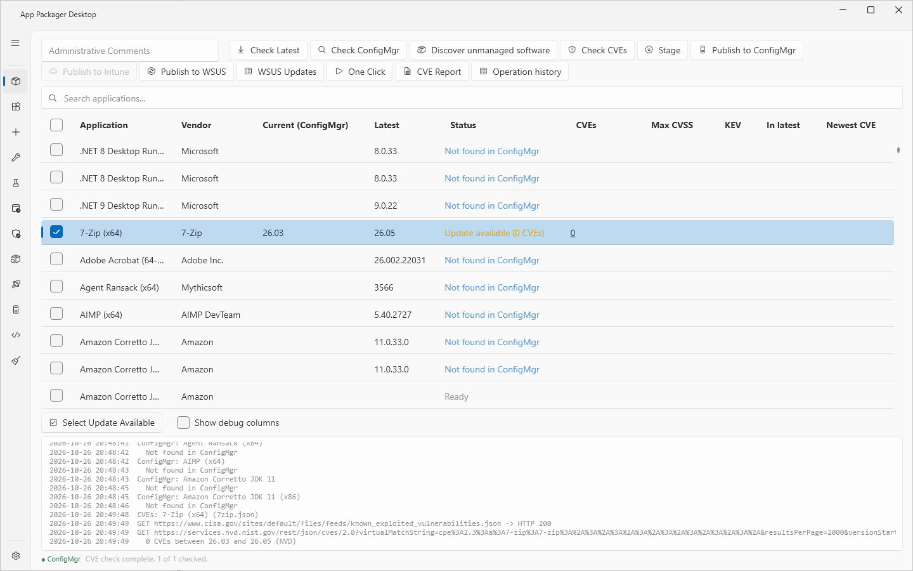
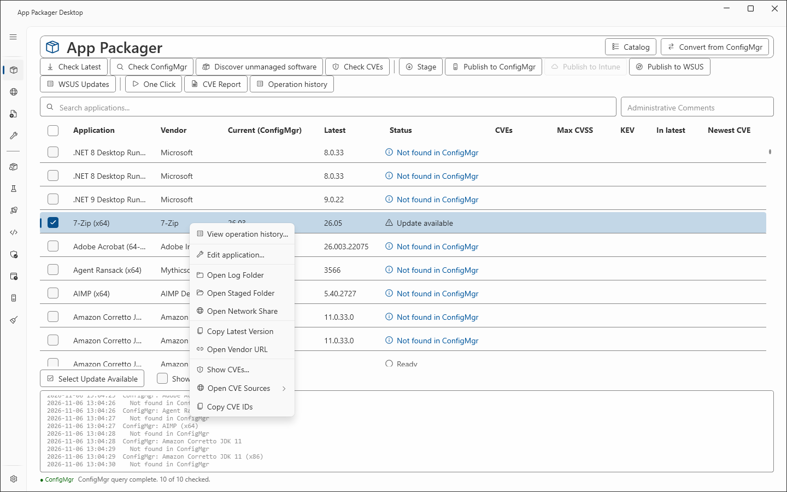
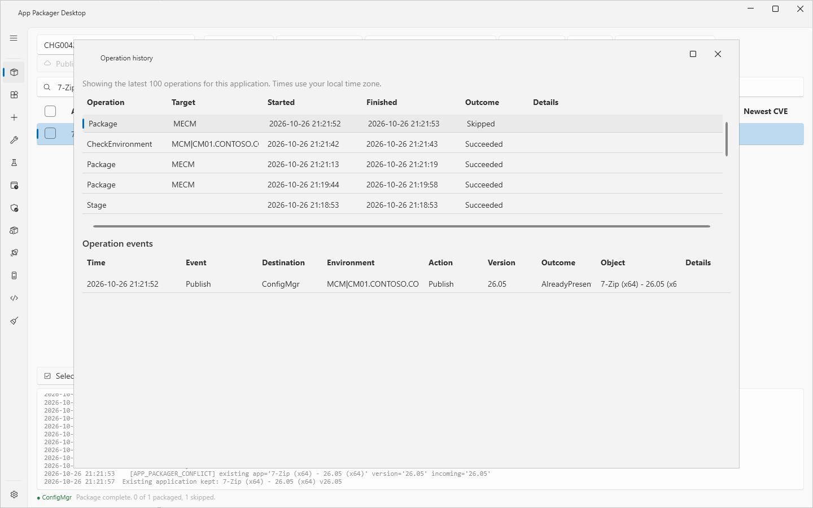
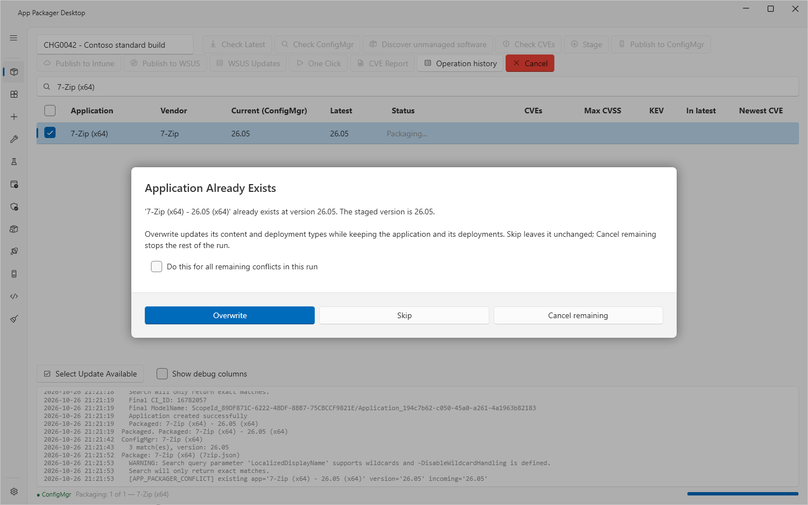
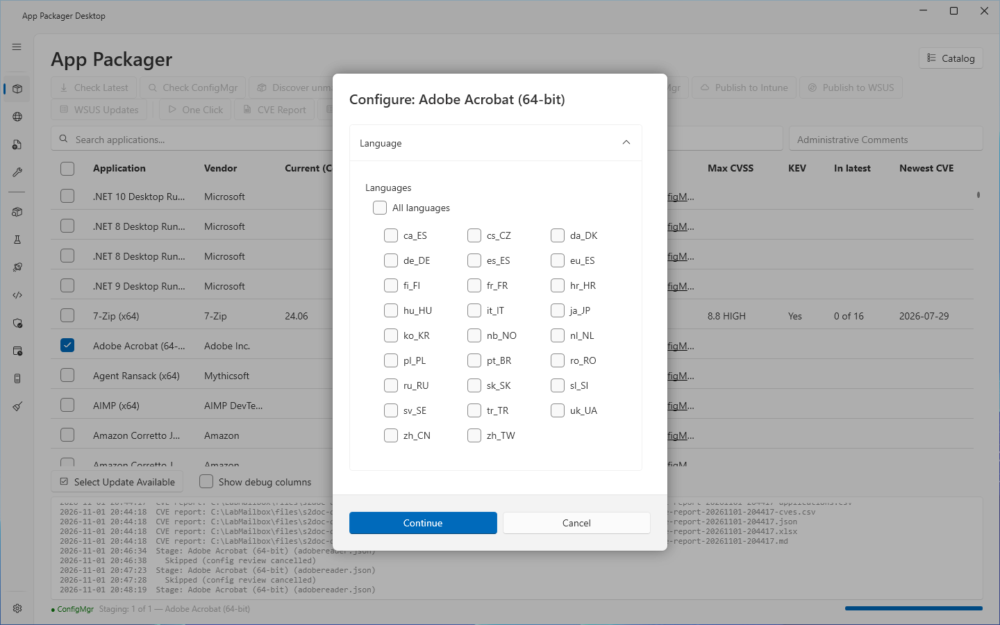

# App Packager grid reference

## What it does

This page describes the parts of the [App Packager page](packages.md): the grid columns, the **Status** values, the row context menu, the log pane, the status line, the **Operation history** window and the dialogs that the page opens.

## When to use it

Use this page to find the meaning of a column, a status, a menu entry or a log line.

## Requirements

None. Some entries need the settings that [App Packager page](packages.md) names.

## Grid columns

A click on a column header sorts the grid. The first column stays in place when the grid scrolls sideways.

| Column | Content | Shown |
|---|---|---|
| (check box) | Marks the row for the next operation. The header check box checks or clears all rows. | Always |
| **Application** | Name of the application. | Always |
| **Vendor** | Vendor name. | Always |
| **Current (ConfigMgr)** | Version in ConfigMgr from the last **Check ConfigMgr**. After a reload, the last stored version. | Always |
| **Latest** | Vendor version from the last **Check Latest**. After a reload, the last stored version. | Always |
| **Status** | Result of the last operation on the row. A tooltip can hold more text. | Always |
| **CVEs** | Number of CVEs, or `CPE missing`, `Error` or `No update`. A click opens the CVE list with links. | Always |
| **Max CVSS** | Highest CVSS score of the CVEs. | Always |
| **KEV** | `Yes` when at least one CVE is in the CISA KEV catalog. | Always |
| **In latest** | `N of M`: the number of CVEs that NVD places at the latest version, out of all CVEs. | Always |
| **Newest CVE** | Publication of the newest CVE. | Always |
| **Max EPSS** | Highest EPSS value. | **Show debug columns** |
| **NVD updated** | Time of the last NVD update. | **Show debug columns** |
| **CVEs Checked (UTC)** | Time of the CVE lookup, in UTC. | **Show debug columns** |
| **CMName** | Name that **Check ConfigMgr** uses to find the application. | **Show debug columns** |
| **Script** | File name of the definition, or of the PS1 packager. | **Show debug columns** |
| **Intune** | Outcome of the Intune build and publish in the last publish run. | **Intune** is selected under Systems in use |

The columns **CVEs**, **Max CVSS**, **In latest** and **Max EPSS** sort by number. The CVE columns are explained in [CVE lookup](cve-lookup.md).

The check box in the first column and the highlighted row are two states. The check box marks a row for an operation. The highlighted row is the row you clicked. **Operation history**, **Edit application...** and the other context menu entries act on the highlighted row.

## Status values

The color of the status text follows the value. Green: **Staged**, **Packaged**, **Up to date**, **Latest retrieved**, **ConfigMgr version retrieved**. Amber: **Update available**. Blue: **Not found in ConfigMgr**, **Current newer**. Red: a value that contains `error`. Gray: all other values.

| Status | Meaning |
|---|---|
| **Ready** | Start value of a row. |
| **Cached** | The list loaded and a vendor version is stored for the row. |
| **Checking latest...** | **Check Latest** is working on the row. |
| **Latest retrieved** | **Check Latest** found a vendor version. |
| **Querying ConfigMgr...** | **Check ConfigMgr** is working on the row. |
| **Up to date** | The ConfigMgr version equals the vendor version. |
| **Current newer** | The ConfigMgr version is newer than the vendor version. |
| **Update available** | The ConfigMgr version is older than the vendor version. After a CVE lookup the text is `Update available (N CVEs, M in KEV)`. |
| **ConfigMgr version retrieved** | ConfigMgr has the application, and no vendor version is known. |
| **Not found in ConfigMgr** | ConfigMgr answered, and the application is not there. |
| **Error** | **Check Latest** found no version or failed, or **Check ConfigMgr** failed. The log pane holds the reason. |
| **Cancelled** | You cancelled the operation while the row was working. |
| **Staging...**, **Staged** | **Stage** is working, or **Stage** succeeded. |
| **Stage error** | **Stage** ended with an exit code other than 0. The row is unchecked. |
| **Skipped** | The row was left out. The reason is a canceled **Configure** dialog, an existing application that you kept, or a local source folder that you did not choose. |
| **Packaging...**, **Packaged** | **Publish to ConfigMgr** is working, or it succeeded. |
| **Package error** | The ConfigMgr publish ended with an exit code other than 0. |
| **Published**, **Publish error** | The Intune-only publish succeeded, or the Intune-only or WSUS-only publish failed. A WSUS-only success reads **Published (updates only)**. |
| **Published (updates only)**, **Already on the server (updates only)**, and the same with **, warning** | The WSUS publish succeeded, the WSUS update for this version existed already, or a follow-up step gave a warning. A WSUS update applies only where the detection finds an older version of the application, so WSUS cannot give a first install of it. |
| `not supported: <codes>` | WSUS refused the application. See [WSUS publishing](wsus-publishing.md). |

A WSUS run that follows a ConfigMgr publish adds a suffix such as `, WSUS not supported`, `, WSUS failed` or `, WSUS warning`. The One Click statuses are in [One Click](one-click.md). **Check Latest** sets no tooltip. A WSUS publish sets the tooltip text of the **Status** cell. The spelling **Canceled** (one l) also appears in a publish status. It comes from the internal name of the outcome.

## Row context menu

A right click selects the row and opens the menu.

| Entry | Effect |
|---|---|
| **View operation history...** | Opens the **Operation history** window for the row. |
| **Edit application...** | Opens the [Workbench](workbench.md) for the row. A double click on a row does the same. The sidebar entry **Workbench** opens it for the highlighted row. |
| **Open Log Folder** | Opens the `Logs` folder in the **Download Root**. The folder holds the log files of the Stage and Publish runs. Nothing happens when the folder does not exist. |
| **Open Staged Folder** | Opens the first folder in the **Download Root** whose name contains the file name of the definition without its extension. Opens the **Download Root** when no folder matches. |
| **Open Network Share** | Opens the **File Share Root** in Explorer. |
| **Copy Latest Version** | Copies the **Latest** value to the clipboard. |
| **Open Vendor URL** | Opens the vendor URL of the definition in the default browser. |
| **Show CVEs...** | Opens the CVE list of the row. |
| **Open CVE Sources** | Lists links to CVE sources. The entry is enabled when the definition has a CPE. |
| **Copy CVE IDs** | Copies the CVE IDs of the stored lookup. The entry is enabled when the definition has a CPE. The log shows `No CVE lookup for this row yet. Run Check CVEs first.` when no lookup exists. |

A double click on the check box or on a column header does not open the Workbench.

## Log pane

The pane under the grid is read only. Each line starts with the date and the time. The pane scrolls to the newest line.

- At the start, the pane shows `Session log: <path>` and the source of the list. The source line is `Loading the shipped definitions (no PS1 packagers folder configured).` or `Loading packagers from: <folder>`.
- The log is also written to two files in the `Logs` folder of the legacy data folder, `%LOCALAPPDATA%\SRLPackr` by default: one file per session named `packr-<yyyyMMdd>-<HHmmss>.log`, and one rolling file `packr.log` in the legacy data folder. App Packager Desktop keeps the newest 30 session files.
- The log files of the child runs of Stage and Publish are in the `Logs` folder of the **Download Root**.

The paths with a data root override are in [Data folders](../reference/data-folders.md).

## Status line

The line under the log pane has three parts.

- The text `● ConfigMgr` shows the state of the ConfigMgr connection by color. Green: connected. Red: the connection failed. Amber: the test is running. Gray: **Site Code** is empty. The default color shows when **ConfigMgr** is not in use. The log pane gives the text of the state, for example `ConfigMgr: Connected to site <code>`.
- The middle text shows the progress, for example `Latest check: 2 of 10 — <application>`, or the result of the run.
- The progress bar shows while an operation runs.

After the list loads, the page tests the ConfigMgr connection once. When **ConfigMgr** is not in use, the test is skipped and the log shows `ConfigMgr: pre-flight version query skipped; ConfigMgr is not in use (Settings, Systems in use).`

## Operation history window

Select a row, then select **Operation history**. The button is disabled until a row is highlighted. The title bar shows `Operation history`. The window name, which the taskbar and screen readers use, is `Operation history — <application>`.

The upper grid lists the latest 100 operations of the application, with local times. A new window selects the first operation.

| Column | Content |
|---|---|
| **Operation** | Kind of operation, for example `CheckLatest` or `CheckEnvironment`. |
| **Target** | Target of the operation. |
| **Started**, **Finished** | Start and end time. |
| **Outcome** | Result. |
| **Details** | Text of the result. |

The grid **Operation events** lists the events of the selected operation: **Time**, **Event**, **Destination**, **Environment**, **Action**, **Version**, **Outcome**, **Object** and **Details**.

- With no recorded operation, the window shows `No operations have been recorded for this application.`
- With no event for the selected operation, it shows `No detailed events were recorded for this operation.`

App Packager Desktop stores the history in the SQLite file `history.db` in the legacy data folder.

## Dialogs that the page opens

### Application Already Exists

A ConfigMgr publish run shows this dialog when ConfigMgr holds an application with the same title at any version. The text names the version in ConfigMgr and the staged version.

| Control | Effect |
|---|---|
| **Overwrite** | Updates the content and the deployment types. Keeps the application and its deployments. |
| **Skip** | Leaves the application unchanged. This is the default button: the Enter key selects it. |
| **Cancel remaining** | Stops the rest of the run. |
| **Do this for all remaining conflicts in this run** | Applies your choice to the other applications of the run. |

The dialog draws **Overwrite** in the accent color, as a primary button. The Enter key still selects **Skip**. Read the button before you select it.

### Configure

**Stage** shows the dialog `Configure: <application>` for a definition that has install parameters. The dialog shows the saved values. **Continue** stages with the values in the dialog. **Cancel** skips the application and sets the status **Skipped**.

The dialog shows when the definition has install parameters and one of two conditions holds. Either the definition sets `ReviewBeforeStage`, or the check box **Skip the review dialog before staging and use the saved values** is cleared under Settings, Install Parameters. The 13 definitions with install parameters are listed in [Definition format: sections](../reference/definition-format-sections.md#install-parameters-in-shipped-definitions).

## Limits

- The columns **CVEs** to **Newest CVE** describe one pair of versions. When the **Current (ConfigMgr)** value or the **Latest** value of a row changes, the CVE cells of that row clear.
- The version lookup of a PS1 packager ends after 30 seconds.
- A row that [Add from file](add-from-file.md) made has no version source. **Check Latest** shows the version that you reviewed and sends no request.

## Troubleshooting

| Message | Cause | Fix |
|---|---|---|
| `No CVE lookup for this row yet. Run Check CVEs first.` | **Copy CVE IDs** found no stored lookup for the row. | Run **Check CVEs**. |

More messages are on [App Packager page](packages.md) and in [Error messages](../reference/error-messages.md).

## Links

- [Introduction to application management in Configuration Manager](https://learn.microsoft.com/intune/configmgr/apps/understand/introduction-to-application-management): Explains how applications, deployment types and deployments relate.
- [Create applications in Configuration Manager](https://learn.microsoft.com/intune/configmgr/apps/deploy-use/create-applications): Describes how to create an application with deployment types, detection methods and dependencies.
- [Monitor applications from the Configuration Manager console](https://learn.microsoft.com/intune/configmgr/apps/deploy-use/monitor-applications-from-the-console): Shows where the console reports the state of applications and deployments.
