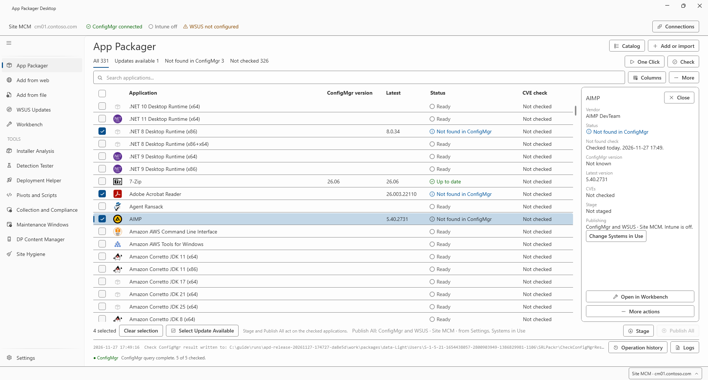
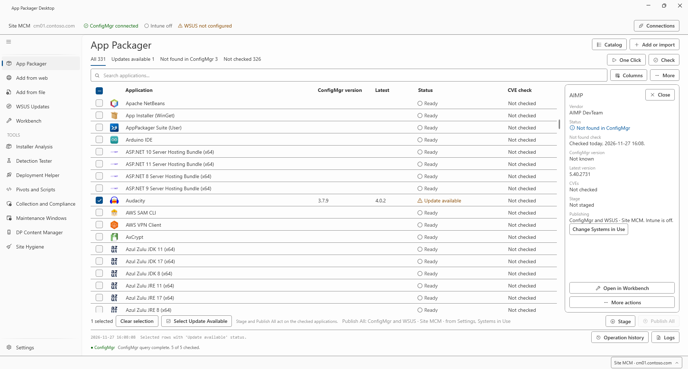
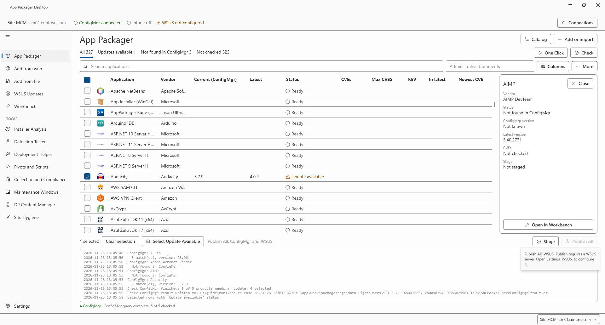

# App Packager page

## What it does

The App Packager page lists every application that App Packager Desktop can package. It is the first entry in the sidebar, it cannot be hidden or moved, and it is the start page. You check rows in the grid, select a button, and read the result in the **Status** column and in the log pane. The header has the button **Catalog**, which opens the [Catalog](applications.md) window, and the menu **Add or import**.

This page covers the page layout, the version checks, the menus and the buttons. The columns, the status values, the context menu and the **Operation history** window are in [App Packager grid reference](packages-grid.md).

## When to use it

- To find out which applications have a newer vendor version than the version in ConfigMgr.
- To stage content and to start a publish run for the checked applications.
- To review what App Packager Desktop did for one application earlier.

## Requirements

| Action | Requirement |
|---|---|
| **Check Latest** | Network access from this computer to the vendor hosts. No ConfigMgr setting is necessary. |
| **Check ConfigMgr** | **ConfigMgr** is selected under Settings, Systems in Use. The ConfigMgr console is installed on this computer. **Site Code** is set under Settings, ConfigMgr. The account can read applications in ConfigMgr. |
| **Publish All** | See [Stage and publish](stage-and-publish.md) and [WSUS publishing](wsus-publishing.md). |

- ConfigMgr work runs in Windows PowerShell 5.1.
- App Packager Desktop did not test a custom ConfigMgr security role. The lab used the Full Administrator role.
- Windows blocks a drag from Explorer to an elevated window. Start App Packager Desktop without elevation if you drop installers on this page. A drop on this page opens [Add from file](add-from-file.md) and starts the analysis of the file.

## The page from top to bottom

| Part | Content |
|---|---|
| Context strip | The strip at the top of the window. It shows on every page. See [The context strip](#the-context-strip). |
| Header | The title, **Catalog** and **Add or import**. |
| Setup strip | Shows only while the setup checklist has work and its panel is closed. See [Getting started](../getting-started.md#the-setup-checklist). |
| Status tabs | **All**, **Updates available**, **Not found in ConfigMgr** and **Not checked**, each with a count. **One Click** and the menu **Check** are at the right. |
| Search row | The **Search applications...** box, the **Administrative Comments** box, **Columns** and **More**. |
| Grid and detail pane | The applications. The pane at the right shows the selected row. |
| Selection line and batch bar | The number of checked applications, the selection buttons, the **Publish All** scope, **Stage** and **Publish All**. **Cancel** shows here while an operation runs. |
| Log pane and status line | See [App Packager grid reference](packages-grid.md#log-pane). |

## The context strip

The strip shows the site (`Site <code>` or `Site not set`), the SMS Provider host (or `server not set`) and one state for each of ConfigMgr, Intune and WSUS. Each state has a symbol and a word. Point at a state to read the reason when the system is not configured.

| Word | Meaning |
|---|---|
| `off` | The system is not selected under Systems in Use. |
| `not configured` | The system is selected, and a requirement is missing. |
| `enabled` | The system is selected and configured. For ConfigMgr, no connection test has a result yet. Intune and WSUS have no connection test. |
| `testing` | The ConfigMgr connection test is running. |
| `connected` | The last ConfigMgr connection test passed. |
| `connection failed` | The last ConfigMgr connection test failed. |

The button **Connections** at the right opens **Settings**. The strip has no box to edit. To change the site or add a site, use the site switcher at the lower right of the window. See [Sites](sites.md).

## Steps

### Check the vendor versions

1. Select **App Packager** in the sidebar.
2. Select the check box of each application you want to check. To select all rows that the grid shows, press Ctrl+A.
3. Select **Check**, then **Check Latest**.
4. View the **Latest** column. The status of a row that succeeded is **Latest retrieved**.
5. If a row shows **Error**, read the log pane. The log line starts with `ERROR:`.

Check Latest does not download the installer. It runs the version source that the definition names. See [Definitions](definitions.md).

### Check the version in ConfigMgr

1. Check the rows you want.
2. Select **Check**, then **Check ConfigMgr**.
3. View the **Current (ConfigMgr)** column and the **Status** column.
4. To check only the rows that have an update, select **Select Update Available** in the batch bar. This button checks every visible row whose status starts with **Update available** and clears all other rows. The header check box then shows a dot. It writes a line to the log.

Check ConfigMgr uses the **CMName** of the definition to find the application. An application counts as found when a current ConfigMgr application title starts with the CMName and the rest of the title is a version or a detail in parentheses. A title with another installer method (EXE or MSI) or another architecture does not count.

### Find a row

1. Type text in the **Search applications...** box.
2. The grid shows the rows whose **Application**, **Vendor** or CMName contains the text. The comparison ignores case.
3. The status line shows `Showing X of N packager(s).`
4. Clear the box to show every row again. With the tab **All** selected, the status line then reads `Loaded N packager(s). Ready.`

A row that the box hides stays checked. An operation still includes it. The selection line shows how many checked rows the view hides.

### Show one status

Select a status tab above the grid. The search box and the tab work together. A tab changes which rows the grid shows. It does not change which rows are checked. The sort of the grid stays.

| Tab | Rows |
|---|---|
| **All** | Every application. |
| **Updates available** | The status starts with **Update available**. |
| **Not found in ConfigMgr** | The status is **Not found in ConfigMgr**. |
| **Not checked** | The row has no ConfigMgr version, and its status is **Ready**, **Cached** or **Latest retrieved**. |

The number on a tab counts every application, also the rows that the search box hides. A row with another status, for example **Staged** or **Error**, is on **All** only.

### Check rows and read the selection line

- The text at the left of the batch bar reads `N selected`. When the search box or the tab hides some checked rows, it reads `N selected, M outside this view`.
- **Show selected** shows when a checked row is hidden. It clears the search box and shows the checked rows only. To leave this view, select a status tab.
- **Clear selection** shows when a row is checked. It unchecks every row, also the hidden rows.
- **Stage**, **Publish All** and the entries of **Check** act on every checked row, also a hidden row.

### Choose the columns

1. Select **Columns**.
2. Clear or select **Vendor**, **Current (ConfigMgr)**, **Latest**, **CVEs**, **Max CVSS**, **KEV**, **In latest** or **Newest CVE**. Every one of these columns shows at first.
3. To restore every column, the first order, the first widths and no sort, select **Reset columns**.

The app saves the hidden columns, the column order, the column widths that you set and the sort. The check box column and the icon column do not move. **Application** and **Status** have no entry in the menu and always show.

### The detail pane

Select a row. The pane at the right of the grid shows the application name, **Vendor**, **Status**, **ConfigMgr version**, **Latest version**, **CVEs** and **Stage**. **Stage** reads `Checking the stage folder`, `Not staged`, `Staged` or `Staged <version>`. **Open in Workbench** opens the [Workbench](workbench.md) for the row. **More actions** opens the same menu as a right-click on the row. See [Row context menu](packages-grid.md#row-context-menu). **Close** closes the pane, and the button **Details** in the corner of the grid opens it again. The app saves this choice. In a window narrower than 1100 pixels, the pane starts closed. The setup checklist takes the place of the pane while it is open.

To change the width of the pane, drag the line between the grid and the pane. From the keyboard, press Tab until the focus is on that line, then press the left or right arrow key. The app saves the width. The pane is from 260 to 640 pixels wide, and the grid keeps room for its first columns.

The detail pane follows the selected row. **Stage** and **Publish All** act on the checked rows.

### Reload the list

1. Select the page, for example an empty part of the log pane or a cell of the grid. Press F5. The key works only while the keyboard focus is on the page. After you select **App Packager** in the sidebar, the focus can stay in the sidebar.
2. The grid reads the definitions again. The reload clears the search box, the check boxes and the statuses. The selected status tab stays.
3. The columns **Current (ConfigMgr)** and **Latest** fill again with the last stored values. A row with a stored vendor version shows the status **Cached**. A row that the last completed **Check ConfigMgr** did not find shows **Not found in ConfigMgr** again. A stored update shows **Update available** again.

Press F5 after you change a file in the user definitions folder. After a save, the result panel of [Add from web](add-app.md) and of [Add from file](add-from-file.md) loads the grid again and selects the new row for you.

### Export the grid to a file

1. Press Ctrl+E.
2. In the **Export the App Packager grid to CSV** dialog, keep the file name `AppPackager-Export-<yyyyMMdd>.csv` or type another name.
3. Select **Save**.

The file holds the rows that the grid shows. The columns are Application, Vendor, CMName, Current (ConfigMgr), Latest, Status, Last Checked and Script. The page has no button for this action.

### Stop a running operation

1. Select **Cancel** in the batch bar, or press Esc.
2. The run stops before the next row. A row that was working can show **Cancelled**.

The **Cancel** button shows only while an operation runs. Its place in the batch bar stays empty at other times. Esc works only while an operation runs.

## Buttons, menus and boxes

| Control | Place | What it does | Page |
|---|---|---|---|
| **Catalog** | Header | Opens the Catalog window. It shows or hides applications in the grid. | [Catalog](applications.md) |
| **Add or import** | Header | Menu. See the table below. | This page |
| **All**, **Updates available**, **Not found in ConfigMgr**, **Not checked** | Status tabs | Show one status. | This page |
| **One Click** | Right of the tabs | Runs the three checks on the tracked applications and opens the One Click plan. | [One Click](one-click.md) |
| **Check** | Right of the tabs | Menu with **Check Latest**, **Check ConfigMgr** and **Check CVEs**. | This page, [CVE lookup](cve-lookup.md) |
| **Search applications...** | Search row | Filters the grid. | This page |
| **Administrative Comments** | Search row | Text for the comment field of the ConfigMgr application description. The publish review and the One Click plan window start with this text. The box can stay empty. | [Stage and publish](stage-and-publish.md) |
| **Columns** | Search row | Chooses the columns. | [App Packager grid reference](packages-grid.md) |
| **More** | Search row | Menu. See the table below. | This page |
| **Details** | Grid | Opens the detail pane. It shows while the pane is closed. | This page |
| **Show selected**, **Clear selection** | Batch bar | Act on the checked rows. | This page |
| **Select Update Available** | Batch bar | Checks the rows with an update. | This page |
| Scope text | Batch bar | `Publish All: ConfigMgr and WSUS`, with the systems of Settings, Systems in Use, or `Publish All: no system in use`. | [Stage and publish](stage-and-publish.md) |
| **Stage** | Batch bar | Downloads and prepares the content of the checked applications. | [Stage and publish](stage-and-publish.md) |
| **Publish All** | Batch bar | Publishes the checked applications to every system that is on in Settings, Systems in Use (ConfigMgr, Intune, WSUS), in one run. A review opens first, except for a publish to WSUS only. | [Stage and publish](stage-and-publish.md) |
| **Cancel** | Batch bar | Stops the running operation. | This page |

There is one publish button. To publish to one system only, select only that system under Settings, Systems in Use, and select **Save Settings**.

| **Check** entry | What it does |
|---|---|
| **Check Latest** | Reads the current vendor version of each checked row. |
| **Check ConfigMgr** | Reads the version of each checked application in ConfigMgr. |
| **Check CVEs** | Looks up the CVEs that an update fixes. |

| **Add or import** entry | What it does |
|---|---|
| **Add from web** | Opens the [Add from web](add-app.md) page. |
| **Add from file** | Opens the [Add from file](add-from-file.md) page. |
| **Convert from ConfigMgr** | Opens the [conversion window](convert-from-configmgr.md). |
| **Import From URL** | Opens the window that [imports vendor definitions](import-vendor-definitions.md). |

| **More** entry | What it does |
|---|---|
| **CVE Report** | Writes the CVE report. See [CVE lookup](cve-lookup.md). |
| **Operation history...** | Opens the recorded operations of the selected row (the **Operation history** window). It is disabled until a row is selected. |
| **Export Check Results...** | Saves the result of the last **Check ConfigMgr** run. It is disabled until such a run ends. See [App Packager grid reference](packages-grid.md#check-configmgr-result-file). |
| **Setup checklist** | Opens the setup checklist beside the grid. |
| **Setup...** | Opens the Setup window. It is disabled while an operation runs. |
| **Show debug columns** | Shows the **CMName**, **Script**, **Max EPSS**, **NVD updated** and **CVEs Checked (UTC)** columns. The app does not save this choice. |

**Discover unmanaged software**, **Supersedence** and **WSUS Updates** are not on this page. Discover is in [Settings](settings-page.md) and in the setup checklist. WSUS Updates is an entry of the sidebar. Supersedence is described in [Publish to ConfigMgr](publish-to-configmgr.md).

**Publish All** is disabled, not hidden, when no system is in use, or when a system in use is not ready. The app does not publish to a smaller set of systems than Settings names. With no system in use, the tooltip reads `Publish All: no system is in use. Turn on ConfigMgr, Intune or WSUS in Settings, Systems in Use.` When a system is not ready, the tooltip starts with `Publish All:` and gives the name of each such system with its reason.

| Reason after the system name | Cause |
|---|---|
| `The ConfigMgr Console is required. It is not detected on this workstation.` | The ConfigMgr console is not installed on this computer. |
| `SiteCode is required. Open Settings to configure.` | **Site Code** is empty. |
| `File Share Root is required. Open Settings to configure.` | **File Share Root (UNC)** is empty. |
| `Publish requires Intune credentials. Open Settings, Intune, to configure Tenant ID, Client ID, and Client Secret.` | An Intune credential is missing. |
| `Publish requires a WSUS server. Open Settings, WSUS, to configure it.` | The **WSUS server** box is empty. It is on the **WSUS** page of Settings. |

The tooltip of a disabled **Check ConfigMgr** entry starts with `Check ConfigMgr:` and names the missing setting.

## Keyboard

| Key | Effect |
|---|---|
| Ctrl+A | Checks every row that the grid shows, or clears all rows. |
| F5 | Reloads the list. |
| Esc | Cancels the running operation. |
| Ctrl+E | Exports the shown rows to a CSV file. |

All keys of the product are in [Keyboard](../reference/keyboard.md).

## Settings that this page reads

| Setting | Where | Effect on this page |
|---|---|---|
| Systems in Use | Settings | Sets the systems of **Publish All**, enables **Check ConfigMgr** and sets the states of the context strip. Shows the **Intune** column when **Intune** is in use. |
| Site Code, Site Server / SMS Provider Host | Settings, ConfigMgr | Target of **Check ConfigMgr** and of the connection test. |
| Download Root (local staging) | Settings, Folders | Folder for staged content and for the logs of Stage and Publish runs. |
| File Share Root (UNC) | Settings, ConfigMgr | Content share of a ConfigMgr publish run. |
| Show or hide per application | [Catalog](applications.md) | Rows that the grid does not list. |

The full list is in [Settings reference](../reference/settings.md).

## Limits

- Check Latest and Check ConfigMgr process the rows one after the other, in grid order. They do not run in parallel.
- A row that the search box hides stays checked. An operation still includes it. Ctrl+A, the header check box and Select Update Available act on the rows the search box shows, and clear the rows it hides.
- Check ConfigMgr stops a query for one application after 60 seconds. The log shows `query timed out after 60s`.
- The update check at start and the button **Check for updates** are not on this page. They are on the **General** page of Settings. See [Updates](updates.md).
- The window opens at 1200 by 800 and cannot be smaller than 900 by 600. The supported minimum size is 1024 by 720. A smaller size can work and is not supported.
- The grid scrolls sideways. A long application name ends with an ellipsis. The tooltip shows the full name.

## Troubleshooting

| Message | Cause | Fix |
|---|---|---|
| `No packagers selected.` | You selected a button and no row is checked. | Check at least one row. |
| `SiteCode is required. Open Settings.` | **Site Code** is empty. | Enter the site code under Settings, ConfigMgr. |
| `Could not connect to site <code>. Check Settings and ensure the Configuration Manager console is available.` | The connection test after the list load failed. The log line `ConfigMgr: Connection failed` names the reason. | Do as the message says. |
| `ERROR: Could not determine latest version for <application>` | The version source returned no version. The row shows **Error** and is unchecked. | Check the version source of the definition. See [Definitions](definitions.md). |
| `ERROR:CM_CMDLETS_NOT_AVAILABLE` | The ConfigMgr cmdlets were not available in Windows PowerShell. | Install the Configuration Manager console on this computer. |
| `ERROR:SITE_DRIVE_FAILED` | The ConfigMgr site drive could not be opened. | Check **Site Code** and **Site Server / SMS Provider Host** in Settings. |
| `ERROR:QUERY_FAILED` | The ConfigMgr query for the application failed. | None stated in the code. |
| `query timed out after 60s` | ConfigMgr did not answer in 60 seconds. | None stated in the code. |
| `GitHub API rate limit reached for <url> ...` | The version source reads `api.github.com`. Without a token GitHub permits 60 requests each hour. | Save a token in Settings, set `GITHUB_TOKEN`, or sign in with the GitHub CLI. Settings, GitHub API shows the current budget. |
| `No applications found. Check the Definitions folder beside the executable or set a Packagers folder in Settings.` | No definition file loaded. | Do as the message says. |
| `All applications are hidden. Select Catalog to show applications.` | Every application is hidden. | Select **Catalog**, select **Show all**, then **Save**. See [Catalog](applications.md). |
| `<n> files were dropped. Drop one installer at a time.` (Add from file page) | You dropped more than one file on the grid. | Drop one file. See [Add from file](add-from-file.md). |
| `Add from file does not take <ext> files. Use an .msi, .exe, .msp, .msix, .appx, .msixbundle or .appxbundle file.` (Add from file page) | The dropped file has another extension. | Drop a supported file. |

The status **Not found in ConfigMgr** is a result, not an error. ConfigMgr answered, and no application title matched the CMName.

## Links

- [Introduction to application management in Configuration Manager](https://learn.microsoft.com/intune/configmgr/apps/understand/introduction-to-application-management): Explains how applications, deployment types and deployments relate.
- [Create applications in Configuration Manager](https://learn.microsoft.com/intune/configmgr/apps/deploy-use/create-applications): Describes how to create an application with deployment types, detection methods and dependencies.
- [Deploy and manage content for Configuration Manager](https://learn.microsoft.com/intune/configmgr/core/servers/deploy/configure/deploy-and-manage-content): Explains how to distribute, update, redistribute and validate content.
- [Add, Assign, and Monitor a Win32 App in Microsoft Intune](https://learn.microsoft.com/intune/app-management/deployment/add-win32): Shows how to add a Win32 app, set its detection rules and assign it.
