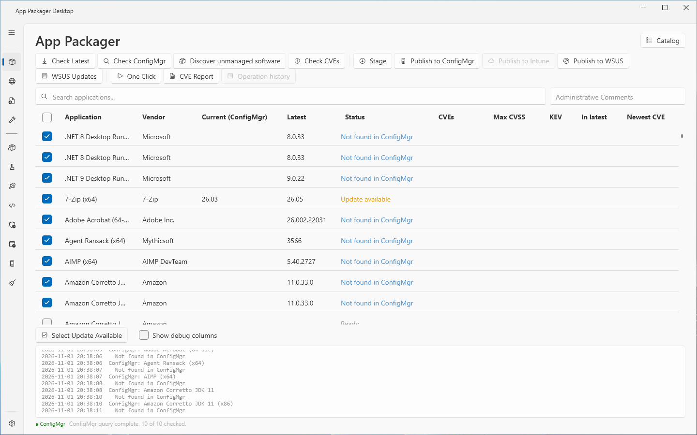
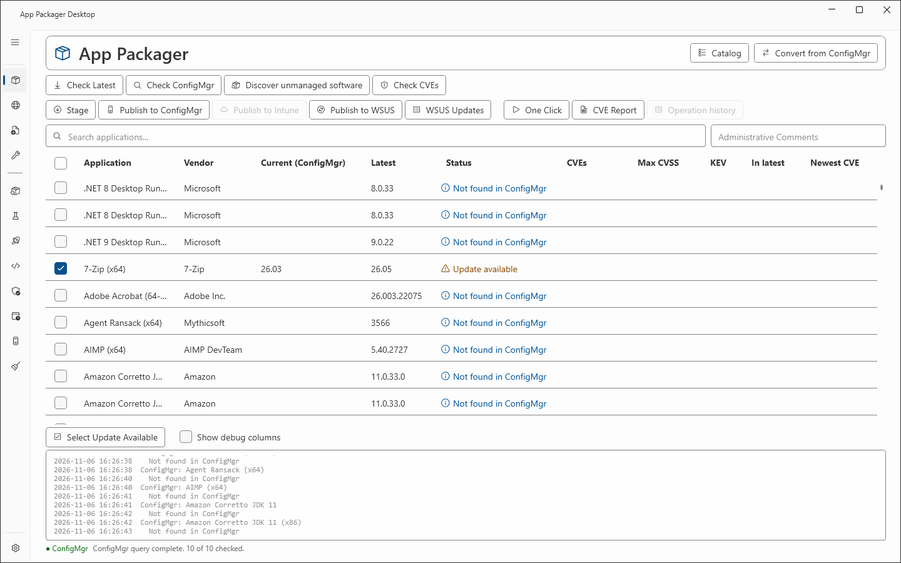
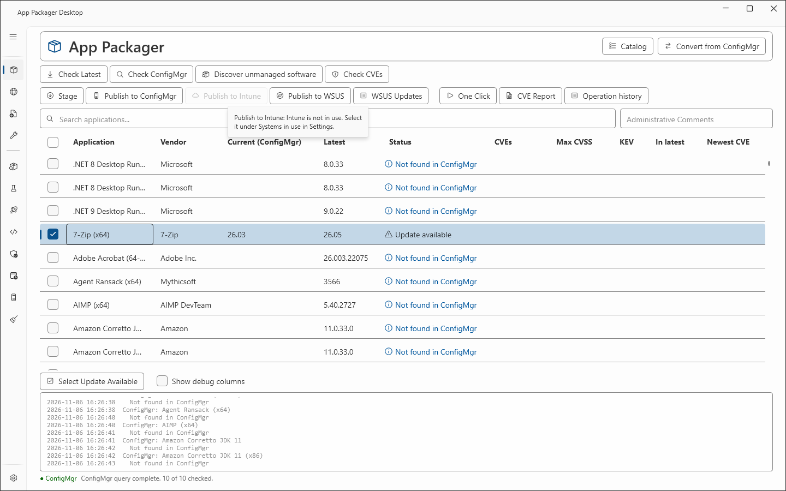

# App Packager page

## What it does

The App Packager page lists every application that App Packager Desktop can package. It is the first entry in the sidebar, it cannot be hidden or moved, and it is the start page. You check rows in the grid, select a button, and read the result in the **Status** column and in the log pane. The header has the button **Catalog**, which opens the [Catalog](applications.md) window.

This page covers the page layout, the version checks and the buttons. The columns, the status values, the context menu and the **Operation history** window are in [App Packager grid reference](packages-grid.md).

## When to use it

- To find out which applications have a newer vendor version than the version in ConfigMgr.
- To stage content and to start a publish run for the checked applications.
- To review what App Packager Desktop did for one application earlier.

## Requirements

| Action | Requirement |
|---|---|
| **Check Latest** | Network access from this computer to the vendor hosts. No ConfigMgr setting is necessary. |
| **Check ConfigMgr** | **ConfigMgr** is selected under Settings, Systems in use. The ConfigMgr console is installed on this computer. **Site Code** is set under Settings, ConfigMgr Site Settings. The account can read applications in ConfigMgr. |
| Publish buttons | See [Stage and publish](stage-and-publish.md) and [WSUS publishing](wsus-publishing.md). |

- ConfigMgr work runs in Windows PowerShell 5.1.
- App Packager Desktop did not test a custom ConfigMgr security role. The lab used the Full Administrator role.
- Windows blocks a drag from Explorer to an elevated window. Start App Packager Desktop without elevation if you drop installers on this page. A drop on this page opens [Add from file](add-from-file.md) and starts the analysis of the file.

## Steps

### Check the vendor versions

1. Select **App Packager** in the sidebar.
2. Select the check box of each application you want to check. To select all rows, press Ctrl+A.
3. Select **Check Latest**.
4. Read the **Latest** column. The status of a row that succeeded is **Latest retrieved**.
5. If a row shows **Error**, read the log pane. The log line starts with `ERROR:`.

Check Latest does not download the installer. It runs the version source that the definition names. See [Definitions](definitions.md).

### Check the version in ConfigMgr

1. Check the rows you want.
2. Select **Check ConfigMgr**.
3. Read the **Current (ConfigMgr)** column and the **Status** column.
4. To check only the rows that have an update, select **Select Update Available**. This button checks every row whose status starts with **Update available** and clears all other rows.

Check ConfigMgr uses the **CMName** of the definition to find the application. An application counts as found when a current ConfigMgr application title starts with the CMName and the rest of the title is a version or a detail in parentheses. A title with another installer method (EXE or MSI) or another architecture does not count.

### Find a row

1. Type text in the **Search applications...** box.
2. The grid shows the rows whose **Application**, **Vendor** or CMName contains the text. The comparison ignores case.
3. The status line shows `Showing X of N packager(s).`
4. Clear the box to show every row again. The status line then reads `Loaded N packager(s). Ready.`

A row that the box hides stays checked. An operation still includes it.

### Reload the list

1. Click the page, for example an empty part of the log pane or a cell of the grid. Press F5. The key works only while the keyboard focus is on the page. After you select **App Packager** in the sidebar, the focus can stay in the sidebar.
2. The grid reads the definitions again. The reload clears the search box, the check boxes and the statuses.
3. The columns **Current (ConfigMgr)** and **Latest** fill again with the last stored values. A row with a stored vendor version shows the status **Cached**.

Press F5 after you change a file in the user definitions folder. After a save, the result panel of [Add from web](add-app.md) and of [Add from file](add-from-file.md) loads the grid again and selects the new row for you.

### Export the grid to a file

1. Press Ctrl+E.
2. In the **Export the App Packager grid to CSV** dialog, keep the file name `AppPackager-Export-<yyyyMMdd>.csv` or type another name.
3. Select **Save**.

The file holds the rows that the grid shows. The columns are Application, Vendor, CMName, Current (ConfigMgr), Latest, Status, Last Checked and Script. The page has no button for this action.

### Stop a running operation

1. Select **Cancel**, or press Esc.
2. The run stops before the next row. A row that was working can show **Cancelled**.

The **Cancel** button shows only while an operation runs. Esc works only while an operation runs.

## Buttons and boxes

| Control | What it does | Page |
|---|---|---|
| **Catalog** | Opens the Catalog window. It shows or hides applications in the grid. | [Catalog](applications.md) |
| **Search applications...** | Filters the grid. | This page |
| **Administrative Comments** | Text for the comment field of the ConfigMgr application description. A publish run with an empty box shows the dialog **No Comment Provided**. The dialog has the buttons **Continue** and **Cancel**. | [Stage and publish](stage-and-publish.md) |
| **Check Latest** | Reads the current vendor version of each checked row. | This page |
| **Check ConfigMgr** | Reads the version of each checked application in ConfigMgr. | This page |
| **Discover unmanaged software** | Finds applications on clients that the catalog can package. | [Discover unmanaged software](discover-unmanaged-software.md) |
| **Check CVEs** | Looks up the CVEs that an update fixes. | [CVE lookup](cve-lookup.md) |
| **Stage** | Downloads and prepares the content. | [Stage and publish](stage-and-publish.md) |
| **Publish to ConfigMgr** | Creates the ConfigMgr application. | [Stage and publish](stage-and-publish.md) |
| **Apply supersedence** | Sets the supersedence relation from each checked application to the older version of its product line on the ConfigMgr site, without a new publish. It repeats the step that "Published, supersedence not applied" names, and it adds only the relations that are missing. | [Publish to ConfigMgr](publish-to-configmgr.md) |
| **Rewrite old versions** | Shows the plan of the version clauses of the older applications of the line that would change from GreaterEquals to IsEquals, asks for the confirmation, rewrites, and restores through Undo. One application at a time. | [Publish to ConfigMgr](publish-to-configmgr.md) |
| **Publish to Intune** | Publishes a Win32 app through Microsoft Graph. | [Stage and publish](stage-and-publish.md) |
| **Publish to WSUS** | Publishes the installer as a WSUS update. | [WSUS publishing](wsus-publishing.md) |
| **WSUS Updates** | Lists the updates that App Packager Desktop published to WSUS. | [WSUS publishing](wsus-publishing.md) |
| **One Click** | Opens the One Click plan for the tracked applications. | [One Click](one-click.md) |
| **CVE Report** | Writes the CVE report. | [CVE lookup](cve-lookup.md) |
| **Operation history** | Opens the recorded operations of the highlighted row. | [App Packager grid reference](packages-grid.md) |
| **Cancel** | Stops the running operation. | This page |
| **Select Update Available** | Checks the rows with an update. | This page |
| **Show debug columns** | Shows the extra columns of the grid. | [App Packager grid reference](packages-grid.md) |

A publish button is disabled, not hidden, while its system is not ready. The tooltip starts with the name of the button and names the missing setting.

| Tooltip text after the button name | Cause |
|---|---|
| `ConfigMgr is not in use. Select it under Systems in use in Settings.` | **ConfigMgr** is cleared under Systems in use. |
| `Needs the ConfigMgr console on this computer.` | The ConfigMgr console is not installed on this computer. |
| `Set the site code in Settings, ConfigMgr Site Settings.` | **Site Code** is empty. |
| `Intune is not in use. Select it under Systems in use in Settings.` | **Intune** is cleared under Systems in use. |
| `set Tenant ID, Client ID and Client Secret in Settings, Intune.` | An Intune credential is missing. |
| `WSUS is not in use. Select it under Systems in use in Settings.` | **WSUS** is cleared under Systems in use. |
| `Set the WSUS server in Settings, WSUS Publishing.` | The **WSUS server** box is empty. |

The check of **File Share Root** is not in a tooltip. It runs when a ConfigMgr publish run starts. The message is `File Share Root is required. Open Settings to configure.`

## Keyboard

| Key | Effect |
|---|---|
| Ctrl+A | Checks all rows, or clears all rows. |
| F5 | Reloads the list. |
| Esc | Cancels the running operation. |
| Ctrl+E | Exports the shown rows to a CSV file. |

All keys of the product are in [Keyboard](../reference/keyboard.md).

## Settings that this page reads

| Setting | Where | Effect on this page |
|---|---|---|
| Systems in use | Settings | Enables or disables the check and publish buttons. Shows the **Intune** column when **Intune** is in use. |
| Site Code, Site Server / SMS Provider Host | Settings, ConfigMgr Site Settings | Target of **Check ConfigMgr** and of the connection test. |
| Download Root (local staging) | Settings, ConfigMgr Site Settings | Folder for staged content and for the logs of Stage and Publish runs. |
| File Share Root (UNC) | Settings, ConfigMgr Site Settings | Content share of a ConfigMgr publish run. |
| Show or hide per application | [Catalog](applications.md) | Rows that the grid does not list. |

The full list is in [Settings reference](../reference/settings.md).

## Limits

- Check Latest and Check ConfigMgr process the rows one after the other, in grid order. They do not run in parallel.
- A row that the search box hides stays checked. An operation still includes it. Ctrl+A and the header check box act on all rows, also on hidden rows.
- Check ConfigMgr stops a query for one application after 60 seconds. The log shows `query timed out after 60s`.
- App Packager Desktop does not check for a new version of itself. Select **Releases** under Settings, About to open the releases page.
- The toolbar shows the label of each button while the labels fit in two lines. When they need more lines, the toolbar shows the icons only. The tooltip of each button then names the button.
- The window opens at 1200 by 800 and cannot be smaller than 900 by 600. The supported minimum size is 1024 by 720. A smaller size can work and is not supported.
- The grid scrolls sideways. A long application name ends with an ellipsis. The tooltip shows the full name.

## Troubleshooting

| Message | Cause | Fix |
|---|---|---|
| `No packagers selected.` | You selected a button and no row is checked. | Check at least one row. |
| `SiteCode is required. Open Settings.` | **Site Code** is empty. | Enter the site code under Settings, ConfigMgr Site Settings. |
| `Could not connect to site <code>. Check Settings and ensure the CM console is available.` | The connection test after the list load failed. The log line `ConfigMgr: Connection failed` names the reason. | Do as the message says. |
| `ERROR: Could not determine latest version for <application>` | The version source returned no version. The row shows **Error** and is unchecked. | Check the version source of the definition. See [Definitions](definitions.md). |
| `ERROR:CM_CMDLETS_NOT_AVAILABLE` | The ConfigMgr cmdlets were not available in Windows PowerShell. | Install the Configuration Manager console on this computer. |
| `ERROR:SITE_DRIVE_FAILED` | The ConfigMgr site drive could not be opened. | Check **Site Code** and **Site Server / SMS Provider Host** in Settings. |
| `ERROR:QUERY_FAILED` | The ConfigMgr query for the application failed. | None stated in the code. |
| `query timed out after 60s` | ConfigMgr did not answer in 60 seconds. | None stated in the code. |
| `GitHub API rate limit reached for <url> ...` | The version source reads `api.github.com`. Without a token GitHub permits 60 requests each hour. | Set `APP_PACKAGER_GITHUB_TOKEN` or `GITHUB_TOKEN`, or run `gh auth login`. Settings, GitHub API shows the current budget. |
| `No applications found. Check the Definitions folder beside the executable or set a Packagers folder in Settings.` | No definition file loaded. | Do as the message says. |
| `All applications are hidden. Select Catalog to show applications.` | Every application is hidden. | Select **Catalog**, select **Show all**, then **Save**. See [Catalog](applications.md). |
| `<n> files were dropped. Drop one installer at a time.` (Add from file page) | You dropped more than one file on the grid. | Drop one file. See [Add from file](add-from-file.md). |
| `Add from file does not take <ext> files. Use an .msi, .exe, .msp, .msix, .appx, .msixbundle or .appxbundle file.` (Add from file page) | The dropped file has another extension. | Drop a supported file. |

The status **Not found in ConfigMgr** is a result, not an error. ConfigMgr answered, and no application title matched the CMName.

## Links

- [Introduction to application management in Configuration Manager](https://learn.microsoft.com/intune/configmgr/apps/understand/introduction-to-application-management): Explains how applications, deployment types and deployments relate.
- [Create applications in Configuration Manager](https://learn.microsoft.com/intune/configmgr/apps/deploy-use/create-applications): Describes how to create an application with deployment types, detection methods and dependencies.
- [Deploy and manage content for Configuration Manager](https://learn.microsoft.com/intune/configmgr/core/servers/deploy/configure/deploy-and-manage-content): Explains how to distribute, update, redistribute and validate content.
- [Add, Assign, and Monitor a Win32 App in Microsoft Intune](https://learn.microsoft.com/intune/app-management/deployment/add-win32): Shows how to add a Win32 app, set its detection rules and assign it.
