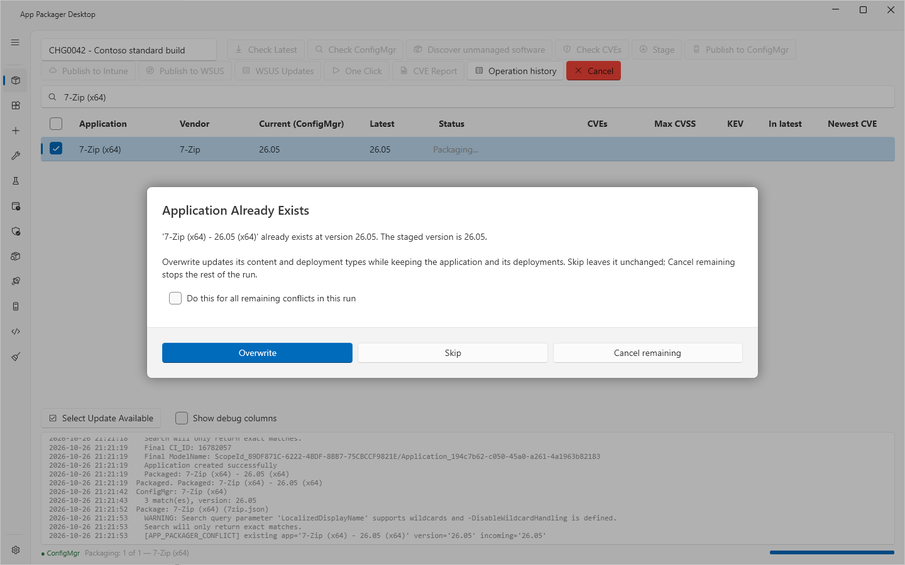
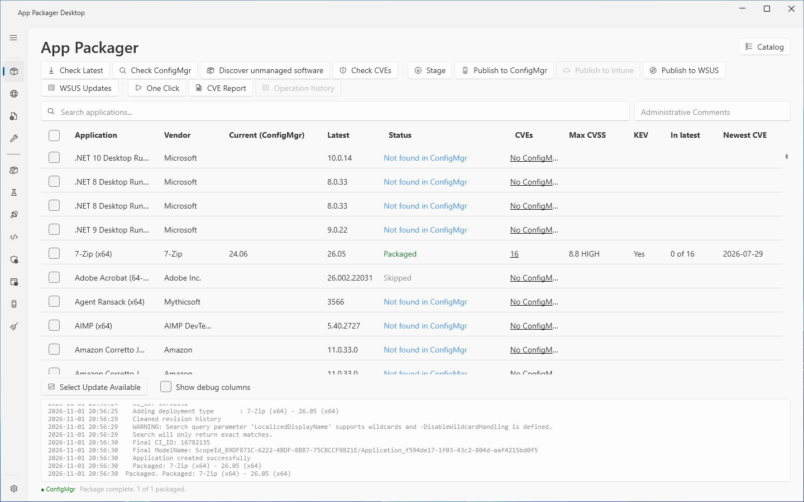
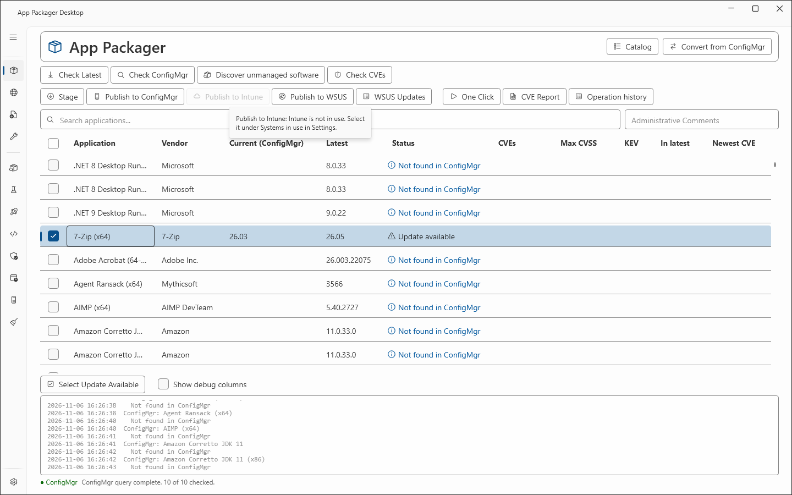

# Publish to ConfigMgr

## What it does

`Publish to ConfigMgr` takes the staged content of each checked application to a Configuration Manager site. It copies the content to the file share, checks the copy, and creates the ConfigMgr application with its deployment types. Optionally it then distributes the content to a distribution point group and creates an Available deployment to a test collection.

## When to use it

- Use it after [Stage](stage-and-publish.md) to create or update an application in ConfigMgr.
- Use [One Click](one-click.md) to do the same for tracked applications without prompts.
- Use `--target MECM` in the [command-line build](command-line-build.md) to do the same from a script.

## Requirements

- The Configuration Manager console on this computer. The app reads the module path from the `SMS_ADMIN_UI_PATH` environment variable.
- Windows PowerShell 5.1.
- **ConfigMgr** selected under **Systems in use** in Settings.
- **Site Code** and **Site Server / SMS Provider Host** set in Settings, ConfigMgr Site Settings.
- **File Share Root (UNC)** set in Settings. Your account needs write access to the share.
- A ConfigMgr security role for the site that can create applications and deployment types. For the optional steps, the role also needs the rights to distribute content and to create deployments. The minimum role is not verified with a custom role. See [Permissions](../reference/permissions.md).
- Staged content for the application. See [Stage and publish](stage-and-publish.md).

## Steps

1. Open the **App Packager** page.
2. Stage the applications that you want to publish.
3. Optional: type a work order or a note in **Administrative Comments**. The app stores it as the description of the ConfigMgr application.
4. Check the rows to publish.
5. Select **Publish to ConfigMgr**.
6. If the dialog **No Comment Provided** opens, select **Continue** to publish with an empty description. Select **Cancel** to go back.
7. If the dialog **Application Already Exists** opens, choose an action:
   - **Overwrite** updates the content and the deployment types. The application and its deployments stay.
   - **Skip** leaves the application unchanged. The row shows `Skipped`.
   - **Cancel remaining** stops the rest of the run.
   - Select **Do this for all remaining conflicts in this run** to use the same answer for the next conflicts of this run.
8. Watch the log. The row status changes from `Packaging...` to `Packaged`.

A publish button is disabled while its system is not set up. Point at the button to read the tooltip. The tooltip names the setting that is missing.

## What the publish does

For each checked row, in this order:

1. It checks that the content share is reachable.
2. It looks for an application with the same title on the site. The result decides the existing-application answer.
3. It checks the staged content against `stage-manifest.json`.
4. It checks that the share folder holds no file that the manifest does not list.
5. It copies the content to the share. The copy compares SHA-256 and overwrites a changed file. The log shows `Content synchronized: <n> copied, <n> refreshed, <n> unchanged.`
6. It checks the copy on the share against the manifest.
7. It connects to the site (`Connecting to ConfigMgr...`) and creates the application and its deployment types. The log shows `Packaged: <application name>`.
8. It runs the After Package steps that Settings turns on.

A ConfigMgr-only run builds no `.intunewin` file and copies nothing besides the content to the share. Only `Publish to Intune` builds the file, whether or not the Content Prep Tool is on the computer.

The share folder depends on **Content Layout**:

| Content Layout | Folder |
|---|---|
| `Nested - Applications\Vendor\App\Version` | `<File Share Root>\Applications\<Vendor>\<App>\<Version>` |
| `Flat - Applications\Vendor-App-Version` | `<File Share Root>\Applications\<Vendor>-<App>-<Version>` |

Deployment types are created in the order of the definition. When the application changes version, the app creates the new deployment types under names that end in `(staging)` first.

## After Package steps

These steps are optional. Turn them on in Settings, After Package.

A new or overwritten application gets an identity marker in its keywords (`APD-Line:<definition identifier>|<profile>|<architecture>`). A later release uses it to find the older versions of one product line. The marker is written only when the application has no keywords of its own: the program never rewrites a keyword that you set. When the application has keywords, or the keywords cannot be read, no marker is written and the result carries a warning. A title with no definition identifier gets no marker. A publish that skips an existing application writes no marker. The Software Center shows keywords to users, so the marker is visible there. A PS1 packager row gets no marker and no version rule.

When the supersedence mode (Settings, Supersedence) is `Replace` or `Replace and uninstall`, a new application that carries the identity marker looks up the older application of its line after it is created: the newest application with the same marker, a lower version and another title, that is not retired. It pairs the deployment types (one and one directly, otherwise by the name suffix of staging) and, when the distribution and the test deployment did not fail, sets one relation for each pair with `Set-CMApplicationSupersedence` (by name; a relation that exists is read first and not written again); `Replace and uninstall` also sets the uninstall option. The old application is not changed or removed. A line that already holds a higher or an equal version under another title is named in the log and is not superseded. A relation that exists counts as done. When the lookup finds nothing, the log says "No older version found". When the step fails, the application stays and the result says "Published, supersedence not applied" with the reason; the run does not fail. The marker is written only for an application that has no keywords of its own, so an application that carries keywords of an administrator is never found as an old application. A change of the supersedence mode has an effect on the next publish only.

The version rule (Settings, Supersedence) changes the operator of the version clause of the detection that is published: `Exact` writes `IsEquals` instead of `GreaterEquals`, only for a File or Registry value version clause whose operator is `GreaterEquals` and whose expected value is the packaged version, and only when a value read from the installed product equals the expected value (the MSI ProductVersion, or a value that a test install recorded). The definition does not change. The supersedence mode `Replace and uninstall` needs `Exact`; the combination `Minimum` with `Replace and uninstall` is refused before anything is created. This release writes no supersedence relation.

Before a publish with the supersedence mode on, the program reads the detection of the older application of the line and writes warnings to the log (`Chain check`), and never blocks: Replace and uninstall with Exact while the older application still has a GreaterEquals version clause (its uninstall will be reported as failed); an older application and a new one that disagree (Exact against Minimum, or the reverse); a new application that keeps a GreaterEquals version clause under Replace and uninstall. The check reads the site once more, so a publish with the mode on takes a little longer.

The two steps run in one Windows PowerShell start, so the ConfigMgr module loads once for both. A distribution that fails ends the script, and the test deployment does not run.

1. **Distribute content after Package** starts content distribution of the new application to the **Distribution point group**. A group that already holds the content counts as done.
2. **Deploy to a test collection after distribution** creates an Available deployment, effective at once, to the **Test collection**. This step runs only after the distribution step. An existing deployment counts as done.
3. The app finds the collection by its exact name. Wildcard matching is off. **Use a user collection** selects user collections. When it is cleared, the app uses device collections. This choice does not change the install context of the application.
4. **Create the collection if it does not exist** creates an empty collection. A user collection is limited to All Users (`SMS00002`). A device collection is limited to All Systems (`SMS00001`). The app does not add members. Add them in ConfigMgr.

A duplicate collection name or a lookup error stops the test-deployment step. When collection creation is off, a missing collection is reported as skipped.

A successful distribution request means that ConfigMgr accepted the content. The app does not wait for the transfer to the distribution points. It does not confirm the installation on clients.

## Options and settings

| Setting (Settings page) | Default | Effect |
|---|---|---|
| Site Code | `MCM` | Site for every ConfigMgr step. Save the site code once. |
| Site Server / SMS Provider Host | empty | Host of the SMS Provider. Empty means this computer. |
| File Share Root (UNC) | `\\fileserver\sccm$` | Root of the content share. |
| Content Layout | `Nested` | Folder shape under the share. |
| Estimated Runtime (mins) | 15 | Estimated install time on the deployment type. |
| Maximum Runtime (mins) | 30 | Maximum run time on the deployment type. |
| Fallback DPs | `Allow` | `Allow` or `Deny`: the client can use the site default boundary group. |
| Neighbor/default DP | `Download` | `Download` or `DoNothing` when the client uses a neighbor or default boundary group. |
| Include version in application name | off | One ConfigMgr application for each release. |
| Remove version from application name | off | Removes the release version from a vendor product name. Available while the version is not added to the name. |
| Distribute content after Package | off | Distribution step. |
| Distribution point group | empty (placeholder `All DPs`) | Target group for distribution. |
| Deploy to a test collection after distribution | off | Test deployment step. |
| Use a user collection | off | Targets users instead of devices. |
| Test collection | empty | Exact collection name. |
| Create the collection if it does not exist | off | Creates an empty collection. |

A per-application choice in the [Workbench](workbench.md) overrides the application title settings. The app does not rename an existing application.

See [Settings reference](../reference/settings.md).

## Limits

- The lab validated ConfigMgr packaging and deployment on a lab site with client computers.
- The user-collection option and the handling of a failed publication have automated tests only. They are not validated against a live site.
- All lab runs used a Full Administrator account. No run used a least-privilege role.
- `Publish to ConfigMgr` does not stage. Stage first.

## Troubleshooting

| Message | Cause | Fix |
|---|---|---|
| Tooltip: `Publish to ConfigMgr: Needs the ConfigMgr console on this computer.` | The console module is not found. | Install the Configuration Manager console. |
| Tooltip: `Publish to ConfigMgr: Set the site code in Settings, ConfigMgr Site Settings.` | The site code is empty. | Enter the site code. |
| Tooltip: `Publish to ConfigMgr: ConfigMgr is not in use. Select it under Systems in use in Settings.` | **ConfigMgr** is not selected. | Select it under **Systems in use**. |
| `This stage asks for the native MSIX deployment type of ConfigMgr, which App Packager no longer publishes. ...` | The manifest has the detection type `MSIX`: a stage from an older release, or a hand-written definition whose detection rule has the type `MSIX`. App Packager publishes an MSIX as a script deployment type. | Select **Stage** again. For a hand-written definition, change the detection rule to a registry key or a script rule first. |
| `The application icon was not applied: <reason>` or `The application icon was not found: <path>` (in the detail of the ConfigMgr step in Operation History, and as `Application icon not applied` or `Application icon not found` in the log) | The application was created, but the site refused the icon or the icon file is not in the content folder. A missing icon does not stop the packaging, so the run counts as a success. | Check that the icon file is in the content folder and that the account can read it, then publish again with **Overwrite**, or set the icon in the console. |
| `File Share Root is required. Open Settings to configure.` | The share root is empty. The check runs when the run starts. | Enter the share in Settings. |
| `Stage manifest not found: <path>. Run Stage for <application> <version> first.` | The application has no staged content for the version. | Select **Stage**. |
| `Content share not accessible: <path>` | The share is missing or your account cannot reach it. | Check the share path and your access. |
| `Staged content does not match its manifest: <list>` | A staged file changed after Stage. | Stage again. |
| `Network content folder holds files the stage manifest does not list; nothing was written to the share: <list>` | The share folder holds extra files. | Remove the listed files from the share folder. |
| `Network content verification failed: <list>` | The copy on the share does not match the manifest. | Check the share, then publish again. |
| `The ConfigurationManager PowerShell module was not found. Install the Configuration Manager console on this computer.` | The module file is missing. | Install the console. |
| `The SMS Provider <name> denied access. The account needs a ConfigMgr security role for site <code>.` | Your account has no role on the site. | Ask the ConfigMgr administrator for a role. |
| `The CMSite drive for site <code> on <provider> could not connect. Check the site code and the SMS Provider in Settings, ConfigMgr Site Settings.` | The site code or the provider name is wrong. | Correct the values in Settings. |
| `Distribution failed: <reason>` or `Test deployment failed: <reason>` (log), and `ConfigMgr application created, but a step after it failed: <step> to '<target>' failed: <reason>` (run result, exit code 1) | An After Package step failed. The application exists, but clients cannot install it. The inventory records the ConfigMgr destination as Partial. | Fix the cause. Then distribute the content or deploy the application in the ConfigMgr console, or publish again with Overwrite. A publish with Skip finds the application and does not run the After Package steps again. In One Click, the version counts as published, so a new run skips it: select Force together with Existing ConfigMgr app = Overwrite, or use the console. |
| `Search query parameter 'LocalizedDisplayName' supports wildcards and -DisableWildcardHandling is defined. Search will only return exact matches.` (three times for each publish run) | The ConfigMgr cmdlet writes this warning into the log pane. It does not mean that the publish failed. | None. The message is a warning of the cmdlet. |

See [Error messages](../reference/error-messages.md) and [Troubleshooting](../troubleshooting.md).

## Links

- [Create applications in Configuration Manager](https://learn.microsoft.com/intune/configmgr/apps/deploy-use/create-applications): Describes how to create an application with deployment types, detection methods and dependencies.
- [Create Windows applications in Configuration Manager](https://learn.microsoft.com/intune/configmgr/apps/get-started/creating-windows-applications): Lists the Windows application types and their options.
- [Deploy and manage content for Configuration Manager](https://learn.microsoft.com/intune/configmgr/core/servers/deploy/configure/deploy-and-manage-content): Explains how to distribute, update, redistribute and validate content.
- [Install and configure distribution points in Configuration Manager](https://learn.microsoft.com/intune/configmgr/core/servers/deploy/configure/install-and-configure-distribution-points): Explains the distribution point settings, the groups and the content validation schedule.
- [Fundamentals of role-based administration for Configuration Manager](https://learn.microsoft.com/intune/configmgr/core/understand/fundamentals-of-role-based-administration): Explains security roles, security scopes and collections for administrative users.
