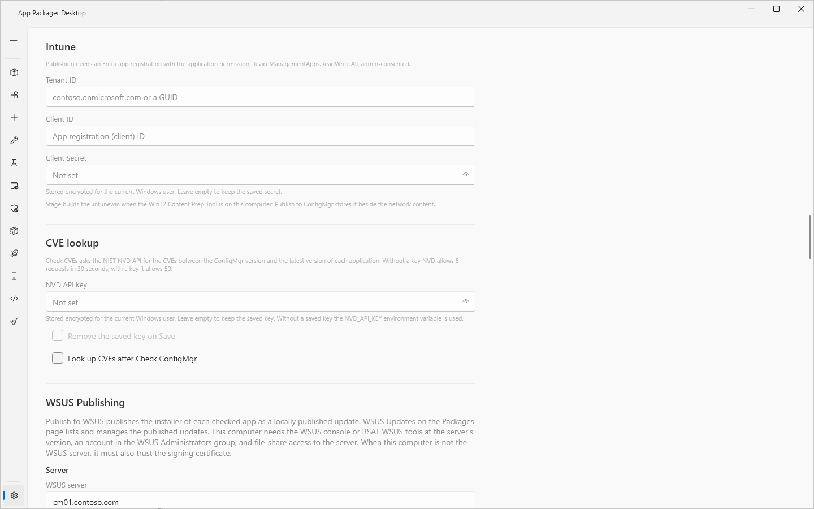

# Publish to Intune

## What it does

`Publish to Intune` builds an `.intunewin` file from the staged content of each checked application. It then publishes the file as a Win32 app through Microsoft Graph. The app does not create assignments. You assign the app in Intune.

## When to use it

- Use it after [Stage](stage-and-publish.md) to create or update a Win32 app in an Intune tenant.
- Use it on a computer that has no Configuration Manager console. An Intune-only run does not connect to a site and does not copy to the file share.
- Use `--target IntuneOnly` or `--target MECMAndIntune` in the [command-line build](command-line-build.md) to publish from a script.

## Requirements

- An Entra app registration with the application permission `DeviceManagementApps.ReadWrite.All`. An administrator must consent to the permission.
- A client secret for the app registration.
- **Intune** selected under **Systems in use** in Settings.
- **Tenant ID**, **Client ID** and **Client Secret** set in Settings, Intune.
- Access to `login.microsoftonline.com` and `graph.microsoft.com`. Graph returns the address of the Azure storage upload. The app uses that address at run time.
- The Win32 Content Prep Tool (`IntuneWinAppUtil.exe`). The first Intune build downloads it. You can also select **Download** in Settings, Detected Tools. The app checks the SHA-256 of the pinned release (1.8.7) and the publisher signature of a file that it downloads, before it installs that file. A copy of the tool that is already in the Tools folder or on the PATH is used as it is and is not checked again.
- Staged content for the application. See [Stage and publish](stage-and-publish.md).

## Steps

1. Open **Settings** and select **Intune** under **Systems in use**.
2. In the **Intune** section, enter **Tenant ID** and **Client ID**.
3. Enter the **Client Secret**. The app stores it encrypted for the current Windows user. If you leave the box empty, the app keeps the saved secret.
4. Select **Save Settings**.
5. Open the **App Packager** page.
6. Stage the applications that you want to publish.
7. Check the rows to publish.
8. Select **Publish to Intune**.
9. If the dialog **Intune review** opens, read the findings. Select **Continue** to publish. Select **Cancel** to stop the whole run.
10. Watch the log. A successful row shows `Published`. The log shows `Intune publish: published (app id <id>)`.
11. Open the Intune admin center and assign the app.

If the button is disabled, point at it. The tooltip reads `Publish to Intune: Intune is not in use. Select it under Systems in use in Settings.` or `Publish to Intune: set Tenant ID, Client ID and Client Secret in Settings, Intune.`

## What the publish does

1. It builds the `.intunewin` file from the staged folder. If a current file exists, the app reuses it (`Intunewin reused`).
2. It builds the compatibility findings for the staged manifest. A Blocking finding refuses the publish before any Graph call.
3. It gets a token from `login.microsoftonline.com`.
4. It looks for an existing Win32 app. See "Replacement rules".
5. It creates or updates the app, creates a content version, and waits for the storage address.
6. It uploads the encrypted content in blocks and commits it.
7. It waits for the commit, then sends one app update with `committedContentVersion`.

The Win32 app carries these values:

| Value | Source |
|---|---|
| Display name | The application title. |
| Description | The text of **Administrative Comments**. If the box is empty, the display name. |
| Publisher | The publisher of the staged manifest. |
| Install and uninstall command | The commands of the staged manifest. |
| Detection rules | The detection rule of the staged manifest. A PowerShell detection script sets `enforceSignatureCheck` when the detection script is signed or when a valid signature is required. A file detection keeps its property: `Version` (file version), `Size` (the definition gives bytes; the Intune rule compares the size in megabytes rounded down, so only a size that is a whole number of megabytes with the operator `GreaterEquals` or `LessThan` is published, and any other size or operator is refused), `DateModified` and `DateCreated` (the value needs a UTC offset and whole seconds, for example `2025-03-01T10:00:00Z`; the rule is sent in UTC) and `Existence`. A file property that the rule cannot carry is refused. It does not publish as "file exists". |
| Return codes | 0 and 1707 are success. 3010 is soft reboot. 1641 is hard reboot. 1618 is retry. |
| Minimum Windows release | `Windows10_21H2` |
| Run as account | `user` for a per-user install. Otherwise `system`. |
| Architecture | The architecture of the installer. |
| Icon | The icon of the staged manifest, if it resolves. |
| Notes | An identity tag that starts with `AppPackager:`. |

The estimated and maximum runtime minutes are not sent to Intune. The app records them in the build only.

## Replacement rules

The app looks for the app to update in this order:

1. A Win32 app that carries the current identity tag of the application and the profile.
2. If none, a Win32 app that carries an earlier identity tag of the application. The app adopts exactly one match.
3. If none, one Win32 app without a tag that has the exact display name.

The app refuses to publish when more than one app matches at step 1, 2 or 3. The message names the app ids.

For an existing app, the app uploads the content and waits for the commit before it changes the metadata. An upload failure, a commit failure or a cancel before the final update does not change the metadata or the active content version of the existing app. A new app needs an app object before the upload. A failed first publication can leave an unpublished app object, or an unused content version, in Intune. A connection failure during the final update leaves the result on the server unknown. Check the app in Intune.

A storage error message shows the endpoint path and the HTTP status. It does not show the SAS query credentials or the response body.

## Compatibility findings

| Severity | Code | Meaning |
|---|---|---|
| Blocking | `MultipleDeploymentTypes` | The application has variants. A Win32 app has no priority and fallback model. |
| Blocking | `InteractiveInstall` | The deployment type allows user interaction. Intune runs Win32 installs silently. |
| Blocking | `DetectionNotMappable` | The detection rule has no Intune equivalent. |
| Blocking | `ArchitectureUnsupported` | The architecture is not x86, x64 or arm64. |
| Review | `RequirementsNotTranslated` | The app does not translate ConfigMgr requirement rules. The Win32 app has no equivalent gating. |
| Review | `ArchitectureUnresolved` | The manifest has no architecture. |
| Info | `TimingNotApplied` | Runtime minutes are not sent. |
| Info | `SetupFileFromPackage` | The setup file comes from the `.intunewin` metadata. |

## Options and settings

| Setting (Settings page) | Default | Effect |
|---|---|---|
| Intune (Systems in use) | off | Enables the button. |
| Tenant ID | empty | Entra tenant. |
| Client ID | empty | App registration. |
| Client Secret | empty | Stored with DPAPI for the current Windows user. |
| Win32 Content Prep Tool, **Download** | not downloaded | Downloads `IntuneWinAppUtil.exe` to the Tools folder. |

The deployment target is not a setting that you edit. It follows the default destinations in Settings, One Click Settings. See [One Click](one-click.md).

See [Settings reference](../reference/settings.md).

## Limits

- The tests use simulated Graph responses. The app is not validated against a live Intune tenant.
- The app does not create assignments.
- The app does not translate ConfigMgr requirement rules.
- Graph waits are limited by configured values: the wait for the storage address and the wait for the commit each end after 600 seconds.
- A PS1 packager cannot publish to Intune. The log shows `Intune publishing applies to JSON-defined apps; this PS1 packager runs the ConfigMgr flow only.`

## Troubleshooting

| Message | Cause | Fix |
|---|---|---|
| `Publish requires Intune credentials. Open Settings, Intune, to configure Tenant ID, Client ID, and Client Secret.` | One of the three values is empty. | Enter the values and save. |
| `Stage manifest not found: <path>. Run Stage for <application> <version> first.` | The application has no staged content. | Select **Stage**. |
| `This application cannot be published to Intune: <code>: <message>` | A Blocking finding. | Read the code in the table above. Change the profile in the [Workbench](workbench.md) or publish to ConfigMgr only. |
| `build failed: <reason>` | The Content Prep Tool failed or could not be downloaded. | Read the reason. Select **Download** in Settings, Detected Tools. |
| `Multiple Intune apps carry the identity tag '<tag>' (ids: ...); resolve the duplicates before publishing.` | More than one app has the current tag. | Remove the duplicates in Intune. |
| `Multiple Intune apps are named '<name>' and none carries this application's identity tag (ids: ...); rename or tag the intended app before publishing.` | More than one untagged app has the name. | Rename or tag the intended app in Intune. |
| `Timed out waiting for the Azure storage upload URI.` | Graph did not return the storage address in time. | Publish again. |
| `Valid detection script signatures are required, but the staged detection reports status '<status>'; re-stage with signing enabled before publishing to Intune.` | **Require valid detection signatures** is on and the staged detection script is not signed. | Stage again with the signing settings on. See [Script signing](script-signing.md). |

See [Error messages](../reference/error-messages.md) and [Troubleshooting](../troubleshooting.md).

## Links

- [Prepare Win32 App Content for Upload](https://learn.microsoft.com/intune/app-management/deployment/create-win32-package): Shows how the Content Prep Tool makes an intunewin file.
- [Add, Assign, and Monitor a Win32 App in Microsoft Intune](https://learn.microsoft.com/intune/app-management/deployment/add-win32): Shows how to add a Win32 app, set its detection rules and assign it.
- [Create win32LobApp](https://learn.microsoft.com/graph/api/intune-apps-win32lobapp-create): Documents the Graph call that creates a Win32 app.
- [Create mobileAppContent](https://learn.microsoft.com/graph/api/intune-apps-mobileappcontent-create): Documents the Graph call that creates a content version for an app.
- [Assign Apps to Groups With Microsoft Intune](https://learn.microsoft.com/intune/app-management/deployment/assign-groups): Explains the assignment types for Intune apps.
- [Microsoft Graph permissions reference](https://learn.microsoft.com/graph/permissions-reference): Lists the Graph permissions that each API needs.
