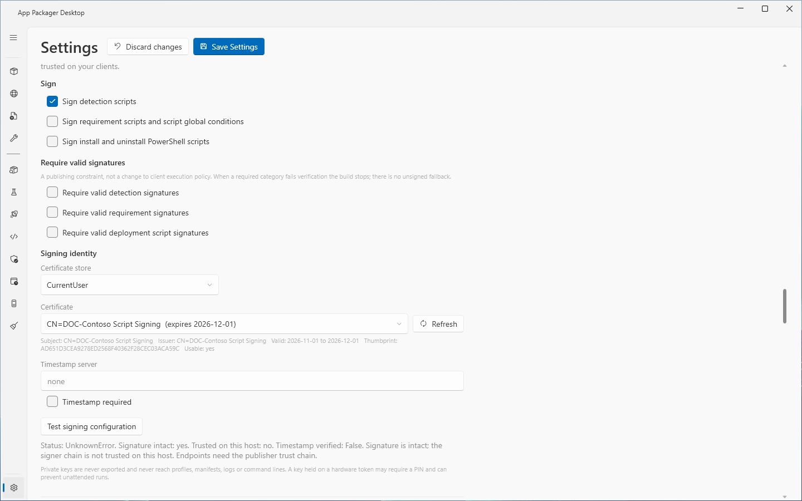

# Script signing

## What it does

Script signing adds an Authenticode signature to the scripts that a build generates. The scripts fall into three categories. Each category has a **Sign** switch and a **Require** switch.

| Category | Scripts | Sign switch | Require switch |
|---|---|---|---|
| Detection | Generated and custom detection scripts | **Sign detection scripts** | **Require valid detection signatures** |
| Requirement | Requirement scripts and script global conditions, including the VPN predicate | **Sign requirement scripts and script global conditions** | **Require valid requirement signatures** |
| Deployment | Install and uninstall PowerShell scripts | **Sign install and uninstall PowerShell scripts** | **Require valid deployment script signatures** |

The switches are independent. Signing a detection script does not sign the install scripts. Signing the deployment scripts does not sign the requirement scripts.

The app signs when you run Stage. All switches are off by default.

## When to use it

- Use **Sign** when the client computers run PowerShell with an execution policy that needs signed scripts, for example `AllSigned`.
- Use **Require** when a build must not leave the app without a valid signature in that category.
- Leave all switches off when the client policy does not check signatures.

## Requirements

- A code-signing certificate with a private key in `CurrentUser\My` or `LocalMachine\My` on this computer.
- Access to the private key for the account that runs the app. A key on a hardware token can need a PIN and can stop unattended runs.
- For a timestamp: a timestamp server address that starts with `http://` or `https://`, and network access to it.

The app never exports a private key. A private key never reaches profiles, manifests, logs or command lines.

## Steps

1. Open **Settings** and go to **Script Signing**.
2. Under **Signing identity**, choose **Certificate store**. `CurrentUser\My` is the supported identity. `LocalMachine\My` needs an explicit choice and tested private-key access.
3. Select **Refresh**. In the list **Certificate**, choose the certificate. Each entry shows the subject and the expiry date. An entry that is not usable ends with `[unusable]`.
4. Read the line under the list. It shows the subject, the issuer, the dates, the thumbprint and `Usable: yes` or `Usable: no - <reason>`.
5. Optional: enter a **Timestamp server**. A timestamped signature stays valid after the certificate expires. Select **Timestamp required** if a timestamp failure must fail the build.
6. Select the **Sign** switches for the categories to sign.
7. Optional: select the **Require** switches.
8. Select **Test signing configuration**. The app signs and verifies a temporary file with the selected certificate. It publishes nothing and saves nothing. Read the result under the button.
9. Select **Save Settings**.
10. Stage the applications again. Staged content from before the change keeps its old signature state.

The result of the test reads like this: `Status: <status>. Signature intact: yes. Trusted on this host: yes. Timestamp verified: <value>.` followed by a reason when one applies. *Signature intact* and *Trusted on this host* are two separate results. A signature can be intact and still not trusted on this computer. A local check does not prove that the certificate is trusted on your clients.

With a self-signed code-signing certificate that this computer does not trust, the result starts with `Status: UnknownError.` The text that follows names the cause: the signer chain is not trusted. The status word is not the cause. Read the text after it.

## How a build uses the switches

Stage resolves the certificate before it writes any file, when any Sign or Require switch is on. If the certificate is not usable, Stage stops and leaves no partial content.

The app then handles each category in this order: detection, requirement, deployment. After the three categories it checks that the launchers carry no execution-policy argument, and then it applies the Require switches.

| Sign | Require | Result for a script |
|---|---|---|
| off | off | The app does not touch the file. Status `NotRequested`. |
| off | on | A valid signature that exists stays (`ExistingSignatureValid`). Without a valid signature the status is `Failed` and the build stops. |
| on | off | The app signs the file and verifies it. Status `SignedAndVerified`. A vendor script that already has an intact signature stays as it is. If signing fails, the status is `Failed`. For the detection and requirement categories, the build continues. For the deployment category, the build stops. |
| on | on | The app signs and verifies. If the file does not verify, the build stops. |

A category with no script has the status `NotApplicable`. A **Require** switch does not stop a build for such a category. For example, a registry detection has no detection script.

With **Sign install and uninstall PowerShell scripts** on, the generated launchers run without an execution-policy argument. The execution policy of the client then applies. For this reason, a failed deployment signature stops the build.

With **Require**, the app refuses a build or a publish when a script of that category has no valid signature. There is no unsigned fallback. The message reads `Require<Category> is set but the <Category> category status is '<status>'; refusing to publish.`

The Deployment Helper applies the signing policy of the product to a Required deployment of a packaged application. See [Deployment Helper](../tools/deployment-helper.md).

Signed scripts reach the targets like this:

- ConfigMgr imports a signed detection script from its file, so the signature bytes stay intact. A required deployment signature is checked again at publish.
- Intune sets `enforceSignatureCheck` on a PowerShell detection rule when the detection script is signed or when a valid detection signature is required.

The staged `stage-manifest.json` records the signing result for each category. The plan on **Review & build** in the [Workbench](workbench.md) shows the signing line, for example `Signing : off; no script is signed in this build`.

## Options and settings

| Setting | Default | Effect |
|---|---|---|
| Sign detection scripts | off | Signs detection scripts. |
| Sign requirement scripts and script global conditions | off | Signs requirement scripts. |
| Sign install and uninstall PowerShell scripts | off | Signs deployment scripts and removes the execution-policy argument from the launchers. |
| Require valid detection signatures | off | Stops the build if detection scripts have no valid signature. |
| Require valid requirement signatures | off | Stops the build if requirement scripts have no valid signature. |
| Require valid deployment script signatures | off | Stops the build or the publish if deployment scripts have no valid signature. |
| Certificate store | `CurrentUser` | `CurrentUser\My` or `LocalMachine\My`. |
| Certificate | none selected | The certificate, selected by thumbprint. A renewed certificate has a new thumbprint. Select it again. |
| Timestamp server | empty (placeholder `none`) | Address of the timestamp service. |
| Timestamp required | off | A timestamp failure fails the signed build. |
| Hash algorithm | `SHA256` | Fixed. Settings has no control for it. |

A thumbprint that is not 40 hexadecimal characters is not accepted. The app resolves the certificate by thumbprint only. It never uses another certificate in its place.

See [Settings reference](../reference/settings.md).

## Limits

- The lab validated signed builds on a client that enforces `AllSigned`.
- **Test signing configuration** waits up to 30 seconds for the signature. A key that needs a PIN or a hardware token can exceed this time.
- The app signs only the scripts that it generates, and the vendor scripts that it finds in the staged folder. It does not sign the installer.
- A detection script, with its signature block, can be at most 32768 bytes. The app stops the stage when the signed script is larger.

## Troubleshooting

| Message | Cause | Fix |
|---|---|---|
| `SigningCertificateUnavailable: no certificate selected. Choose a code-signing certificate thumbprint in Options.` | A Sign or Require switch is on and no certificate is selected. | Select a certificate in Settings, Script Signing. |
| `SigningCertificateUnavailable: thumbprint <thumbprint> was not found in Cert:\<store>\My.` | The certificate is not in the chosen store. | Select the correct store and certificate. |
| `SigningCertificateUnavailable: certificate <thumbprint> expired on <date>. Select a renewed certificate.` | The certificate is expired. | Select the renewed certificate. |
| `SigningCertificateUnavailable: the private key for <thumbprint> is not accessible to this account.` | The account cannot use the private key. | Use an account with access to the key. |
| `SigningCertificateUnavailable: certificate <thumbprint> does not carry the code-signing extended key usage.` | The certificate is not a code-signing certificate. | Select a code-signing certificate. |
| `The timestamp server URL must begin with http:// or https://.` | The timestamp address is not valid. | Correct the address. |
| `Signing did not complete within 30 seconds; the private key may require interactive confirmation.` | The key waits for a PIN or a token. | Complete the prompt, or use a key that needs no prompt. |
| `Require<Category> is set but the <Category> category status is '<status>'; refusing to publish.` | A Require switch is on and the category has no valid signature. | Turn on the Sign switch of the category, or sign the scripts, then stage again. |
| `TimestampRequired is set but the <Category> script '<path>' carries no timestamp counter-signature (server '<server>').` | The timestamp server gave no timestamp. | Check the timestamp server address. |
| `Detection script is <n> bytes after signing; ConfigMgr refuses a script larger than <limit> bytes.` | The signed script is too large. | Shorten the script. |

The first message names "Options". In the app, this place is **Settings**.

See [Error messages](../reference/error-messages.md).

## Links

- [Set-AuthenticodeSignature](https://learn.microsoft.com/powershell/module/microsoft.powershell.security/set-authenticodesignature): Documents the cmdlet that signs a script.
- [Get-AuthenticodeSignature](https://learn.microsoft.com/powershell/module/microsoft.powershell.security/get-authenticodesignature): Documents the cmdlet that reads the signature of a file.
- [about_Signing](https://learn.microsoft.com/powershell/module/microsoft.powershell.core/about/about_signing): Explains how to sign scripts and how the host trusts the certificate.
- [about_Execution_Policies](https://learn.microsoft.com/powershell/module/microsoft.powershell.core/about/about_execution_policies): Explains the execution policies and the scopes where they apply.
- [Time Stamping Authenticode Signatures](https://learn.microsoft.com/windows/win32/seccrypto/time-stamping-authenticode-signatures): Explains time stamps for Authenticode signatures.
- [SignTool](https://learn.microsoft.com/windows/win32/seccrypto/signtool): Documents the SignTool command.
