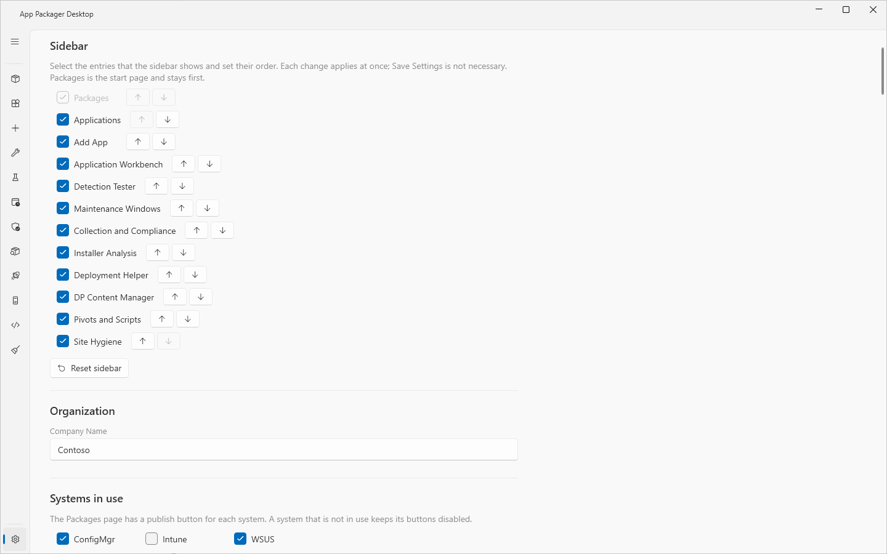
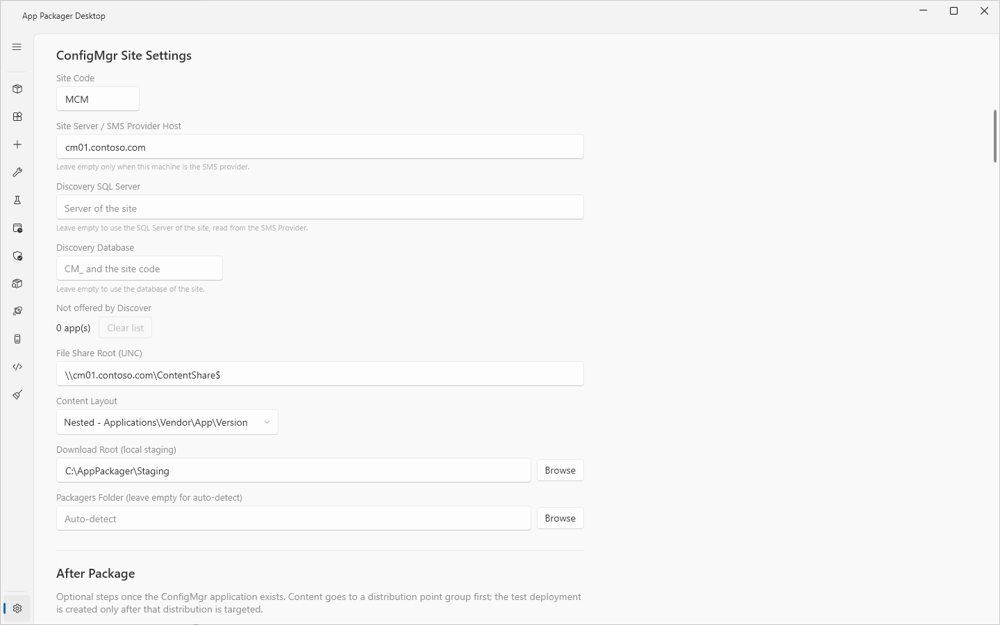
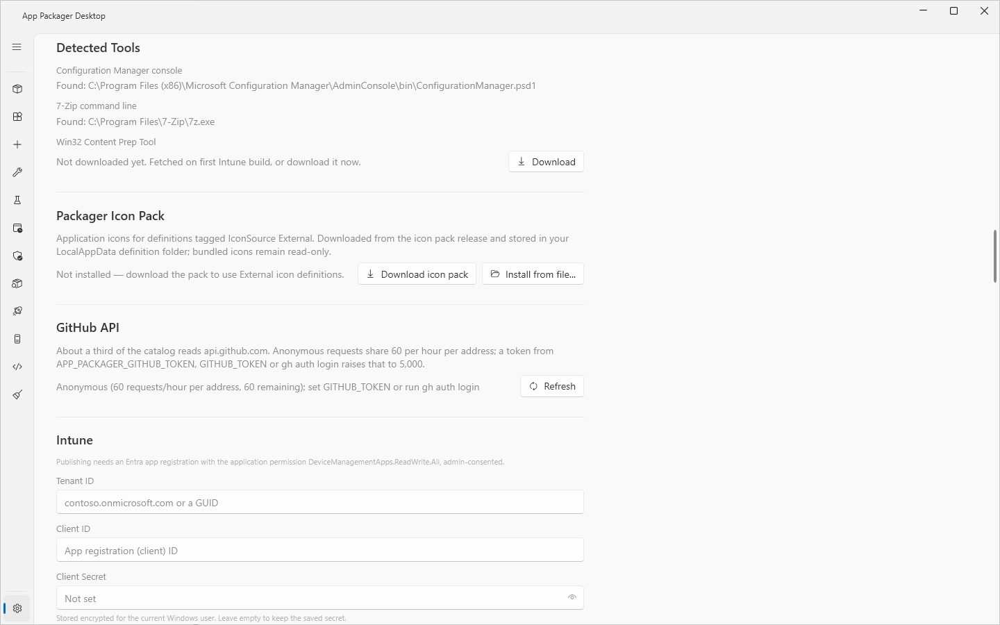
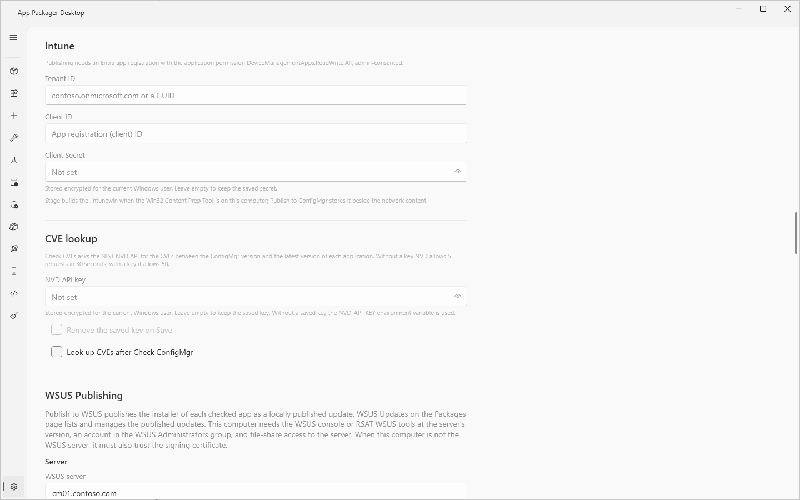
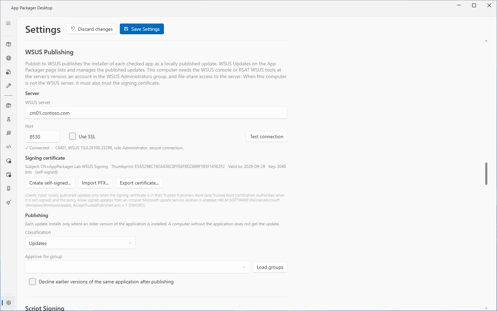
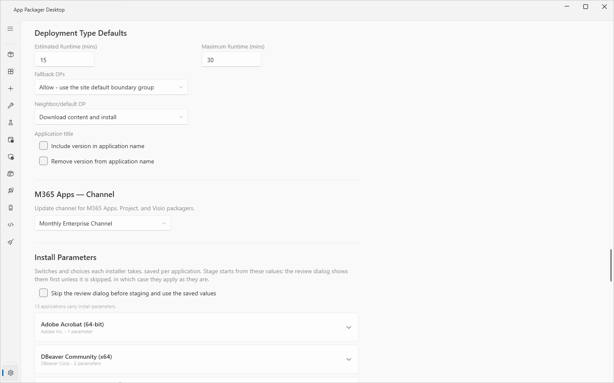
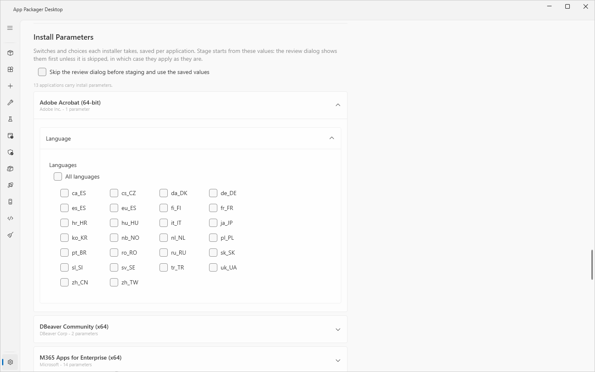
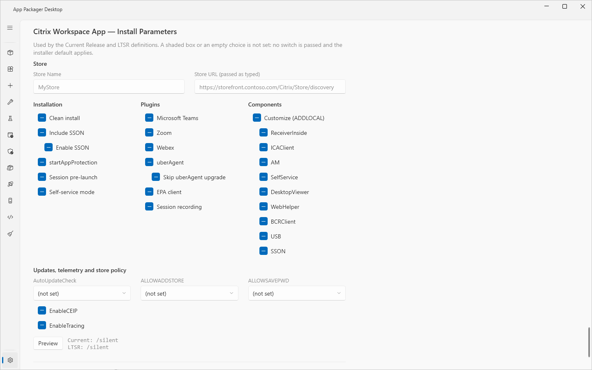
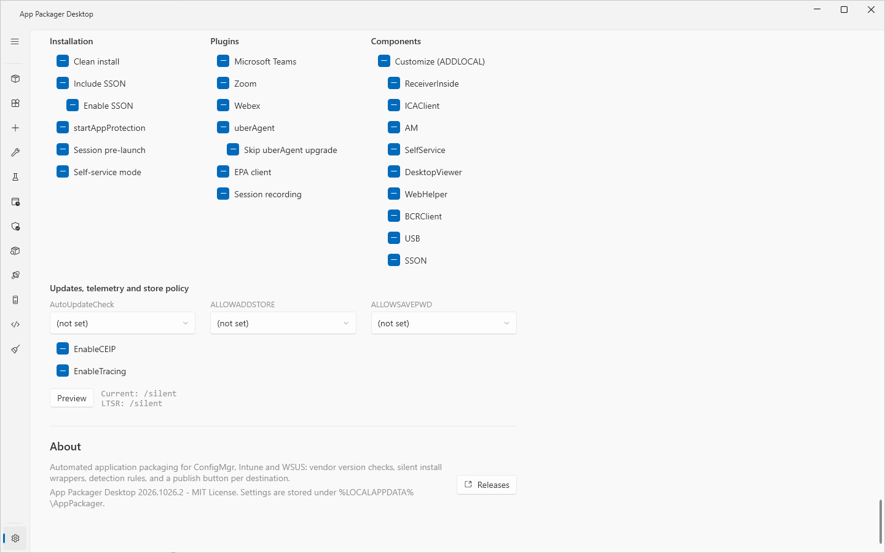

# Settings page

The Settings page holds the settings of App Packager Desktop. This page describes each section in the order that the page shows it.

## What it does

The Settings page sets the systems in use, the connection details, the publish options and the signing policy. It stores them in `settings.json` in the data folder `%LOCALAPPDATA%\AppPackager`. The Sidebar section applies at once. Every other section is stored when you select **Save Settings**.

## When to use it

Use the page after the Setup window, or when a site, share, certificate or key changes. [reference/settings.md](../reference/settings.md) lists every setting with its default and storage key.

## Requirements

- A save writes to the data folder of the current Windows user. The folder cannot be a junction or a symbolic link. It cannot be under Program Files.

## Steps

1. Select **Settings**, the last entry of the sidebar.
2. Change the values in the sections below.
3. Select **Save Settings**. The snackbar shows "Settings saved."
4. To discard unsaved edits, select **Discard changes**. The button reloads every setting on the page from the saved settings.

The theme choice **Dark** or **Light** is at the top of the page. The window changes at once when you select a theme. **Save Settings** stores the choice. The default theme is **Dark**.

## Options and settings of this page

### Sidebar

Each entry has a check box, a **Move up** button and a **Move down** button. **Reset sidebar** restores the default order and shows every entry. These changes apply at once. **Save Settings** is not necessary. **Packages** stays first and cannot be hidden.

### Organization

| Control | Default | Effect |
|---|---|---|
| **Company Name** | Empty | When a Packagers folder exists, App Packager Desktop writes the value to `packager-preferences.json` in that folder, for PS1 packagers. No other part of the application reads it. |

### Systems in use

| Control | Default | Effect |
|---|---|---|
| **ConfigMgr** | Selected | Enables **Check ConfigMgr** and **Publish to ConfigMgr**. |
| **Intune** | Cleared | Enables **Publish to Intune**. |
| **WSUS** | Cleared | Enables **Publish to WSUS** and **WSUS Updates**. |

A system that is not in use keeps its buttons disabled. A settings file that has no systems value infers Intune from a stored tenant ID and WSUS from a stored server name.

### ConfigMgr Site Settings

| Control | Default | Effect |
|---|---|---|
| **Site Code** | `MCM` | The site for every ConfigMgr step. Replace the default with your site code. |
| **Site Server / SMS Provider Host** | Empty | The host that the CMSite drive connects to. Empty means this computer. Leave it empty only when this computer is the SMS Provider. |
| **Discovery SQL Server** | Empty | The SQL Server instance of the site database. Empty means the value from the SMS Provider. Windows authentication only. |
| **Discovery Database** | Empty | The database name. Empty means `CM_` and the site code. |
| **Not offered by Discover**, **Clear list** | Empty list | Applications that Discover unmanaged software no longer offers. **Clear list** takes effect on **Save Settings**. |
| **File Share Root (UNC)** | `\\fileserver\sccm$` | The root of the content share. Content goes under `Applications`. |
| **Content Layout** | **Nested - Applications\Vendor\App\Version** | The other choice is **Flat - Applications\Vendor-App-Version**. |
| **Download Root (local staging)**, **Browse** | `Staging` in the data folder | The local staging folder. The application refuses a folder that other accounts can write to. |
| **Packagers Folder (leave empty for auto-detect)**, **Browse** | Empty | The folder of PS1 packagers. Empty means the `Packagers` folder next to the executable. |

### After Package

Both steps are optional. They run after the ConfigMgr application exists. All controls are cleared at first.

| Control | Effect |
|---|---|
| **Distribute content after Package** | Distributes the content to the group below. A group that holds the content counts as done. |
| **Distribution point group** | The group name. The placeholder is `All DPs`. |
| **Deploy to a test collection after distribution** | Creates an Available deployment, effective at once. An existing deployment counts as done. |
| **Use a user collection** | Targets users. Cleared means a device collection. This does not change the install context. |
| **Test collection** | The collection name. The match is literal. |
| **Create the collection if it does not exist** | Creates an empty collection, limited to All Users or All Systems. Add pilot members in ConfigMgr. |

The controls for the test deployment are disabled until **Distribute content after Package** is selected. See [Deployment behavior](../deployment-behavior.md).

### One Click Settings

See [One Click](one-click.md). The section has **Action on update** (**Report only**, **Stage**, **Stage and Publish**; default **Report only**), **Default cadence (days)** (default 7), **Force on launch (ignore cadence)** (default cleared), **Default destinations** (**ConfigMgr**, **WSUS**, **Intune**), **Existing ConfigMgr app** (**Skip the application** or **Overwrite it**; default **Skip the application**), the buttons **Track none**, **Track all** and **Refresh list**, and a grid with the columns **Track**, **Application**, **Vendor**, **ConfigMgr**, **WSUS**, **Intune** and **Cadence (days)**.

### Detected Tools

| Item | Effect |
|---|---|
| **Configuration Manager console** | Shows if the console is found. |
| **7-Zip command line** | Shows if `7z.exe` is found. Installer analysis and archive extraction need it. |
| **Win32 Content Prep Tool**, **Download** | Fetches `IntuneWinAppUtil.exe` and checks its publisher signature before use. |

### Packager Icon Pack and GitHub API

- **Install from file...** and **Download icon pack** install application icons. The download checks a SHA-256 value.
- **Refresh** under **GitHub API** shows the request budget. A token from `APP_PACKAGER_GITHUB_TOKEN`, `GITHUB_TOKEN` or `gh auth login` raises the limit from 60 to 5,000 requests each hour.

### Intune and CVE lookup

| Control | Effect |
|---|---|
| **Tenant ID**, **Client ID** | The Entra app registration. The application permission `DeviceManagementApps.ReadWrite.All` must have admin consent. |
| **Client Secret** | Stored encrypted for the current Windows user. An empty box keeps the saved secret. |
| **NVD API key** | Stored encrypted for the current Windows user. An empty box keeps the saved key. Without a saved key, the `NVD_API_KEY` variable is used. |
| **Remove the saved key on Save** | Deletes the saved key when you select **Save Settings**. |
| **Look up CVEs after Check ConfigMgr** | Cleared at first. Runs the CVE lookup after **Check ConfigMgr**. |

### WSUS Publishing

| Control | Default | Effect |
|---|---|---|
| **WSUS server** | Empty | Empty means WSUS is not set up. |
| **Port**, **Use SSL** | 8530; 8531 with SSL | The port follows **Use SSL** until you type a port. |
| **Test connection**, **Cancel** | | Reads the server version, the account role and the signing certificate. |
| **Create self-signed...**, **Import PFX...**, **Export certificate...** | | Sets or exports the signing certificate. |
| **Classification** | **Updates** | The WSUS classification of every published update. |
| **Approve for group**, **Load groups** | Empty | Empty publishes without approval. |
| **Decline earlier versions of the same application after publishing** | Cleared | Declines the lower-version updates of the same application. |

See [WSUS publishing](wsus-publishing.md).

### Script Signing

The section has three **Sign** check boxes and three **Require valid ... signatures** check boxes, all cleared at first. It also has **Certificate store** (**CurrentUser\My** or **LocalMachine\My**), **Certificate**, **Refresh**, **Timestamp server**, **Timestamp required** and **Test signing configuration**. The timestamp server must start with `http://` or `https://`. See [Script signing](script-signing.md).

### Deployment Type Defaults

| Control | Default | Effect |
|---|---|---|
| **Estimated Runtime (mins)** | 15 | Range 1 to 120. |
| **Maximum Runtime (mins)** | 30 | Range 1 to 720. |
| **Fallback DPs** | **Allow - use the site default boundary group** | The other choice is **Deny - current and neighbor groups only**. |
| **Neighbor/default DP** | **Download content and install** | The other choice is **Do not download content**. |
| **Include version in application name** | Cleared | One ConfigMgr application for each release. Existing applications are not renamed. |
| **Remove version from application name** | Cleared | Available while the first box is cleared. |

A choice in the Application Workbench overrides the title choices. The two content options apply to deployment types that later Package runs create.

### M365 Apps, Install Parameters and sources

- **M365 Apps — Channel**: **Monthly Enterprise Channel** (default), **Current Channel** or **Semi-Annual Enterprise Channel (kiosk)**.
- **Install Parameters**: **Skip the review dialog before staging and use the saved values** (cleared at first). Each application with install parameters has an expander. An application marked for review in its definition still shows the dialog.
- **Local Installer Sources**: one **Browse...** folder for each application whose download needs a sign-in. Stage takes the highest file version in the folder. The installer must carry a valid signature.
- **Packager Files**: one **Browse...** file for each file that an installer reads from its folder. The file is copied beside the installer and is never read.

### Citrix Workspace App — Install Parameters

The section sets the install switches of the Citrix Workspace App definitions: **Store**, **Installation**, **Plugins**, **Components**, and the groups for updates, telemetry and store policy. A shaded box or an empty choice passes no switch. **Preview** shows the arguments for Current Release and LTSR.

### About

The section shows the application name, the version, and the text "MIT License. Settings are stored under %LOCALAPPDATA%\AppPackager." **Releases** opens the releases page of the project in the browser.

## Limits

- A settings file that cannot be read gives the defaults. Nothing is written to that file until you select **Save Settings**. The save first keeps the unreadable file as `settings.json.unreadable-<timestamp>`.
- A staging root that is still the old default `C:\temp\ap` moves one time to the per-user folder. A notice states this.
- The setting **Deployment Target** for Intune has no control. It follows **Default destinations** in **One Click Settings**.

## Troubleshooting

| Message | Cause | Fix |
|---|---|---|
| Settings file could not be read: `<path>` (`<reason>`). | `settings.json` is not valid or not readable. | Select **Save Settings** to replace it. The old file is kept. |
| Staging folder '`<f>`' can be changed by other accounts. | The access list of the staging root allows other accounts to write. | Use a folder that only your account and administrators can write. |
| The timestamp server URL must begin with http:// or https://. | The **Timestamp server** value is not a URL. | Correct the value. |
| WSUS server name '`<x>`' is not a host name. | The **WSUS server** value is malformed. | Correct the name. |

See [Troubleshooting](../troubleshooting.md) and [error messages](../reference/error-messages.md).

## Links

- [Authentication and authorization basics](https://learn.microsoft.com/graph/auth/auth-concepts): Explains how an app gets an access token for Graph.
- [Microsoft Graph permissions reference](https://learn.microsoft.com/graph/permissions-reference): Lists the Graph permissions that each API needs.
- [Fundamentals of role-based administration for Configuration Manager](https://learn.microsoft.com/intune/configmgr/core/understand/fundamentals-of-role-based-administration): Explains security roles, security scopes and collections for administrative users.
- [Plan for the SMS Provider](https://learn.microsoft.com/intune/configmgr/core/plan-design/hierarchy/plan-for-the-sms-provider): Explains the SMS Provider role.
