# Settings page

The Settings page holds the settings of App Packager Desktop. This page describes each section in the order that the page shows it. The list of sections is on the left. To change the width of the list, drag the handle between the list and the section.

## What it does

The Settings page sets the systems in use, the connection details, the publish options and the signing policy. It stores them in `settings.json` in the data folder `%LOCALAPPDATA%\AppPackager`. The Sidebar section applies at once. Every other section is stored when you select **Save Settings**.

## When to use it

Use the page after the Setup window, or when a site, share, certificate or key changes. [reference/settings.md](../reference/settings.md) lists every setting with its default and storage key.

## Requirements

- A save writes to the data folder of the current Windows user. The folder cannot be a junction or a symbolic link. It cannot be under Program Files.

## Steps

1. Select **Settings**, the last entry of the sidebar.
2. Change the values in the sections below.
3. Select **Save Settings** in the page header, at the top right. The snackbar shows "Settings saved."
4. To discard unsaved edits, select **Discard changes** next to it. The button reloads every setting on the page from the saved settings.

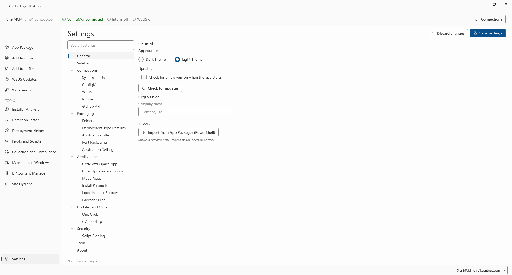

The theme choice **Dark Theme** or **Light Theme** is at the top of the page. The window changes at once when you select a theme. **Save Settings** stores the choice. The default theme is **Dark Theme**.

## Options and settings of this page

### Sidebar

Each entry has a check box, a **Move up** button and a **Move down** button. **Reset sidebar** restores the default order and shows every entry. These changes apply at once. **Save Settings** is not necessary. The entries are in two groups, the first group and **TOOLS**. An entry moves only inside its group. **App Packager** stays first and cannot be hidden.

### Updates

| Control | Default | Effect |
|---|---|---|
| **Check for a new version when the app starts** | On | The app asks GitHub for the latest release once at start. A newer version opens the update window. Select **Save Settings** to store the choice. |
| **Check for updates** | - | Opens the update window and checks at once. See [Updates](updates.md). |

### Organization

| Control | Default | Effect |
|---|---|---|
| **Company Name** | Empty | When a Packagers folder exists, App Packager Desktop writes the value to `packager-preferences.json` in that folder, for PS1 packagers. No other part of the application reads it. |

### Systems in Use

| Control | Default | Effect |
|---|---|---|
| **ConfigMgr** | Selected | Enables **Check ConfigMgr** and **Publish to ConfigMgr**. |
| **Intune** | Cleared | Enables **Publish to Intune**. |
| **WSUS** | Cleared | Enables **Publish to WSUS** and **Publish All** for WSUS and the **WSUS Updates** entry of the sidebar. |

ConfigMgr is selected at first. The three systems are independent, and each one is optional. Clear **ConfigMgr** and select **Intune**, **WSUS** or both to publish with no ConfigMgr site, console or file share. A system that is not in use keeps its buttons disabled. A settings file that has no systems value infers Intune from a stored tenant ID and WSUS from a stored server name.

### ConfigMgr Site Settings

The site fields (**Site Code**, **Site Server / SMS Provider Host**, **File Share Root (UNC)**) apply to ConfigMgr only. A run that does not publish to ConfigMgr does not read them. **Download Root (local staging)** and **Packagers Folder** are in this section, but they are not ConfigMgr settings: every destination uses them.

| Control | Default | Effect |
|---|---|---|
| **Site Code** | `MCM` | The site for every ConfigMgr step. Replace the default with your site code. |
| **Site Server / SMS Provider Host** | Empty | The host that the CMSite drive connects to. Empty means this computer. Leave it empty only when this computer is the SMS Provider. |
| **Discovery SQL Server** | Empty | The SQL Server instance of the site database. Empty means the value from the SMS Provider. Windows authentication only. |
| **Discovery Database** | Empty | The database name. Empty means `CM_` and the site code. |
| **Discover not selected**, **Discover all** | Not applicable | Scan the site inventory for applications that the catalog can package. **Discover not selected** scans only the applications that are cleared in the Catalog and were not dismissed. **Discover all** scans every application. A scan changes nothing until you choose in the prompt. After the first-run setup, the program asks if it must run **Discover not selected** to help you pick the applicable products. |
| **Not offered by Discover**, **Clear list** | Empty list | Applications that Discover unmanaged software no longer offers. **Clear list** takes effect on **Save Settings**. |
| **File Share Root (UNC)** | `\\fileserver\sccm$` | The root of the content share. Content goes under `Applications`. |
| **Content Layout** | **Nested - Applications\Vendor\App\Version** | The other choice is **Flat - Applications\Vendor-App-Version**. |
| **Download Root (local staging)**, **Browse** | `Staging` in the data folder | The local staging folder. The application refuses a folder that other accounts can write to. |
| **Packagers Folder (leave empty for auto-detect)**, **Browse** | Empty | The folder of PS1 packagers. Empty means the `Packagers` folder next to the executable. |

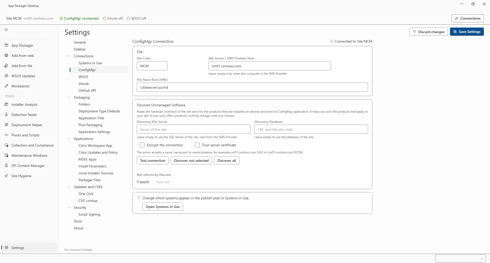

### Post Packaging

Both steps are optional. They run after the ConfigMgr application exists. All controls are cleared at first.

| Control | Effect |
|---|---|
| **Distribute content after Package** | Distributes the content to the group below. A group that holds the content counts as done. |
| **Distribution point group** | The group name. The placeholder is `All DPs`. |
| **Deploy to a test collection after distribution** | Creates an Available deployment, effective at once. An existing deployment counts as done. |
| **Use a user collection** | Targets users. Cleared means a device collection. This does not change the install context. |
| **Test collection** | The collection name. The match is literal. |
| **Create the collection if it does not exist** | Creates an empty collection, limited to All Users or All Systems. Add pilot members in ConfigMgr. |

The controls for the test deployment are disabled until **Distribute content after Package** is selected. See [Deployment behavior](../deployment-behavior.md).

### Application Settings

This page holds the defaults for all applications, and one grid with the settings of each application. The grid replaces the Deployment Conditions page of earlier versions: it lists every application of the App Packager page, and every column is a setting that the package run uses.

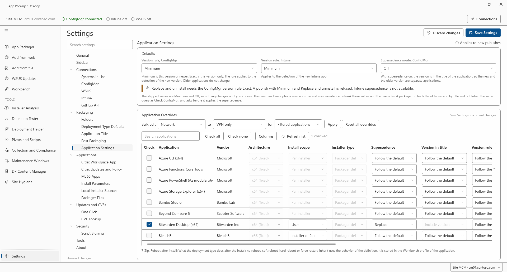

| Control | Default | Effect |
|---|---|---|
| **Version rule, ConfigMgr**, **Version rule, Intune** | **Minimum** | The operator of the version clause of the detection that is published. **Minimum** is this version or newer. **Exact** is this version only. See [Publish to ConfigMgr](publish-to-configmgr.md). |
| **Supersedence mode, ConfigMgr** | **Off** | The default for every application: **Off**, **Replace** or **Replace and uninstall**. An application that has no setting of its own follows it. |

The grid has one row for each application. **Columns** lists every setting that the grid can show; the first five are on at the start, and the others are one click away. A setting that does not apply to an application is greyed out, and its tooltip says why. It is never ignored without a sign.

| Column | Choices | Effect |
|---|---|---|
| **Check** | Checked or not | Marks the application for the bulk bar. |
| **Application**, **Vendor** | Not applicable | The application. The grid sorts by name. |
| **Package source** | **Packager default**, **x64 only**, **ARM64 only**, **x64 and ARM64** | The architecture of the package. The choice is offered only for an application that has an architecture choice (a second installer for another architecture). An application with one architecture shows it, for example **x64 (fixed)**. **x64 only** and **ARM64 only** add a requirement to the deployment type. **x64 and ARM64** makes one deployment type for each architecture. |
| **Install scope** | **Installer default**, **System**, **User** | **System** installs for all users. **User** installs for the signed-in user, and the install command, the uninstall command and the detection follow. The choice is offered only for an installer that supports both. |
| **Supersedence** | **Follow the default**, **Off**, **Replace**, **Replace and uninstall** | The supersedence mode of one application. |
| **Version in title** | **Follow the default**, **Include version**, **No version** | **Include version** adds the version to the name of the application, so each release is its own application. **No version** removes it, so one application carries every release. While supersedence is on for the application the cell is locked to **Include version**, because the new and the older version must be separate applications. |
| **Version rule** | **Follow the default**, **Minimum**, **Exact** | The version rule of one application. |
| **Network** | **Any network**, **VPN only**, **On site only** | A requirement of the deployment type: the computer is on the VPN, or is not. |
| **Network split** | **No split**, **VPN and managed** | One deployment type for computers on the VPN and one for the others. Offered only for an application that supports it. |
| **Install command**, **Uninstall command** | Text | Replaces the command line of the deployment type. Empty keeps the command of the definition. |
| **Estimated runtime (min)**, **Maximum runtime (min)** | Number | The runtime of the deployment type in minutes. Empty inherits the default runtime. The value is a field of the Workbench profile of the application (see below). |
| **Reboot after install** | **Inherit**, **No reboot**, **Soft reboot**, **Hard reboot**, **Force restart** | What the deployment type does after the install. **Inherit** uses the behavior of the definition. The value is a field of the Workbench profile of the application. |
| **Distribution point group** | Text | The distribution point group that receives the content of this application after Package. Empty uses the group of the Post Packaging page. A group here also turns the distribution on for this application. |
| **Test collection** | Text | The collection that receives the test deployment of this application. Empty uses the collection of the Post Packaging page. A collection here also turns the test deployment on for this application. |
| **Detection** | **Inherit**, **Custom in Workbench** | Read only. It shows whether the Workbench profile of the application holds its own detection rule. A detection rule is a list of rules, so you edit it in the Workbench. |
| **In One Click** | **No**, **Yes** | Includes the application in a One Click run. |
| **Check interval (days)** | Number | How many days a fresh check stays valid. Empty uses the default interval. |
| **Publish to ConfigMgr**, **Publish to Intune**, **Publish to WSUS** | **Follow the default**, **Yes**, **No** | The destinations of the application in One Click. **Follow the default** uses the One Click default destinations. WSUS is greyed out for an application that WSUS cannot publish. |

The bulk bar sets one column for several applications. Choose the column, the value and the applications, then select **Apply**. The applications are the **Checked applications**, the **Filtered applications** (the rows that the search box shows: type part of a name or of a vendor) or **All applications**. The first value of a column returns the application to its default. **None: reset all** returns every column of every application to its default. **Check all**, **Check none** and **Refresh list** manage the list. An application that a setting does not apply to keeps its value when the bulk bar sets that column.

The changes of this page are written on **Save Settings**. A package run reads the distribution point group and the test collection of the application first, and the settings of the Post Packaging page when the application has none. They are stored in the keys that the package run reads: `Supersedence.Mode`, `Supersedence.TitleOverrides` (the mode and the version rule of an application) `DeploymentConditions` (package source, install scope, version in title, network and network split of an application, keyed by the definition identifier), `CommandOverrides` (the install and uninstall commands) `DistributionOverrides` (the distribution point group and the test collection of an application), and the One Click keys (`OneClick.TrackedApplications`, `OneClick.CadenceOverrides`, `OneClick.Destinations`). A value that an earlier version stored still shows in its cell. The runtime and reboot columns write fields of the Workbench profile of the application, with the semantics of the Workbench: an empty value or **Inherit** removes the field so the next level supplies the value, and a value is a custom override. The grid writes the profile that carries the saved conditions (named Migrated) and creates it when it is missing. It becomes the active profile only while the application is on the default profile. When an application uses another profile that you chose, the cell is greyed out and its tooltip names the profile: set the value in the Workbench. A detection rule has no column to edit it, because it is a list of rules, not one value: edit it in the Workbench. Nothing here switches supersedence on by itself, and a package run still asks before it applies a supersedence. A Workbench profile that you made for an application outranks the grid for the package source, the install scope and the version in title of that application. See [Workbench](workbench.md).

### One Click Settings

See [One Click](one-click.md). The section has **Action on update** (**Report only**, **Stage**, **Stage and Publish**; default **Report only**), **Default cadence (days)** (default 7), **Force on launch (ignore cadence)** (default cleared), **Default destinations** (**ConfigMgr**, **WSUS**, **Intune**), **Existing ConfigMgr app** (**Skip the application** or **Overwrite it**; default **Skip the application**), the buttons **Track none**, **Track all** and **Refresh list**, and a grid with the columns **Track**, **Application**, **Vendor**, **ConfigMgr**, **WSUS**, **Intune** and **Cadence (days)**.

### Detected Tools

| Item | Effect |
|---|---|
| **Configuration Manager console** | Shows if the console is found. |
| **7-Zip command line** | Shows if `7z.exe` is found. Installer analysis and archive extraction need it. |
| **Win32 Content Prep Tool**, **Download** | Fetches `IntuneWinAppUtil.exe` and checks its pinned SHA-256 and its publisher signature before use. |

### Packager Icon Pack and GitHub API

- **Install from file...** and **Download icon pack** install application icons. The download checks a SHA-256 value.
- **Refresh** under **GitHub API** shows the one status line of the GitHub sign-in: the source of the token (`Signed in via GitHub CLI as <account>`, `Token saved in settings as <account>`, `Environment variable GITHUB_TOKEN as <account>`), or `Not authenticated: 60 requests per hour`, with the requests that are left. A token that GitHub refuses shows `Token rejected (401)`. The **GitHub token** box below it says which source provides the token now; a token that you save there wins over the environment and the GitHub CLI. Any token raises the limit from 60 to 5,000 requests each hour.

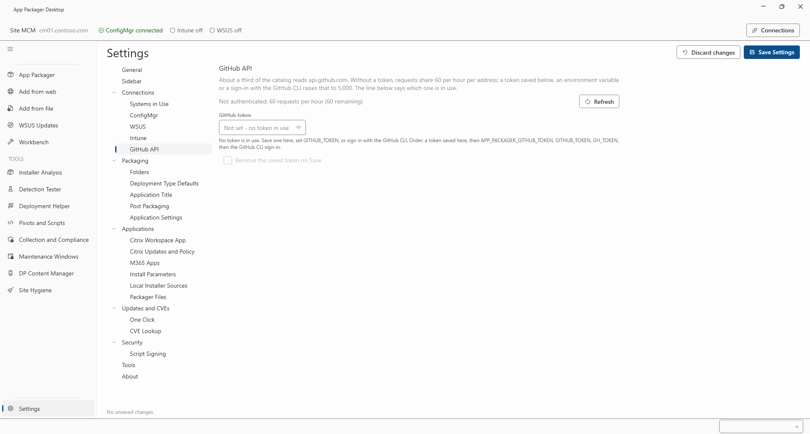

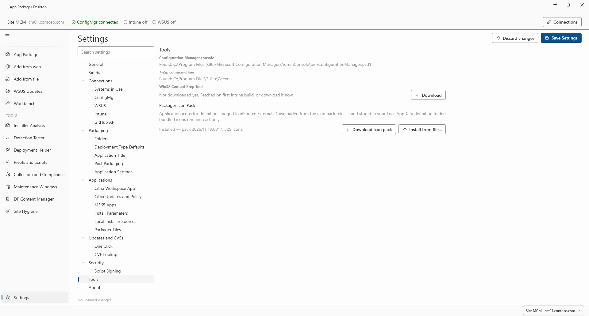

### Intune and CVE Lookup

| Control | Effect |
|---|---|
| **Tenant ID**, **Client ID** | The Entra app registration. The application permission `DeviceManagementApps.ReadWrite.All` must have admin consent. |
| **Client Secret** | Stored encrypted for the current Windows user. An empty box keeps the saved secret. |
| **Minimum Windows release** | The oldest Windows release that an Intune app is offered to. Every Intune app that is published gets it. Default: `Windows10_21H2`, which every app got before the setting existed. The setting changes nothing in Intune by itself. The next publish of an app sends the new value, also for an app that is already in Intune, and devices below that release then no longer get the app. |
| **NVD API key** | Stored encrypted for the current Windows user. An empty box keeps the saved key. Without a saved key, the `NVD_API_KEY` variable is used. |
| **Remove the saved key on Save** | Deletes the saved key when you select **Save Settings**. |
| **Look up CVEs after Check ConfigMgr** | Cleared at first. Runs the CVE lookup after **Check ConfigMgr**. |

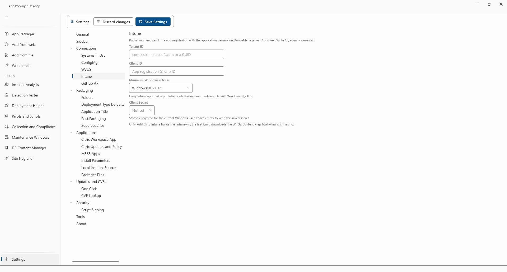

### WSUS Publishing

| Control | Default | Effect |
|---|---|---|
| **WSUS server** | Empty | Empty means WSUS is not set up. |
| **Port**, **Use SSL** | 8530; 8531 with SSL | The port follows **Use SSL** until you type a port. |
| **Test connection**, **Cancel** | | Reads the server version, the account role and the signing certificate. |
| **Create self-signed...**, **Import PFX...**, **Export certificate...** | | Sets or exports the signing certificate. |
| **Classification** | **Updates** | The WSUS classification of every published update. |
| **Approve for group**, **Load groups** | Empty | Empty publishes without approval. |
| **Decline earlier versions of the same application after publishing** | Cleared | Declines the lower-version updates of the same application. |

See [WSUS publishing](wsus-publishing.md).

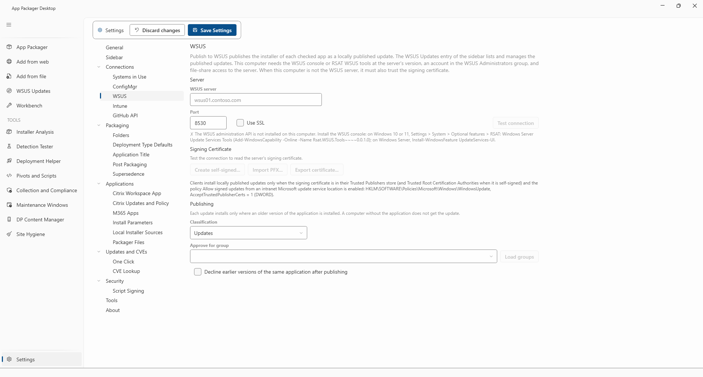

### Script Signing

The section has three **Sign** check boxes and three **Require valid ... signatures** check boxes, all cleared at first. It also has **Certificate store** (**CurrentUser\My** or **LocalMachine\My**), **Certificate**, **Refresh**, **Timestamp server**, **Timestamp required** and **Test signing configuration**. The timestamp server must start with `http://` or `https://`. See [Script signing](script-signing.md).

### Deployment Type Defaults

| Control | Default | Effect |
|---|---|---|
| **Estimated Runtime (mins)** | 15 | Range 1 to 120. |
| **Maximum Runtime (mins)** | 30 | Range 15 to 720. The site refuses other values. |
| **Fallback DPs** | **Allow - use the site default boundary group** | The other choice is **Deny - current and neighbor groups only**. |
| **Neighbor/default DP** | **Download content and install** | The other choice is **Do not download content**. |
| **Include version in application name** | Cleared | One ConfigMgr application for each release. Existing applications are not renamed. |
| **Remove version from application name** | Cleared | Available while the first box is cleared. |

A choice in the Workbench overrides the title choices. The two content options apply to deployment types that later Package runs create.

### M365 Apps, Install Parameters and sources

- **M365 Apps - Channel**: **Monthly Enterprise Channel** (default), **Current Channel** or **Semi-Annual Enterprise Channel (kiosk)**.
- **Install Parameters**: **Skip the review dialog before staging and use the saved values** (cleared at first). Each application with install parameters has an expander. An application marked for review in its definition still shows the dialog.
- **Local Installer Sources**: one **Browse...** folder for each application whose installer a script cannot download (a vendor sign-in or a bot protection). You put the file in the folder by hand. Stage takes the highest file version in the folder. The installer must carry a valid signature, except where the row says otherwise. See [Installer source folders](#installer-source-folders).
- **Packager Files**: one **Browse...** file for each file that an installer reads from its folder. The file is copied beside the installer and is never read.

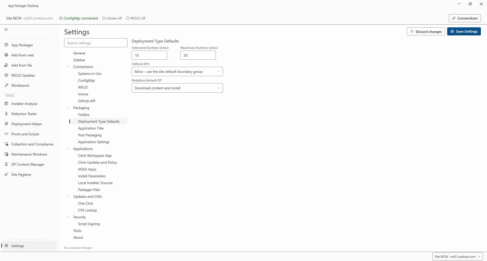

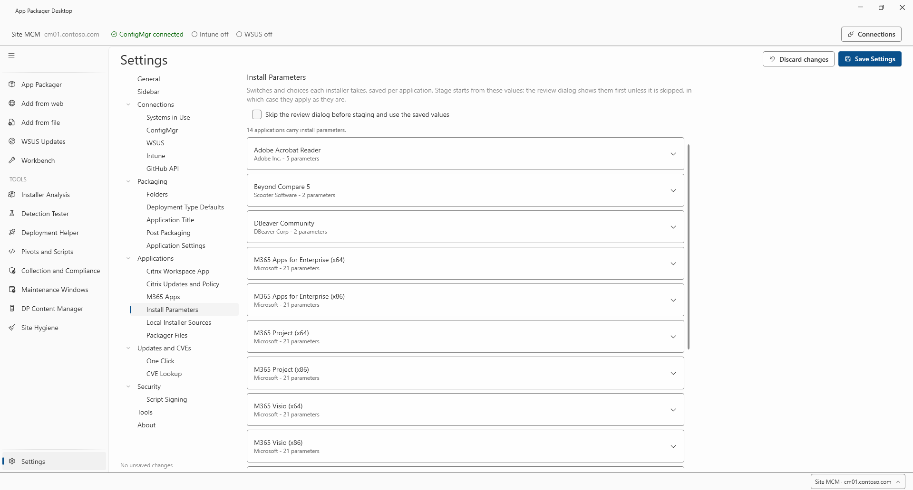

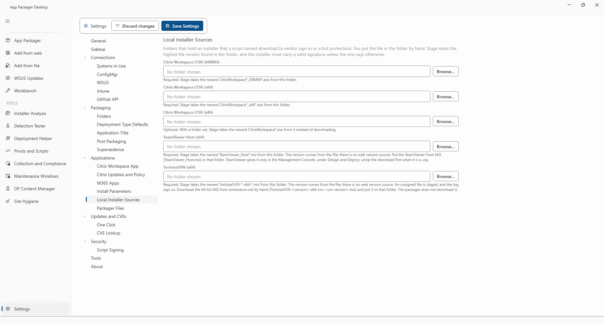

### Installer source folders

Some installers cannot be downloaded by a script. TeamViewer gives the Host MSI only to signed-in Management Console users. The TortoiseSVN site protects its download page against scripts, and App Packager Desktop does not try to get around that protection. For these applications you fill a folder, and Stage takes the installer from it.

| Application | Put in the folder | File name rule |
|---|---|---|
| TeamViewer Host (x64) | The MSI from the Management Console, under Design and Deploy. Unzip the download first when it is a .zip; a .zip is not read. | `TeamViewer_Host*.msi` |
| TortoiseSVN (x64) | The x64 MSI from tortoisesvn.net, downloaded by hand. | `TortoiseSVN-*-x64-*.msi` |
| Citrix Workspace LTSR (x64, ARM64; x86 when you set a folder) | The installer from the Citrix download page. | `CitrixWorkspace*_<architecture>*.exe` |

- **Where the folder is set.** Settings, Local Installer Sources: one folder for each application (the same folder is allowed). Stage and One Click ask for it when it is empty.
- **Which file.** When the folder holds more than one match, the file with the highest version is staged: the ProductVersion of an MSI file, the file version of an EXE. A tie goes to the newest write time.
- **Which version.** For TeamViewer Host and TortoiseSVN the version is the ProductVersion of the MSI file. It names the staged folder, the application and the detection. No web page is read. The TortoiseSVN MSI has three parts (for example `1.14.29743`); its file name has four.
- **No matching file.** The run stops with a message that names the folder and the file to put there.
- **Check Latest.** These two applications have no web version source. Check Latest shows the version of the newest matching MSI in the folder. With no folder or no matching file it fails, and the message says where the version comes from and what to put in the folder. Check ConfigMgr does not depend on it.
- **Signature.** TeamViewer Host stages only an MSI with a valid signature. TortoiseSVN stages the file either way and the log shows the signature status.

### Citrix Workspace App - Install Parameters

The section sets the install switches of the Citrix Workspace App definitions: **Store**, **Installation**, **Plugins**, **Components**, and the groups for updates, telemetry and store policy. A shaded box or an empty choice passes no switch. **Preview** shows the arguments for Current Release and LTSR.

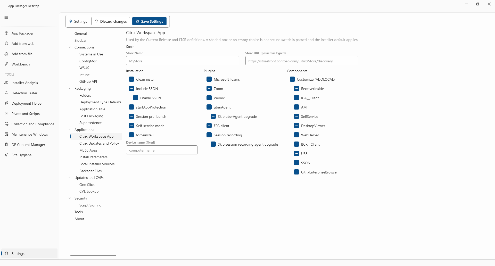

### About

The section shows the application name, the version, and the text "MIT License. Settings are stored under %LOCALAPPDATA%\AppPackager." The text does not follow an `APP_PACKAGER_DATA_ROOT` override: with an override, the settings are under the override folder. See [Data folders](../reference/data-folders.md). **Releases** opens the releases page of the project in the browser.

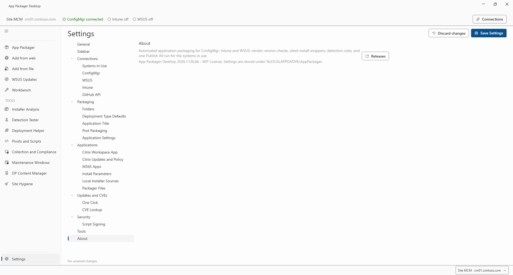

## Limits

- A settings file that cannot be read gives the defaults. Nothing is written to that file until you select **Save Settings**. The save first keeps the unreadable file as `settings.json.unreadable-<timestamp>`.
- A staging root that is still the old default `C:\temp\ap` moves one time to the per-user folder. A notice states this.
- The setting **Deployment Target** for Intune has no control. It stores the name of the target that matches **Default destinations** in **One Click Settings**, for example `IntuneAndWSUS`. The names are in the [command-line build](command-line-build.md#targets) table. If no default destination is selected, the setting keeps `ConfigMgr`, and the saved **Default destinations** decide what a run publishes to. A stored value that is empty takes the saved **Default destinations**. If none are saved, the app uses `ConfigMgr`, the default of this setting, and shows a notice. A value that is not a valid name publishes to no destination, and the log lists the valid names.

## Troubleshooting

| Message | Cause | Fix |
|---|---|---|
| Settings file could not be read: `<path>` (`<reason>`). | `settings.json` is not valid or not readable. | Select **Save Settings** to replace it. The old file is kept. |
| Staging folder '`<f>`' can be changed by other accounts. | The access list of the staging root allows other accounts to write. | Use a folder that only your account and administrators can write. |
| The timestamp server URL must begin with http:// or https://. | The **Timestamp server** value is not a URL. | Correct the value. |
| WSUS server name '`<x>`' is not a host name. | The **WSUS server** value is malformed. | Correct the name. |

See [Troubleshooting](../troubleshooting.md) and [error messages](../reference/error-messages.md).

## Links

- [Authentication and authorization basics](https://learn.microsoft.com/graph/auth/auth-concepts): Explains how an app gets an access token for Graph.
- [Microsoft Graph permissions reference](https://learn.microsoft.com/graph/permissions-reference): Lists the Graph permissions that each API needs.
- [Fundamentals of role-based administration for Configuration Manager](https://learn.microsoft.com/intune/configmgr/core/understand/fundamentals-of-role-based-administration): Explains security roles, security scopes and collections for administrative users.
- [Plan for the SMS Provider](https://learn.microsoft.com/intune/configmgr/core/plan-design/hierarchy/plan-for-the-sms-provider): Explains the SMS Provider role.
