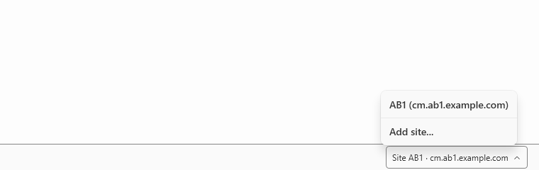

# Sites

A site is one ConfigMgr site with its SMS Provider. App Packager Desktop keeps the settings and the data of each site apart. You can work with more than one site, for example a production site and a lab site, and switch between them in the footer. The data of one site never shows under another site.

## The site switcher

The footer at the lower right of the main window shows the active site: "Site AB1", a middle dot and the SMS Provider. The footer is the site switcher.

1. Select the footer. The list shows each known site with its label and its SMS Provider. A check mark shows the active site.
2. Select a site to make it active. The Settings page, the App Packager grid and every tool then show the settings and the data of that site.
3. To add a site, select **Add site...**.

The tooltip of the footer says what it does. The footer is the only control that changes the site, and **Settings** shows the site code of the active site.

### A switch is refused while a run is active

The site cannot change while a check, Stage, publish or tool run is active. The footer then shows a message and the site stays. Wait until the run ends or cancel it, then switch the site. A switch writes nothing into the old site and nothing into the new site.

## Add a site

1. Select the footer, then **Add site...**.
2. Enter the **Site code**: exactly three letters or digits, for example `AB1`. The code `SMS` and the names that Windows reserves are refused.
3. Enter the **SMS Provider**, for example `provider.example.com`. You can enter it later in **Settings**.
4. Optional: enter a **Label**, for example `Production`. The list shows it next to the code.
5. Select **Add site**. The new site becomes the active site. It starts with the default values of every site setting.

### The site code is already in use

When you add a code that a site already uses with another SMS Provider, a question appears.

- **Yes** means the same site with another SMS Provider. The app uses the existing site, and its data stays. The new provider is added to the site.
- **No** means a different environment that reuses the code, for example a second lab. The app creates a new site with its own data. Its folder name is the code, a tilde and a number, for example `AB1~2`.
- **Cancel** adds nothing.

## Change the site code in Settings

The **Site Code** box of **Settings** is also a switch. When you enter another code and select **Save Settings**, the app switches to that site (or adds it, with the same question), then shows the settings of that site. Review them and save again if you changed anything. The values that you typed for the old site are not copied into the new site.

## What is per site and what is global

| Per site | Global |
|---|---|
| Site code, SMS Provider, Discovery SQL Server and database, File Share Root | Theme, window size, sidebar, page filters |
| Content distribution (DP group, test collection) and the per-application overrides | Packaging options and the per-application settings (installer values, conditions, command overrides, hidden applications) |
| The destination flags of One Click | One Click tracked applications, cadence and action |
| WSUS server and the Site Hygiene options | The Intune tenant and client ID |
| ConfigMgr versions and published versions of each application | The latest vendor version |
| The Check ConfigMgr result, the application inventory and the operation history | Templates, user definitions and icons |
| Deployment ring plans, ring runs and the deployment audit | The CVE cache and the CVE reports |
| Site Hygiene stores (suppressions, last scan, metrics, audit) | Session logs |
| DP Content audit and reports, Pivots and Scripts saved runs, Maintenance Windows and Collections reports | The GitHub token, the Intune client secret, the NVD API key and the feed credentials |

Secrets and tokens stay global. The app never copies a secret into a site and never shows it in a site file. The GitHub token, the NVD API key, the Intune client secret and the feed credentials work in every site.

## Where the data is

The data of the sites is in `%LOCALAPPDATA%\AppPackagerData\sites\<site>\`, one folder for each site. See [Data folders](../reference/data-folders.md). The file `%LOCALAPPDATA%\AppPackagerData\active-site.json` holds the site that you used last. The app opens that site at the next start.

## The first start of this version

At the first start the app finds the site code that you saved in an earlier version. It copies the data of that site into `sites\<code>\`, checks the SHA-256 of each copy, and keeps the old files where they were. A copy that does not match stops the copy, and the old files stay in use. The footer then shows a message. The old files stay for at least one release. If you have not saved a site code yet, nothing is copied until you save one in the Setup window or in **Settings**.

## The command line

`AppPackagerBuild` uses the active site. Set `APP_PACKAGER_SITE` to a site code to use that site for one run. A code that has no site yet creates the site.

## Related pages

- [Settings page](settings-page.md)
- [Data folders](../reference/data-folders.md)
- [Settings reference](../reference/settings.md)
