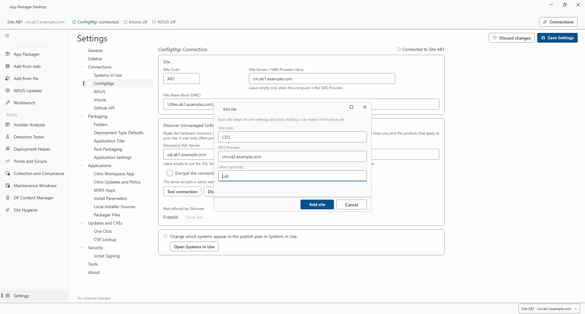
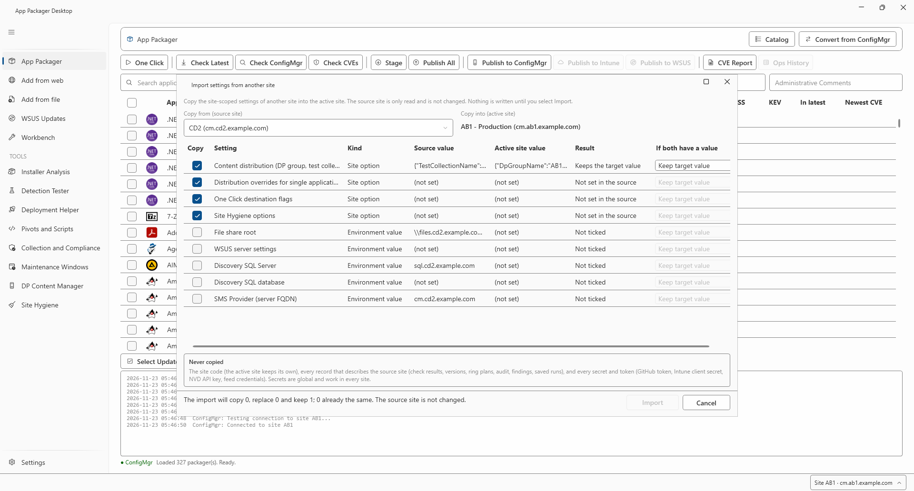

# Sites

A site is one ConfigMgr site with its SMS Provider. App Packager Desktop keeps the settings and the data of each site apart. You can work with more than one site, for example a production site and a lab site, and switch between them in the footer. The data of one site never shows under another site.

## The site switcher

The footer at the lower right of the main window shows the active site: "Site AB1", a middle dot and the SMS Provider. The footer is the site switcher.

1. Select the footer. The list shows each known site with its label and its SMS Provider. A check mark shows the active site.
2. Select a site to make it active. The Settings page, the App Packager grid and every tool then show the settings and the data of that site.
3. To add a site, select **Add site...**.
4. To copy the settings of another site into the active site, select **Import settings from another site...**. See [Import settings from another site](#import-settings-from-another-site).

The tooltip of the footer says what it does. The footer is the only control that changes the site, and **Settings** shows the site code of the active site.

### A switch is refused while a run is active

The site cannot change while a check, Stage, publish or tool run is active. The footer then shows a message and the site stays. Wait until the run ends or cancel it, then switch the site. A switch writes nothing into the old site and nothing into the new site.

## Add a site

1. Select the footer, then **Add site...**.
2. Enter the **Site code**: exactly three letters or digits, for example `AB1`. The code `SMS` and the names that Windows reserves are refused.
3. Enter the **SMS Provider**, for example `provider.example.com`. You can enter it later in **Settings**.
4. Optional: enter a **Label**, for example `Production`. The list shows it next to the code.
5. Select **Add site**. The new site becomes the active site. It starts with the default values of every site setting.

### The site code is already in use

When you add a code that a site already uses with another SMS Provider, a question appears.

- **Yes** means the same site with another SMS Provider. The app uses the existing site, and its data stays. The new provider is added to the site.
- **No** means a different environment that reuses the code, for example a second lab. The app creates a new site with its own data. Its folder name is the code, a tilde and a number, for example `AB1~2`.
- **Cancel** adds nothing.

## Import settings from another site

When you manage more than one site, you can copy the site-scoped settings of one site into another. A typical case: you add the site `AB1` and you want the same DP group names and options as the site `CD2`. The import only copies. The source site is read and is never changed.

1. Make the target the active site. Select the footer, then the target site, or add it with **Add site...**.
2. Select the footer, then **Import settings from another site...**. The entry is disabled while a run is active, and while the app knows only one site.
3. In **Copy from (source site)**, choose the site to copy from. The target is always the active site.
4. Tick the settings to copy. The list shows each setting with its value in the source site and its value in the active site, and the **Result** column shows what the import will do. **Nothing is written until you select Import.**
5. Select **Import**. A message tells how many settings were copied, replaced and kept.

### What the list offers

| Kind | Settings | Ticked at first |
|---|---|---|
| Site option | Content distribution (DP group and test collection names), distribution overrides of single applications, the One Click destination flags, and the Site Hygiene options | Yes |
| Environment value | File share root, WSUS server settings, Discovery SQL Server, Discovery SQL database, and the SMS Provider (server FQDN) | No |

An environment value belongs to one environment and usually differs between sites. It is copied only when you tick it. The names of a DP group or a collection are copied as text. The next connect shows each name that the active site does not have, and the app clears nothing.

The settings that are global (the packaging options, the per-application settings, the templates, the theme) are the same in every site. They need no import.

### What is never copied

- The site code. The active site keeps its own code, which is the name of its folder.
- Every record that describes the source site: the ConfigMgr and published versions of the applications, the Check ConfigMgr result, the inventory, the operation history, ring plans and ring runs, the deployment audit, the Site Hygiene findings, suppressions and metrics, the DP Content, Pivots and Scripts, Maintenance Windows and Collections records.
- Every secret and token: the GitHub token, the Intune client secret, the NVD API key and the feed credentials. They are global and work in every site. A value whose name looks like a secret (token, password, secret, key, credential, webhook) is dropped from every copied setting.

The **Never copied** note at the bottom of the window repeats this list.

### A setting that the active site already has

When the active site already holds another value for a setting, the row shows **Keeps the target value**, and the box **If both have a value** is enabled. The default is **Keep target value**: the value of the active site stays. Choose **Replace with source value** to overwrite it. The choice is per setting. A row with the same value in both sites shows **Already the same** and changes nothing.

Before a replace, the app keeps a copy of the settings file of the active site as `settings.json.before-import-<date>` in the site folder. The app checks the copy by its SHA-256.

### Check, repeat and resume

Every file that the import writes is written to a temporary file first. The app checks the SHA-256 of the temporary file, replaces the settings file, and checks the SHA-256 again. A run that stops before the replace leaves the settings file as it was. Run the import again: it has the same effect as a first run. A second import of the same settings changes nothing, and **Import** is disabled when there is nothing to copy.

The file `imported-from.json` in the site folder records the last import: the source site, the date, the result of each setting, and the SHA-256 of the source settings file and of the settings file of the active site.

## Change the site code in Settings

The **Site Code** box of **Settings** is also a switch. When you enter another code and select **Save Settings**, the app switches to that site (or adds it, with the same question), then shows the settings of that site. Review them and save again if you changed anything. The values that you typed for the old site are not copied into the new site.

## What is per site and what is global

| Per site | Global |
|---|---|
| Site code, SMS Provider, Discovery SQL Server and database, File Share Root | Theme, window size, sidebar, page filters |
| Content distribution (DP group, test collection) and the per-application overrides | Packaging options and the per-application settings (installer values, conditions, command overrides, hidden applications) |
| The destination flags of One Click | One Click tracked applications, cadence and action |
| WSUS server and the Site Hygiene options | The Intune tenant and client ID |
| ConfigMgr versions and published versions of each application | The latest vendor version |
| The Check ConfigMgr result, the application inventory and the operation history | Templates, user definitions and icons |
| Deployment ring plans, ring runs and the deployment audit | The CVE cache and the CVE reports |
| Site Hygiene stores (suppressions, last scan, metrics, audit) | Session logs |
| DP Content audit and reports, Pivots and Scripts saved runs, Maintenance Windows and Collections reports | The GitHub token, the Intune client secret, the NVD API key and the feed credentials |

Secrets and tokens stay global. The app never copies a secret into a site and never shows it in a site file. The GitHub token, the NVD API key, the Intune client secret and the feed credentials work in every site.

## Where the data is

The data of the sites is in `%LOCALAPPDATA%\AppPackagerData\sites\<site>\`, one folder for each site. See [Data folders](../reference/data-folders.md). The file `%LOCALAPPDATA%\AppPackagerData\active-site.json` holds the site that you used last. The app opens that site at the next start.

## The first start of this version

At the first start the app finds the site code that you saved in an earlier version. It copies the data of that site into `sites\<code>\`, checks the SHA-256 of each copy, and keeps the old files where they were. A copy that does not match stops the copy, and the old files stay in use. The footer then shows a message. The old files stay for at least one release. If you have not saved a site code yet, nothing is copied until you save one in the Setup window or in **Settings**.

## The command line

`AppPackagerBuild` uses the active site. Set `APP_PACKAGER_SITE` to a site code to use that site for one run. A code that has no site yet creates the site.

## Related pages

- [Settings page](settings-page.md)
- [Data folders](../reference/data-folders.md)
- [Settings reference](../reference/settings.md)

## Export a site file and import it on another computer

A site file carries the settings of one site from one computer to another. It is one zip file with a manifest, the settings and a list of what it holds. The file is small, a few kilobytes.

### Export

1. Make the site the active site.
2. Select the footer, then **Export site file...**.
3. Choose where to save the file. The name proposes the site code and the date, for example `site-AB1-20261123.zip`.

The file holds the same settings that **Import settings from another site** offers: the content distribution names, the distribution overrides, the One Click destination flags, the Site Hygiene options, and the environment values (file share root, WSUS server, Discovery SQL Server and database, SMS Provider). The environment values are in the file and are not ticked when you import.

The file never holds a secret. The export is a list of allowed settings, not a list of excluded ones: a setting that the list does not name cannot enter the file. This includes the GitHub token, the Intune client secret, the NVD API key, the feed credentials, and every result, version, history, ring plan and audit record of the site. A value whose name looks like a secret is dropped even inside an allowed setting.

### Import

1. Select the footer, then **Import site file...** and choose the file.
2. The app checks the file before it shows anything: the manifest, the SHA-256 and the size of each part, the site code, and that the file holds only the allowed settings. A file that fails a check is refused and nothing is written. The message names the check.
3. In **Copy into (target site)**, choose **Merge into** a site that you have, or the new site that the import creates. When you already have a site with the code of the file, the new site is a different environment with the same code (for example `AB1~2`).
4. Tick the settings, read the preview and select **Import**. A value that the target site already has is kept unless you choose **Replace with source value**. A replace keeps a verified backup of the settings file. Nothing is written until you select **Import**.

A new site is not made active. Select the footer and choose the site to use it. The file is only read and is never changed.
