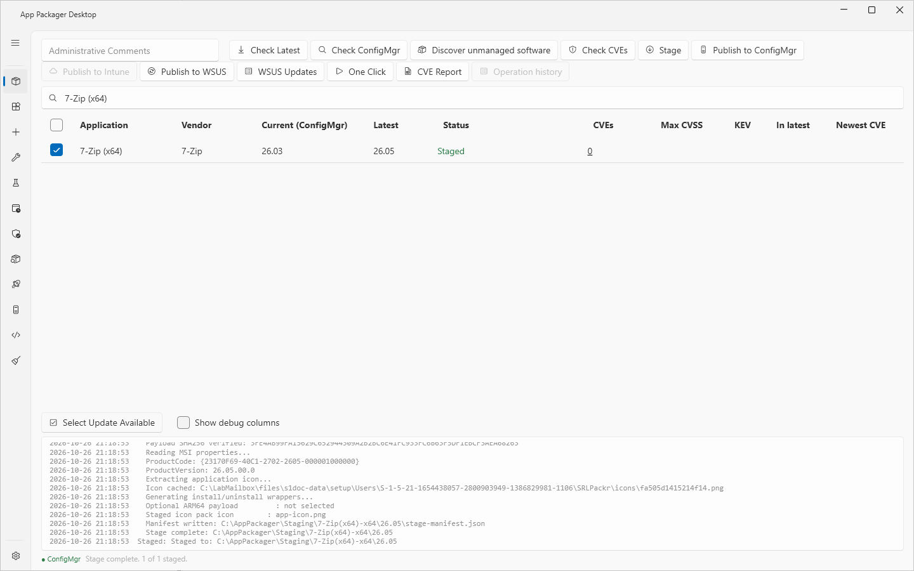
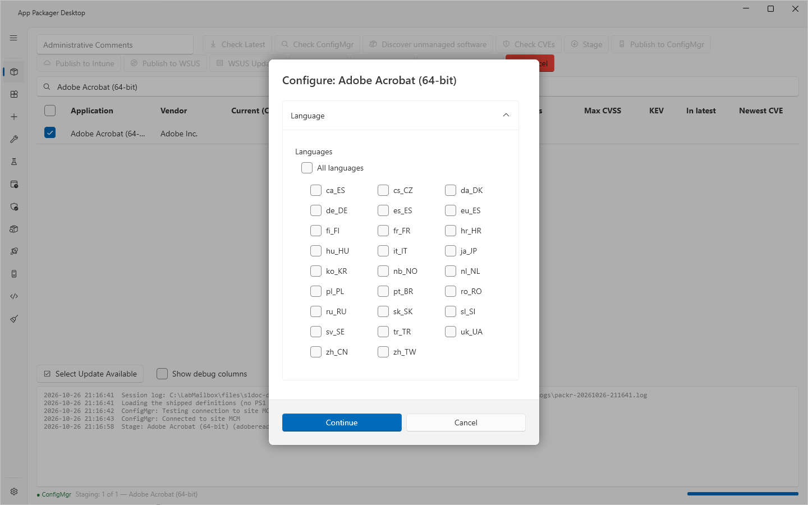

# Stage and publish

## What it does

Stage downloads the installer of each checked application. It checks the file, writes the install and uninstall scripts, and records the result in a staged folder on this computer. A publish button then takes the staged content to a target system: ConfigMgr, Intune or WSUS.

Each target has its own page:

| Target | Button | Result | Page |
|---|---|---|---|
| ConfigMgr | `Publish to ConfigMgr` | An application with a deployment type, and the content on the file share | [Publish to ConfigMgr](publish-to-configmgr.md) |
| Intune | `Publish to Intune` | A Win32 app in the Intune tenant | [Publish to Intune](publish-to-intune.md) |
| WSUS | `Publish to WSUS` | A locally published update | [WSUS publishing](wsus-publishing.md) |

The three buttons never create assignments or approvals on their own. Deployments to a test collection are an optional step of `Publish to ConfigMgr`.

## When to use it

- Use **Stage** to prepare content, and to read the staged scripts before you publish.
- Use a publish button to send the staged content to one target.
- Use [One Click](one-click.md) to check, stage and publish many tracked applications in one run.
- Use the [command-line build](command-line-build.md) to stage and publish without the window.

## Requirements

- A folder in **Download Root (local staging)** (Settings, ConfigMgr Site Settings). Only your account and administrators can write to it.
- Windows PowerShell 5.1.
- Internet access to the vendor download hosts of the checked applications.
- Settings that each target needs. The target pages list them.

The app does not need elevation. Do not run the app as administrator if you use drag and drop from Explorer.

## Steps: stage one or more applications

1. Open the **Packages** page.
2. Select the check box of each application to stage.
3. Optional: select **Check Latest**. Stage reuses the version that **Check Latest** found and does not read the vendor again.
4. Select **Stage**.
5. If the dialog **Configure: `<application>`** opens, set the values and select **Continue**. Select **Cancel** to skip the application. The row then shows `Skipped`.
6. If a folder prompt opens, choose the folder that holds the installer. The prompt appears for an application whose download needs a sign-in. If you cancel the prompt, the log shows `Skipped <application>: no installer source folder chosen.`
7. Watch the row status. It changes from `Staging...` to `Staged`.
8. To stop the run, select **Cancel** or press Esc. The status of the running row changes to `Cancelled`.
9. To read the result, right-click the row and select **Open Staged Folder**.

If you do not select any row, the page shows `No packagers selected.`

## What Stage does

Stage runs these steps for each application, in this order:

1. It resolves the signing certificate when a **Sign** or **Require** switch is on. If the certificate is not usable, Stage stops before it writes any file. See [Script signing](script-signing.md).
2. It reads the latest version.
3. It creates the staged folder `<Download Root>\<application name without spaces>-<architecture>\<version>`.
4. It downloads the installer. If the definition uses a local installer, it copies that file. A local installer must carry a valid Authenticode signature.
5. It checks the file:
   - An EXE must start with the bytes `MZ`. A MSI must start with the OLE compound-file bytes. A web page that a vendor sends in place of the installer is refused.
   - If the definition names a vendor SHA-256, the file must match it.
   - The PE machine type must match the architecture of the definition.
6. It reads the product code, the product version and the manufacturer from a MSI file.
7. It extracts the application icon.
8. It applies the install parameters, builds the detection rule, and writes `install.ps1`, `install.bat`, `uninstall.ps1` and `uninstall.bat`.
9. It copies the side files that you set in Settings, Packager Files.
10. It signs the scripts that the signing policy covers.
11. It writes `stage-manifest.json` in the staged folder.
12. If the Win32 Content Prep Tool is on this computer, it builds the `.intunewin` file.

Office (ODT) definitions stage through the Office Deployment Tool. They use the channel from Settings, M365 Apps — Channel.

The shared download cache is `<Download Root>\_cache`. A profile other than the packager default stages under `<Download Root>\profiles\<ProfileId>`. See [Application Workbench](workbench.md).

A download that fails is tried a second time after 5 seconds. The log shows `Downloading: <file> (attempt 1/2)`.

## Options and settings

| Setting (Settings page) | Effect on Stage |
|---|---|
| Download Root (local staging) | Folder for staged content. |
| Skip the review dialog before staging and use the saved values | Stage uses the saved Install Parameters and does not show **Configure**. An application with `ReviewBeforeStage` in its definition still shows the dialog. |
| Install Parameters | Values for each installer switch, saved per application. |
| Local Installer Sources | Folder that holds the installer of an application whose download needs a sign-in. Stage takes the highest file version in the folder. |
| Packager Files | Files that Stage copies beside the installer. The app never reads them. |
| M365 Apps — Channel | Update channel for the Microsoft 365 Apps, Project and Visio definitions. |
| Script Signing | Signature policy for the generated scripts. |

See [Settings reference](../reference/settings.md) for defaults.

## Limits

- Stage does not publish anything. It changes no site, tenant or server.
- `Publish to ConfigMgr` and `Publish to Intune` on the Packages page use content that Stage already wrote. If the staged manifest is missing, the log shows `Stage manifest not found: <path>. Run Stage for <application> <version> first.` `Publish to WSUS` stages by itself when no stage of the latest version exists.
- When a Content Prep Tool is not on this computer, Stage does not download it. The first Intune publish downloads it. You can also select **Download** in Settings, Detected Tools.
- The lab validated Stage and ConfigMgr publishing on a lab site with client computers.

## Troubleshooting

| Message | Cause | Fix |
|---|---|---|
| `No packagers selected.` | No row is checked. | Check at least one row. |
| `Could not determine latest version` | The version scraper of the definition returned no version. | Select **Check Latest**, read the log line, and check the scraper settings of the definition. |
| `Download failed after 2 attempts: <url>` | Both download attempts failed. | Check the address and the network path to the vendor host, then stage again. |
| `Downloaded file is not a valid EXE (starts with '...') - the vendor endpoint likely returned an HTML page: <file>` | The vendor host sent a web page. The same message names MSI or ZIP for those types. | Try again later. Check the download address of the definition. |
| `Payload SHA256 '<actual>' does not match the expected value '<expected>': <file>` | The downloaded file differs from the hash that the vendor published. | Stage again. If the message repeats, do not use the file. |
| `Payload architecture is '<actual>', expected '<expected>': <file>` | The installer is for a different architecture than the definition. | Check the architecture of the definition. |
| `Installer signature is <status>, not Valid: <file>` | A local installer has no valid Authenticode signature. | Use a signed installer. |
| `Staging folder '<folder>' can be changed by other accounts (<list>). Use a folder that only your account and administrators can write, such as '<default>'.` | Other accounts can write to Download Root. | Choose a folder that only your account and administrators can write. |
| `Skipped <application>: no installer source folder chosen.` | You cancelled the folder prompt. | Stage again and choose the folder. |
| `Stage FAILED (exit 1)` followed by `STDERR:` lines | Stage stopped. The `STDERR` lines name the reason. | Read the lines. |

See [Error messages](../reference/error-messages.md) and [Troubleshooting](../troubleshooting.md).

## Links

- [Create applications in Configuration Manager](https://learn.microsoft.com/intune/configmgr/apps/deploy-use/create-applications): Describes how to create an application with deployment types, detection methods and dependencies.
- [Deploy and manage content for Configuration Manager](https://learn.microsoft.com/intune/configmgr/core/servers/deploy/configure/deploy-and-manage-content): Explains how to distribute, update, redistribute and validate content.
- [Prepare Win32 App Content for Upload](https://learn.microsoft.com/intune/app-management/deployment/create-win32-package): Shows how the Content Prep Tool makes an intunewin file.
- [Add, Assign, and Monitor a Win32 App in Microsoft Intune](https://learn.microsoft.com/intune/app-management/deployment/add-win32): Shows how to add a Win32 app, set its detection rules and assign it.
- [Create win32LobApp](https://learn.microsoft.com/graph/api/intune-apps-win32lobapp-create): Documents the Graph call that creates a Win32 app.
