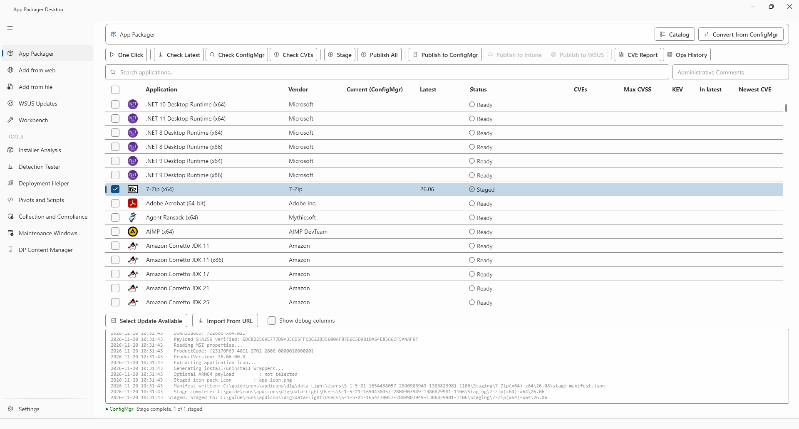
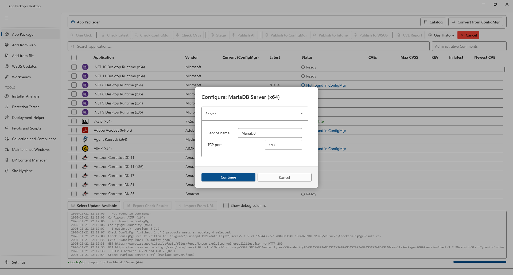

# Stage and publish

## What it does

Stage downloads the installer of each checked application. It checks the file, writes the install and uninstall scripts, and records the result in a staged folder on this computer. **Publish All** then publishes the checked applications to the systems that are on in Settings, Systems in Use: ConfigMgr, Intune and WSUS. The three destinations are independent, and each is optional. You can publish to any one of them or to any combination. Publishing to ConfigMgr is not a requirement for Intune or WSUS.

Each destination has its own page:

| Destination | Result | Page |
|---|---|---|
| ConfigMgr | An application with a deployment type, and the content on the file share | [Publish to ConfigMgr](publish-to-configmgr.md) |
| Intune | A Win32 app in the Intune tenant | [Publish to Intune](publish-to-intune.md) |
| WSUS | A locally published update | [WSUS publishing](wsus-publishing.md) |

The names of the destination combinations (for example `IntuneAndWSUS`) are in the [Targets](command-line-build.md#targets) table of the command-line build. That table lists the destinations of each name.

A publish never creates assignments or approvals on its own. An approval group for WSUS and a deployment to a test collection are optional settings.

## When to use it

- Use **Stage** to prepare content, and to read the staged scripts before you publish.
- Use **Publish All** to publish the checked applications. To publish to one destination only, select only that system under Settings, Systems in Use.
- Use [One Click](one-click.md) to check, stage and publish many tracked applications in one run.
- Use the [command-line build](command-line-build.md) to stage and publish without the window.

## Requirements

- A folder in **Download Root (local staging)** (Settings, Folders). Every destination uses it. Only your account and administrators can write to it.
- Windows PowerShell 5.1.
- Internet access to the vendor download hosts of the checked applications.
- The settings that each destination you use needs, and no others. The destination pages list them. A publish to Intune or WSUS needs no ConfigMgr site.

The app does not need elevation. Do not run the app as administrator if you use drag and drop from Explorer.

## Steps: stage one or more applications

1. Open the **App Packager** page.
2. Select the check box of each application to stage.
3. Optional: select **Check Latest**. Stage reuses the version that **Check Latest** found and does not read the vendor again.
4. Select **Stage** in the batch bar.
5. If the dialog **Configure: `<application>`** opens, set the values and select **Continue**. Select **Cancel** to skip the application. The row then shows `Skipped`.
6. If a folder prompt opens, choose the folder that holds the installer. The prompt appears for an application whose installer a script cannot download. If you cancel the prompt, the log shows `Skipped <application>: no installer source folder chosen.`
7. Watch the row status. It changes from `Staging...` to `Staged`.
8. To stop the run, select **Cancel** or press Esc. The status of the running row changes to `Cancelled`.
9. To read the result, right-click the row and select **Open Staged Folder**.

If you do not select any row, the page shows `No packagers selected.`

## Publish All

1. Select the systems under Settings, Systems in Use, and select **Save Settings**.
2. Open the **App Packager** page.
3. Select the check box of each application to publish. For ConfigMgr and Intune, stage the applications first. The WSUS part of a run stages an application that has no stage of its latest version.
4. Select **Publish All**. The window **Review Publish All** opens.
5. Optional: enter a work order or a note in **Administrative comment**.
6. Check the review. Select **Back** to close it. Nothing is published, and the checks stay.
7. Select **Publish N applications**. The app reads ConfigMgr again before the first write.
8. Answer the prompts that the run can show: a folder prompt, the **Intune review** dialog, the supersedence window and **Application Already Exists**.
9. Review the window **Publish results**. Select **Done**.

### The review

The review shows these parts:

| Part | Content |
|---|---|
| Site line and heading | The site and its SMS Provider, and `Review <N> applications`. |
| Count line | For example `3 applications, 2 systems: 6 publishes are planned.` With skipped cells, the line adds `<N> skipped.` |
| Scope line | For example `Publish All: ConfigMgr and Intune`, then the site and `from Settings, Systems in Use`, with a middle dot between the parts. The batch bar of the App Packager page shows the same text. |
| Hidden line | The number of checked applications that are outside the current view. The run publishes them too. |
| Blocked line | Each system that is not ready, with its reason. The confirm button is then disabled. |
| Grid | One row for each checked application. The columns are **Application**, **Version** (`Not checked` when no version is known), **Checked** and one column for each system. **Checked** reads `Changed`, `Outside the view`, both or nothing. |
| **Administrative comment** | A work order or a note for the description of the ConfigMgr application. It starts with the comment of your last review in this session, also after **Back**. It can stay empty. |
| Cards | One card for each system: what a publish creates there. The ConfigMgr card shows the scope, the content source, the detection method, the existing application, distribution and supersedence. |
| May ask line | The prompts that can still open during the run. Each prompt still asks. |
| Plan note | The time of the last check of the listed applications, and what the app reads again when you confirm. |

A cell reads `Create application and deployment type`, `Create Win32 app` or `Create software update`. It reads `Blocked: <reason>`, `Not supported: <reason>` or `Skip: <reason>` when the run writes nothing there. A cell is skipped when the system has this version or a newer one. It is also skipped when the system refused this version before because of the installer: its type, an install for the signed-in user, or a payload that is too large. Another earlier refusal does not skip the cell. The cell then adds `Warning: this version was refused before` with the reason. A ConfigMgr application of this version whose last publish did not finish is not skipped. The cell then says to verify it in ConfigMgr. For ConfigMgr, the answer of the site decides what the site has. An application that the site no longer has is not skipped. A build with another profile revision or signing policy is not skipped. The run writes only to the cells that are not skipped. The confirm button counts the applications that the run writes. It is disabled when there is nothing to publish. A ConfigMgr cell can add `Then:` with the steps after the application: distribution, test deployment or supersedence. When the last check found the application in ConfigMgr, the cell says which version ConfigMgr has, and that the run asks before it replaces an application with the same title.

The review comes from the last check. When that check would leave nothing to publish and a ConfigMgr cell is skipped, the app reads ConfigMgr before it shows the review. When you confirm, the app reads again: the systems and their readiness, the version of each application and, with ConfigMgr in the plan, the ConfigMgr application of each application. When the plan differs, the review opens again. It starts with `Nothing was published. The plan changed after you confirmed it. Check it and confirm again.` and then gives each difference. The log shows the same differences. Nothing is published until a fresh read matches the plan that you confirmed.

### The results

The window **Publish results** shows a headline: `N publishes completed`, `Publish completed with issues`, `Nothing was published` or `Publish was cancelled`. It shows the counts **Published**, **Failed** and **Skipped** as three tiles. Each cell has a symbol and a text. When the run created a ConfigMgr application and asked for no test deployment, the line `Publishing created a ConfigMgr application. No deployment was created.` shows. The grid has one row for each application and one column for each system. A cell reads `Published`, `Published, supersedence not applied`, `Failed`, `Failed at <step>`, `Failed, state not known`, `Stopped, state not known`, `Skipped`, `Not supported`, `Blocked` or `Not run`. A system that fails does not stop the next system of the run. For an application that reached one system and not another, a notice says what the run did. What reached a system stays published. When a state is not known, check that system. The lines below the grid give the message of each cell that needs one.

A failed row stays checked. Select **Done** to close the window. The grid keeps its filter, its sort, the selected row and the scroll position.

The buttons under the grid are **Operation history** (the selected or the first failed application), **Open report**, **Logs** and, after a failure, **Review failed application**, which closes the window and selects that application in the grid. Each Publish All run writes a report as a Markdown file and a JSON file in the folder `PublishReports` of the log folder.

### Retry a failed destination

Below the grid, the results have one line for each cell that failed. A line for **ConfigMgr** or **WSUS** can have the button **Retry failed destination**. The button retries one system of one application.

| Failed cell | What the window offers |
|---|---|
| **ConfigMgr** | The button. Before the retry, the app reads ConfigMgr. The retry publishes nothing when ConfigMgr has this version, or when ConfigMgr cannot be read. The retry does not replace an application. When ConfigMgr has an application with the same title, the app keeps it and the cell reads `Skipped`. |
| **ConfigMgr**, `Failed at content` | No button. ConfigMgr has the application and a later step failed. Verify the application in ConfigMgr. |
| **WSUS** | The button. The publish compares the stage with the update that WSUS has for this version. It does not change that update. It refuses a stage that differs. |
| **Intune** | No button. The line reads `Verify in Intune before retrying.` The app cannot verify what a failed publish left in Intune. |

The retry opens **Review Publish All** for this application and this system only. It reads the plan again when you confirm, as the first publish does. The retry publishes the same version as the failed publish. When the version is now different, the retry does not run. Use **Publish All** to review the new version.

After the retry, the results open again. The cell shows the result of the retry. When the retry did not run, the window gives the reason. The results of a **One Click** run have no retry.

### Only the reviewed version is published

A publish uses the version that the review shows. A stage can hold another version, for example when the vendor released a version after the last check, or when a local installer has another file version. The app then publishes nothing for that cell, and the message reads `Staged <version>, reviewed <version>; check the version and review again. Nothing was published.` For a definition whose stage takes a local installer, the review and the **One Click** plan show the version of that file, and that version is published. The website version still decides whether an update is available. An application with no version in the review is not published. Select **Check**, then **Check Latest**, and use **Publish All** again. A PS1 packager publishes through its own script. For it, the app compares the version of the row before the script runs. The app cannot compare what the script then publishes. The command line has no review, so it does not compare.

### A publish to WSUS only

When WSUS is the only system in use, **Publish All** opens the same review window and the same results window. The review has one column, **WSUS**. It has no **Administrative comment** box, because WSUS does not get the comment. When you confirm, the app reads the settings and the versions again. The read does not connect to the WSUS server. The publish itself checks the update that the server has for this version. A row that WSUS cannot take stays checked. A row that fails also stays checked. See [WSUS publishing](wsus-publishing.md).

## What Stage does

Stage runs these steps for each application, in this order:

1. It resolves the signing certificate when a **Sign** or **Require** switch is on. If the certificate is not usable, Stage stops before it writes any file. See [Script signing](script-signing.md).
2. It reads the latest version.
3. It creates the staged folder `<Download Root>\<application name without spaces>-<architecture>\<version>`.
4. It downloads the installer. If the definition uses a local installer, it copies that file. A local installer must carry a valid Authenticode signature.
5. It checks the file:
   - An EXE must start with the bytes `MZ`. A MSI must start with the OLE compound-file bytes. A web page that a vendor sends in place of the installer is refused.
   - If the definition names a vendor SHA-256, the file must match it.
   - The PE machine type must match the architecture of the definition.
6. It reads the product code, the product version and the manufacturer from a MSI file.
7. It extracts the application icon.
8. It applies the install parameters, builds the detection rule, and writes `install.ps1`, `install.bat`, `uninstall.ps1` and `uninstall.bat`.
9. It copies the side files that you set in Settings, Packager Files.
10. It signs the scripts that the signing policy covers.
11. It writes `stage-manifest.json` in the staged folder.

A definition from [Add from file](add-from-file.md) has no version source and no download address. For it, step 2 takes the version that you reviewed. Step 4 copies the saved installer into the staged folder. Before the copy, Stage checks that the file exists and has the saved SHA-256. After the copy, it checks the hash of the copy. A missing or changed file stops the stage with a message that gives the path.

A definition with the installer type `MSIX` (a `.msix`, `.appx`, `.msixbundle` or `.appxbundle` file) is checked for its signature and its architecture. A package with no signature, a signature that is not valid, or an architecture that differs from the definition stops the stage. An MSIX is published to ConfigMgr as a script deployment type, as every other product is: the stage wraps the package and gives it a detection (the provisioning key of the package, or a script). App Packager does not create the native MSIX deployment type of ConfigMgr. A stage that asks for it (a manifest with the detection type `MSIX`, from an older release) is refused at publish with the message to stage the application again. A definition with the installer type `MSP` stages a Windows Installer patch.

Office (ODT) definitions stage through the Office Deployment Tool. They use the channel from Settings, M365 Apps - Channel.

The shared download cache is `<Download Root>\_cache`. A profile other than the packager default stages under `<Download Root>\profiles\<ProfileId>`. See [Workbench](workbench.md).

A download that fails is tried a second time after 5 seconds. The log shows `Downloading: <file> (attempt 1/2)`.

## Options and settings

| Setting (Settings page) | Effect on Stage |
|---|---|
| Download Root (local staging) | Folder for staged content. |
| Skip the review dialog before staging and use the saved values | Stage uses the saved Install Parameters and does not show **Configure**. An application with `ReviewBeforeStage` in its definition still shows the dialog. |
| Install Parameters | Values for each installer switch, saved per application. |
| Local Installer Sources | Folder that holds the installer of an application that a script cannot download. Stage takes the highest file version in the folder. |
| Packager Files | Files that Stage copies beside the installer. The app never reads them. |
| M365 Apps - Channel | Update channel for the Microsoft 365 Apps, Project and Visio definitions. |
| Script Signing | Signature policy for the generated scripts. |

See [Settings reference](../reference/settings.md) for defaults.

## Limits

- Stage does not publish anything. It changes no site, tenant or server.
- The ConfigMgr and Intune parts of a publish use content that Stage already wrote. If the staged manifest is missing, the log shows `Stage manifest not found: <path>. Run Stage for <application> <version> first.` The WSUS part stages by itself when no stage of the latest version exists.
- Stage never builds a `.intunewin` file, and never downloads the Content Prep Tool. The first Intune publish downloads it and builds the file. You can also select **Download** in Settings, Tools.
- The lab validated Stage and ConfigMgr publishing on a lab site with client computers.

## Troubleshooting

| Message | Cause | Fix |
|---|---|---|
| `No packagers selected.` | No row is checked. | Check at least one row. |
| `Could not determine latest version` | The version scraper of the definition returned no version. | Select **Check Latest**, read the log line, and check the scraper settings of the definition. |
| `Download failed after 2 attempts: <url>` | Both download attempts failed. | Check the address and the network path to the vendor host, then stage again. |
| `Downloaded file is not a valid EXE (starts with '...') - the vendor endpoint likely returned an HTML page: <file>` | The vendor host sent a web page. The same message names MSI or ZIP for those types. | Try again later. Check the download address of the definition. |
| `Payload SHA256 '<actual>' does not match the expected value '<expected>': <file>` | The downloaded file differs from the hash that the vendor published. | Stage again. If the message repeats, do not use the file. |
| `Payload architecture is '<actual>', expected '<expected>': <file>` | The installer is for a different architecture than the definition. | Check the architecture of the definition. |
| `Installer signature is <status>, not Valid: <file>` | A local installer has no valid Authenticode signature. | Use a signed installer. |
| `Staging folder '<folder>' can be changed by other accounts (<list>). Use a folder that only your account and administrators can write, such as '<default>'.` | Other accounts can write to Download Root. `<default>` is the `Staging` folder of the per-user data folder. With an `APP_PACKAGER_DATA_ROOT` override, its path includes your Windows SID, for example `C:\...\Users\S-1-5-21-...\Staging`. | Choose a folder that only your account and administrators can write. |
| `Skipped <application>: no installer source folder chosen.` | You cancelled the folder prompt. | Stage again and choose the folder. |
| `Stage FAILED (exit 1)` followed by `STDERR:` lines | Stage stopped. The `STDERR` lines name the reason. | Review the lines. |

See [Error messages](../reference/error-messages.md) and [Troubleshooting](../troubleshooting.md).

## Links

- [Create applications in Configuration Manager](https://learn.microsoft.com/intune/configmgr/apps/deploy-use/create-applications): Describes how to create an application with deployment types, detection methods and dependencies.
- [Deploy and manage content for Configuration Manager](https://learn.microsoft.com/intune/configmgr/core/servers/deploy/configure/deploy-and-manage-content): Explains how to distribute, update, redistribute and validate content.
- [Prepare Win32 App Content for Upload](https://learn.microsoft.com/intune/app-management/deployment/create-win32-package): Shows how the Content Prep Tool makes an intunewin file.
- [Add, Assign, and Monitor a Win32 App in Microsoft Intune](https://learn.microsoft.com/intune/app-management/deployment/add-win32): Shows how to add a Win32 app, set its detection rules and assign it.
- [Create win32LobApp](https://learn.microsoft.com/graph/api/intune-apps-win32lobapp-create): Documents the Graph call that creates a Win32 app.
