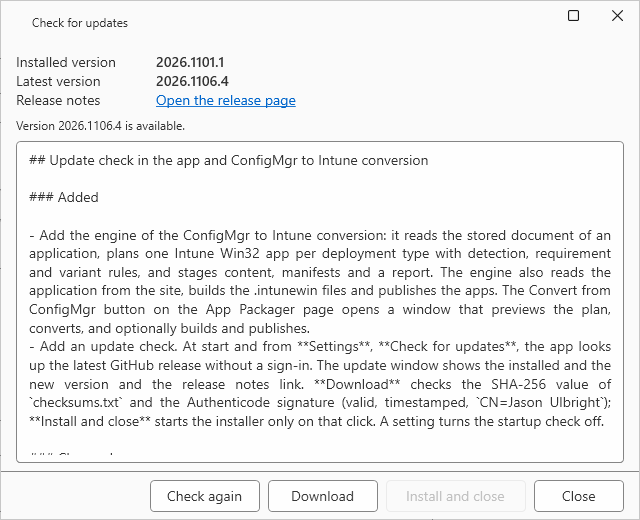
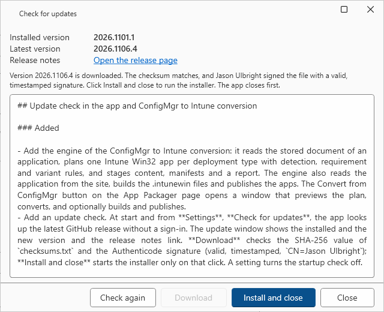

# Updates

BLUF: App Packager Desktop checks GitHub for a newer release. It downloads the signed installer and checks it. It starts the installer only after you click **Install and close**.

## What it does

- The app asks GitHub for the latest release of `jasonulbright/app-packager-desktop`. It sends no sign-in, no token and no data from this computer.
- The check compares the installed version with the tag of the release. The tag has the form `v2026.1103.3`. A tag that is not a version, such as `v2026.1103.3-beta`, gives the status "The latest release has no version tag that this app understands." The start check stays silent for this status. **Check for updates** shows it.
- The update window shows the installed version, the latest version and a link to the release notes.

## When to use it

- Use it to find out if a newer release exists.
- Use it to update without the browser. You can also download the installer by hand from the [releases page](https://github.com/jasonulbright/app-packager-desktop/releases).

## Steps

1. Open **Settings**. In the **Updates** section, select **Check for updates**. The update window opens and checks at once.
2. Read the latest version and the release notes. Select **Open the release page** to see the full notes.

   
3. Select **Download**. The app downloads `AppPackagerDesktop-Setup-<version>.exe` and `checksums.txt` into a new empty folder in the temporary folder of your account.
4. The app checks the file. The status line says that the checksum matches and that `Jason Ulbright` signed the file with a valid, timestamped signature.

   
5. Select **Install and close**. The app closes and starts the installer. The installer asks for the usual confirmations. The installer is small because it does not carry the .NET Desktop Runtime. It checks for the runtime first and installs it when it is missing: see [Getting started](../getting-started.md).

## The startup check

- At start, the app checks once in the background. The check never blocks the app.
- When a newer release exists, the update window opens once. When no newer release exists, nothing shows. When the computer is offline or GitHub limits the check, nothing shows.
- Clear **Check for a new version when the app starts** in **Settings**, **Updates**, and select **Save Settings**, to turn the startup check off. **Check for updates** always works.

## What the app checks before it offers the installer

The app refuses the update and deletes the download folder when any check fails:

| Check | Refusal |
|---|---|
| The release has `AppPackagerDesktop-Setup-<version>.exe` and `checksums.txt` | A file is missing, or two files have the same name |
| The address of each file | The address is not an `https://github.com/jasonulbright/app-packager-desktop/releases/download/` address |
| The size of the file | The size is not the size that the release lists |
| The SHA-256 value | The value does not match the entry in `checksums.txt`, or `checksums.txt` has no entry or two different entries |
| The Authenticode signature | The status is not **Valid**, the signature has no timestamp, or the signer is not `CN=Jason Ulbright` |

Just before the installer starts, the app calculates the SHA-256 value again. A file that changed after the check does not start.

## Errors and limits

| Status line | Cause | Action |
|---|---|---|
| The latest release has no version tag that this app understands | The tag is not a number list, or GitHub sent a document the app cannot read | Open the releases page and install by hand |
| GitHub cannot be reached | The computer is offline, or a proxy blocks `api.github.com` | Try again later |
| GitHub limits the checks without a sign-in | GitHub allows a small number of checks each hour for an address without a sign-in | Wait for the time in the status line |
| The update was refused and deleted | A check in the table above failed | Download the installer from the releases page and compare it with `checksums.txt` by hand. Report the status line. |
| The installer did not start | Windows refused to start the file | Download the installer from the releases page and run it by hand |

## Notes

- The installer does not replace an executable that is in use. The app closes before the installer works. Close other copies of the app first.
- The zip build has no installer. The check still shows a newer version. Download the new zip by hand.
- No token is stored. The app does not read `GITHUB_TOKEN` for this check.
