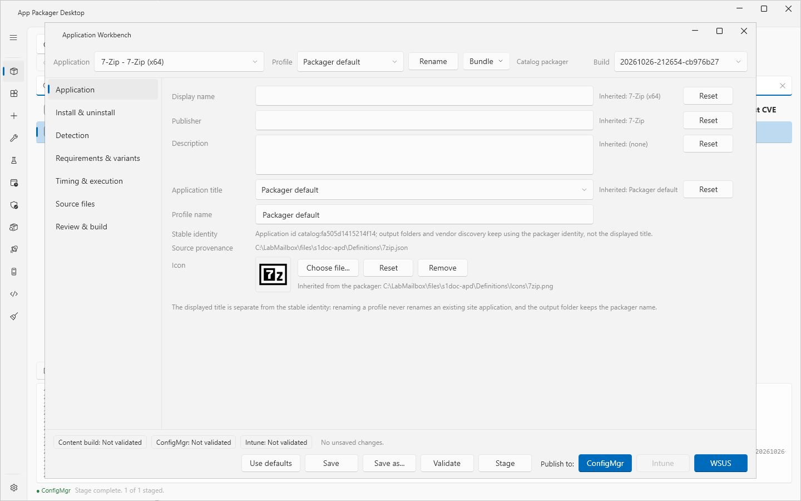
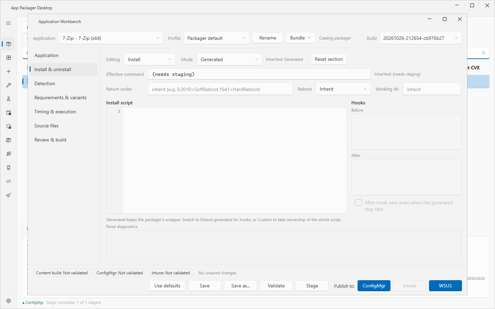
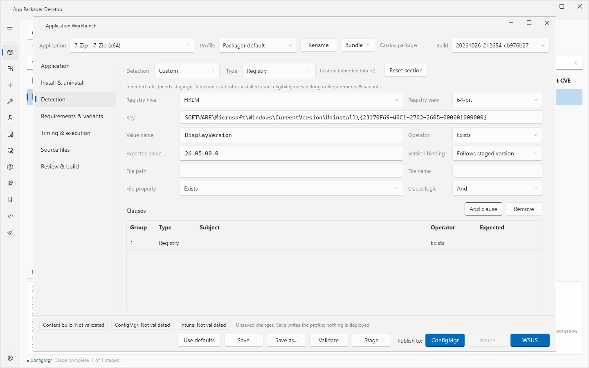
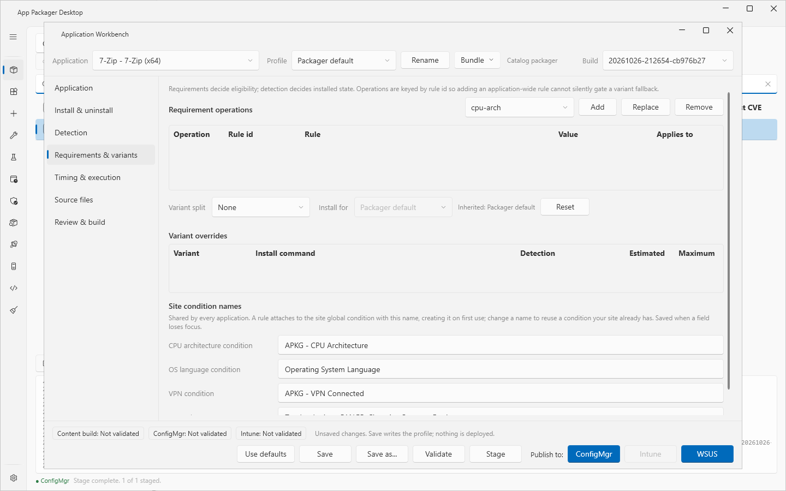
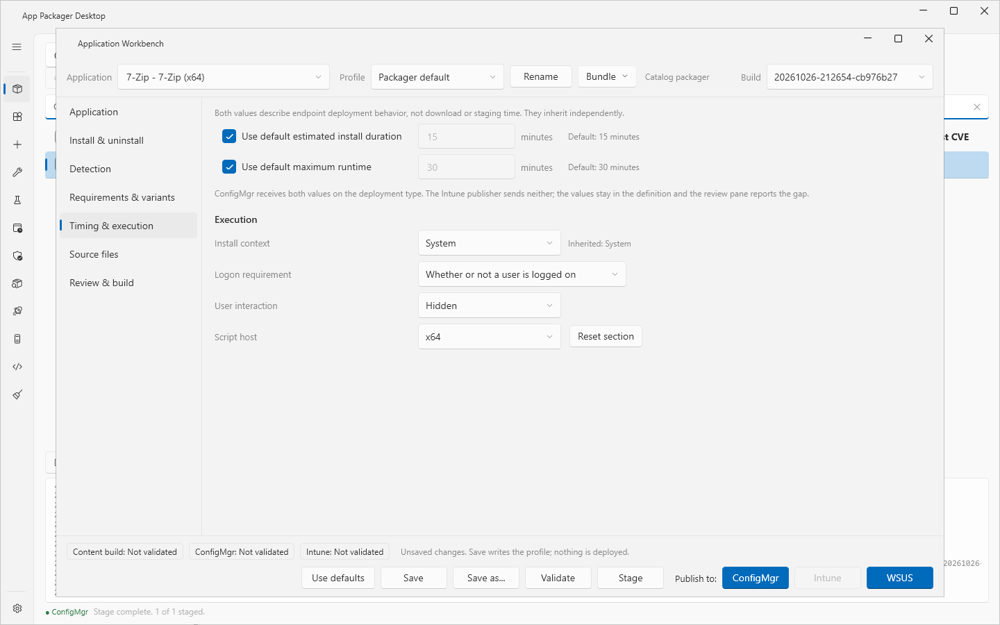
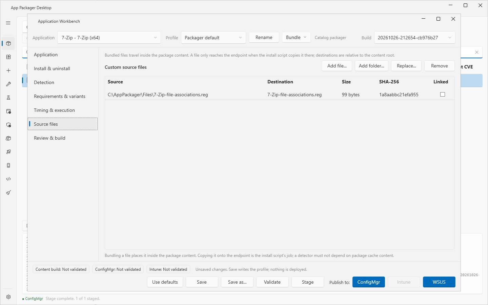
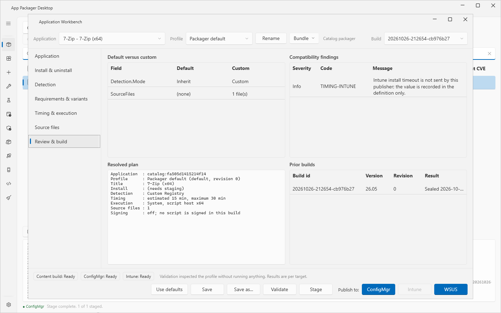
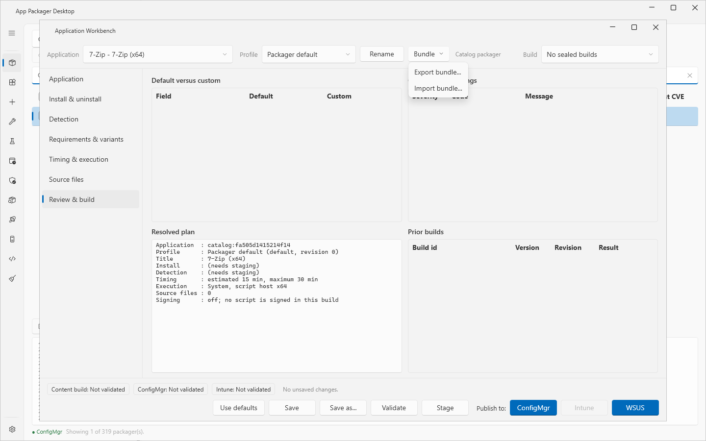

# Application Workbench

## What it does

The Application Workbench is the editor for one application. A definition supplies the default values. A profile holds your changes. Each field shows where its value comes from. **Reset** returns a field to the inherited value.

Stage and publish runs of the Workbench use a saved profile. A run writes a build record. You can export an application with its profiles as a bundle and import the bundle on another computer.

## When to use it

- Use it to change the install command, the detection rule, the timing, the requirements or the files of one application without editing the definition.
- Use it to run install steps before or after the generated install script.
- Use it to review the differences from the defaults before you publish.
- Use it to manage the installer revisions of a [bring-your-own application](bring-your-own-installer.md).

## Requirements

- No site, tenant or server is needed to edit a profile.
- A run from the Workbench needs the settings of its target. See [Publish to ConfigMgr](publish-to-configmgr.md), [Publish to Intune](publish-to-intune.md) and [WSUS publishing](wsus-publishing.md).
- A **Stage** run needs **Download Root (local staging)** in Settings.

## Steps: change an application and stage it

1. Open the **Workbench**. Use one of these ways:
   - Select **Application Workbench** in the sidebar. The Workbench opens on the selected row of the Packages grid.
   - Double-click a row of the Packages grid.
   - Right-click a row and select **Edit application...**.
2. In **Application**, choose the application. The list holds catalog applications, user-authored scripts and saved bring-your-own applications. If the list is empty, the dialog `No applications were found. Load packagers or save a bring-your-own installer first.` opens.
3. In **Profile**, choose a profile. The profile **Packager default** is read-only.
4. Select a section in the list on the left and change the fields.
5. Select **Save**. On **Packager default**, the dialog **Profile** asks for a name (**Name for this profile**, default `Managed`). To keep the current profile and create another, select **Save as...** instead.
6. Select **Validate**. The Workbench opens **Review & build** and shows the findings. Validation inspects the profile. It does not run anything.
7. Select **Stage**. The Workbench closes and the Packages page runs the stage.
8. Open the Workbench again. Choose the new build in **Build**.
9. Under **Publish to:**, select **ConfigMgr**, **Intune** or **WSUS**. The publish uses the build that **Build** shows.

If you have unsaved edits when you start a run, the app asks `Save the profile before this run? A run uses the saved profile revision.` Select **Save**, **Discard** or **Cancel**.

If a finding of severity Blocking applies to the target, the dialog **Blocked** opens and the run does not start. If **Build** shows `No sealed builds` when you select a publish button, the dialog shows `No sealed build exists for this profile. Stage it first; Package consumes an exact build id, not the newest manifest on disk.`

## The header and the footer

| Control | Function |
|---|---|
| **Application** | Application to edit. You can type to search. |
| **Profile** | Profile to edit. One profile is active for each application. |
| **Rename** | Renames the selected custom profile. The packager default cannot be renamed. |
| **Bundle** | Menu with **Export bundle...** and **Import bundle...**. |
| **Build** | Sealed builds of the application and profile. A publish uses the selected build. |
| `Content build`, `ConfigMgr`, `Intune` chips | Result of the last **Validate**: `Ready`, `Needs review`, `Unsupported` or `Not validated`. An Intune finding never changes the other two chips. |
| **Use defaults** | Clears every override in the profile. The dialog **Use Defaults** asks first. Saved builds stay. |
| **Save**, **Save as...** | Writes the profile. The message reads `Saved "<name>" at revision <n>. Existing builds are now stale relative to this profile; nothing was deployed.` |
| **Validate** | Shows the findings. |
| **Stage** | Stages the application with the saved profile. |
| **Publish to:** **ConfigMgr**, **Intune**, **WSUS** | Publishes the selected build. The tooltip of a disabled button names the missing setting. |

When the Workbench opens, it can find unsaved changes from an earlier session. The dialog **Recover Draft** asks `Unsaved changes to "<name>" were found from an earlier session. Recover them?`

## Sections

The sections **Install & uninstall**, **Detection** and **Timing & execution** have a **Reset section** button. It returns the section to the inherited values.

### Application

Fields: **Display name**, **Publisher**, **Description**, **Application title**, **Profile name**, **Stable identity**, **Source provenance**, **Icon**.

- **Application title** offers `Packager default`, `Include version` and `No version`. A title with the version creates one ConfigMgr application for each release. A title without the version updates the same application.
- **Icon** has **Choose file...**, **Reset** and **Remove**. **Remove** publishes no icon.
- The displayed title is separate from the stable identity. Renaming a profile never renames an existing site application. The output folder keeps the packager name.
- For a bring-your-own application, the list **Installer source** and the button **Replace installer...** appear. See [Bring your own installer](bring-your-own-installer.md).

### Install & uninstall

- **Editing** selects `Install` or `Uninstall`. The two are set apart.
- **Mode** offers `Generated`, `Extend generated` and `Custom`.
  - `Generated` keeps the wrapper of the packager. The script box is read-only.
  - `Extend generated` runs the **Before** hook, the generated wrapper and the **After** hook as separate processes. A step with a non-zero exit code ends the run with that code. An exit code of 3010 from any step is held and becomes the exit code when all steps succeed. The check box **After hook runs even when the generated step fails** runs the After hook after a failed generated step. The generated step keeps its exit code.
  - `Custom` replaces the generated wrapper. Later changes to the wrapper of the packager do not reach this profile.
- **Effective command** shows the entry command of the build. It shows `(needs staging)` until a stage resolves the installer.
- **Return codes** takes a list such as `0,3010=SoftReboot,1641=HardReboot`. An empty box inherits.
- **Reboot** offers `Inherit`, `No reboot`, `Soft reboot`, `Hard reboot` and `Force restart`.
- **Working dir** is empty to inherit.
- **Parse diagnostics** lists syntax errors of the script. Validation never runs the script.
- Press Ctrl+F in a script box to open the find box. Press Enter to find the next match.
- A script can use the tokens `{{InstallerFile}}`, `{{Version}}`, `{{ProductCode}}` and `{{ContentRoot}}`. In a command, `{{ContentRoot}}` is `%~dp0`. In a script, it is `$PSScriptRoot`. An unknown token, or a token without a value at build time, fails the stage.

### Detection

- **Detection** offers `Inherit` and `Custom`. `Inherit` uses the validated rule of the packager.
- With `Custom`, **Type** offers `Registry`, `File`, `PowerShell` and `Compound`.
- Registry fields: **Registry hive** (`HKLM`, `HKCU`, `HKCR`), **Registry view** (`64-bit`, `32-bit`), **Key**, **Value name**, **Operator**, **Expected value**, **Version binding**. `Follows staged version` updates the expected value at every build. `Pinned` keeps the literal value.
- File fields: **File path**, **File name**, **File property** (`Exists`, `Version`, `Size`, `DateModified`).
- **Clause logic** offers `And`, `Or` and `Two groups`. The **Clauses** list has the columns **Group**, **Type**, **Subject**, **Operator** and **Expected**. Use **Add clause** and **Remove**.
- For `PowerShell`, the box holds the script. Intune reads the result from the script. Exit code 0 plus output on STDOUT means installed. Output on STDERR is a negative result. Exit 0 with no output means not installed.
- The check box **Allow Intune to publish this rule as a converted detection script** is off by default. A native clause without an Intune mapping stays blocked until you select it.

### Requirements & variants

- **Requirement operations** list: columns **Operation**, **Rule id**, **Rule**, **Value**, **Applies to**. Choose a condition in the list above the grid and select **Add**, **Replace** or **Remove**.
- **Variant split** stages one application with several deployment types. The list offers `None` and the splits that the packager declares.
- **Install for** offers `Packager default`, `System` and `User`, as far as the packager declares them. The arguments, the uninstall command, the detection hive and the view follow this choice.
- **Variant overrides** list: **Variant**, **Install command**, **Detection**, **Estimated**, **Maximum**.
- **Site condition names**: **CPU architecture condition**, **OS language condition**, **VPN condition**, **VPN adapter patterns**. These names are shared by every application. The app saves them when a field loses focus. The OS language condition must already exist on the site.

### Timing & execution

- **Use default estimated install duration** and **Use default maximum runtime** inherit the Settings values. Clear a check box to enter minutes.
- ConfigMgr receives both values on the deployment type. The Intune publisher sends neither.
- **Execution**: **Install context** (`System`, `User`), **Logon requirement** (`Whether or not a user is logged on`, `Only when a user is logged on`, `Only when no user is logged on`), **User interaction** (`Hidden`, `Normal`, `Minimized`, `Maximized`), **Script host** (`x64`, `x86`). Detection and requirement scripts run in the script host. Intune maps it to the 32-bit flag.

### Source files

- **Custom source files** list: **Source**, **Destination**, **Size**, **SHA-256**, **Linked**. Buttons: **Add file...**, **Add folder...**, **Replace...**, **Remove**.
- A bundled file travels inside the package content. It reaches the endpoint only when the install script copies it. Destinations are relative to the content root. A destination that leaves the content root is a Blocking finding.

### Review & build

- **Default versus custom** lists each field that differs: **Field**, **Default**, **Custom**.
- **Compatibility findings** lists **Severity** (`Blocking`, `Review`, `Info`), **Code** and **Message**.
- **Resolved plan** shows the application, the profile and revision, the title, the install command, the detection, the timing, the execution values, the number of source files and the signing line.
- **Prior builds** lists **Build id**, **Version**, **Revision** and **Result**.

Finding codes that **Validate** can show:

| Code | Severity | Meaning |
|---|---|---|
| `TIMING-RANGE` | Blocking | Estimated and maximum minutes must both be at least 1. |
| `TIMING-ORDER` | Blocking | Estimated minutes are greater than maximum minutes. |
| `TIMING-INTUNE` | Info | Intune does not receive the timing. |
| `INSTALL-CUSTOM` | Review | A custom script no longer follows the wrapper of the packager. |
| `DETECT-NO-OUTPUT` | Blocking | The detection script writes nothing to STDOUT. |
| `DETECT-PARSE` | Blocking | The detection script does not parse. |
| `DETECT-INTUNE-COMPOUND` | Blocking | Intune cannot express an OR or grouped detection without script conversion. |
| `REQ-INTUNE` | Review | The Intune publisher does not translate requirement rules. |
| `VARIANT-INTUNE` | Blocking | Intune does not support a variant split. |
| `SOURCE-PATH` | Blocking | A source file destination leaves the content root. |

## Bundles

1. Select **Bundle**, then **Export bundle...**.
2. For a bring-your-own application, the dialog **Export Bundle** asks `Include the installer binaries?` Without them the bundle is marked `IncompleteSource`. The imported application needs **Replace installer...** before it stages.
3. Choose a file. The default name is `<application name>.bundle.zip`.
4. On the other computer, select **Bundle**, then **Import bundle...**.
5. The app checks the schema and the SHA-256 of every file before it extracts anything. If the application exists, the dialog **Import Bundle** names what the replacement removes. Select **Yes** to replace it.

## Options and settings

| Setting | Effect on the Workbench |
|---|---|
| Estimated Runtime (mins), Maximum Runtime (mins) | Inherited timing values. |
| Include version in application name, Remove version from application name | Inherited title mode. |
| Script Signing | Policy that a build applies. See [Script signing](script-signing.md). |

The Workbench data folder is `%LOCALAPPDATA%\AppPackager\Workbench`. It holds `applications`, `runs`, `drafts`, `builds` and `definitions`. The variable `APP_PACKAGER_WORKBENCH_ROOT` replaces the folder. See [Data folders](../reference/data-folders.md).

## Limits

- A run from the Workbench closes the Workbench window. The work then runs in the main window.
- The lab validated that hooks and custom script text reach the client, and that a publish from the footer creates the application.
- Intune publishing is tested against simulated Graph responses only.

## Troubleshooting

| Message | Cause | Fix |
|---|---|---|
| `Install.Mode Custom requires a script.` (in the log after **Stage**) | **Mode** is `Custom` and the script is empty. | Enter a script or choose another mode. |
| `Another operation is running on the Packages page. Wait for it to finish, then run this again.` | The Packages page runs an operation. | Wait, then run again. |
| `This application is not in the main grid, so it cannot run through the grid pipeline.` | The application is not listed on the Packages page. | Show it on the [Applications](applications.md) page. |
| `This application has no packager script. Bring-your-own applications run through the installer intake flow.` | The application has no source for a grid run. | Use a bring-your-own application or a definition. |
| `Unknown build token ''; supported tokens are InstallerFile, Version, ProductCode, ContentRoot.` | A script uses another token. | Use a supported token. |
| `Run snapshot not available: <reason>` | The app could not write the run snapshot. | Read the reason. |

See [Error messages](../reference/error-messages.md).

## Links

- [Create applications in Configuration Manager](https://learn.microsoft.com/intune/configmgr/apps/deploy-use/create-applications): Describes how to create an application with deployment types, detection methods and dependencies.
- [Prepare Win32 App Content for Upload](https://learn.microsoft.com/intune/app-management/deployment/create-win32-package): Shows how the Content Prep Tool makes an intunewin file.
- [Add, Assign, and Monitor a Win32 App in Microsoft Intune](https://learn.microsoft.com/intune/app-management/deployment/add-win32): Shows how to add a Win32 app, set its detection rules and assign it.
