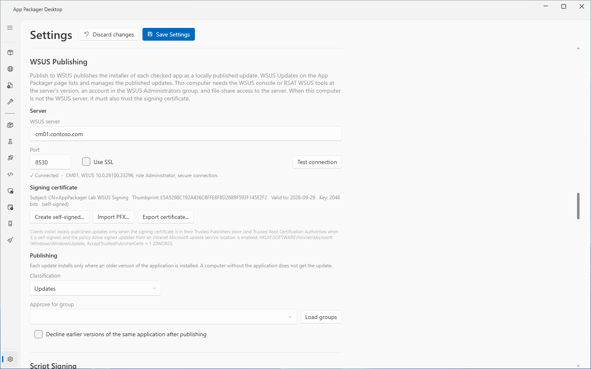
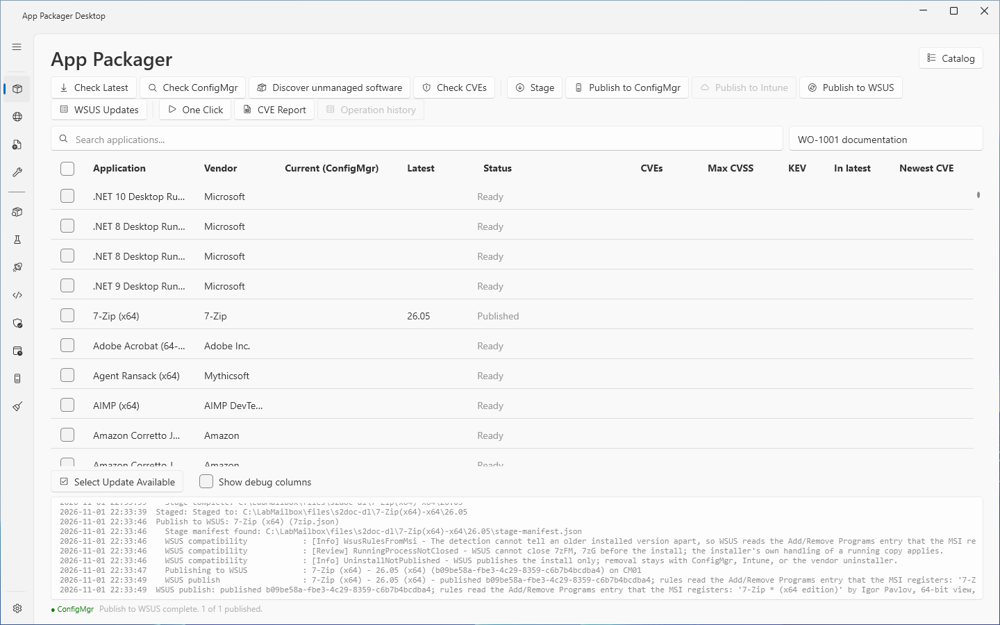

# WSUS publishing

## What it does

**Publish to WSUS** publishes the installer of each checked application to a WSUS server as a locally published update. The update applies only to a computer that has an older version of the application. A computer without the application does not get the update.

App Packager Desktop refuses an application that WSUS cannot carry. The refusal shows a code and a reason. Nothing reaches the server when it refuses.

The page [WSUS Updates](wsus-updates.md) describes the window that approves, declines, expires and removes the published updates, and the Catalog Import window.

## When to use

- Use WSUS publishing to update an application that is already installed on clients. WSUS does not install an application on a computer that does not have it.
- Use [Publish to ConfigMgr](stage-and-publish.md) or Intune to install an application on a new computer.
- Use [One Click](one-click.md) to publish tracked applications to WSUS, ConfigMgr and Intune in one run.

## Requirements

**On the computer that runs App Packager Desktop:**

- The WSUS console, or the RSAT WSUS tools, at the version of the server. The app needs the file `Microsoft.UpdateServices.Administration.dll`.
- An account that is a member of the WSUS Administrators group on the server.
- Access to the file shares of the server (`UpdateServicesPackages` and `WSUSContent`).
- Windows PowerShell 5.1.
- WSUS selected under **Systems in use** in Settings, and a **WSUS server** name.
- When the computer is not the WSUS server, the computer must trust the signing certificate of the server.
- With **Use SSL**, the computer must trust the HTTPS certificate of the server and use TLS 1.2. See `SchUseStrongCrypto` in the troubleshooting table.

**On each client:**

- The signing certificate is in the Trusted Publishers store. When the certificate is self-signed, it is also in the Trusted Root Certification Authorities store.
- The policy **Allow signed updates from an intranet Microsoft update service location** is enabled. The value is `AcceptTrustedPublisherCerts` = 1 (DWORD) under `HKLM\SOFTWARE\Policies\Microsoft\Windows\WindowsUpdate`.

The rights of each page are in [Permissions](../reference/permissions.md).

## Steps

### Connect to the server

1. Select **Settings** in the sidebar.
2. Under **Systems in use**, select **WSUS**.
3. In the section **WSUS Publishing**, enter the name of the server in **WSUS server**. Enter a host name. A name with a scheme or a path is refused.
4. Check **Port** and **Use SSL**. The port changes to 8531 when you select **Use SSL**, and to 8530 when you clear it. A port that you type yourself stays.
5. Select **Test connection**.
6. Read the status line. A successful test shows `Connected`, the server name, the WSUS version, your role and `secure` or `unencrypted`.
7. Read the line under **Signing certificate**. It shows the subject, the thumbprint, the end date, the key length and the flags `self-signed` and `EXPIRED`.
8. Select **Save Settings**.

If the buttons of the section are disabled, the WSUS administration API is not on this computer. The status line then shows the text that names the fix. See [Troubleshooting](#troubleshooting).

### Prepare the signing certificate

The server signs each update with its signing certificate. Use one of these buttons when the server has none, or when you want another certificate.

1. To let the server create a self-signed certificate, select **Create self-signed...**. Read the question in the **Create Signing Certificate** dialog. Confirm it.
2. To use a certificate from your PKI, select **Import PFX...**. Select the PFX file. Enter its password in the **Certificate Password** window. Confirm the question in the **Import Signing Certificate** dialog.
3. To give the public certificate to clients, select **Export certificate...**. Save the `.cer` file. The suggested file name is `WSUS-signing-<server>.cer`.
4. Distribute the `.cer` file to the clients. Put it in the Trusted Publishers store, and in the Trusted Root Certification Authorities store when it is self-signed.

**Create self-signed...** and **Import PFX...** replace the certificate that the server uses. Clients that trust only the old certificate reject updates that the new certificate signs.

### Set what a publish does after it

1. Select a **Classification**.
2. Optional: enter or select a computer group in **Approve for group**. Select **Load groups** to fill the list from the server. When the box is empty, a publish does not approve the update.
3. Optional: select **Decline earlier versions of the same application after publishing**.
4. Select **Save Settings**.

### Publish

1. Select **App Packager** in the sidebar.
2. Check the applications to publish.
3. Select **Publish to WSUS**.
4. Read the **Status** column of each row and the log pane.

The run stages an application first when it has no stage of its latest version. The run then checks the staged build against the rules of WSUS and publishes it.

## Results in the Status column

| Status | Meaning |
|---|---|
| `Staging...` | The run stages the application. |
| `Publishing to WSUS...` | The run publishes to the server. |
| `Published` | The update is new on the server. |
| `Already on the server` | An update of the same identity and version exists. The run applies the approval and the decline again. |
| `Published, warning` or `Already on the server, warning` | The update is on the server. A follow-up step failed. |
| `not supported: <codes>` | WSUS refused the application. The codes are separated by commas. |
| `Publish error` | The stage or a server call failed. |
| `Cancelled` | You cancelled the run. |

Hold the pointer over a `not supported` or `warning` status. The tooltip shows the full text.

The log line `WSUS publish:` ends with the result. The result can contain these parts, separated by `;`: the package ID, the Add/Remove Programs entry that the rules read, the approval group, the number of superseded and declined earlier versions, and each warning.

## What the update contains

- The vendor is `AppPackager`. The product is `AppPackager Applications`.
- The title is the application name and the version. A title longer than 79 characters is cut before the version.
- The update carries a line `AppPackager identity:` with the identity, the type `Update` and the version. The app uses this line to find earlier versions.
- A lower version of the same identity is superseded. A higher version stays as it is.
- For an MSI, the update keeps only the `PROPERTY=value` arguments of the install arguments. It drops every `/switch`. It turns `/norestart` and `/promptrestart` into `REBOOT=ReallySuppress` when no `REBOOT` property exists. For an EXE, the exit codes 0 and 1707 mean success. The exit codes 3010 and 1641 mean success with a restart.
- The app does not send the estimated runtime or the maximum runtime to WSUS. WSUS publishes the install only. It does not publish the uninstall.

## Refusal codes

A refusal code with the severity Blocking stops the publish. The codes are in the status text and in the log.

| Code | Cause |
|---|---|
| `MultipleDeploymentTypes` | The application has deployment-type variants. An update carries one installer. |
| `InstallerTypeUnsupported` | The installer type is not MSI or EXE. |
| `PerUserInstall` | The application installs for the signed-in user. WSUS installs as SYSTEM. |
| `InteractiveInstall` | The deployment type lets the user interact with the installation. WSUS installs silently. |
| `CustomInstall` | The build installs through a custom command or script, or `install.ps1` does more than run the installer. |
| `PayloadOutsideStage` | The stage manifest names a file that is not inside the content folder. |
| `InstallerMissing` | The manifest names no installer, or the installer is not in the staged content. |
| `InstallerInSubfolder` | The installer is in a subfolder. An update carries its files in one folder. |
| `DetectionNotMappable` | The detection cannot find an older installed version. See below. |
| `PayloadInSubfolder` | A staged file is in a subfolder. |
| `PayloadMissing` | A file that the stage recorded is no longer in the staged content. Run Stage again. |
| `PayloadTooLarge` | The payload is larger than 2047 MB. An update is one signed cab. |

Two findings do not stop the publish. `RequirementsNotTranslated` means the app does not translate ConfigMgr requirement rules into WSUS rules. Approve the update only for computer groups that meet them. `RunningProcessNotClosed` means WSUS cannot close a running process before the install.

### Detection rules

WSUS needs to find an older installed version. The app takes the rules from the detection of the application. A detection that only checks that a file or a registry key exists is refused with `DetectionNotMappable`. A detection that reads the product key of an MSI is refused for the same reason, because an MSI registers a new key for each version.

For an MSI the app reads the Add/Remove Programs entry that the staged MSI registers. Then the publish continues. The log shows this as `rules read the Add/Remove Programs entry that the MSI registers`.

A definition can declare the result in advance. The plan of [One Click](one-click.md) shows `WSUS: not supported` for such an application.

## Options and settings

All settings are in **Settings**, **WSUS Publishing**. The settings are stored in `settings.json`. See [Settings](../reference/settings.md).

| Control | Default | Effect |
|---|---|---|
| **WSUS server** | empty | Empty means WSUS is not set up. The value must be a host name. |
| **Port** | 8530 | A value outside 1 to 65535 becomes 8531 with **Use SSL** and 8530 without. |
| **Use SSL** | off | Connects to the administration API over HTTPS. |
| **Classification** | `Updates` | One of `Updates`, `Security Updates`, `Critical Updates`, `Feature Packs`, `Service Packs`, `Tools`, `Update Rollups`. With ConfigMgr, the software update point must synchronize the classification. |
| **Approve for group** | empty | Group for the approval right after a publish. |
| **Decline earlier versions of the same application after publishing** | off | Declines the AppPackager updates of the same application with a lower version. Approving one again reverses it. |

The command line publishes to WSUS with `--target WSUSOnly` or `--target MECMAndWSUS`. See [Command-line build](command-line-build.md). The exit code is 1 when a publish succeeded and a follow-up step, such as the approval, failed. Read the WSUS result and the package ID in the output before you try again.

## Limits

- A published update is not proof of approval or of installation on a client. The client must trust the certificate. The WSUS client policy must allow locally published updates.
- Validated on a lab site with client computers: WSUS publishing with a client update. A lab pass published and refused applications, repeated a publish, and approved, declined, expired and removed the update.
- The lab refused five definitions whose detection reads the product key of an MSI with `DetectionNotMappable`.
- Automated tests cover the generated PowerShell against stand-in WSUS operations. These tests do not replace acceptance tests on live servers.

## Troubleshooting

| Message | Cause | Fix |
|---|---|---|
| `The WSUS administration API is not installed on this computer. Install the WSUS console...` (also the dialog **WSUS API Required** and the status `WSUS administration API not installed.`) | `Microsoft.UpdateServices.Administration.dll` is not on this computer. | Install the RSAT WSUS tools, or on Windows Server `UpdateServices-UI`. |
| `WSUS server required.` and `Publish requires a WSUS server. Open Settings, WSUS Publishing, to configure it.` | **WSUS server** is empty. | Enter the server in **Settings**, **WSUS Publishing**. |
| `WSUS server name '<x>' is not a host name.` | The name has a scheme, a path or a character that a host name cannot have. | Enter the host name only. |
| `Connecting to WSUS <server>:<port> failed: ...` | The server did not answer, or the console version does not match. | Install the WSUS console at the version of the server. For SSL, trust the server certificate and set `SchUseStrongCrypto` = 1 as the message shows. |
| `Connecting to WSUS <server>:<port> failed: Request for principal permission failed.. The WSUS console on this computer must match the server version.` | The token of the account lacks the WSUS Administrators right. The lab saw this when the test ran without elevation, as a member of the local Administrators group. The hint about the console version is then not the cause, and the text has a double period. | Give the account the WSUS Administrators right, or start the app elevated for the test. Do not trust the hint about the console version in this case. |
| `The account must be a member of the WSUS Administrators group on the server.` | The account has no administrator rights on WSUS. | Add the account to the WSUS Administrators group. |
| `This computer must trust the WSUS signing certificate...` | The server text says `Verification of file signature failed`. | Export the certificate with **Export certificate...**. Import it into Trusted Publishers on this computer. Import it into Trusted Root Certification Authorities when it is self-signed. |
| `The UpdateServicesPackages or WSUSContent share on the server is missing, not shared, or not writable.` | The server text says `CreateDirectory failed`. | Check the shares and their permissions. |
| `The WSUS database did not answer in time...` | The server text says `timeout expired`. | Run WSUS database maintenance on the server: update statistics and rebuild the SUSDB indexes. Publish again. The lab saw this error after the indexes had become fragmented. |
| `WSUS rejected the package: <server text>` | The server refused the package. The text can end with a hint. | Read the hint. A payload larger than the cab limit of the server needs a higher `LocalPublishingMaxCabSize` (at most 2047). |
| `WSUS server <x> has no signing certificate. Create or import one...` | The server has no signing certificate. | Use **Create self-signed...** or **Import PFX...**. The message names the section "Options, WSUS Publishing". The section is **WSUS Publishing** in **Settings**. |
| `The WSUS signing certificate <thumbprint> expired on <date>.` | The certificate expired. | Import a new certificate. Clients must then trust it. |
| `WSUS did not create a self-signed certificate: ...` | The server does not create one without the registry value `EnableSelfSignedCertificates` = 1. | Import a code-signing certificate from your PKI with **Import PFX...**. |
| `The update is declined on the server, so its approval and the decline of earlier versions were skipped` | The update on the server is declined. | Approve the update in [WSUS Updates](wsus-updates.md). |

## Links

- [Local Publishing](https://learn.microsoft.com/en-us/previous-versions/windows/desktop/bb902470%28v=vs.85%29): Explains local publishing, the WSUS API method for custom updates.
- [Step 2: Configure WSUS](https://learn.microsoft.com/windows-server/administration/windows-server-update-services/deploy/2-configure-wsus): Explains WSUS settings, TLS and the code-signing certificate for local publishing.
- [Updates Operations](https://learn.microsoft.com/windows-server/administration/windows-server-update-services/manage/updates-operations): Explains update approval, decline and the other update operations.
- [Enable third-party updates](https://learn.microsoft.com/intune/configmgr/sum/deploy-use/third-party-software-updates): Explains how to enable third-party updates in ConfigMgr.
- [Manage certificates and security for Updates Publisher](https://learn.microsoft.com/intune/configmgr/sum/tools/updates-publisher-security): Explains the signing certificates of Updates Publisher.
- [WSUS and the Microsoft Update Catalog](https://learn.microsoft.com/windows-server/administration/windows-server-update-services/manage/wsus-and-the-catalog-site): Explains how WSUS imports updates from the Microsoft Update Catalog.
