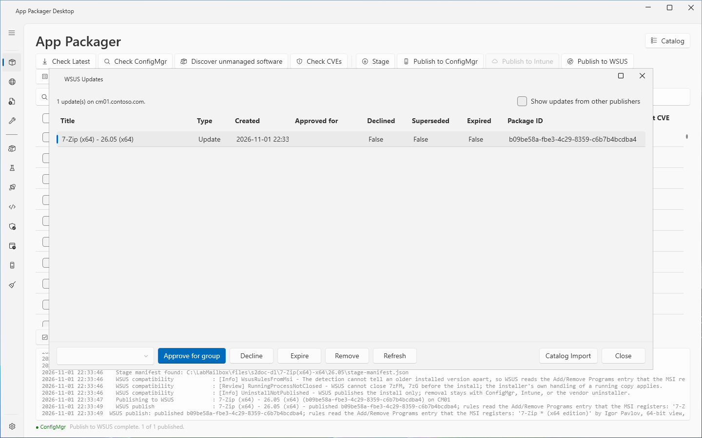
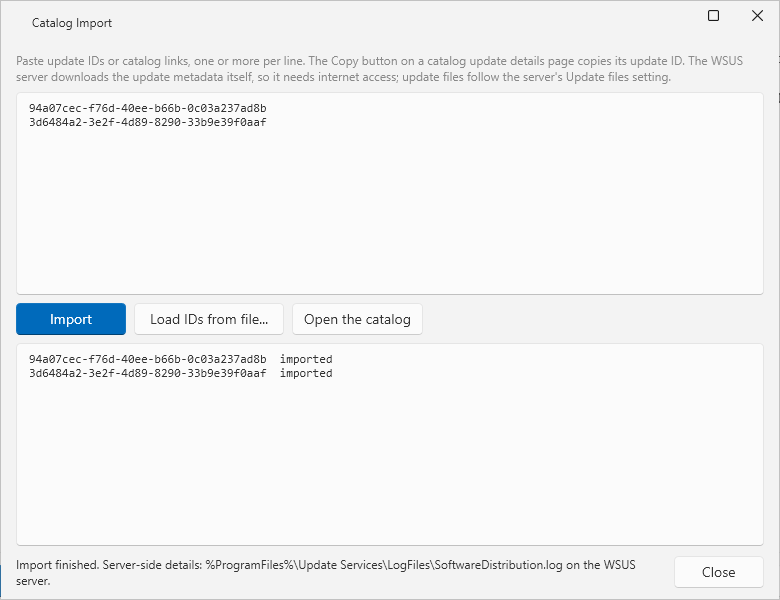

# WSUS Updates and Catalog Import

## What it does

The **WSUS Updates** window lists the locally published updates on your WSUS server. It approves, declines, expires and removes the selected updates. The **Catalog Import** window imports updates from the Microsoft Update Catalog by update ID.

This page is the second part of [WSUS publishing](wsus-publishing.md). That page describes how to set up the server and how to publish.

## When to use

- Approve an update after a publish, when **Approve for group** in Settings was empty. The WSUS console does not list locally published updates.
- Decline an update to stop WSUS from offering it. You can reverse a decline by approving the update again.
- Expire or remove an update that you no longer need.
- Import a Microsoft update that does not synchronize on its own.

## Requirements

- WSUS selected under **Systems in use** in Settings, and a **WSUS server** name. See [WSUS publishing](wsus-publishing.md).
- The WSUS administration API on this computer. The window opens without it, but the list then shows the error text.
- An account in the WSUS Administrators group on the server.
- For Catalog Import: the WSUS server needs internet access. The server downloads the update metadata itself.

## Steps

### Open the window

1. Select **Packages** in the sidebar.
2. Select **WSUS Updates**.
3. Read the summary line. It shows `<N> update(s) on <server>.`

The button is disabled when **Systems in use** does not include WSUS or when no server is set. The tooltip names the missing setting.

### Approve, decline, expire or remove

1. Select one or more rows. The grid takes several rows with Ctrl or Shift.
2. For **Approve for group**: enter or select a computer group in the box at the left of the buttons. The list loads from the server. The box starts with the group from Settings.
3. Select **Approve for group**, **Decline**, **Expire** or **Remove**.
4. For **Expire** and **Remove**: read the question and confirm it. The dialogs are **Expire Updates** and **Remove Updates**.
5. Read the summary line. It shows `<Action>: <done> of <selected> update(s) done.` A failed update adds its title and the message of the server.

**Approve for group** and **Decline** ask for no confirmation.

| Button | Effect |
|---|---|
| **Approve for group** | Approves the selected updates for the computer group. |
| **Decline** | The server does not offer a declined update to any client. Approve the update again to reverse it. |
| **Expire** | Expires the update on the server. Expiry is permanent. Clients stop seeing the update. You cannot approve it again. |
| **Remove** | Declines the update and deletes it from the WSUS database. You cannot undo it. Computers that installed the update keep the software. |
| **Refresh** | Reads the list again. |

With ConfigMgr, expire the update first. Let the software update point synchronize. Then remove the update. WSUS refuses to remove an update that another update still references.

### Show updates of other publishers

1. Select **Show updates from other publishers**.

The list then shows every locally published update on the server, not only the ones that App Packager Desktop published.

### Import from the Microsoft Update Catalog

1. In **WSUS Updates**, select **Catalog Import**.
2. Select **Open the catalog** to open `https://catalog.update.microsoft.com` in your browser.
3. On the page of an update, select the Copy button. It copies the update ID.
4. Paste the update IDs or the catalog links into the large box. Use one or more per line.
5. Optional: select **Load IDs from file...** to read the IDs from a text file.
6. Select **Import**.
7. Read the result box. Each ID has one line: `<id>  imported` or `<id>  FAILED  <message>`.
8. Read the status line. It ends with the location of the server log.
9. Select **Close**.

The window finds the IDs in the text. It imports each distinct ID once, in the order of the text. **Cancel** shows while an import runs. It stops before the next ID.

## Options and settings

The windows have no saved settings of their own. The group box starts with **Approve for group** from **Settings**, **WSUS Publishing**. The server comes from the same section.

| Control | Window | Effect |
|---|---|---|
| **Show updates from other publishers** | WSUS Updates | Lists every locally published update on the server. |
| Computer group box | WSUS Updates | Group for **Approve for group**. |
| **Load IDs from file...** | Catalog Import | Reads the box content from a text file. |
| **Open the catalog** | Catalog Import | Opens the Microsoft Update Catalog in the browser. App Packager Desktop sends no request to the catalog. |

## Limits

- The list shows the columns **Title**, **Type**, **Created**, **Approved for**, **Declined**, **Superseded**, **Expired** and **Package ID**.
- The lab verified Approve, Decline, Expire, Remove and Catalog Import on a ConfigMgr site with a WSUS server. The import of one valid update ID succeeded. The import of an ID that the catalog does not hold showed `FAILED` with the text of the server.
- The lab found no other publisher's update on its server. **Show updates from other publishers** was therefore not verified with a result that differs from the default.
- Details of an import are in `SoftwareDistribution.log` in the `Update Services\LogFiles` folder on the WSUS server.

## Troubleshooting

| Message | Cause | Fix |
|---|---|---|
| `Select one or more updates first.` | No row is selected. | Select a row. |
| `Enter or choose a computer group to approve for.` | The group box is empty. | Enter a group or use the list. |
| `Listing failed: <message>` | The server did not answer, or the API is missing. | Read the message. See [WSUS publishing](wsus-publishing.md). |
| `Computer groups could not be listed: <message>` | The call for the groups failed. The update list loaded. | Type the group name. |
| `... Another update on the server still references this update. Expire this update instead, or remove the update that references it first.` | **Remove** failed because of a reference. | Follow the message. |
| `... Only a locally published update that is not already expired can be expired on this server.` | The server refused **Expire**. | Check that the update was published locally and is not already expired. |
| `... The update is now declined.` | A step failed after the app declined the update. | Approve the update again if you want to undo the decline. |
| `The update is removed; its package folder on the server was not deleted: <message>` | The folder in `UpdateServicesPackages` could not be deleted. | Delete the folder on the server. |
| `No update IDs found in the text.` | The box has no update ID. | Paste an update ID or a catalog link. |
| `... The WSUS server could not reach the Microsoft Update Catalog over TLS 1.2...` | The server has no strong cryptography setting. | On the server, set `SchUseStrongCrypto` = 1 (DWORD) under `HKLM\SOFTWARE\Microsoft\.NETFramework\v4.0.30319`. Restart the WSUS service and the World Wide Web Publishing service. |
| `Import canceled before <id>.` or `Import canceled during <id>.` | You selected **Cancel**. | Select **Import** again. |

## Links

- [Local Publishing](https://learn.microsoft.com/en-us/previous-versions/windows/desktop/bb902470%28v=vs.85%29): Explains local publishing, the WSUS API method for custom updates.
- [WSUS and the Microsoft Update Catalog](https://learn.microsoft.com/windows-server/administration/windows-server-update-services/manage/wsus-and-the-catalog-site): Explains how WSUS imports updates from the Microsoft Update Catalog.
- [Updates Operations](https://learn.microsoft.com/windows-server/administration/windows-server-update-services/manage/updates-operations): Explains update approval, decline and the other update operations.
- [Step 2: Configure WSUS](https://learn.microsoft.com/windows-server/administration/windows-server-update-services/deploy/2-configure-wsus): Explains WSUS settings, TLS and the code-signing certificate for local publishing.
- [Manage software updates in Updates Publisher](https://learn.microsoft.com/intune/configmgr/sum/tools/manage-updates-with-updates-publisher): Shows how Updates Publisher publishes updates to an update server.
