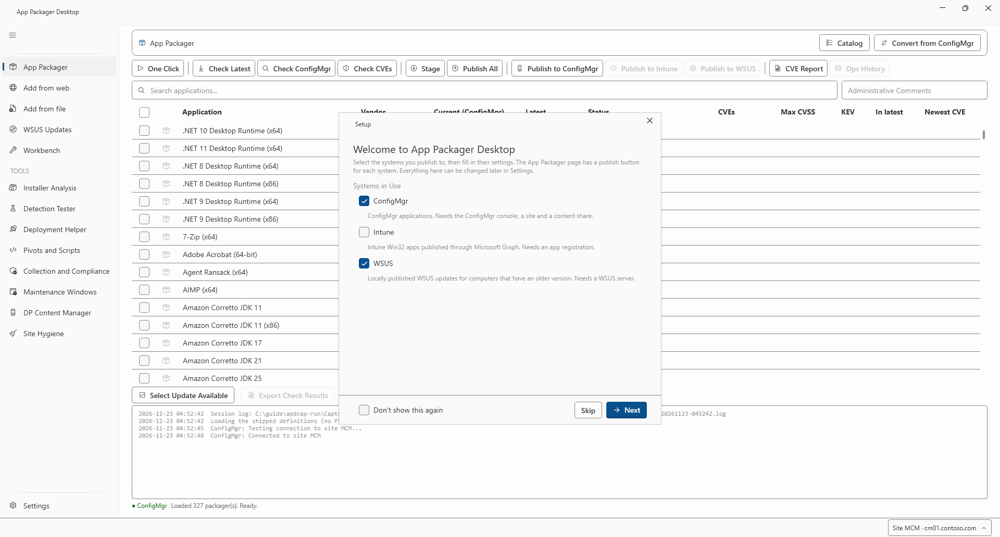
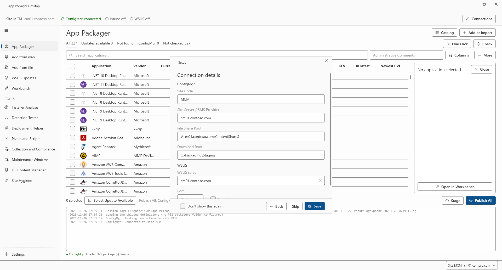
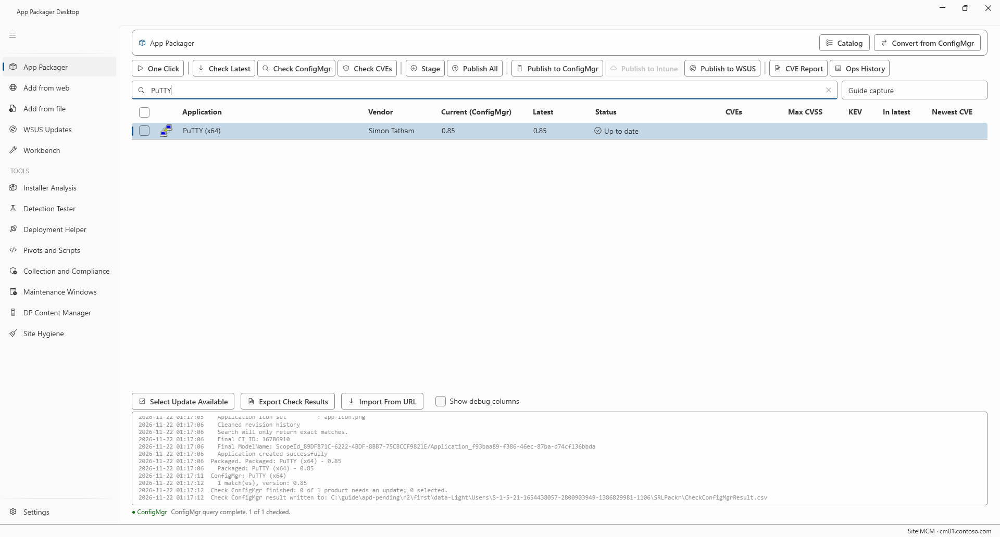
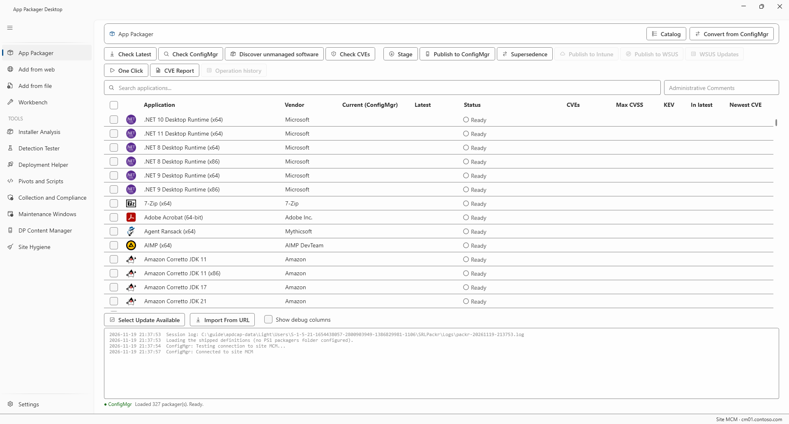
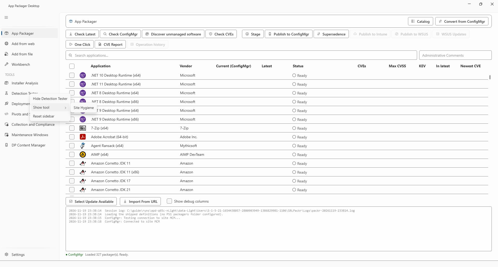

# Getting started

This page shows how to install App Packager Desktop, finish the setup checklist, connect to a ConfigMgr site, and package one application from the start to the end.

## What it does

App Packager Desktop packages third-party Windows applications. It reads the current version from the vendor, downloads the installer, stages the content, and publishes to ConfigMgr, Intune or WSUS. This page uses ConfigMgr as the destination.

## When to use it

Use this page on a new installation, or when you connect the application to a different site.

## Requirements

- Windows 10, Windows 11 or Windows Server, 64-bit.
- Windows PowerShell 5.1.
- For ConfigMgr: the Configuration Manager console on this computer. You also need an account with rights to create applications.
- For ConfigMgr publishing: a UNC path to a content share. The account must be able to write to it.
- A local folder for staging. The default is the `Staging` folder in the data folder `%LOCALAPPDATA%\AppPackager`. Only your account and administrators can have write rights to it. Stage refuses a folder that other accounts can change, for example `BUILTIN\Users`.
- 7-Zip, for applications whose installer is an archive.
- A window of at least 1024 by 720 pixels. The window opens at 1200 by 800 and cannot be made smaller than 900 by 600. A size below 1024 by 720 can work and is not supported.

The .NET Windows Desktop Runtime 10.0.14 or newer (x64) must be on the computer. The runtime is not part of the release. The installer checks for it and, when it is missing or older, downloads the latest 10.x runtime from Microsoft, checks its Microsoft signature and installs it. Windows asks for consent. Without the installer, install the runtime yourself from [dotnet.microsoft.com](https://dotnet.microsoft.com/download/dotnet/10.0): choose **Desktop Runtime**, **x64**.

For WSUS and Intune requirements, see [Settings page](core/settings-page.md).

## Steps

### Install

1. Download the release from the Releases page of the project.
2. Choose one of the two files:
   - `AppPackagerDesktop-Setup-<version>.exe` installs for the current user without elevation. It adds a Start Menu shortcut. The switch `/S` installs silently. When the .NET Desktop Runtime is missing, the installer downloads it from Microsoft, checks the signature and installs it first. Windows asks for consent.
   - `AppPackagerDesktop-<version>.zip` is the same build without an installer. Install the .NET Desktop Runtime first, then extract it and run `ApplicationPackagerUI.exe`.
3. Close the application before you install an update by hand. The installer does not replace an executable that is in use. The app can also update itself: see [Updates](core/updates.md).

The application checks for a new version at start. To check at once, open **Settings** and select **Check for updates**. To read the release page, open **Settings**, go to **About**, and select **Releases**.

### The setup checklist

The app starts on the **App Packager** page with the grid. The Setup window does not open by itself. On a new installation, the panel **Setup checklist** is open at the right of the grid. A new installation is one whose settings file has no completed first run and does not hold a whole setup. In a narrow window, a strip above the status tabs shows in place of the panel. The strip reads `Connect a site to check for updates` or `Finish the setup checklist`, with the progress. Select **Open Setup Checklist**.

The panel shows the progress, for example `1 of 4 complete`, and four steps. Each step has a state: `To do`, `Complete`, `Not needed`, `Skipped` or `Failed`.

| Step | Complete when | Buttons |
|---|---|---|
| **Choose systems** | At least one system is in use. | **Open Setup** |
| **Connect to your site** | The ConfigMgr connection test passed. `Not needed` when ConfigMgr is not in use. | **Open Setup**, **Test Connection** |
| **Set content folders** | **Download Root** is set and, with ConfigMgr in use, **File Share Root** is set to a value other than the example `\\fileserver\sccm$`. | **Open Setup** |
| **Discover unmanaged software** | A scan of the active site ran, or you skipped it. `Not needed` when ConfigMgr is not in use. | **Scan Site Inventory** or **Scan Again**, **Skip Scan** |

In a page at least 1400 pixels wide, the panel also takes the height of the batch bar and the log pane, so the four steps show without scrolling in a maximized window on a 1920 x 1080 display. In a smaller window, the steps scroll. The buttons below the steps always show.

- **Skip for Now** closes the panel until the next start. The strip above the status tabs then shows while the checklist has work. When the checklist has no work left, the button reads **Close**.
- **Do Not Show Again** stops the checklist from opening at the start. It changes no other setting.
- To open the checklist again, select **More**, then **Setup checklist**.
- When all steps are done, the checklist does not open again. It opens again only for a site that has no scan record.
- An installation that was set up before does not get the checklist. **More**, **Setup checklist** still opens it.

### The Setup window

Open the window with **Open Setup** in the checklist, or with **More**, **Setup...** on the **App Packager** page. **Setup...** is disabled while an operation runs.

1. View the first page, **Welcome to App Packager Desktop**.
2. Under **Systems in Use**, select **ConfigMgr**, **Intune** and **WSUS** as needed. **ConfigMgr** is selected on a new installation. Each system is optional: you can use Intune, WSUS or both without ConfigMgr.
3. Select **Next**.
4. On the **Connection details** page, enter the values for the systems that you selected. For ConfigMgr, enter **Site Code**, **Site Server / SMS Provider** and **File Share Root**. **Download Root** shows for every choice of systems.
   - **File Share Root** is the share itself, for example `\\fileserver\sccm$`. The app adds `Applications\<Vendor>\<App>\<Version>` below it. A root that ends in `\Applications` gives `...\Applications\Applications\...`.
   - **Download Root** shows the `Staging` folder of the data folder at first.
5. Select **Save**.

Notes about the Setup window:

- The boxes show the saved values or the defaults. The default **Site Code** is `MCM`, shown as a value. The default **File Share Root** is `\\fileserver\sccm$`, shown as a placeholder. Replace each default value with your own value.
- The window is 620 by 600 pixels. With **ConfigMgr** and **WSUS** selected, the **Port** row of WSUS is cut at the bottom. Scroll to reach **Use SSL**.
- **Back** returns to the first page. **Skip** closes the window and saves nothing.
- The check box **Don't show this again** applies to **Skip**. It marks the first run as completed and stops the setup checklist from opening. No other setting changes.
- When a site is active, **Site Code** is read only. Use the site switcher to add or change a site.
- If you clear **ConfigMgr**, **Save** stores an empty site code.
- If you select no system, the window shows this text: "No system is selected. Save stores that, and Publish All stays disabled until a system is selected in Settings."
- When **Save** changes the systems in use, it makes each selected system a default destination of One Click. It does the same on a new installation that has no saved default destinations. The log pane of the **App Packager** page then shows a line that starts with "Setup complete." In other cases, **Save** keeps the saved One Click destinations.
- After **Save**, the app tests the ConfigMgr connection again.
- All Setup values are also on the **Settings** page. See [Settings page](core/settings-page.md).

The first start shows the Dark theme. To change it, open **Settings** and select **Light Theme**, then **Save Settings**.

### Connect to a site

1. Open **Settings**.
2. Select the page **ConfigMgr**. Check **Site Code**. Enter the three-character site code of your site.
3. In **Site Server / SMS Provider Host**, enter the host name of the SMS Provider. Leave the box empty only when this computer is the SMS Provider.
4. In **File Share Root (UNC)**, enter the UNC path of the content share.
5. Select **Save Settings**.
6. Open **App Packager**. Select the page, then press F5 to reload the application list. The reload tests the connection to the site.
7. View the ConfigMgr state in the context strip at the top of the window. It reads `connected` when the test passed and `connection failed` when it did not. The signal beside the heading **ConfigMgr Connection** in Settings shows the same result. You can also view the `● ConfigMgr` indicator in the status line. The text of the indicator does not change. Its color shows the state. Green means the test passed. Red means the test did not pass. Amber means the test is running. Gray means that no site code is configured. The default color shows when **ConfigMgr** is not selected under **Systems in Use**.
8. Review the log pane for the text of the state. A passed test shows `ConfigMgr: Connected to site <code>`. A failed test shows `ConfigMgr: Connection failed` and the reason.

**Publish All** is disabled, not hidden, when a system in use is not ready. The tooltip names the system and the reason. See [Troubleshooting](troubleshooting.md).

### Package one application

1. Open **App Packager**.
2. In the grid, select the check box of one application. Use **Search applications...** to find it.
3. Select **Check**, then **Check Latest**. The **Latest** column shows the vendor version.
4. Select **Check**, then **Check ConfigMgr**. The **Current (ConfigMgr)** column shows the version that the site holds. The **Status** column shows **Update available** when the site version is older than the vendor version. It shows **Not found in ConfigMgr** when the site has no application with that name.
5. Select **Stage**. App Packager Desktop downloads the installer and prepares the content in the download root. The status shows **Staging...** and then **Staged**.
6. If the dialog **Configure: <application>** opens, check the values. Select **Continue**. Select **Cancel** to skip the application.
7. Select **Publish All**. With ConfigMgr as the only system in use, it publishes to ConfigMgr. Review the **Review Publish All** window and select **Publish 1 application**.
8. The status shows **Packaging...** and then **Packaged**. If the dialog **Application Already Exists** opens, select **Overwrite**, **Skip** or **Cancel remaining**.
9. Review the **Publish results** window and select **Done**.
10. Select **Check**, then **Check ConfigMgr** again. The status shows **Up to date** when the site version equals the vendor version.

To stop an operation, select **Cancel** in the batch bar or press Esc. **Cancel** is visible only while an operation runs.

### Add your own application

The sidebar has two entries for an application that is not in the catalog. The menu **Add or import** of the **App Packager** page also opens them.

- **Add from web** is a wizard for an application with a download address and a version source. See [Add from web](core/add-app.md).
- **Add from file** analyzes an installer file on this computer. Drop the file on the page, or on the **App Packager** page. See [Add from file](core/add-from-file.md).

Both end on a result panel with the buttons **Open in Workbench**, **Stage now** and **Done**. Nothing is staged until you select **Stage now**.

### Use the sidebar

The footer at the lower right of the window shows the site code and the site server ("Site P01", a middle dot and the server; "Site not set" when there is no site code). The footer is the site switcher: select it to switch to another site or to add a site. See [Sites](core/sites.md). You edit the site code and the server in Settings (or in the Setup window). The sidebar on the left lists the pages in two groups. The first group has **App Packager**, **Add from web**, **Add from file** and **Workbench**. The group **TOOLS** has the eight tools. **Settings** is always the last entry. The application starts on **App Packager**. **App Packager** cannot be hidden or moved. An entry moves only inside its group.

1. Right-click an entry to open its menu.
2. Select **Hide** followed by the entry name, for example **Hide Detection Tester**, to remove the entry from the sidebar.
3. To return a hidden entry, right-click an entry or the empty area of the sidebar. Select **Show tool**, then select the name of the entry. **Show tool** is a submenu. It appears only when an entry is hidden.
4. Select **Reset sidebar** to restore the default order and show every entry.

See [Keyboard](reference/keyboard.md) for the keys that move an entry. See [Settings page](core/settings-page.md) for the Sidebar section.

## Options and settings of this page

The first-run flag, the state of the checklist and the system choices are stored in `settings.json` in the data folder. Every setting that the Setup window changes is also on the **Settings** page.

## Limits

- Lab tests of ConfigMgr publishing used an account with the Full Administrator role. The application was not tested with a custom role.
- The application does not require elevation. A drag from Explorer cannot reach an application that runs elevated. Do not run the application elevated if you use drag and drop.
- The **Setup** window cannot test a connection. Use **Test Connection** in the setup checklist, or read the context strip.

## Troubleshooting

| Message | Cause | Fix |
|---|---|---|
| Could not connect to site `<code>`. Check Settings and ensure the Configuration Manager console is available. | The connection test failed. | Check the settings. Install the Configuration Manager console on this computer. |
| SiteCode is required. Open Settings to configure. | The site code is empty. | Enter the site code in **Settings**. |
| File Share Root is required. Open Settings to configure. | The share root is empty. | Enter the UNC path in **Settings**. |

See [Troubleshooting](troubleshooting.md) for more messages.
