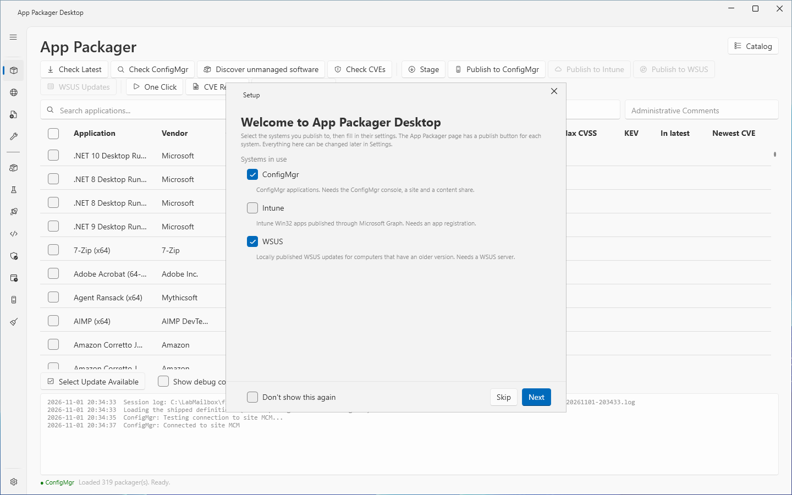
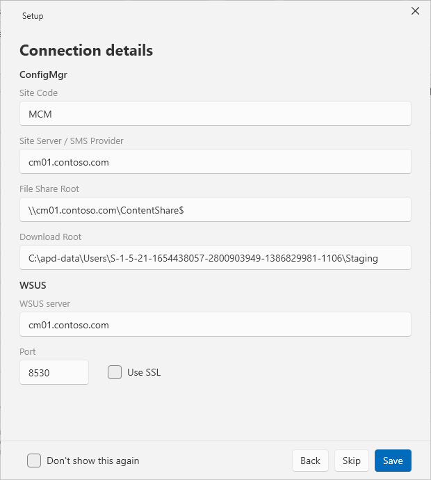
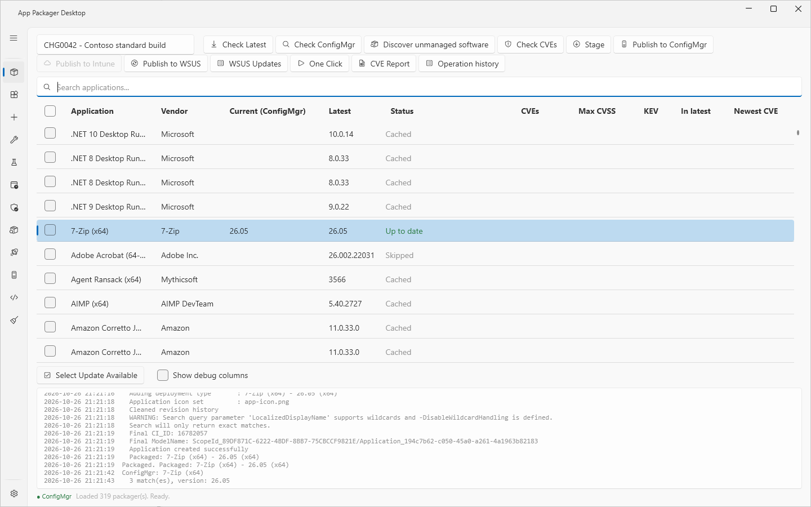
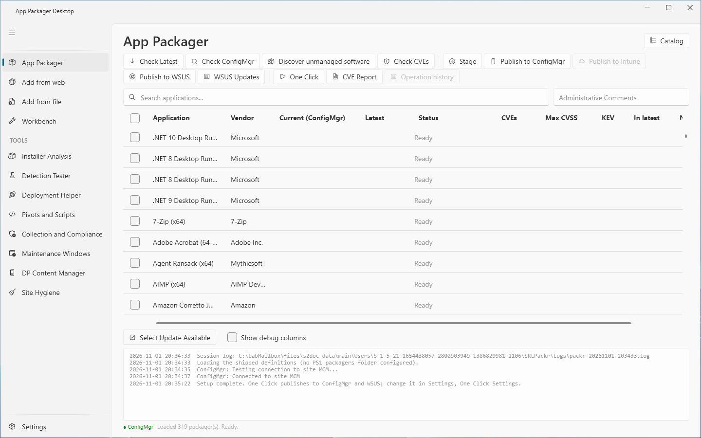
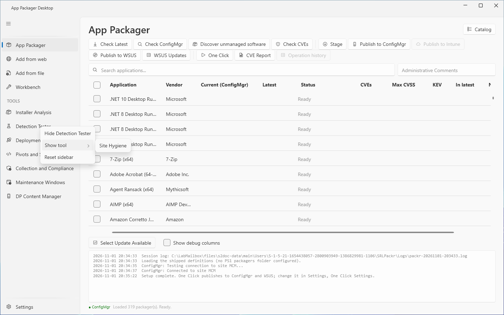

# Getting started

This page shows how to install App Packager Desktop, finish the first-run Setup window, connect to a ConfigMgr site, and package one application from the start to the end.

## What it does

App Packager Desktop packages third-party Windows applications. It reads the current version from the vendor, downloads the installer, stages the content, and publishes to ConfigMgr, Intune or WSUS. This page uses ConfigMgr as the destination.

## When to use it

Use this page on a new installation, or when you connect the application to a different site.

## Requirements

- Windows 10, Windows 11 or Windows Server, 64-bit.
- Windows PowerShell 5.1.
- For ConfigMgr: the Configuration Manager console on this computer. You also need an account with rights to create applications.
- For ConfigMgr publishing: a UNC path to a content share. The account must be able to write to it.
- A local folder for staging. The default is the `Staging` folder in the data folder `%LOCALAPPDATA%\AppPackager`. Only your account and administrators can have write rights to it. Stage refuses a folder that other accounts can change, for example `BUILTIN\Users`.
- 7-Zip, for applications whose installer is an archive.
- A window of at least 1024 by 720 pixels. The window opens at 1200 by 800 and cannot be made smaller than 900 by 600. A size below 1024 by 720 can work and is not supported.

The .NET Windows Desktop Runtime 10.0.14 or newer (x64) must be on the computer. The runtime is not part of the release. The installer checks for it and, when it is missing or older, downloads the latest 10.x runtime from Microsoft, checks its Microsoft signature and installs it. Windows asks for consent. Without the installer, install the runtime yourself from [dotnet.microsoft.com](https://dotnet.microsoft.com/download/dotnet/10.0): choose **Desktop Runtime**, **x64**.

For WSUS and Intune requirements, see [Settings page](core/settings-page.md).

## Steps

### Install

1. Download the release from the Releases page of the project.
2. Choose one of the two files:
   - `AppPackagerDesktop-Setup-<version>.exe` installs for the current user without elevation. It adds a Start Menu shortcut. The switch `/S` installs silently. When the .NET Desktop Runtime is missing, the installer downloads it from Microsoft, checks the signature and installs it first. Windows asks for consent.
   - `AppPackagerDesktop-<version>.zip` is the same build without an installer. Install the .NET Desktop Runtime first, then extract it and run `ApplicationPackagerUI.exe`.
3. Close the application before you install an update by hand. The installer does not replace an executable that is in use. The app can also update itself: see [Updates](core/updates.md).

The application checks for a new version at start. To check at once, open **Settings** and select **Check for updates**. To read the release page, open **Settings**, go to **About**, and select **Releases**.

### Finish the Setup window

The **Setup** window opens one time, after the main window appears. It opens when the first-run flag is not set in the settings file. An existing settings file without the flag counts as completed.

1. Read the first page, **Welcome to App Packager Desktop**.
2. Under **Systems in use**, select **ConfigMgr**, **Intune** and **WSUS** as needed. **ConfigMgr** is selected at first.
3. Select **Next**.
4. On the **Connection details** page, enter the values for the systems that you selected. For ConfigMgr, enter **Site Code**, **Site Server / SMS Provider**, **File Share Root** and **Download Root**.
   - **File Share Root** is the share itself, for example `\\fileserver\sccm$`. The app adds `Applications\<Vendor>\<App>\<Version>` below it. A root that ends in `\Applications` gives `...\Applications\Applications\...`.
   - **Download Root** shows the `Staging` folder of the data folder at first.
5. Select **Save**.

Notes about the Setup window:

- The boxes show the saved values or the defaults. The default **Site Code** is `MCM`, shown as a value. The default **File Share Root** is `\\fileserver\sccm$`, shown as a placeholder. Replace each default value with your own value.
- The window is 620 by 600 pixels. With **ConfigMgr** and **WSUS** selected, the **Port** row of WSUS is cut at the bottom. Scroll to reach **Use SSL**.
- **Back** returns to the first page. **Skip** closes the window and saves nothing. With **Skip**, the window opens again at the next start.
- The check box **Don't show this again** sets the first-run flag. Use it with **Skip** to stop the window without saving any setting.
- If you clear **ConfigMgr**, **Save** stores an empty site code.
- If you select no system, the window shows this text: "No system is selected. Save stores that, and the publish buttons stay disabled until a system is selected in Settings."
- **Save** makes each selected system a default destination of One Click. The log pane of the **App Packager** page then shows a line that starts with "Setup complete."
- All Setup values are also on the **Settings** page. See [Settings page](core/settings-page.md).

The first start shows the Dark theme. To change it, open **Settings** and select **Light**.

### Connect to a site

1. Open **Settings**.
2. Under **ConfigMgr Site Settings**, check **Site Code**. Enter the three-character site code of your site.
3. In **Site Server / SMS Provider Host**, enter the host name of the SMS Provider. Leave the box empty only when this computer is the SMS Provider.
4. In **File Share Root (UNC)**, enter the UNC path of the content share.
5. Select **Save Settings**.
6. Open **App Packager**. Click the page, then press F5 to reload the application list. The reload tests the connection to the site.
7. Read the `● ConfigMgr` indicator in the status line. The text of the indicator does not change. Its color shows the state. Green means the test passed. Red means the test did not pass. Amber means the test is running. Gray means that the site code is empty. The default color shows when **ConfigMgr** is not selected under **Systems in use**.
8. Read the log pane for the text of the state. A passed test shows `ConfigMgr: Connected to site <code>`. A failed test shows `ConfigMgr: Connection failed` and the reason.

The publish buttons are disabled, not hidden, when a system is not ready. The tooltip of a disabled button names the missing setting. See [Troubleshooting](troubleshooting.md).

### Package one application

1. Open **App Packager**.
2. In the grid, select the check box of one application. Use **Search applications...** to find it.
3. Select **Check Latest**. The **Latest** column shows the vendor version.
4. Select **Check ConfigMgr**. The **Current (ConfigMgr)** column shows the version that the site holds. The **Status** column shows **Update available** when the site version is older than the vendor version. It shows **Not found in ConfigMgr** when the site has no application with that name.
5. Select **Stage**. App Packager Desktop downloads the installer and prepares the content in the download root. The status shows **Staging...** and then **Staged**.
6. If the dialog **Configure: <application>** opens, check the values. Select **Continue**. Select **Cancel** to skip the application.
7. Select **Publish to ConfigMgr**. The status shows **Packaging...** and then **Packaged**.
8. If the dialog **Application Already Exists** opens, select **Overwrite**, **Skip** or **Cancel remaining**.
9. Select **Check ConfigMgr** again. The status shows **Up to date** when the site version equals the vendor version.

To stop an operation, select **Cancel** or press Esc. **Cancel** is visible only while an operation runs.

### Add your own application

The sidebar has two entries for an application that is not in the catalog.

- **Add from web** is a wizard for an application with a download address and a version source. See [Add from web](core/add-app.md).
- **Add from file** analyzes an installer file on this computer. Drop the file on the page, or on the **App Packager** page. See [Add from file](core/add-from-file.md).

Both end on a result panel with the buttons **Open in Workbench**, **Stage now** and **Done**. Nothing is staged until you select **Stage now**.

### Use the sidebar

The sidebar on the left lists the pages in two groups. The first group has **App Packager**, **Add from web**, **Add from file** and **Workbench**. The group **TOOLS** has the eight tools. **Settings** is always the last entry. The application starts on **App Packager**. **App Packager** cannot be hidden or moved. An entry moves only inside its group.

1. Right-click an entry to open its menu.
2. Select **Hide** followed by the entry name, for example **Hide Detection Tester**, to remove the entry from the sidebar.
3. To return a hidden entry, right-click an entry or the empty area of the sidebar. Select **Show tool**, then select the name of the entry. **Show tool** is a submenu. It appears only when an entry is hidden.
4. Select **Reset sidebar** to restore the default order and show every entry.

See [Keyboard](reference/keyboard.md) for the keys that move an entry. See [Settings page](core/settings-page.md) for the Sidebar section.

## Options and settings of this page

The first-run flag and the system choices are stored in `settings.json` in the data folder. Every setting that the Setup window changes is also on the **Settings** page.

## Limits

- Lab tests of ConfigMgr publishing used an account with the Full Administrator role. The application was not tested with a custom role.
- The application does not require elevation. A drag from Explorer cannot reach an application that runs elevated. Do not run the application elevated if you use drag and drop.
- The **Setup** window cannot test a connection. Use the `● ConfigMgr` indicator on the **App Packager** page.

## Troubleshooting

| Message | Cause | Fix |
|---|---|---|
| Could not connect to site `<code>`. Check Settings and ensure the CM console is available. | The connection test failed. | Check the settings. Install the Configuration Manager console on this computer. |
| SiteCode is required. Open Settings to configure. | The site code is empty. | Enter the site code in **Settings**. |
| File Share Root is required. Open Settings to configure. | The share root is empty. | Enter the UNC path in **Settings**. |

See [Troubleshooting](troubleshooting.md) for more messages.
