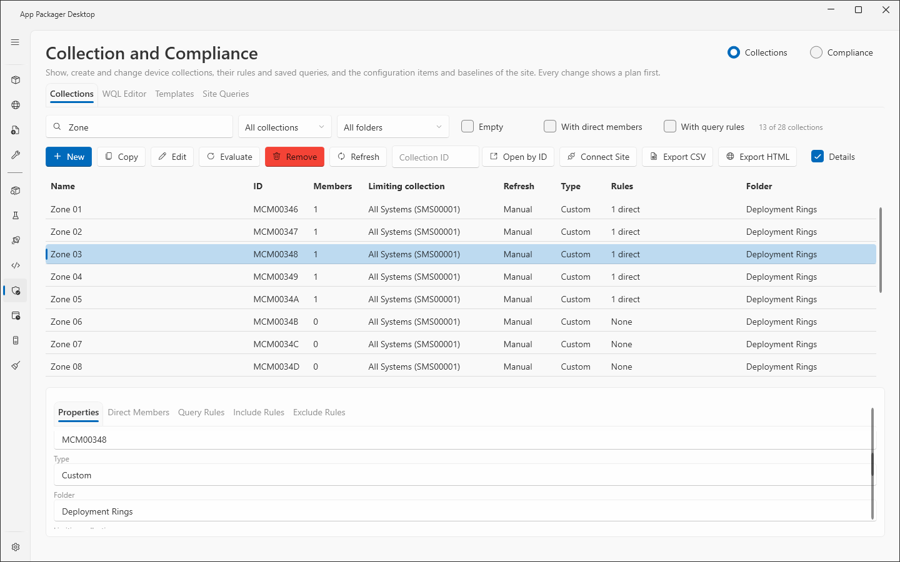
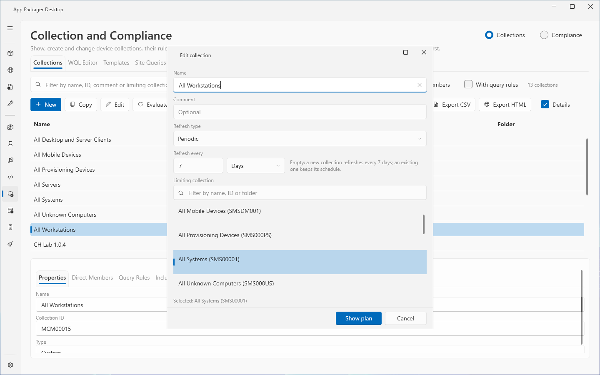
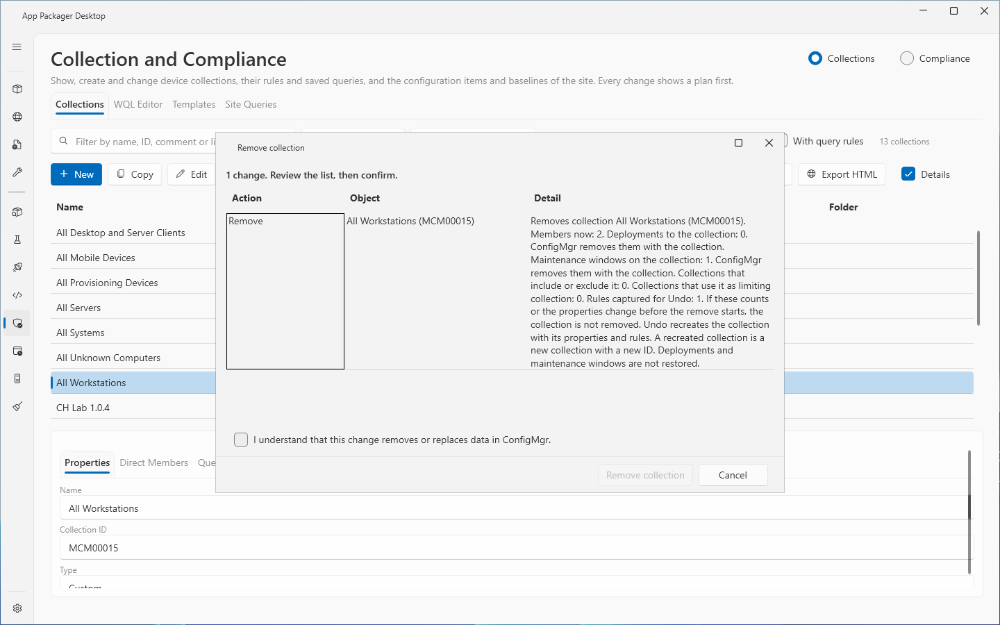

# Collection and Compliance

The Collection and Compliance page shows and changes the device collections of a ConfigMgr site. It also holds the Compliance section for configuration items and baselines. This page describes the page as a whole and the Collections tab. The other tabs have their own pages:

- WQL Editor, Templates and Site Queries: [Collections: queries and templates](collections-queries.md).
- The Compliance section: [Compliance](compliance.md).

Every change shows a plan first. Nothing changes until you read the plan, select the confirmation box (when the plan shows one) and select the action button.

## When to use it

Use the Collections tab to create, copy, edit, evaluate or remove device collections. Use it to add direct members, include rules and exclude rules. Use it to find a collection by its ID or to export the list.

## Requirements

- ConfigMgr must be selected under Systems in use in [Settings](../core/settings-page.md). If it is not, the page shows: "ConfigMgr is not in use. Select it under Systems in use in Settings."
- The `Site Code` and the `Site Server / SMS Provider Host` must be set in Settings, ConfigMgr Site Settings. If the site code is empty, the page shows: "Set the site code in Settings, ConfigMgr Site Settings."
- The Configuration Manager console must be installed on this computer. The page uses its PowerShell module through Windows PowerShell 5.1.
- The account that runs the application needs a ConfigMgr security role with "Read, Modify, Create and Delete on Collection and Query".
- The code does not require an elevated application.
- No test with a custom security role is on record. The role text above is the text in the code. See [permissions](../reference/permissions.md).

## Steps: read the collections

1. Select `Collection and Compliance` in the sidebar.
2. Select the `Collections` switch at the top right of the page.
3. Wait for the status text "Reading the collections." to end. The page reads the collections on the first visit and each time you return to the page.
4. Read the count of shown rows next to the filters.
5. Select `Cancel` to stop a read that takes too long. The `Cancel` button shows only while the page reads.

To test the connection without reading the list, select `Connect Site`. The page shows "Connected to site <site code>." or the cause of the failure.

To open one collection without reading the list, enter the ID in the `Collection ID` box and select `Open by ID`. Press Enter in the box for the same action. An ID has eight characters, for example `LAB00012`. After `Open by ID` the list holds only that collection. A change that needs the whole list shows "The list holds only the collection opened by ID. Select Refresh to read the whole list, then try again." Select `Refresh` to read the whole list.

## Steps: create, copy or edit a collection

1. Select `New` to create a collection. Select a row and select `Copy` to copy it. Select a row and select `Edit` to change it.
2. In the dialog, enter the `Name`. A copy starts with the name "Copy of <source name>". The dialog shows `Source` for a copy.
3. For `New` and `Edit`, set `Comment`, `Refresh type` and `Limiting collection`. The `Refresh type` choices are Manual, Periodic, Continuous and Both.
4. For `Periodic` and `Both`, set `Refresh every` with a count and a unit (Minutes, Hours or Days). Leave the count empty to use the default.
5. Select the `Limiting collection` in the list. Use the filter box above the list to find it. A new collection starts with the collection with the ID `SMS00001` selected, when the list holds it.
6. Select `Show plan`.
7. Read the plan. Select the action button (`Create collection`, `Copy collection` or `Save changes`).

Rules for the dialog:

- The interval is 1 to 59 minutes, 1 to 23 hours or 1 to 31 days.
- A new collection with an empty interval refreshes every 7 days. An existing collection keeps its schedule when you leave the interval empty.
- The page reads the stored schedule back after the write. It reports a failure when ConfigMgr stored another schedule.
- A collection cannot be its own limiting collection. The list does not offer a collection that the edited collection limits, directly or through other collections.
- `Copy` changes only the name. The copy gets the properties and the rules of the source.

## Steps: evaluate a collection

1. Select one or more rows.
2. Select `Evaluate`.
3. Read the plan. The plan states "The update starts membership evaluation work on the site server." and "Undo: not applicable."
4. Select the action button `Update membership of <n> collection(s)`.

## Steps: add direct members

1. Select a custom collection. Open the `Direct Members` tab in the details.
2. Select `Add`.
3. Enter one device name or resource ID on each line. The dialog accepts at most 200 lines.
4. Select `Look up and show plan`.
5. Read the plan. A line that matches no device, or more than one device, shows as Skip with the reason.
6. Select the action button.

To remove direct members, select one or more rows in the `Direct Members` tab and select `Remove`. The plan has a confirmation box. The tab shows 200 members on each page. Use the arrow buttons (`Previous page`, `Next page`) to change the page.

## Steps: add include rules and exclude rules

1. Select a custom collection. Open the `Include Rules` tab or the `Exclude Rules` tab.
2. Select `Add`.
3. In the picker, check the collections. Use `Check shown` and `Clear` to change all shown rows. Select `Show plan`.
4. Read the plan. The plan states that an include or exclude rule changes the membership evaluation of the collection.
5. Select the action button.

To remove a rule, select it in the list and select `Remove`. The `Query Rules` tab lists the query rules. `Edit in WQL Editor` opens a rule in the WQL Editor tab (see [Collections: queries and templates](collections-queries.md)).

## Steps: remove a collection

1. Select one custom collection.
2. Select `Remove`.
3. Read the plan. The plan shows the member count, the deployments, the maintenance windows and the references. The page reads them from the site when the plan opens.
4. Select the confirmation box "I understand that this change removes or replaces data in ConfigMgr."
5. Select `Remove collection`.

- A built-in collection cannot be removed. The page shows "A built-in collection cannot be changed or removed here."
- A collection that limits another collection cannot be removed. A collection that another collection includes or excludes cannot be removed.
- ConfigMgr removes the deployments and the maintenance windows of the collection with the collection.
- If a count or a property changes after the plan opened, the collection is not removed.

## The plan window

All writes of the page use the same plan window.

1. Before the run, the window shows "<n> change(s). Review the list, then confirm." The grid has the columns `Action`, `Object` and `Detail`. A notes box can show lines with checks and impact.
2. During the run, the window shows "Running..." and the step. `_Cancel` stops the run between changes.
3. After the run, the window shows the grid `Result`, `Action`, `Object` and `Message`.
4. `_Undo` reverses the run when the plan has an Undo. `C_lose` closes the window.
5. If a run does not stop after `_Cancel`, the window offers `Close _without waiting`. The run can then still change ConfigMgr.

The page also has `Undo last change`. It shows a plan that reverses the last change set. The button shows only when an Undo exists.

## Options and settings

Filters of the Collections tab:

| Control | Effect |
|---|---|
| Filter box ("Filter by name, ID, comment or limiting collection") | Shows the rows that contain the text. |
| Type list | `All collections`, `Built-in` or `Custom`. |
| Folder list | `All folders` or a console folder. A folder with sub-folders shows as `<Folder> (and sub-folders)` and covers everything below it. |
| `Empty` | Shows collections with no members. |
| `With direct members` | Shows collections that have direct member rules. |
| `With query rules` | Shows collections that have query rules. |
| `Details` | Shows or hides the detail panel under the list. Drag the splitter to change its height. |

Columns of the list: `Name`, `ID`, `Members`, `Limiting collection`, `Refresh`, `Type`, `Rules`, `Folder`. The `Rules` column shows the counts in the form "2 query, 1 direct", or "None".

Detail tabs: `Properties`, `Direct Members` (columns `Name`, `Resource ID`, `Membership`; the membership is "Direct" or "From a rule"), `Query Rules`, `Include Rules` and `Exclude Rules`.

Export:

- `Export CSV` and `Export HTML` write a report of the shown collections. A CSV cell that a spreadsheet would read as a formula starts with an apostrophe. The HTML report encodes all text.
- Report files are named `collections-<yyyyMMdd-HHmmss>.csv` or `.html`. They are in the `Collections\Reports` folder of the data folder. See [data folders](../reference/data-folders.md).
- A reports folder that is a junction or a symbolic link is refused.

The page saves the selected tab, the detail tab, the filters, the state of `Details` and the size of the collection dialog for the current Windows user. See [settings](../reference/settings.md).

Each completed run adds one line to the operation history. The line holds counts and no names or queries.

## Limits

- The Collections tab lists device collections.
- The member list of a collection shows 200 members on each page.
- A collection name has at most 255 characters.
- Evaluate cannot be undone.
- Remove is undone by creating the collection again with its properties and rules. The new collection has a new ID. Deployments and maintenance windows are not restored.
- A run that stops part way keeps the Undo data of the changes it made. A write that may have changed ConfigMgr but whose result is unknown gives no Undo. The message says to check ConfigMgr.
- The page checks the collection again when it writes. ConfigMgr has no conditional write. A change made in the short time between this check and the write can still be lost.
- The command time limit of the ConfigMgr session is 5 minutes. The connect time limit is 2 minutes (`IConfigMgrSession.cs`).
- The page was not tested with a custom security role.

## Troubleshooting

| Message | Cause | Fix |
|---|---|---|
| ConfigMgr is not in use. Select it under Systems in use in Settings. | ConfigMgr is off in Settings. | Select ConfigMgr under Systems in use. |
| Set the site code in Settings, ConfigMgr Site Settings. | The site code is empty. | Enter the `Site Code`. |
| The ConfigurationManager PowerShell module was not found. Install the Configuration Manager console on this computer. | The console module is missing. | Install the Configuration Manager console. |
| The SMS Provider <name> denied access. The account needs a ConfigMgr security role for site <code>. | The account has no role on the site. | Give the account a role with rights on collections and queries. The page adds: "The ConfigMgr console role needs collection and query rights." |
| The CMSite drive for site <code> on <provider> could not connect. Check the site code and the SMS Provider in Settings, ConfigMgr Site Settings. | Wrong site code or provider name. | Correct the two settings. |
| The collections could not be read. The log has the details. | The read failed for a reason that the page does not name. | Read the log. Select `Refresh`. |
| Enter a collection ID of eight characters, for example LAB00012. | The ID in the `Collection ID` box has the wrong form. | Enter an ID of eight characters. |
| No collection with the ID <id> exists. | `Open by ID` found no collection. | Check the ID. |
| A built-in collection cannot be changed or removed here. | The selected collection is built in. | Select a custom collection. |
| The Collections reports folder is a junction or symbolic link. The report was not written. | The `Collections\Reports` folder is a link. | Replace the link with a real folder. |
| Select a limiting collection. | The dialog has no limiting collection. | Select one in the list. |
| Enter a refresh interval of 1 to 59 minutes, 1 to 23 hours or 1 to 31 days, or leave it empty. | The interval is outside the range. | Enter a valid interval. |

See also [error messages](../reference/error-messages.md).

## Links

- [Introduction to collections in Configuration Manager](https://learn.microsoft.com/intune/configmgr/core/clients/manage/collections/introduction-to-collections): Explains the built-in and the custom collections.
- [How to create collections in Configuration Manager](https://learn.microsoft.com/intune/configmgr/core/clients/manage/collections/create-collections): Explains the collection rule types and how to create a collection.
- [Create queries in Configuration Manager](https://learn.microsoft.com/intune/configmgr/core/servers/manage/create-queries): Shows how to create and edit queries.
- [WQL (SQL for WMI)](https://learn.microsoft.com/windows/win32/wmisdk/wql-sql-for-wmi): Describes the WQL syntax for WMI queries.
- [Plan for and configure compliance settings in Configuration Manager](https://learn.microsoft.com/intune/configmgr/compliance/plan-design/plan-for-and-configure-compliance-settings): Explains compliance settings, configuration items and baselines.
- [Create configuration baselines in Configuration Manager](https://learn.microsoft.com/intune/configmgr/compliance/deploy-use/create-configuration-baselines): Shows how to create configuration baselines.
