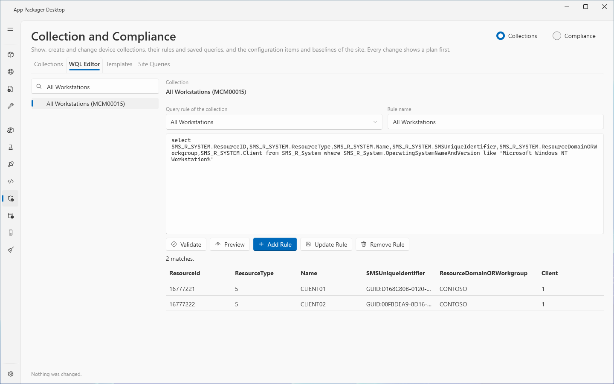
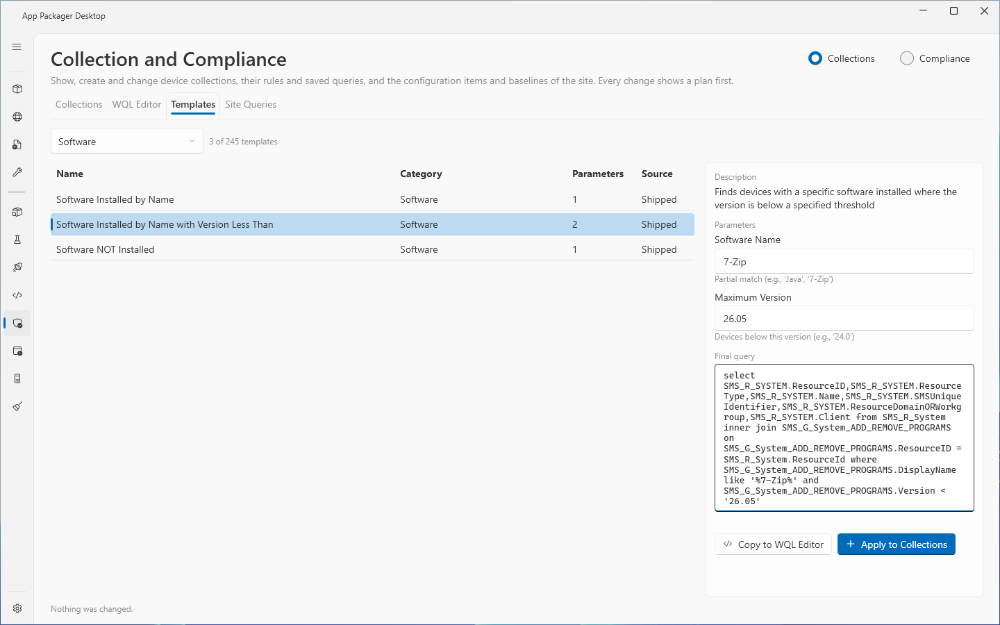
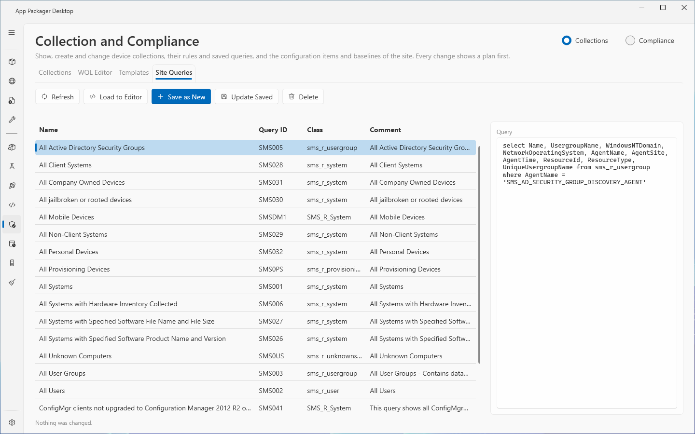

# Collections: queries and templates

The WQL Editor, Templates and Site Queries tabs of the Collection and Compliance page work with WQL queries. The WQL Editor checks a query, shows its matches and adds it to a collection as a query rule. The Templates tab holds 245 shipped query templates and your own templates. The Site Queries tab lists the saved queries of the site.

The Collections tab, the plan window and the connection settings are in [Collection and Compliance](collection-and-compliance.md). The Compliance section is in [Compliance](compliance.md).

Every change shows a plan first. Nothing changes until you read the plan and select the action button.

## When to use it

- Use the WQL Editor to write or change the query rule of a collection and to see the matches before you save the rule.
- Use the Templates tab to start from a ready query, or to add one query to several collections.
- Use the Site Queries tab to keep a query on the site, or to load a saved query into the editor.

## Requirements

- The requirements of [Collection and Compliance](collection-and-compliance.md): ConfigMgr in use, site code, SMS Provider host, console module.
- Rights: "Read, Modify, Create and Delete on Collection and Query".
- The Templates tab needs no site connection to list the templates.

## Steps: check a query and add it as a rule

1. Select the `WQL Editor` tab.
2. In the tree on the left, select a collection. Use the filter box ("Filter by name or ID") to find it. Folders group the collections as in the console. A built-in collection is not accepted for a change. The page shows "A built-in collection cannot be changed or removed here."
3. Read the line `Collection` above the editor. The list `Query rule of the collection` holds the query rules that the collection has now.
4. Enter the query in the editor. The query must be one `select` statement.
5. Enter a `Rule name`.
6. Select `Validate`. The page shows "The query is valid. It matches <n> resources." or the reason the query is not valid.
7. Select `Preview`. The page shows the match count and the first rows in the order of the select list. The message reads "<n> matches." or "<n> matches. The first <m> are shown." Select `Cancel preview` to stop a preview.
8. Select `Add Rule`.
9. Read the plan. The plan shows the rule name, the query and the line about the last preview. If you did not run `Preview` for this query, the plan states "Preview was not run for this query."
10. Select the action button `Add rule`.

## Steps: change or remove a query rule

1. Select the collection in the tree.
2. Select the rule in the list `Query rule of the collection`. The editor shows its name and its query.
3. Change the query or the `Rule name`.
4. Select `Update Rule`. Read the plan. Select the action button `Update rule`.
5. To remove the rule, select `Remove Rule`, read the plan and select the action button `Remove rule`.

You can also select the rule on the `Query Rules` detail tab of the Collections tab and select `Edit in WQL Editor`.

How `Update Rule` works: the page adds the new rule under a temporary name first, checks it, and then removes the old rule. The collection never has fewer rules than before. When a step fails, the old rule stays and the message names the rules that exist. If the query and the name did not change, the page shows "Nothing to change."

## What the page checks in a query

The page checks the query before it reaches the SMS Provider (`WqlGuard.cs`):

- The query starts with `select` followed by a space or a line break.
- The query has at most 16384 characters.
- The query holds no semicolon, no `--` comment and no `/* */` comment outside a quoted value.
- The query holds no second `select` outside parentheses. A `select` inside parentheses, as in an `in` clause, is accepted.
- Two quotes in a row end one value and start another, and WQL does not accept them. Write a quote inside a value as `\'` or `\"`.
- The query holds no control character other than a tab or a line break.
- A rule name has at most 256 characters and no control character. ConfigMgr stores `*`, `?`, `[` and `]` in a rule name. The page accepts them and matches rule names exactly.

## Steps: use a template

1. Select the `Templates` tab.
2. Select a `Category` in the list, or leave `All categories`. The count next to the list reads "245 templates" or "<n> of 245 templates". With your own templates the total is higher.
3. Select a template row. The panel on the right shows the `Description`, the `Parameters` (if any) and the `Final query`.
4. For a parameterized template, enter a value in each parameter box. The final query changes as you type. The message below the final query shows why a value is not accepted.
5. To edit the query first, select `Copy to WQL Editor`. The page opens the WQL Editor tab with the final query and the template name as rule name.
6. To add the query to collections, select `Apply to Collections`.
7. In the picker, check the collections. The picker does not offer built-in collections. Select `Show plan`.
8. Read the plan. A collection that already has a rule with the template name shows as Skip. Select the action button.

Rules for parameter values:

- A value inside quotes keeps the quote character of its place. The page puts a backslash before a backslash and before the quote character, so a value cannot end the quoted text.
- A value outside quotes must be a whole number. In an `in ( )` list, enter whole numbers separated by commas, for example `8,9,10`.
- A value for a `like` comparison cannot contain `%`, `_` or `[`. The query reads them as wildcards.
- A value has at most 256 characters and no control character.
- Every parameter needs a value.

Undo of `Apply to Collections` removes the rules that the run added.

## Your own templates

The Templates tab also lists templates from files that you add.

1. Open the `Templates` folder inside the `Collections` folder of the data folder. See [data folders](../reference/data-folders.md). The folder may not exist until you create it.
2. Put a `.json` file in the folder. The file holds one template object or an array of template objects.
3. Give each template a `Name` and a `Query` (or `Expression`). Optional fields: `Category` (the default is `Other`), `Description`, `LimitingCollection`, and `Parameters`.
4. A parameter is a string such as `{Name}` or an object with `Placeholder`, `Label`, `HelpText` and `DefaultValue`. A placeholder counts only if the query contains it.
5. Select the `Templates` tab again. The `Source` column shows `User` for your templates and `Shipped` for the others.

The page skips a file that is a link, is larger than 4 MB, is not valid JSON, or holds no template with a name and a query. A message above the list names each skipped file. A user folder that is a junction or a symbolic link is not read. A user template never replaces a shipped template. Shipped templates come first in the list, then user templates by category and name.

## Steps: use a saved query of the site

1. Select the `Site Queries` tab. The page reads the saved queries of the site.
2. Select a row. The panel `Query` shows the query text.
3. To edit it, select `Load to Editor`.
4. To save the query of the WQL Editor as a new saved query, select `Save as New`, enter a `Name` in the dialog, and select `Show plan`. The page saves the query for the class `SMS_R_System`.
5. To replace the query text of the selected saved query, select `Update Saved`. The query in the WQL Editor becomes the saved query.
6. To remove a saved query, select `Delete`. The plan has a confirmation box.
7. Select `Refresh` to read the list again.

Undo of a delete creates the query again with a new ID. A saved query name must be unique (compared without case), has at most 255 characters and no control character.

## Options and settings

| Item | Effect |
|---|---|
| Filter box of the tree | Filters the collections by name or ID. |
| `Category` list | Filters the templates. The saved choice is kept for the current Windows user. |
| `Cancel preview` | Shows only while a preview runs. |
| Columns of the Templates list | `Name`, `Category`, `Parameters` (`None` or a number), `Source`. |
| Columns of the Site Queries list | `Name`, `Query ID`, `Class`, `Comment`. |

The page saves the selected tab and the template category in `settings.json`. See [settings](../reference/settings.md).

## Limits

- Preview shows at most 500 rows (`CollectionService.cs`, `MaxPreviewRows`).
- Validate and Preview count matches up to 10000. When the count stops there, the page says "10000 or more".
- The Templates tab holds 245 shipped templates: 225 operational templates without parameters and 20 parameterized templates, of which 18 have parameters. See [shipped content](../reference/shipped-content.md).
- A user template file is limited to 4 MB.
- Saved queries that `Save as New` creates always use the class `SMS_R_System`.
- The page was not tested with a custom security role.

## Troubleshooting

| Message | Cause | Fix |
|---|---|---|
| Only a select query can be used here. The query must start with select. | The text does not start with `select`. | Start the query with `select`. |
| The query can hold only one statement. Remove the semicolon. | The query holds a semicolon. | Remove it. |
| The query cannot hold a comment. Remove -- and the text after it. | The query holds `--`. | Remove the comment. |
| The query cannot hold a comment. Remove /* and */ and the text between them. | The query holds `/* */`. | Remove the comment. |
| The query can hold only one statement. Remove the second select or put it in parentheses as part of an in clause. | A second `select` stands outside parentheses. | Remove it, or put it in an `in` clause. |
| A quoted value in the query is not closed. | A quote has no end. | Close the quote. |
| Enter a WQL query. | The editor is empty. | Enter a query. |
| Enter a rule name. | `Rule name` is empty. | Enter a name. |
| The collection already has a query rule named <name>. | The name is in use. | Use another name. |
| Select a query rule of the collection. | `Update Rule` or `Remove Rule` without a selected rule. | Select a rule in `Query rule of the collection`. |
| Select a collection in the tree first. | No collection is selected. | Select one in the tree. |
| Enter a value for each parameter. | A parameter box is empty. | Fill each box. |
| Enter a whole number for <label>, for example 14. | The value is not a whole number. | Enter a whole number. |
| The value for <label> cannot contain <character>. The query compares it with like, where <character> is a wildcard. | The value holds `%`, `_` or `[`. | Remove the character. |
| A saved query named <name> already exists. | The name is in use. | Use another name. |
| The saved queries could not be read. The log has the details. | The read failed. | Read the log. Select `Refresh`. |
| The templates could not be read. The log has the details. | A template read failed. | Read the log. |

See also [error messages](../reference/error-messages.md).

## Links

- [How to create collections in Configuration Manager](https://learn.microsoft.com/intune/configmgr/core/clients/manage/collections/create-collections): Explains the collection rule types and how to create a collection.
- [Introduction to queries in Configuration Manager](https://learn.microsoft.com/intune/configmgr/core/servers/manage/introduction-to-queries): Introduces ConfigMgr queries.
- [Create queries in Configuration Manager](https://learn.microsoft.com/intune/configmgr/core/servers/manage/create-queries): Shows how to create and edit queries.
- [WQL (SQL for WMI)](https://learn.microsoft.com/windows/win32/wmisdk/wql-sql-for-wmi): Describes the WQL syntax for WMI queries.
- [Querying with WQL](https://learn.microsoft.com/windows/win32/wmisdk/querying-with-wql): Shows how to query WMI with WQL.
- [How to manage collections in Configuration Manager](https://learn.microsoft.com/intune/configmgr/core/clients/manage/collections/manage-collections): Shows how to manage, export and import collections.
