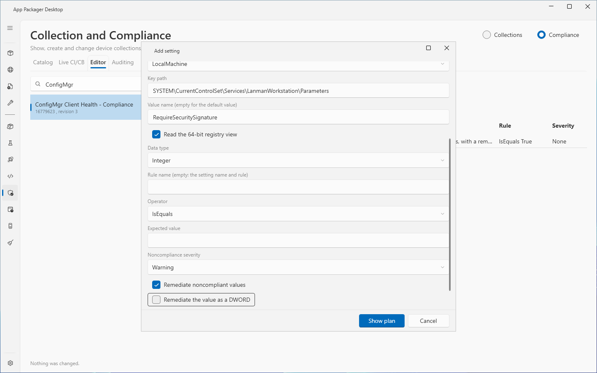
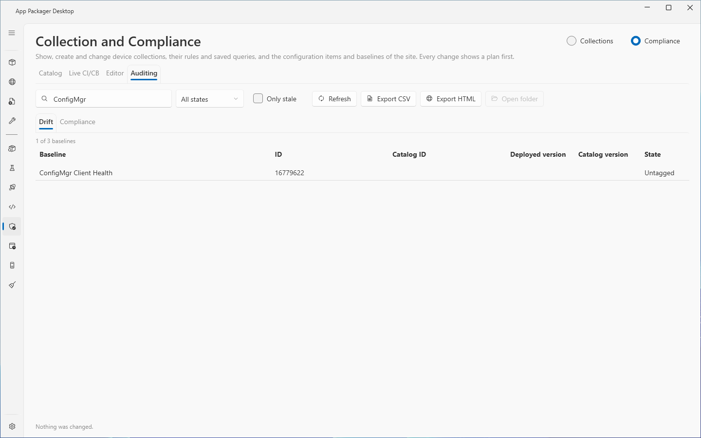
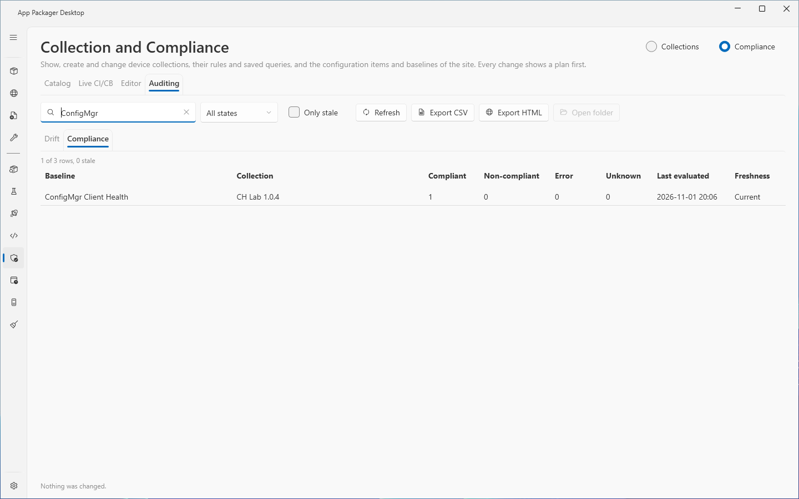

# Compliance: Editor and Auditing

The `Editor` tab shows the settings of one configuration item and adds, changes and removes registry value settings and script settings. The `Auditing` tab compares the version in the drift tag of each baseline with the shipped catalog (Drift), and shows the compliance counts of each baseline deployment (Compliance).

The section, the `Catalog` tab and the `Live CI/CB` tab are in [Compliance: Catalog and Live CI/CB](compliance.md). The Collections tabs are in [Collection and Compliance](collection-and-compliance.md).

Every change shows a plan first. Nothing changes until you read the plan, select the confirmation boxes the plan shows, and select the action button.

## When to use it

- Use the `Editor` tab to change a value that a configuration item checks, for example to change the expected value of a registry setting.
- Use the `Auditing` tab to find baselines that are older than the catalog, and deployments that no client reported on for a long time.

## Requirements

- The requirements of [Compliance: Catalog and Live CI/CB](compliance.md): ConfigMgr in use, site code, SMS Provider host, console module, and a ConfigMgr security role with Compliance Settings Manager rights and read rights on collections.
- The page was not tested with a custom security role.

## Steps: read the settings of a configuration item

1. Open the `Compliance` section, then the `Editor` tab. You can also select a configuration item in the `Live CI/CB` tab and select `Edit settings`.
2. Use the filter ("Filter by name or ID") to find the configuration item. The list shows the name, the ID and the revision.
3. Select the item. The text `Configuration item` shows "<name> (<ID>) revision <n>". The grid lists the settings with the columns `Name`, `Kind`, `Data type`, `Detail`, `Rule` and `Severity`.
4. Select `Refresh` to read the list again.

## Steps: add a setting

1. Select a configuration item.
2. Select `Add`.
3. In the dialog `Add setting`, select the `Kind`: `Registry` or `Script`.
4. Enter the `Name` and, if you want, the `Description (optional)`.
5. For a registry setting, set `Hive`, `Key path` and `Value name (empty for the default value)`. Select `Read the 64-bit registry view` for the 64-bit view.
6. For a script setting, set `Discovery script language` and `Discovery script`. Optionally set `Remediation script language` and `Remediation script (optional)`. Select `Run the scripts as a 64-bit process` for a 64-bit process. The languages are PowerShell, VBScript and JScript.
7. Set the rule: `Data type`, `Rule name (empty: the setting name and rule)`, `Operator`, `Expected value` and `Noncompliance severity`. For a list operator or a string array, enter one value on each line.
8. Select the boxes you need: `Remediate noncompliant values`, `Remediate the value as a DWORD` (registry settings), `Report noncompliance when the value is not found`.
9. Select `Show plan`.
10. Read the plan. It shows the new values, the revision note and the Undo note. Select the confirmation box if the plan shows one. Select the action button `Add setting`.

## Steps: edit or remove a setting

1. Select the configuration item and the setting in the grid.
2. Select `Edit`. Change the values. Select `Show plan`. Read the plan, which shows the old and the new values. Select the action button `Edit setting`.
3. Or select `Remove`. Read the plan. Select the confirmation box. Select the action button `Remove setting`.

What the plan tells you:

- ConfigMgr gives the configuration item a new revision with each change. Clients that have a baseline with this item evaluate the new revision.
- ConfigMgr cannot change the data type, the rule or the expected value of a setting in place. For such a change the page adds the new setting first and removes the old setting after it. The setting gets a new ID. If a step fails, both settings stay and the message names them.
- A change to a setting that remediates, on a configuration item that a remediating deployment uses, needs a confirmation box. It reads: "I understand that this setting remediates: where a baseline with this configuration item is deployed with remediation, clients change this value on every device of the collection."
- Undo sets the old values back. A removed or recreated setting has a new ID.
- The plan shortens script text longer than 20 lines or 2000 characters (`ComplianceText.ScriptPlanLines`, `ScriptPlanCharacters`). The dialog shows the full text.

Rules of the dialog (messages from the code):

- A DateTime setting with remediation is refused: "ConfigMgr does not store a DateTime setting with remediation: the cmdlet reports success and stores nothing. Turn remediation off."
- The data type Boolean is for script settings only. The data type StringArray is for registry settings only.
- A StringArray setting takes the operator `AllOf` (the message calls it "All of").
- A Boolean setting takes `IsEquals` or `NotEquals`, and the expected value `True` or `False`.
- A DateTime expected value has a form such as `2026-01-31T08:00:00`.
- The `Name` has at most 255 characters. A script has at most 256 KB.
- The hives are LocalMachine, CurrentUser, ClassesRoot, CurrentConfig and Users.
- The severities are None, Informational, Warning, Critical and CriticalWithEvent.
- ConfigMgr allows two settings with the same name, and a removal by name removes all of them. The page uses the setting ID.
- The page shows a setting that is not a registry or script setting with one value rule, but does not change it. The page shows: "This setting is not a registry or script setting with one value rule. This page shows it and does not change it."

## Steps: audit drift and compliance

1. Open the `Auditing` tab. The page reads the drift rows and the compliance rows in one pass.
2. Use the filter ("Filter by baseline, collection or catalog ID"). On the `Drift` sub-tab, use the list of drift states. On the `Compliance` sub-tab, select `Only stale`.
3. Select `Refresh` to read again.
4. Read the sub-tab `Drift`. Its columns are `Baseline`, `ID`, `Catalog ID`, `Deployed version`, `Catalog version` and `State`.
5. Read the sub-tab `Compliance`. Its columns are `Baseline`, `Collection`, `Compliant`, `Non-compliant`, `Error`, `Unknown`, `Last evaluated` and `Freshness`.
6. Select `Export CSV` or `Export HTML` to write a report. Select `Open folder` to open the folder of the last report.

States of the `Drift` list:

| State | Meaning |
|---|---|
| Current | The version in the drift tag equals the catalog version. |
| Behind | The version in the drift tag is older than the catalog version. |
| Untagged | The baseline description holds no drift tag. |
| Unknown | The tag is not in the catalog form, its ID is not in the catalog, or its version is newer than the catalog version. |

Rules of the `Compliance` list:

- A count that ConfigMgr did not report shows `unknown`, not 0.
- A deployment that no client reported on shows `never` in `Last evaluated`.
- `Freshness` shows `Stale` or `Current`. A deployment is stale when its compliance summary is more than 7 days old, or when it has no summary (`ComplianceRules.StaleDays`).
- The summary line shows the number of rows and the number of stale rows.

Export:

- `Export CSV` and `Export HTML` write all rows of both lists, without the filters, whichever sub-tab shows. The status line states the scope.
- Report files are named `compliance-<yyyyMMdd-HHmmss>.csv` or `.html`. They are in the `Collections\Reports` folder of the data folder. See [data folders](../reference/data-folders.md).
- A reports folder that is a junction or a symbolic link is refused.

## Options and settings

The section saves the selected tab, the sub-tab of `Auditing`, the filters, the drift state and `Only stale` for the current Windows user (`settings.json`, key `CollectionCompliance`, section `Compliance`). See [settings](../reference/settings.md).

The result area under the tabs has `Undo last change` and the check box `Rows`. Each completed run adds one line to the operation history. The line holds counts and no names or script text. Script text never reaches the log.

## Limits

- The `Editor` tab changes settings of kind `Registry` and `Script` with one value rule only.
- A DateTime setting cannot remediate. A Boolean value works for script settings only. A StringArray value works for registry settings only.
- The drift tag has the form `[ccm:<ID>@<version>]`. A version has three or four numbers separated by dots.
- A deployment counts as stale after 7 days without a compliance summary. A device reports its compliance again only when its state changes, so a healthy deployment can have an old summary.
- The page was not tested with a custom security role.

## Troubleshooting

| Message | Cause | Fix |
|---|---|---|
| Select a configuration item first. | `Add` without an item. | Select an item. |
| Select a setting first. | `Edit` or `Remove` without a setting. | Select a setting. |
| Enter a name for the setting. | `Name` is empty. | Enter a name. |
| Enter the registry key path. | `Key path` is empty. | Enter the path. |
| Enter the expected value. | `Expected value` is empty. | Enter a value. |
| Enter the discovery script. | A script setting has no discovery script. | Enter the script. |
| A script is longer than 256 KB. | A script is too long. | Shorten the script. |
| Nothing was changed in the setting. | The dialog values equal the stored values. | Change a value. |
| The configuration items could not be read. The log has the details. | The read for the `Editor` tab failed. | Read the log. Select `Refresh`. |
| The settings of the configuration item could not be read. The log has the details. | The settings read failed. | Read the log. |
| The drift and compliance data could not be read. The log has the details. | The `Auditing` read failed. | Read the log. Select `Refresh`. |
| The list has no rows to export. | Both lists are empty. | Read the data first. |
| The run that continued in the background has ended. Refresh the lists to see the result. | A plan window was closed during a run. | Select `Refresh`. |

See also [error messages](../reference/error-messages.md).

## Links

- [Plan for and configure compliance settings in Configuration Manager](https://learn.microsoft.com/intune/configmgr/compliance/plan-design/plan-for-and-configure-compliance-settings): Explains compliance settings, configuration items and baselines.
- [Create configuration items in Configuration Manager](https://learn.microsoft.com/intune/configmgr/compliance/deploy-use/create-configuration-items): Shows how to create configuration items.
- [Create custom configuration items for Windows desktop and server computers managed with the Configuration Manager client](https://learn.microsoft.com/intune/configmgr/compliance/deploy-use/create-custom-configuration-items-for-windows-desktop-and-server-computers-managed-with-the-client): Shows how to create custom configuration items for Windows computers.
- [Create configuration baselines in Configuration Manager](https://learn.microsoft.com/intune/configmgr/compliance/deploy-use/create-configuration-baselines): Shows how to create configuration baselines.
