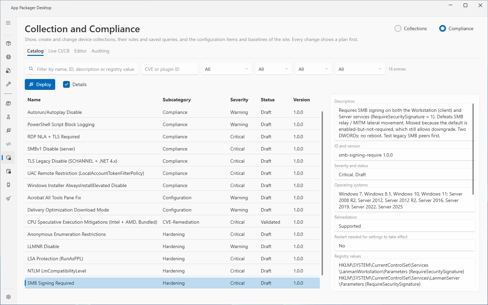
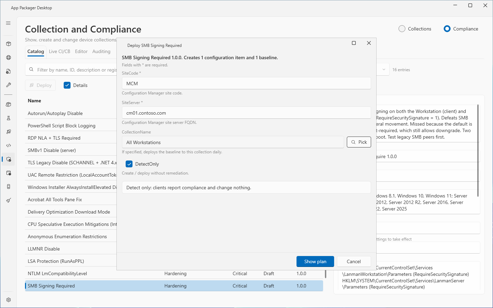
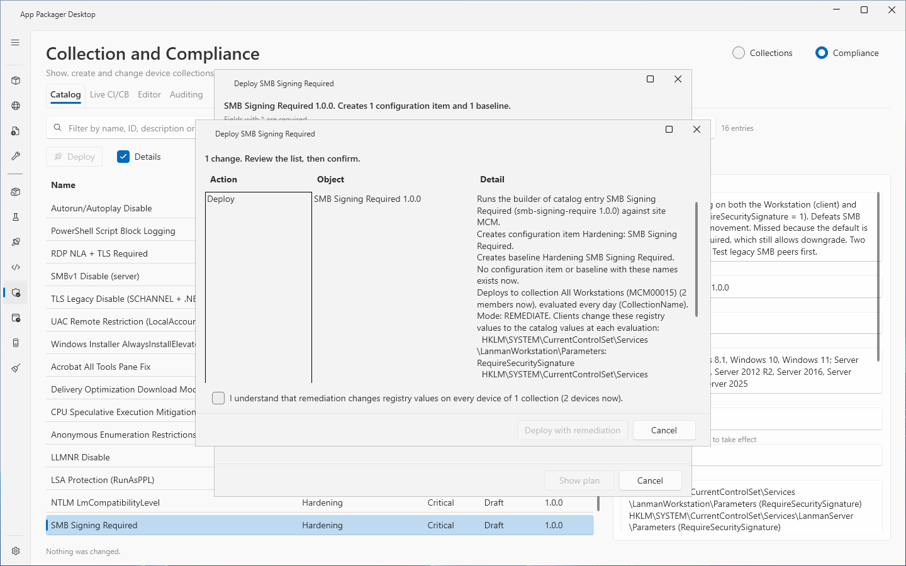
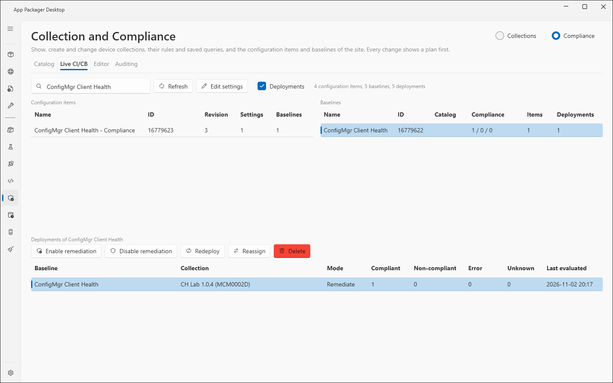

# Compliance: Catalog and Live CI/CB

The Compliance section of the Collection and Compliance page manages configuration items (CI) and configuration baselines (CB) of a ConfigMgr site. It has four tabs: `Catalog`, `Live CI/CB`, `Editor` and `Auditing`. This page describes the section, the `Catalog` tab and the `Live CI/CB` tab. The `Editor` and `Auditing` tabs are in [Compliance: Editor and Auditing](compliance-editor-auditing.md).

The `Catalog` tab lists 16 shipped catalog entries. Each entry makes configuration items, baselines and baseline deployments for one hardening, compliance or configuration setting. The `Live CI/CB` tab lists what the site holds and changes baseline deployments.

Every change shows a plan first. Nothing changes until you read the plan, select the confirmation boxes the plan shows, and select the action button.

## When to use it

- Use `Catalog` > `Deploy` to create the objects of one catalog entry on the site and deploy them to a collection.
- Use `Live CI/CB` to see the compliance counts of baselines and to turn remediation on or off, redeploy, reassign or delete baseline deployments.

## Requirements

- The requirements of [Collection and Compliance](collection-and-compliance.md): ConfigMgr in use, site code, SMS Provider host, console module.
- The account needs a ConfigMgr security role with Compliance Settings Manager rights (configuration items, baselines and their deployments) and read rights on collections. This is the text in the code (`ComplianceService.cs`). The page was not tested with a custom security role.
- Windows PowerShell 5.1. The catalog builders run in it.
- The `Catalog` tab lists the entries without a site connection. `Deploy` and the other tabs need the connection.
- The code does not require an elevated application.

## Steps: switch to the Compliance section

1. Open `Collection and Compliance` in the sidebar.
2. Select the `Compliance` switch at the top right.
3. Select a tab: `Catalog`, `Live CI/CB`, `Editor` or `Auditing`.

## Steps: find a catalog entry

1. Open the `Catalog` tab.
2. Use the filters. The text filter ("Filter by name, ID, description or registry value") searches the display name, the ID, the description and the registry key paths and value names. The box `CVE or plugin ID` finds entries that name a CVE or a scanner plugin ID. The lists `Subcategory`, `Severity`, `Status` and `Operating system` hold the values of the shipped entries, and `All`.
3. Read the count, for example "16 entries" or "3 of 16 entries".
4. Select a row. Select `Details` to show or hide the details beside the list.

The grid has the columns `Name`, `Subcategory`, `Severity`, `Status` and `Version`. The details show: Description; ID and version; Severity and status; Operating systems; Remediation ("Supported" or "Not supported; detection only"); "Restart needed for settings to take effect"; Registry values; Creates configuration items; Creates baselines; Needs; CVEs; Plugin IDs; References; Parameters.

## Steps: deploy a catalog entry

1. Select an entry in the `Catalog` tab.
2. Select `Deploy`. The page reads the device collections first. Its status text reads "Reading the device collections."
3. In the dialog `Deploy <entry name>`, read the summary line: "<name> <version>. Creates <n> configuration items and <m> baselines." Fields with `*` are required.
4. Fill the fields:
   - `SiteCode` and `SiteServer` come from Settings (`Site Code` and `Site Server / SMS Provider Host`). A field that Settings fills is read-only.
   - A collection field (for example `CollectionName`) takes the name of a device collection. Select `Pick` to choose one. The picker offers custom collections only.
   - The switch `DetectOnly` is on by default. With `DetectOnly` on, clients report compliance and change nothing. The mode text in the dialog reads "Detect only: clients report compliance and change nothing." With `DetectOnly` off, it reads "Remediation is on: clients change the registry values of this entry on every device of the target collections."
   - An entry with a `Needs` list shows each needed collection. If a needed collection does not exist, the dialog shows `Create` for a collection that a shipped builder can create. Otherwise it shows "A required collection is missing. Create it or pick another collection, then deploy."
5. Select `Show plan`.
6. Read the plan. See "The plan of a deploy" below.
7. Select the confirmation box if the plan shows one.
8. Select the action button `Deploy detect only` or `Deploy with remediation`.
9. Watch the steps in the plan window while the builder runs. Select `_Cancel` to end the builder and every process that it started.
10. Read the result. Select `C_lose`, or `_Undo` to reverse the run.

### The plan of a deploy

The plan names the configuration items and the baselines that the entry creates, the target collections with their member counts, and the mode. It also states that each baseline gets the drift tag `[ccm:<ID>@<version>]` one time in its description and that the existing description stays.

A deploy is refused while a configuration item or a baseline with a name that the entry creates exists. A second run of a builder would create a second configuration item and baseline with the same names, add the new item to the existing baseline too, and deploy both baselines. A missing collection stops the plan with a message.

A deploy with remediation changes registry values on every device of the target collection. The plan lists the registry paths and the number of devices. The action button stays off until you select the confirmation box. The box reads, for example: "I understand that remediation changes registry values on every device of 1 collection (12 devices now)." When the entry needs a restart, the box adds that the devices need a restart.

### How the run works

- The entry runs from a private copy of its builder script in a new `run-<id>` folder under `Collections\Catalog` in the data folder. The folder is removed after the run. A `run-` folder older than one day that a run left behind is removed at the next run.
- The application compares the SHA-256 hash of the extracted file with the hash in the catalog right before the start. If the hash does not match, the builder does not start.
- The builder runs with `powershell.exe` (Windows PowerShell 5.1) with `-NoProfile -NonInteractive -ExecutionPolicy Bypass -File`. The process tree ends when the run ends.
- The time limit of one builder is 30 minutes (`CatalogBuilderRunner.DefaultTimeout`).
- The application keeps at most 500 output lines of the builder (`MaxOutputLines`).
- After the builder, the application reads the site again and writes the drift tag to each baseline description.

### Undo of a deploy

`_Undo` removes the deployments, the baselines and the configuration items that the run created, and only these. An object that existed before the run is never removed. An object that something else uses, for example a deployment that another administrator made during the run, stays. The message names it.

After a cancel, a baseline can appear a few seconds late. The result then says so. `_Undo` also removes an object with a name of the entry that this account made after the run start, up to 10 minutes after the run ended or until another deploy of the same entry starts.

## Steps: read and change baseline deployments

1. Open the `Live CI/CB` tab. The page reads three lists in one pass: configuration items, baselines and deployments. The count line reads "<a> configuration items, <b> baselines, <c> deployments". The page makes no query for each row.
2. Use the filter ("Filter by name, ID or catalog ID") to narrow the lists. `Refresh` reads the lists again. `Cancel` stops a read.
3. Select a baseline row. The deployments list below shows "Deployments of <baseline>". With no baseline selected it shows "Deployments of every baseline". The check box `Deployments` shows or hides this list.
4. Select one or more deployment rows.
5. Select one of the buttons below.

| Button | Effect |
|---|---|
| `Enable remediation` | Sets remediation on for the selected deployments. The plan has the remediation confirmation box. |
| `Disable remediation` | Sets remediation off. The page reads the stored mode back after the write. |
| `Redeploy` | Creates the deployment again, then removes the old deployment only after the new one passes the read back. If the new deployment differs or the write fails, both deployments stay and the message says so. The plan has a confirmation box. The new deployment has a new ID. |
| `Reassign` | Creates the deployment on another collection first, then removes the old one after the read back. It works on one deployment. A picker (`Reassign <baseline>`) offers custom collections. |
| `Delete` | Removes the selected deployments. The plan shows their compliance counts and has a confirmation box. This also works for a deployment on a built-in collection. |
| `Edit settings` | Opens the selected configuration item in the `Editor` tab. |

The page shows "The selected deployments already have this mode." when a remediation change would change nothing.

`_Undo` of `Enable remediation` and `Disable remediation` sets the old mode back. `_Undo` of `Delete` creates the deployments again with new IDs. `_Undo` of `Reassign` moves the deployment back. Undo is not offered after a full `Redeploy`, because the deployment holds the same values. When both deployments stay, Undo removes the new one.

Grids of the tab: configuration items (`Name`, `ID`, `Revision`, `Settings`, `Baselines`), baselines (`Name`, `ID`, `Catalog`, `Compliance`, `Items`, `Deployments`), deployments (`Baseline`, `Collection`, `Mode`, `Compliant`, `Non-compliant`, `Error`, `Unknown`, `Last evaluated`). A count that ConfigMgr did not report shows `unknown`, not 0.

## Options and settings

The section saves the selected tab, the filters of each tab, and the state of `Details` and `Deployments` for the current Windows user (`settings.json`, key `CollectionCompliance`, section `Compliance`). See [settings](../reference/settings.md).

The result area under the tabs shows the summary of the last change set. `Rows` shows or hides the result of each change. `Undo last change` shows a plan that reverses the last change set.

## Limits

- The catalog holds 16 entries. The page does not add entries. See [shipped content](../reference/shipped-content.md).
- A catalog parameter value has at most 256 characters (`ComplianceRules.MaxParameterLength`).
- A collection name in a catalog field cannot contain `*`, `?`, `[` or `]`. ConfigMgr cmdlets read them as wildcards, so the builder could deploy to other collections.
- If two device collections have the same name, a builder cannot pick one. The dialog asks you to rename one in ConfigMgr first.
- The entry `lsa-protection-runasppl` (LSA Protection (RunAsPPL)) does not support remediation. It has no `DetectOnly` switch.
- A deploy decides that an object was made during its run by comparing times. The clock of this computer and the clock of the site database may differ by at most 5 minutes (`ComplianceRules.ClockTolerance`).
- The page was not tested with a custom security role.

## Troubleshooting

| Message | Cause | Fix |
|---|---|---|
| The catalog could not be read. The log has the details. | The catalog read failed. | Read the log. |
| On a second run a builder creates a second configuration item and baseline with the same names ... so the page does not run it while objects with these names exist. Remove or rename them first. | The site already holds the objects of the entry. | Remove or rename the objects, then deploy again. |
| Remediation changes client settings and needs its own confirmation, so nothing was changed. | The second confirmation box was not selected. | Select the box in the plan. |
| The extracted builder does not match the shipped catalog, so it was not started. | The SHA-256 check failed. | The code states no fix. The builder did not start and nothing changed. |
| The catalog run folder is a junction or symbolic link, so the builder was not started. | A folder in `Collections\Catalog` is a link. | Replace the link with a real folder. |
| Windows PowerShell 5.1 could not start the builder. | `powershell.exe` did not start. | Check that Windows PowerShell 5.1 starts on this computer. |
| The builder could not be started in a contained process, so it was stopped before it ran. | The job object for the process tree was not created. | The code states no fix. Nothing ran. |
| A required collection is missing. Create it or pick another collection, then deploy. | A needed collection does not exist. | Select `Create` in the dialog, or pick another collection. |
| No device collection named <name> exists. | The name in a collection field matches no device collection. | Use `Pick`. |
| <name> is a built-in collection. Pick another collection. | A built-in collection was entered. | Pick a custom collection. |
| Check one collection. | The picker has no checked row, or more than one. | Check exactly one collection. |
| The deployment already targets this collection. | `Reassign` to the same collection. | Pick another collection. |
| The result of the catalog deploy is not known: ConfigMgr could not be read after the builder. Check in ConfigMgr ... Undo is not available. | The read after the builder failed. | Check the objects in the console. |
| The configuration items and baselines could not be read. The log has the details. | The `Live CI/CB` read failed. | Read the log. Select `Refresh`. |
| The ConfigMgr console role needs Compliance Settings Manager rights. | The provider denied access. | Add the rights to the role. |

See also [error messages](../reference/error-messages.md).

## Links

- [Plan for and configure compliance settings in Configuration Manager](https://learn.microsoft.com/intune/configmgr/compliance/plan-design/plan-for-and-configure-compliance-settings): Explains compliance settings, configuration items and baselines.
- [Create configuration items in Configuration Manager](https://learn.microsoft.com/intune/configmgr/compliance/deploy-use/create-configuration-items): Shows how to create configuration items.
- [Create custom configuration items for Windows desktop and server computers managed with the Configuration Manager client](https://learn.microsoft.com/intune/configmgr/compliance/deploy-use/create-custom-configuration-items-for-windows-desktop-and-server-computers-managed-with-the-client): Shows how to create custom configuration items for Windows computers.
- [Create configuration baselines in Configuration Manager](https://learn.microsoft.com/intune/configmgr/compliance/deploy-use/create-configuration-baselines): Shows how to create configuration baselines.
- [How to deploy configuration baselines in Configuration Manager](https://learn.microsoft.com/intune/configmgr/compliance/deploy-use/deploy-configuration-baselines): Shows how to deploy a baseline to a collection.
- [Monitor compliance settings in Configuration Manager](https://learn.microsoft.com/intune/configmgr/compliance/deploy-use/monitor-compliance-settings): Shows how to read compliance results.
