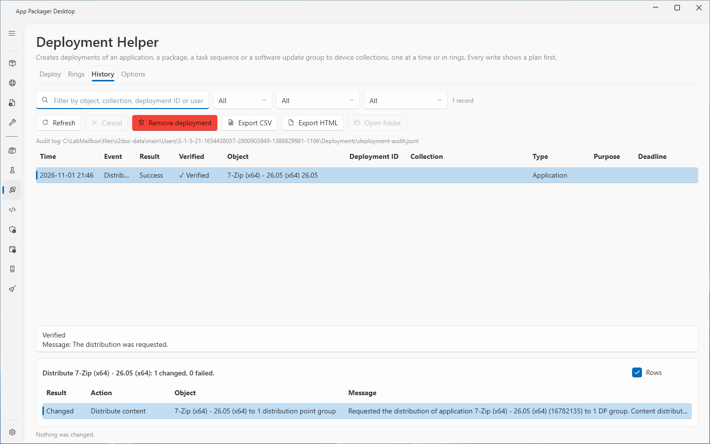
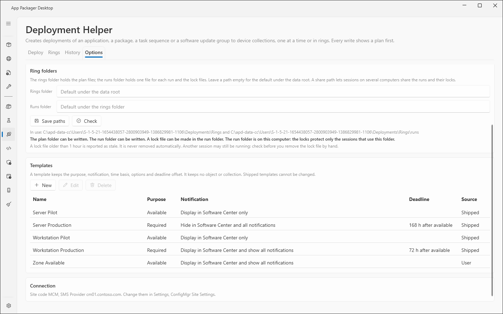

# Deployment Helper: History and Options

The **History** tab lists the audit log of the Deployment Helper. It can remove a deployment that this product created. The **Options** tab sets the audit log path and the ring folders, and it manages the deployment templates.

The **Deploy** tab is in [Deployment Helper: Deploy tab](deployment-helper.md). The **Rings** tab is in [Deployment rings](deployment-rings.md).

## When to use it

- Use **History** to see what the page created, distributed and removed, and to remove a deployment that the page created.
- Use **History** to export the audit records to a CSV or HTML file.
- Use **Options** to move the audit log to a share, to share ring runs between computers, or to change your own templates.

## Requirements

- The same Settings and rights as the **Deploy** tab. See [Deployment Helper: Deploy tab](deployment-helper.md).
- **History** reads the audit file. It needs no connection to the site to list the records. **Remove deployment** needs the connection.

## Steps: read the history

1. Select **Deployment Helper** in the sidebar. Select the **History** tab.
2. Select **Refresh** to read the audit log. Select **Cancel** to stop the read.
3. Filter the rows. Enter text in **Filter by object, collection, deployment ID or user**. Select an event in the **Event** list, an object type in the **Object type** list, and a ring run in the **Ring run** list.
4. Select a row to read its details under the grid. The details show whether the record is verified, its message and the deployment IDs that need a check in the console.

## Steps: remove a deployment from History

1. Select a record of the event Create that has a deployment ID.
2. Select **Remove deployment**. The page reads the deployment from the site and opens a plan.
3. Read the plan. The plan shows the deployment ID, the object, the collection, the purpose, the times and the checks.
4. Select the confirmation box of the plan. Select the action button **Remove deployment**.
5. A question window titled **Remove deployment** opens. Select **Remove deployment** to remove the deployment. Select **Cancel** to keep it. **Cancel** is the default button.

Software that clients already installed stays installed.

## Steps: export the history

1. Set the filters. The export writes the rows that the filters show.
2. Select **Export CSV** or **Export HTML**.
3. Select **Open folder** to open the folder of the last report.

## Steps: set the audit log path

1. Select the **Options** tab.
2. Enter a path in the audit log box. Leave the box empty for the default under the data folder. A share path is allowed.
3. Select **Save path**.
4. Select **Check**. The page shows whether the log can be written. The text **In use:** shows the path that the page uses now.

## Steps: set the ring folders

1. Select the **Options** tab.
2. Enter a path in **Rings folder** for the plan files. Leave it empty for the default under the data folder.
3. Enter a path in **Runs folder** for the run files and the lock files. Leave it empty for the default under the rings folder.
4. Select **Save paths**.
5. Select **Check**. The page shows whether both folders can be written and whether a lock file can be made in the runs folder.

A share path lets sessions on several computers share runs and locks. See [Deployment rings](deployment-rings.md).

## Steps: manage templates

1. Select the **Options** tab.
2. Select **New**, or select a template and select **Edit** or **Delete**.
3. In the template window, enter the **Name**. Check **Required (installs at the deadline)** for a Required template. Enter **Deadline, hours after the available time (0 for none)**. Select the **User notification**.
4. Check the options: **Use UTC instead of local time**, **Override maintenance windows**, **Allow restart outside maintenance windows**, **Allow download on a metered connection**, **Allow fallback to neighbor boundary groups**, **Allow Microsoft Update when no distribution point has the content**, **Require a full scan after the restart**.
5. Select **Save template**.

Shipped templates cannot be changed. You can also create a template from the **Deploy** tab with **Save as template**. See [Deployment Helper: Deploy tab](deployment-helper.md).

## Options and settings

| Control | Where | Effect |
|---|---|---|
| **Refresh**, **Cancel** | **History**, **Options** | Read again, or stop the read. |
| **Remove deployment** | **History** | Opens the removal plan for the selected record. |
| **Export CSV**, **Export HTML** | **History** | Write the rows that the filters show to the `Deployments` folder of the data folder. |
| **Open folder** | **History** | Opens the folder of the last report. |
| **Save path**, **Check** | **Options**, audit log | Save the path. Test that the log can be written. |
| **Save paths**, **Check** | **Options**, ring folders | Save both paths. Test both folders and the lock file. |
| **New**, **Edit**, **Delete** | **Options**, templates | Change your own templates. |

The **History** grid has these columns: **Time**, **Event**, **Result**, **Verified**, **Object**, **Deployment ID**, **Collection**, **Type**, **Purpose** and **Deadline**. The columns **Plan**, **Ring #**, **Ring** and **Run** show only when a loaded record carries a run ID.

The **Event** list offers: All, Create, Distribute, Undo, Close run, Cancel ring and Abandon ring. The **Options** tab also shows a **Connection** card. It names the site code and the SMS Provider that the page uses. Change them in Settings, ConfigMgr Site Settings.

The page saves the audit log path, the ring folders and the template choice in `settings.json`. The default files are in the `Deployments` folder of the data folder: `deployment-audit.jsonl` with a lock file, `Reports\deployment-history*` and `Templates\*.json`. The ring plans and runs are in `Deployments\Rings`. See [Data folders](../reference/data-folders.md) and [Settings reference](../reference/settings.md).

## The audit log

- Every create, distribution and removal adds one record to an append-only file, `deployment-audit.jsonl`. The page never rewrites or shortens the file.
- Each record ends with a hash that covers its fields and the previous record. The **Verified** column shows whether a record passes this chain. The column shows **Verified** or **Not verified**.
- A record that was edited by hand, or that comes after an edited record, shows **Not verified**. It cannot be undone from History. Remove such a deployment in the console.
- The page shows the newest 2000 records. It says so when the log holds more. The older records stay in the file.
- A CSV cell that starts with `=`, `+`, `-`, `@`, a tab, a carriage return or a line feed is written as text. The HTML report encodes all text.
- The page refuses a reports folder that is a junction or a symbolic link.

## Limits

- Undo from History works only for a verified record. The page also checks the record against the site: the creator account, the creation time within 5 minutes, the stored values and, for an application, the object revision. If a check fails, the page refuses and says why.
- Applications and update groups carry the creation time and the account. Packages and task sequences have neither. For these the page reads status message 30006 of the site. If the site no longer holds that message, Undo from History is refused.
- Undo from History checks the audit record against the site. It cannot stop a process of the same account that forges both.
- A record without every value that the removal compares (type, IDs, purpose, times and time basis) cannot be removed from History. Remove the deployment in the console.
- The ring records of the audit log were checked in the lab on one site with one client. No separate lab record covers the **History** tab for single deployments.

## Troubleshooting

| Message | Cause | Fix |
|---|---|---|
| The audit log could not be read. The log has the details. | The file is missing, locked or unreadable. | Check the path on the **Options** tab. Select **Check**. |
| The list has no rows to export. | The filters show no rows. | Change the filters. |
| The audit log was not read. Select Refresh, then export. | You exported before the first read. | Select **Refresh**. |
| Select a create record that names its deployment ID. | The selected record is not a Create record with an ID. | Select another record. |
| This record cannot be checked (the log was edited or its chain is broken): Undo from History is refused. Remove the deployment in the console. | The record is **Not verified**. | Remove the deployment in the console. |
| The record does not hold every value the removal compares ... | The record lacks values. | Remove the deployment in the console. |
| Undo from History is refused: ... | A check against the site failed. The message after the colon names it. | Read the message. Remove the deployment in the console if needed. |
| The Deployments templates folder is a junction or symbolic link. The templates were not read or changed. | The template folder is a link. | Use a normal folder. |

See also [Error messages](../reference/error-messages.md) and [Troubleshooting](../troubleshooting.md).

## Links

- [Deploy applications with Configuration Manager](https://learn.microsoft.com/intune/configmgr/apps/deploy-use/deploy-applications): Shows how to deploy an application to a collection and set the purpose.
- [Deploy a task sequence](https://learn.microsoft.com/intune/configmgr/osd/deploy-use/deploy-a-task-sequence): Shows how to deploy a task sequence and set the purpose.
- [Deploy software updates](https://learn.microsoft.com/intune/configmgr/sum/deploy-use/deploy-software-updates): Explains how to deploy software updates.
