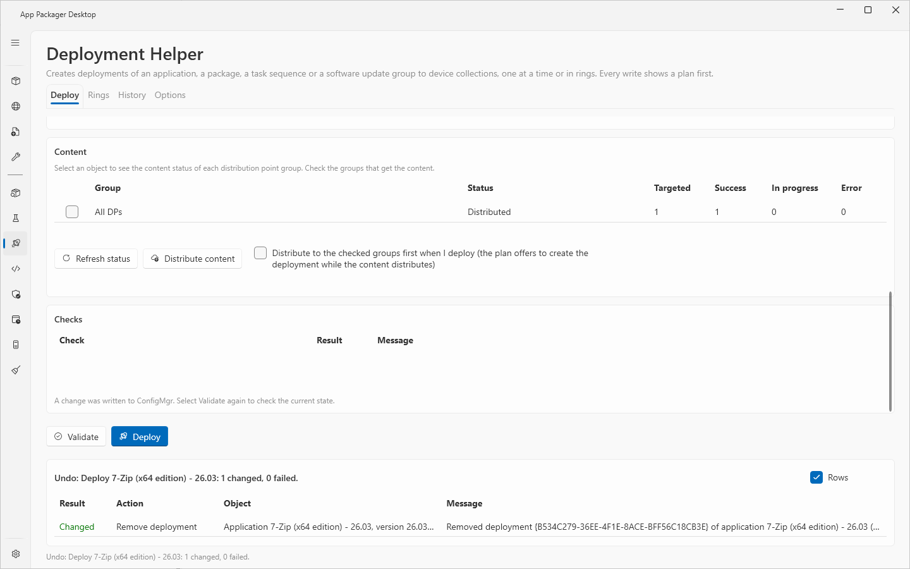
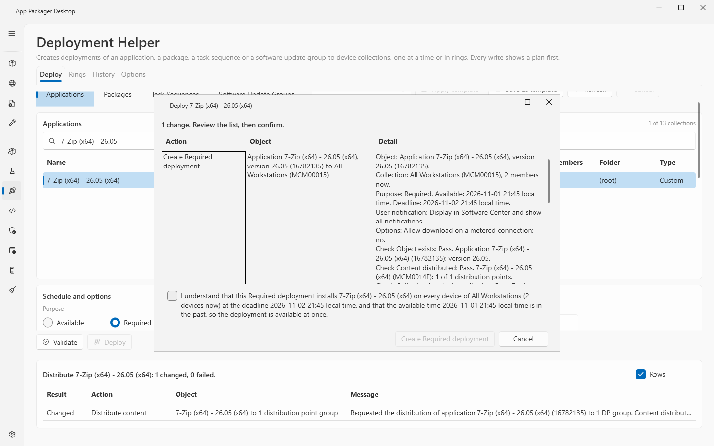
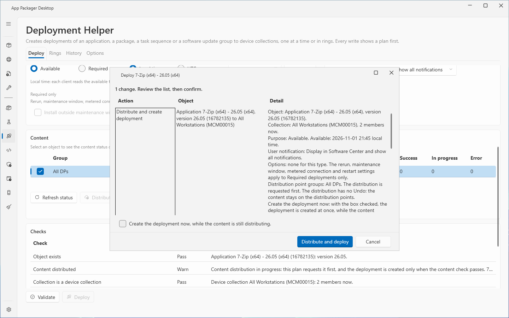

# Deployment Helper: Deploy tab

The Deployment Helper page creates one deployment of an application, a package, a task sequence or a software update group to one device collection. The page checks the deployment first and shows a plan. ConfigMgr changes only after you confirm the plan.

The page has four tabs: **Deploy**, **Rings**, **History** and **Options**. This page describes the **Deploy** tab. The **History** and **Options** tabs are in [Deployment Helper: History and Options](deployment-helper-history-options.md). The **Rings** tab is in [Deployment rings](deployment-rings.md).

## When to use it

- Use the **Deploy** tab to send one object to one collection.
- Use it when you want checks, a plan, a read-back of the stored values and an audit record for the deployment.
- Use the **Rings** tab to send one object to a series of collections.

## Requirements

- The Configuration Manager console is on this computer. The page runs the console PowerShell module in Windows PowerShell 5.1.
- **Systems in use** in Settings includes ConfigMgr. The **Site Code** and the **Site Server / SMS Provider Host** are set in Settings, **ConfigMgr Site Settings**. See [Settings page](../core/settings-page.md).
- The ConfigMgr account has deployment rights for the object type, distribute content rights and read rights on collections. See [Permissions](../reference/permissions.md). The rights were not tested with a custom security role; the lab used a full administrator.
- The audit log can be written. The **Options** tab shows this. A deployment is created only when the audit log can be written.
- The page makes no network request other than the calls to the SMS Provider through the ConfigMgr session.

## Steps: create one deployment

1. Select **Deployment Helper** in the sidebar. Select the **Deploy** tab.
2. Select the object type: **Applications**, **Packages**, **Task Sequences** or **Software Update Groups**.
3. Select the object in the object grid. Use the filter box **Filter by name, version or ID** to find it. For a package, select the program in the **Program** list.
4. Select a device collection in the **Device collection** grid. Use the filter box **Filter by name, ID or folder** to find it. The grid also lists built-in collections. The page refuses to choose one.
5. Select the **Purpose**: **Available** or **Required**.
6. Select the **Time basis**: **Local time** or **UTC**.
7. Enter the **Available** date and time. Enter the time as hours and minutes, for example `08:30`.
8. For a Required deployment, enter the **Deadline** date and time in the same way.
9. Select the **User notification**. The list is shown for the types that have this setting.
10. Set the options of the object type. See the table in [Options and settings](#options-and-settings).
11. For an application, a package or a task sequence, check the distribution point groups in the **Content** card. Select **Refresh status** to read the content status again. For a software update group the page shows no **Content** card, because the console distributes update content.
12. Select **Validate**. Read the **Checks** grid. A check with the result Fail or Unknown blocks the deployment.
13. Select **Deploy**. The plan window opens. Read the plan.
14. Select the extra confirmation box if the plan shows one. Select the action button of the plan.
15. Read the result under the tabs. The result lists each change with **Result**, **Action**, **Object** and **Message**.
16. Check the new deployment in the ConfigMgr console. The result panel names deployments that the page could not identify.

## The plan

The plan window lists the object, the collection with its member count now, the purpose, the times, the user notification, the options and the result of every check. The action button of the plan is named for the action. The names are **Create deployment**, **Create Required deployment**, **Distribute and deploy** and **Distribute content**.

A Required deployment installs the software on every device of the collection at the deadline. The plan shows an extra confirmation box. The box names the object, the collection, the number of devices now and the deadline. The action button stays off until you select the box. The service also refuses a Required deployment without this confirmation.

An Available time in the past also needs an extra confirmation. The box says that the deployment is available at once.

## Distribute content

Select **Distribute content** to send the content of the selected object to the checked groups. The page shows a plan first. The distribution has no Undo. The content stays on the distribution points. The page writes an audit record for each request.

To distribute and deploy in one run, check the groups and select the box **Distribute to the checked groups first when I deploy**. The plan then distributes the content and creates the deployment. The page requests the distribution first. It creates the deployment when the content check passes. The plan has an optional box, **Create the deployment now, while the content is still distributing.** With the box checked, the page creates the deployment at once. Without the box, the page skips the create when the content check does not pass. You can run the create again later.

## Undo the last change

After a change, the result panel shows **Undo last change**. The button opens a plan that removes the deployments of the last change. Undo removes the deployment that this run created, found by its deployment ID. It asks one more question first. Software that clients already installed stays installed. A change that the page did not try starts with "Skipped" in the **Message** column.

To remove an older deployment, use **Remove deployment** on the **History** tab.

## Options and settings

| Control | Choices | Note |
|---|---|---|
| **Template** list, **Apply template** | The templates of the page | Fills the purpose, notification, time basis and options. Four templates ship: Workstation Pilot, Workstation Production, Server Pilot and Server Production. |
| **Save as template** | A template name | Keeps the purpose, notification, time basis, options and deadline offset. A template holds no object or collection. |
| **Purpose** | **Available**, **Required** | A new visit starts with **Available**. |
| **Time basis** | **Local time**, **UTC** | A new visit starts with **Local time**. |
| **User notification** | Display in Software Center and show all notifications; Display in Software Center only; Hide in Software Center and all notifications | Hide in Software Center and all notifications with **Available** is blocked. |
| **Fast network** (package) | Download content from the distribution point and run locally; Run the program from the distribution point | |
| **Slow network** (package) | Do not run the program; Download content from the distribution point and run locally | ConfigMgr refuses to run the program from the distribution point on a slow network. The list does not offer it. |
| **Available to** (task sequence) | Configuration Manager clients only; Clients, media and PXE; Media and PXE only; Media and PXE only (hidden) | |
| **Content** (task sequence) | Download content locally when the task sequence needs it; Download all content locally before the task sequence starts | |
| **Show task sequence progress** | Check box | Task sequence only. |
| **Allow fallback to the default site boundary group** | Check box | Package and task sequence. |
| **Require a full scan after the restart** | Check box | Software update group only. |
| **Install outside maintenance windows at the deadline** | Check box | Under **Required only**. |
| **Allow restart outside maintenance windows** | Check box | Under **Required only**. |
| **Allow download on a metered connection** | Check box | Under **Required only**. Shown for every object type. |
| **Rerun behavior** | Never rerun the deployed program; Always rerun the program; Rerun if the previous attempt failed; Rerun if the previous attempt succeeded | Package and task sequence. Under **Required only**. |
| Software update group options | **Allow fallback to the default site boundary group**, **Download from Microsoft Update when no distribution point has the content**, **Suppress restarts on servers and workstations (devices do not restart after the installation)** | Under **Required only**. |

For an Available deployment, ConfigMgr ignores the settings under **Required only**. The page turns these inputs off and shows a note.

The **Packaged** column shows **Yes** for an object that this product created.

The page saves the selected tab, object type and template for the current Windows user. Each completed run adds one line to the operation history, with counts only.

## The checks

**Validate** runs these checks. The labels are the labels of the **Check** column.

| Check | What it tests |
|---|---|
| **Object exists** | The object exists. |
| **Content distributed** | The content is on the distribution points. |
| **Collection is a device collection** | The collection is a device collection. |
| **Collection is not built in** | The collection ID does not start with `SMS`. |
| **No duplicate deployment** | No deployment of this object to this collection exists. |
| **Schedule and options** | The schedule and the options are valid. |
| **Audit log** | The audit log can be written. |
| **Script signing** | The script-signing rule of the product. |

ConfigMgr refuses a second application deployment to the same collection. It allows a second package, task sequence or update group deployment. The page blocks it in the **No duplicate deployment** check.

The schedule rules are:

- The deadline is later than the available time.
- A deadline in the past is blocked.
- A Required deployment needs a deadline.

For a package or task sequence, the page sends the UTC flag with the available time only. A UTC package or task sequence deployment then has no expiry. The **Deploy** tab shows the note "No expiration time is set."

## Limits

- The page reads the state when the plan opens: the object revision, the content references and the member count. If the object or its content changed, or the member count of a Required collection grew, the page skips the deployment. It asks you to validate again. A decrease of the member count is allowed.
- After the create, the page reads the deployment back and compares it with the plan. A difference fails the result and names the values.
- For an application that this product packaged, a Required deployment follows the signing policy of the product. The page finds the application by its CI ID, and by its name when no CI ID is stored. An older packaged application that was renamed in the console before the page first listed it can pass as an application that the product did not package.
- The page does not offer user collections.
- The page matches names exactly. A `*` or `[` in a name is a plain character.
- A lock file next to the audit log stops two sessions of this product from creating the same deployment at the same time. The site cannot stop another administrator. If a second deployment of the same object appears during the create, the result is Partial with an Undo for the deployment made here. If the page cannot tell which deployment it made, the result names both IDs with their creators and times and offers no Undo.
- Lab: the page was checked on CM01 with CLIENT01. The lab used one site and a full administrator account.

## Troubleshooting

| Message | Cause | Fix |
|---|---|---|
| ConfigMgr is not in use. Select it under Systems in use in Settings. | ConfigMgr is off in **Systems in use**. | Select ConfigMgr in Settings. |
| Set the site code in Settings, ConfigMgr Site Settings. | The site code is empty. | Enter the **Site Code**. |
| Built-in collections cannot be chosen. Pick a device collection that was made at the site. | The collection ID starts with `SMS`. | Select another collection. |
| A Required deployment installs on every device of the collection and needs its own confirmation, so nothing was created. | The plan was confirmed without the extra box. | Select the box in the plan. |
| ... is now deployed to collection ... (deployment ID ...), so no duplicate was created. | The object is already deployed to the collection. | None. The page created nothing. |
| the audit log cannot be written, so the deployment was not created. | The audit file is not writable. | Fix the path on the **Options** tab and select **Check**. |
| another session of this product is creating a deployment of the same object to this collection now ... Try again when that session finishes. | The target lock is held, or the lock file cannot be made. | Wait, then try again. |
| An Available deployment cannot hide all notifications | **Available** with **Hide in Software Center and all notifications**. | Choose another notification. |
| The deadline is in the past. Set a deadline later than now. | The deadline is not later than now. | Set a later deadline. |
| Enter the time as hours and minutes, for example 08:30. | The time box has another format. | Enter the time as `HH:mm`. |
| The ConfigMgr console role needs deployment rights for the object type and distribute content rights. | The account lacks rights. | Give the rights to the account. |

See also [Error messages](../reference/error-messages.md) and [Troubleshooting](../troubleshooting.md).

## Links

- [Deploy applications with Configuration Manager](https://learn.microsoft.com/intune/configmgr/apps/deploy-use/deploy-applications): Shows how to deploy an application to a collection and set the purpose.
- [Deploy a task sequence](https://learn.microsoft.com/intune/configmgr/osd/deploy-use/deploy-a-task-sequence): Shows how to deploy a task sequence and set the purpose.
- [Deploy software updates](https://learn.microsoft.com/intune/configmgr/sum/deploy-use/deploy-software-updates): Explains how to deploy software updates.
- [Create phased deployments with Configuration Manager](https://learn.microsoft.com/intune/configmgr/osd/deploy-use/create-phased-deployment-for-task-sequence): Explains phased deployments, the concept that rings follow.
- [Introduction to collections in Configuration Manager](https://learn.microsoft.com/intune/configmgr/core/clients/manage/collections/introduction-to-collections): Explains the built-in and the custom collections.
