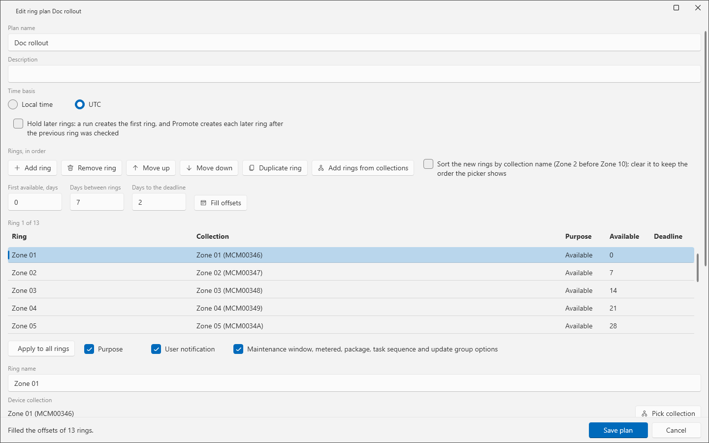

# Ring plans

A ring plan is an ordered list of rings. Each ring names a device collection, a purpose and the days from the plan start for its available time and its deadline. A plan is a JSON file. The **Rings** tab of the Deployment Helper lists the plans and opens the plan editor.

Runs are in [Deployment rings](deployment-rings.md).

## When to use it

- Create a plan once for a rollout pattern that you repeat.
- Copy a shipped plan when you want a start point.
- Edit a plan when the collections or the offsets change.

## Requirements

- The device collections of the rings exist on the site.
- The plan folder can be written. The default is `Deployments\Rings` in the data folder. You can set another folder on the **Options** tab. A share path is allowed.
- The page needs a connection to the site to read the collection list. See [Deployment Helper: Deploy tab](deployment-helper.md) for the Settings and rights.

## Shipped plans

Two plans ship with the page. They are examples. They name no collection, so they cannot run until you copy one and set a collection for each ring. Shipped plans cannot be changed: **Edit** is refused with a message, and **Copy** makes a plan that you can change.

| Plan | Time basis | Hold later rings | Ring | Purpose | Available (day) | Deadline (day) | User notification | Success threshold |
|---|---|---|---|---|---|---|---|---|
| Workstation-Rings | Local time | No | QA | Required | 0 | 1 | Display in Software Center and show all notifications | none |
| | | | Pilot | Required | 2 | 5 | same | 90 % |
| | | | Prod 1 | Required | 7 | 10 | same | 95 % |
| | | | Prod Final | Required | 14 | 17 | same | none |
| Server-Rings | Local time | Yes | Test | Required | 0 | 2 | Hide in Software Center and all notifications | 95 % |
| | | | Prod | Required | 7 | 9 | same | none |

## Steps: create a plan

1. Select the **Rings** tab. Find the **Ring plans** card.
2. Select **New**. To start from an existing plan, select the plan and select **Copy**. To change your own plan, select it and select **Edit**.
3. Enter the **Plan name** and the **Description**.
4. Select the **Time basis**: **Local time** or **UTC**.
5. Check **Hold later rings: a run creates the first ring, and Promote creates each later ring after the previous ring was checked** if a run of this plan creates only the first ring.
6. Add the rings. Use one of these methods:
   - Select **Add ring**. Select the ring in the grid. Enter the **Ring name**. Select **Pick collection** to choose the **Device collection**.
   - Select **Add rings from collections**. Check the collections in the picker. The page makes one ring for each collection. It names each ring after its collection. The check box **Sort the new rings by collection name (Zone 2 before Zone 10); clear it to keep the order the picker shows** sets the order.
7. Set the offsets. Enter **First available, days**, **Days between rings** and **Days to the deadline**. Select **Fill offsets**. The page sets the offsets of every ring. You can still change each ring.
8. Set the fields of each ring. See the table below.
9. Select **Move up**, **Move down**, **Duplicate ring** or **Remove ring** to change the order or the count.
10. To copy settings from the selected ring to all rings, check the boxes **Purpose**, **User notification** or **Maintenance window, metered, package, task sequence and update group options**, then select **Apply to all rings**.
11. Select **Save plan**. Select **Cancel** to close the editor without saving.

To delete a plan, select it and select **Delete**. A dialog asks for confirmation.

## Options and settings

The plan list has the columns **Name**, **Rings**, **Rings created**, **Time basis**, **Source** and **Description**.

| Field of a ring | Choices and rule |
|---|---|
| **Ring name** | At most 64 characters, on one line. |
| **Device collection** | An 8-character collection ID. Empty is allowed: the plan loads and cannot run. |
| **Purpose** | **Available** or **Required**. |
| **Available, days after the plan start** | A whole number from 0 to 3650. |
| **Deadline, days after the plan start** | A whole number from 0 to 3650. Required only. |
| **Success threshold, % (empty for none)** | Empty, or a whole number from 0 to 100. **Promote** uses it as a gate. |
| **User notification** | The same list as the **Deploy** tab. |
| **Distribution point group (empty for none)** | A group name. A name with `*`, `?`, `[`, `]` or a control character is refused. |
| **Install outside maintenance windows at the deadline** | Check box, under **Required only**. |
| **Allow restart outside maintenance windows** | Check box, under **Required only**. |
| **Allow download on a metered connection** | Check box, under **Required only**. |
| **Fast network**, **Slow network**, **Rerun behavior** | Package options. A run of another type ignores them. |
| **Advanced options: task sequence and software update group** | **Make available to**, **Content**, **Show task sequence progress**, **Allow fallback to the default site boundary group**, **Download from Microsoft Update when no distribution point has the content**, **Require a full scan after the restart**. A run of another type ignores them. |

The editor keeps every option of a ring that you do not change.

## Plan rules

The editor and the loader check these rules:

- The plan has a name and at least one ring. It has at most 100 rings.
- Each ring has a name.
- Rings do not share a collection.
- A built-in collection (an ID that starts with `SMS`) is refused.
- A Required ring has a deadline. The deadline is later than its available time and later than the deadline of the previous Required ring.
- An Available ring cannot use **Hide in Software Center and all notifications**.
- The slow network option "Run the program from the distribution point" is refused, because ConfigMgr rejects it.

A run adds one more rule: a deadline in the past is refused.

For a **Local time** plan, a time that a daylight saving change skips moves later by the length of the gap. A time that occurs twice is kept. Both cases add a warning check.

## Limits

- The plan file is limited to 256 KB. A plan folder or plan file that is a junction or symbolic link is neither read nor written.
- A plan name that is not a safe file name is refused. The lab refused `..`, `..\evil`, `CON`, `NUL.json`, `a*b`, `x/y`, a blank name and a name of 200 characters.
- A plan that you edit by hand is checked at load. A file with a built-in collection, a shared collection or more than 100 rings is refused with a message that names the ring.
- A plan file can be shared with the Deployment Helper tool of the App Packager Suite, a separate program, because both use the same file format. The suite tool applies its own defaults for a ring that sets no rerun, slow network or fast network option.
- Lab: the editor was checked with plans of 1, 2, 4, 13 and 100 rings on CM01.

## Troubleshooting

| Message | Cause | Fix |
|---|---|---|
| A plan holds at most 100 rings. | The plan has more than 100 rings. | Remove rings, or split the plan. |
| ... targets built-in collection ... Built-in collections are blocked. | A ring uses a collection ID that starts with `SMS`. | Choose a custom device collection. |
| ... targets ..., which ... also targets. Rings must not share a collection. | Two rings use one collection. | Give each ring its own collection. |
| ... deadline offset (...) must be later than its available offset (...). | The deadline is not later than the available time. | Increase the deadline offset. |
| ... is Available with HideAll: users never see it and it never installs. | An Available ring hides all notifications. | Choose another notification. |
| The plan has no rings. | The plan is empty. | Add a ring. |

See also [Error messages](../reference/error-messages.md) and [Troubleshooting](../troubleshooting.md).

## Links

- [Create phased deployments with Configuration Manager](https://learn.microsoft.com/intune/configmgr/osd/deploy-use/create-phased-deployment-for-task-sequence): Explains phased deployments, the concept that rings follow.
- [How to create collections in Configuration Manager](https://learn.microsoft.com/intune/configmgr/core/clients/manage/collections/create-collections): Explains the collection rule types and how to create a collection.
- [How to use maintenance windows in Configuration Manager](https://learn.microsoft.com/intune/configmgr/core/clients/manage/collections/use-maintenance-windows): Explains maintenance windows on device collections.
- [Automatically deploy software updates](https://learn.microsoft.com/intune/configmgr/sum/deploy-use/automatically-deploy-software-updates): Shows how automatic deployment rules create update deployments.
