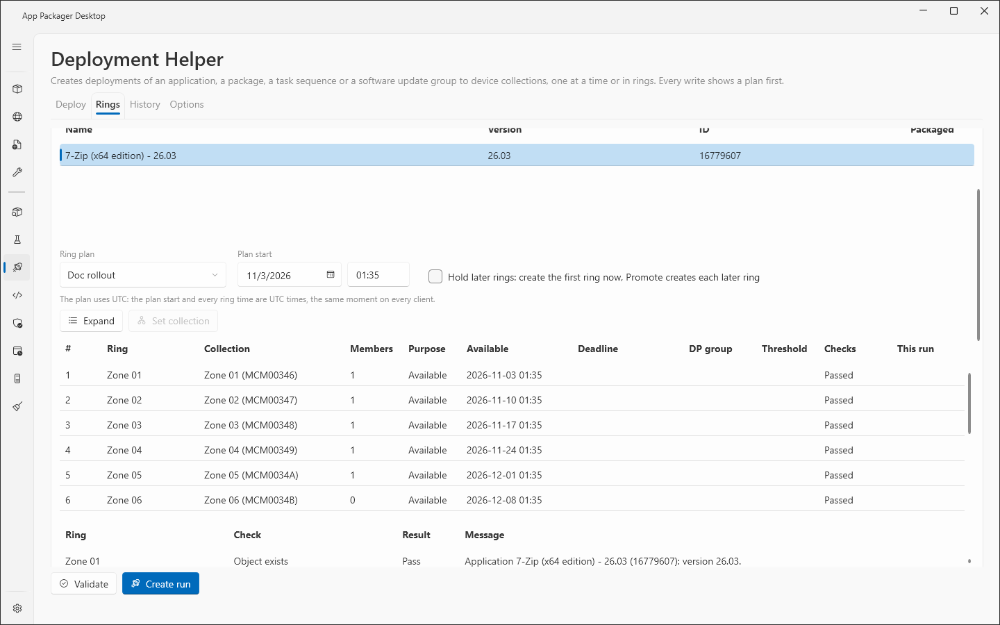
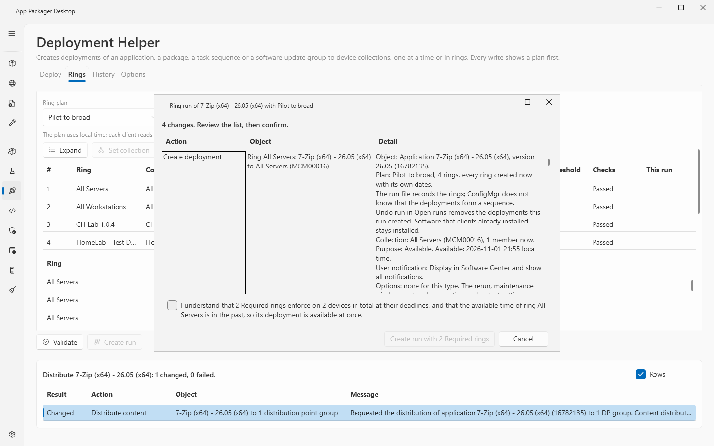
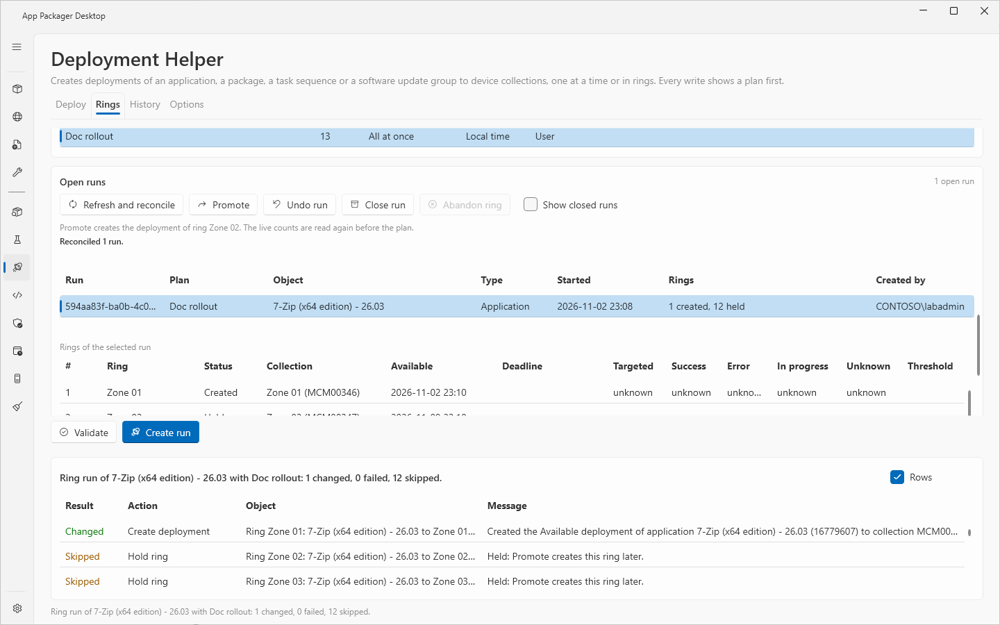

# Deployment rings

The **Rings** tab of the Deployment Helper deploys one object to a series of device collections, from 1 up to 100. A ring plan lists the rings in order. A run turns one object and one plan into ordinary deployments, one for each ring. ConfigMgr does not know that the deployments form a sequence. The page keeps that information in a run file.

The plan editor and the shipped plans are in [Ring plans](deployment-ring-plans.md). The other tabs are in [Deployment Helper: Deploy tab](deployment-helper.md) and [Deployment Helper: History and Options](deployment-helper-history-options.md).

## When to use it

- Use rings to roll out software in waves, for example a pilot, then ten percent groups, then a final ring.
- Use **Hold later rings** when you want to look at the live counts of a ring before the next ring starts.
- Use the **Deploy** tab for one deployment to one collection.

## Requirements

- The same Settings, rights and audit log as the **Deploy** tab. See [Deployment Helper: Deploy tab](deployment-helper.md).
- You create the collections yourself, before the run. For example, create ten collections with a membership query on the resource ID, plus a pilot collection and a final collection.
- The shipped plans name no collection. They cannot run until you copy one and set a collection for each ring. See [Ring plans](deployment-ring-plans.md).
- The ring folders can be written. Select **Check** on the **Options** tab to test them.

## Steps: create a run

1. Select **Deployment Helper** in the sidebar. Select the **Rings** tab.
2. Select the object type in the list above the grid: **Applications**, **Packages**, **Task Sequences** or **Software Update Groups**.
3. Select the object in the object grid. Use **Filter by name, version or ID** to find it. For a package, select the **Program**.
4. Select the **Ring plan**.
5. Enter the **Plan start** date and time. Enter the time as hours and minutes, for example `08:00`.
6. Check **Hold later rings: create the first ring now, Promote creates each later ring** if you want to promote the rings one by one. Without the check box, the run creates every ring now with its own future dates. ConfigMgr then enforces the schedule.
7. Select **Expand**. The preview grid shows each ring with **#**, **Ring**, **Collection**, **Members**, **Purpose**, **Available**, **Deadline**, **DP group**, **Threshold**, **Checks** and **This run**. **Expand** changes nothing.
8. To use another collection for one ring, select the ring and select **Set collection**. The change applies to this run only. The plan file keeps its own collection.
9. Select **Validate**. The page runs the checks of the single deployment page for every ring and the rules of the plan. The **Checks** grid lists **Ring**, **Check**, **Result** and **Message**.
10. Select **Create run**. The plan window lists every deployment of the run, with the options of each ring. Held rings are listed as **Hold ring**.
11. Select the extra confirmation box if the plan shows one. A plan with Required rings shows it. The box names the number of Required rings and the number of devices in total. The service refuses each Required ring without the box.
12. Select the action button. It is named **Create run**. A plan with Required rings names it **Create run with 1 Required ring** or **Create run with N Required rings**.

The run creates the rings in order. If a ring is not fully created, the run stops at that ring. The rings before it stay. The rings after it are not tried. The result says so. Select **Undo run** to remove the rings that were created.

## Steps: promote a held ring

1. Select the **Rings** tab. In **Open runs**, select **Refresh and reconcile** to read the live counts.
2. Select the run. The grid **Rings of the selected run** shows each ring with **Status** and the live counts.
3. Select **Promote**. If **Promote** is off, the page shows the reason.
4. Read the plan. A Required ring needs its own extra box.
5. Select the action button. It is named **Promote ring** or **Promote Required ring**.

The page checks these conditions for Promote:

- The previous ring is **Created**.
- The object is still the same.
- The checks of the deployment page pass again.
- The live counts are read again.
- If the previous ring has a success threshold, its success rate reaches it. A ring with no counts keeps the gate shut. The page names the reason.

If the deadline of the ring has passed, the plan offers to move that ring and every later held ring by the same time. Each ring keeps its time from available to deadline. Nothing is promoted by itself.

## Steps: undo, close or abandon

- **Undo run**: select the run and select **Undo run**. The plan removes only the deployments that this run created. The page checks each deployment against the audit log, the site and the run file. A deployment that fails a check is kept. The plan names it and gives the reason. Held rings are cancelled. A question window titled **Remove deployment** follows the plan. Select **Show closed runs** to find a closed run that still has created rings.
- **Close run**: select the run and select **Close run**. The plan closes the run and changes no deployment. A finished run closes itself at the next **Refresh and reconcile**.
- **Abandon ring**: select a ring in the status Creating and select **Abandon ring**. The plan returns the ring to Held. The plan has its own box. The box says that a deployment of the ring may exist and that you check the collection in the console. Use it only when **Refresh and reconcile** cannot prove the create.

## Options and settings

| Control | Effect |
|---|---|
| **Refresh**, **Cancel** (new run) | Read the objects, collections, plans and runs again, or stop the read. |
| **Expand**, **Set collection**, **Validate**, **Create run** | The steps of a new run. |
| **Refresh and reconcile** | Reads the counts of every open run, resolves rings left in Creating, marks a ring Removed only when its deployment is gone, and closes finished runs. |
| **Promote**, **Undo run**, **Close run**, **Abandon ring** | Change an open run. Each shows a plan first. |
| **Show closed runs** | Lists closed runs. |

A ring has one of the statuses Created, Creating, Held, Removed or Cancelled. The grid shows the live counts from the site as **Targeted**, **Success**, **Error**, **In progress** and **Unknown**. A count that the site has not summarized shows `unknown`. The **Threshold** column shows the success threshold of the ring. The **Open runs** grid has the columns **Run**, **Plan**, **Object**, **Type**, **Started**, **Rings** and **Created by**.

The **Options** tab of the page sets the ring folders. The default plan folder is `Deployments\Rings` in the data folder. The default run folder is the `runs` folder below it. Closed run files move to a `closed` folder. See [Deployment Helper: History and Options](deployment-helper-history-options.md) and [Data folders](../reference/data-folders.md).

The **History** tab lists every ring create, **Promote**, undo, close, cancelled ring and **Abandon ring**. The record has the plan name, the ring number, the ring name and the run ID. The **Ring run** list filters the rows.

## Limits

- A plan has at most 100 rings. The page refuses a plan with more.
- A ring in Creating waits 5 minutes. If **Refresh and reconcile** finds no deployment in that time, the ring returns to Held. After a crash, **Refresh and reconcile** adopts exactly one deployment that matches the ring and can be proven to belong to this run. If two match, the ring stays blocked.
- After 1 hour, a ring in Creating gets a note that offers **Abandon ring**. The page abandons nothing without you.
- A ring is marked Removed only when ConfigMgr no longer has the deployment. A missing summary row does not mark a ring Removed.
- A lock file next to the run file stops two sessions from changing the same run. The lock protects only sessions that share the same runs folder. The site cannot stop another administrator from creating a deployment of the same object.
- A lock file older than 1 hour is reported as stale. The page never removes it. Another session may still run. Check before you remove the file by hand. If another session holds the lock, the page names the lock file and its owner.
- A run file that cannot be read shows "Unreadable ring N". **Promote** and **Undo run** stay off for it.
- Undo from History checks the audit record against the site. It cannot stop a process of the same account that forges both.
- A ring that the page cannot prove to belong to a run is kept, not removed. A deployment made by another run, by the **Deploy** tab or by hand is never removed.
- **Expand** reads the collection list once for all rings. **Validate** and **Create run** read the site once for each ring. A plan with more rings takes more reads.
- A package ring with the time basis UTC has no expiry, as on the **Deploy** tab.
- Lab: the Rings tab was checked on one site with one client with plans of 1, 2, 4, 13 and 100 rings, create-all runs, hold runs, **Promote**, **Undo run**, a crash during a create, a lock held by a second session over a shared folder, and a Required application that the client installed. The lab used a full administrator account and one site.
- The lab found that the same plan files can be read by the Deployment Helper tool of the App Packager Suite, a separate program. That tool applies other defaults to a ring that sets no rerun, slow network or fast network option.

## Troubleshooting

| Message | Cause | Fix |
|---|---|---|
| The run cannot be created: ... | A check of the run or of a ring that is created now failed. | Read the checks. Fix the cause. Select **Expand** and **Validate** again. |
| The deadline of ring ... is in the past. Choose a later plan start and select Expand again. | A Required ring has a deadline before now. | Choose a later **Plan start**. |
| The run could not be prepared. Select Expand and Validate again. | The page lost the prepared state. | Select **Expand**, then **Validate**. |
| Ring ... is ..., not created, so ring ... cannot be promoted. Select Refresh and reconcile. | The previous ring is not Created. | Select **Refresh and reconcile**. |
| Ring ... has ... % success ...; ring ... needs ... % | The success threshold is not met. | Wait for more clients to report. Select **Refresh and reconcile**. |
| Promote and Undo run are not available until the run file is corrected | The run file has a problem. | Correct the run file, or close the run. |
| Skipped: Another session holds the run: the lock file ... | Another session holds the lock. | Wait. If the lock is stale, check and remove the lock file. |
| Nothing of this run can be undone: ... | Every ring failed a check, or none is left to remove. | Read the reasons. Remove the deployments in the console. |
| The ring runs folder is a junction or symbolic link. The runs were not read or changed. | The runs folder is a link. | Use a normal folder or a share. |

See also [Error messages](../reference/error-messages.md) and [Troubleshooting](../troubleshooting.md).

## Links

- [Create phased deployments with Configuration Manager](https://learn.microsoft.com/intune/configmgr/osd/deploy-use/create-phased-deployment-for-task-sequence): Explains phased deployments, the concept that rings follow.
- [Deploy applications with Configuration Manager](https://learn.microsoft.com/intune/configmgr/apps/deploy-use/deploy-applications): Shows how to deploy an application to a collection and set the purpose.
- [Deploy a task sequence](https://learn.microsoft.com/intune/configmgr/osd/deploy-use/deploy-a-task-sequence): Shows how to deploy a task sequence and set the purpose.
- [How to use maintenance windows in Configuration Manager](https://learn.microsoft.com/intune/configmgr/core/clients/manage/collections/use-maintenance-windows): Explains maintenance windows on device collections.
