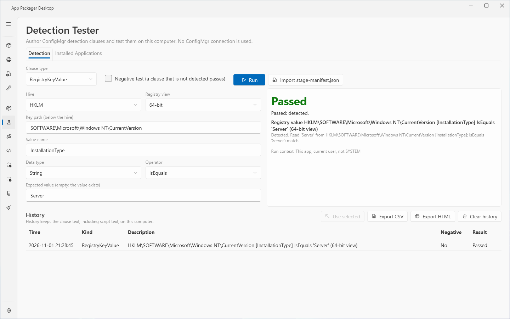
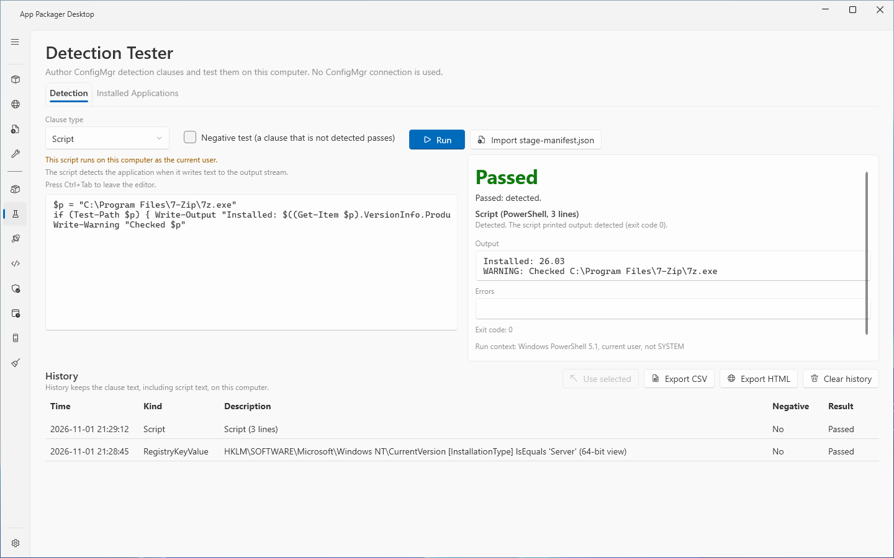
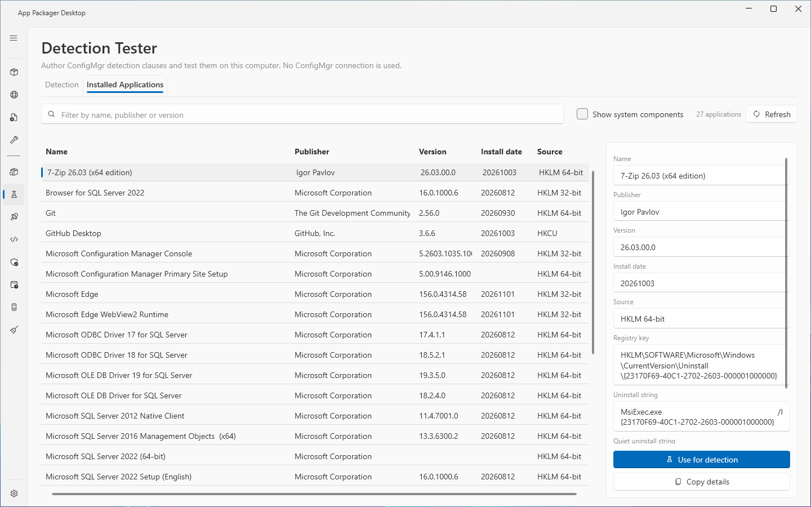

# Detection Tester

## What it does

The Detection Tester page tests a ConfigMgr detection clause on this computer. It evaluates a registry value, a registry key, a file or a PowerShell script and shows the result with the reason. It also lists the applications that are installed on this computer, and it keeps a history of every test. The page makes no ConfigMgr connection and no network request.

## When to use it

- Use it before you put a detection method in an application, to see if the clause finds the application.
- Use it to check a clause with a negative test, to see that the clause does not find an application that is not installed.
- Use it to test the detection of a staged build. Import the `stage-manifest.json` of the build, then run it.
- Use it to find the uninstall registry key of an installed application. The Installed Applications tab fills a clause for you.

## Requirements

- ConfigMgr rights: none. The page does not connect to ConfigMgr.
- Local rights: the Windows account that started the app. The page reads the registry hives HKLM and HKCU and the file system as that account. No code in the page asks for elevated rights.
- Settings: none. The page does not read the ConfigMgr settings.
- Windows PowerShell 5.1 on this computer, for the Script clause type only.

## Steps

### Test a registry value

1. Select **Detection Tester** in the sidebar.
2. Open the **Detection** tab.
3. In **Clause type**, select **RegistryKeyValue**.
4. In **Hive**, select **HKLM** or **HKCU**.
5. In **Registry view**, select **64-bit** or **32-bit**.
6. In **Key path (below the hive)**, enter the key path, for example `SOFTWARE\Microsoft\Windows\CurrentVersion\Uninstall\{product code}`.
7. In **Value name**, enter the name of the value, for example `DisplayVersion`.
8. In **Data type**, select **String** or **Version**.
9. In **Operator**, select the comparison.
10. In **Expected value (empty: the value exists)**, enter the value to compare. Leave the box empty to test only that the value exists.
11. Select **Run**.

The result panel shows a headline (**Passed** or **Failed**), a summary and one line for each clause. Each line shows the value that the page read and the comparison.

### Test a registry key

1. In **Clause type**, select **RegistryKey**.
2. Fill **Hive**, **Registry view** and **Key path (below the hive)**.
3. Select **Run**. The clause is detected when the key exists.

### Test a file

1. In **Clause type**, select **File**.
2. In **Folder path**, enter the folder, for example `%ProgramFiles%\Vendor\Product`.
3. In **File name**, enter the file name only, for example `product.exe`.
4. In **Property**, select **Existence** or **Version**.
5. For **Version**, select an **Operator** and enter **Expected version**.
6. In **View**, select **64-bit** or **32-bit**.
7. Select **Run**.

### Test a script

1. In **Clause type**, select **Script**.
2. Enter the PowerShell script in the editor. The script is detected when it writes text to the output stream.
3. Select **Run**. Select **Cancel** to stop a running script.
4. Read the **Output** box, the **Errors** box and the **Exit code**.
5. To leave the editor with the keyboard, press Ctrl+Tab.

### Run a negative test

1. Select **Negative test (a clause that is not detected passes)**.
2. Select **Run**. The test passes when the clause is not detected.

### Import a staged build

1. Select **Import stage-manifest.json**.
2. Select the `stage-manifest.json` file of a staged build.
3. Read the status line. The page fills the inputs from the detection of the first deployment type of the manifest.
4. Select **Run**. Nothing runs before you select **Run**.

### Find and reuse an installed application

1. Open the **Installed Applications** tab.
2. Enter text in the filter box to find the application by name, publisher or version.
3. Select the application. The detail panel shows the registry key, the uninstall strings and the install location.
4. Select **Use for detection**. The page fills a registry value clause on the uninstall key of the application.
5. Open the **Detection** tab and select **Run**.

### Reuse an earlier test

1. In the history grid, select a row.
2. Select **Use selected**. The page fills the inputs from the row.

## Options and settings of this page

### Controls on the Detection tab

| Control | Effect |
|---|---|
| **Clause type** | **RegistryKeyValue**, **RegistryKey**, **File** or **Script**. After an import of a compound detection, the page also offers **Compound**. |
| **Negative test (a clause that is not detected passes)** | Reverses the pass rule. |
| **Run** | Tests the clause. |
| **Cancel** | Stops a running test. A running script ends with its child processes. The result is **Cancelled**. |
| **Import stage-manifest.json** | Reads the detection of a staged build. |
| **Hive** | **HKLM** or **HKCU**. |
| **Registry view** | **64-bit** or **32-bit**. The view also applies to the file clause. |
| **Key path (below the hive)** | The key path without the hive. |
| **Value name** | The registry value to read. |
| **Data type** | **String** or **Version**. |
| **Operator** (registry) | **IsEquals**, **NotEquals**, **GreaterThan**, **GreaterEquals**, **LessThan**, **LessEquals**, **BeginsWith**, **EndsWith**, **Contains**. The default is **IsEquals**. |
| **Expected value (empty: the value exists)** | The value to compare. An empty box tests that the value exists. |
| **Folder path** | The folder of the file. |
| **File name** | The file name. A path in this box is an error. |
| **Property** | **Existence** or **Version**. |
| **Operator** (file) | **IsEquals**, **NotEquals**, **GreaterThan**, **GreaterEquals**, **LessThan**, **LessEquals**. The default is **GreaterEquals**. |
| **Expected version** | The version to compare. Required when **Property** is **Version**. |

### Rules of the comparison

- **BeginsWith**, **EndsWith** and **Contains** compare text and ignore case.
- With **Data type** set to **Version**, the page reads both sides as versions. If a side is not a version, the clause is not evaluated and the test fails.
- An empty or missing value is not detected, except for **NotEquals**, **LessThan** and **LessEquals**, which can match an empty value.
- A key path that starts with a hive prefix sets **Hive** and removes the prefix. The page accepts `HKLM\`, `HKCU\`, `HKLM:\`, `HKCU:\`, `HKEY_LOCAL_MACHINE\`, `HKEY_CURRENT_USER\` and the `Registry::` forms of these. The status line says that the hive changed.
- A file clause with a 32-bit view reads the 32-bit program folders.
- For an imported compound detection, **Run** tests every clause and shows one line for each clause.

### Result headlines

| Headline | Meaning |
|---|---|
| **Passed** | The clause is detected, or it is not detected and the test is negative. |
| **Failed** | The pass rule is not met, or the page could not evaluate a clause. |
| **Invalid clause** | An input is missing. The summary names the input. |
| **Cancelled** | You selected **Cancel**. |
| **Error** | The test could not run. The log has the details. |
| **Import failed** | The page could not read the file as a stage manifest, or the file is larger than 8 MiB. |

### History

- Every test adds a row with the columns **Time**, **Kind**, **Description**, **Negative** and **Result**.
- **Use selected** fills the inputs from the selected row.
- **Export CSV** and **Export HTML** write a report of the history. A CSV cell that starts with `=`, `+`, `-` or `@` is written as text. The HTML report encodes all text.
- **Clear history** asks first.
- History keeps the clause text, including script text, on this computer.
- The history holds at most 500 tests. The oldest test is removed first.

### Installed Applications tab

- **Refresh** reads the list again.
- **Show system components** adds the entries that Windows marks as system components.
- The list shows the applications of three uninstall locations: HKLM 64-bit, HKLM 32-bit and HKCU. An entry in two hives appears once for each hive.
- The columns are **Name**, **Publisher**, **Version**, **Install date** and **Source**.
- The detail panel shows **Registry key**, **Uninstall string**, **Quiet uninstall string** and **Install location**.
- **Use for detection** fills a clause on the uninstall key of the selected application. **Copy details** copies the details as text.

### Saved choices

The page saves **Clause type**, **Hive**, **Registry view** and **Show system components** in `settings.json` under the key `DetectionTester`. The defaults are RegistryKeyValue, HKLM, 64-bit and off.

### Files

All files are in the `DetectionTester` folder of the data folder (`%LOCALAPPDATA%\AppPackager`).

| File or folder | Content |
|---|---|
| `history.json` | The history. |
| `Reports` | The CSV and HTML reports. |
| `run` | A temporary script file `ap-detection-<guid>.ps1` while a script runs. |

The page deletes a script file after the run. At the next start, the page removes script files that are older than one day. The page refuses a folder that is a junction or a symbolic link.

## Limits

- A script runs in a child Windows PowerShell 5.1 as the current user, not as SYSTEM. ConfigMgr runs a detection script as SYSTEM and also reads the exit code. A script can give another result in ConfigMgr.
- A script clause detects the application when the script writes output. If the script writes output and ends with a non-zero exit code, the page reports it as detected and adds a warning, because ConfigMgr treats a non-zero exit code as a failed detection.
- One script time limit of 30 seconds applies to the whole test. When a test holds several script clauses, they share the 30 seconds. A script that runs out of time is ended with its process tree, and the clause fails.
- The page keeps at most 64 KiB of output and 64 KiB of error output for a script. The page drops the rest. The page waits at most 5 seconds for the output after the script ends.
- A job object ends the child processes of a script when the script ends. If Windows does not allow this containment, the page does not run the script.
- The page tests on this computer only. It does not test a remote device.
- The page has no template feature and no clause library.
- A Compound clause comes only from an import. The page cannot build one.
- A registry value of a kind that the page cannot compare fails the test with a message that names the kind.

## Troubleshooting

| Message | Cause | Fix |
|---|---|---|
| The key path is required. | **Key path (below the hive)** is empty. | Enter the key path. |
| The value name is required. | A **RegistryKeyValue** clause has no **Value name**. | Enter the value name. |
| The folder path is required. / The file name is required. | A file clause has an empty box. | Fill **Folder path** and **File name**. |
| The expected version is required when the property is Version. | **Property** is **Version** and **Expected version** is empty. | Enter the version. |
| The script is required. | The script editor is empty. | Enter a script. |
| Import a stage-manifest.json with a compound detection first. | **Clause type** is **Compound** and nothing was imported. | Select **Import stage-manifest.json**. |
| This manifest has no detection to import. | The manifest holds no detection. | Select another manifest. |
| The file is too large for a stage manifest. | The file is larger than 8 MiB. | Select the correct `stage-manifest.json`. |
| The script timed out; its process tree was ended. | The script ran longer than the 30 second limit. | Make the script shorter. |
| The script printed no output: not detected (exit code N). | The script wrote nothing to the output stream. | Write the detection text to the output stream. |
| '…' or '…' is not a version. | **Data type** is **Version** and a side is not a version. | Use **String**, or correct the values. |
| The key path '…' names another hive than the clause's … | An imported clause names a hive that does not match its hive field. | Correct the key path in the manifest. |
| The script was not run: this computer did not allow the script's processes to be contained, so they could not be ended reliably. | Windows did not allow the job object. | The message states no fix. |
| The Detection Tester folder is a junction or symbolic link. The history is not read or saved. | The `DetectionTester` data folder is a link. | Replace the link with a normal folder. |
| The details could not be copied. Another program holds the clipboard. | The clipboard is in use. | Select **Copy details** again. |

## Links

- [Create applications in Configuration Manager](https://learn.microsoft.com/intune/configmgr/apps/deploy-use/create-applications): Describes how to create an application with deployment types, detection methods and dependencies.
- [Add, Assign, and Monitor a Win32 App in Microsoft Intune](https://learn.microsoft.com/intune/app-management/deployment/add-win32): Shows how to add a Win32 app, set its detection rules and assign it.
- [win32LobAppRule resource type](https://learn.microsoft.com/graph/api/resources/intune-apps-win32lobapprule): Describes the detection and requirement rule types of a Win32 app.
- [ProductCode property](https://learn.microsoft.com/windows/win32/msi/productcode): Describes the product code that identifies an installed product.
- [Windows Installer Properties for the Uninstall Registry Key](https://learn.microsoft.com/windows/win32/msi/uninstall-registry-key): Lists the Uninstall registry values that Windows Installer writes.
