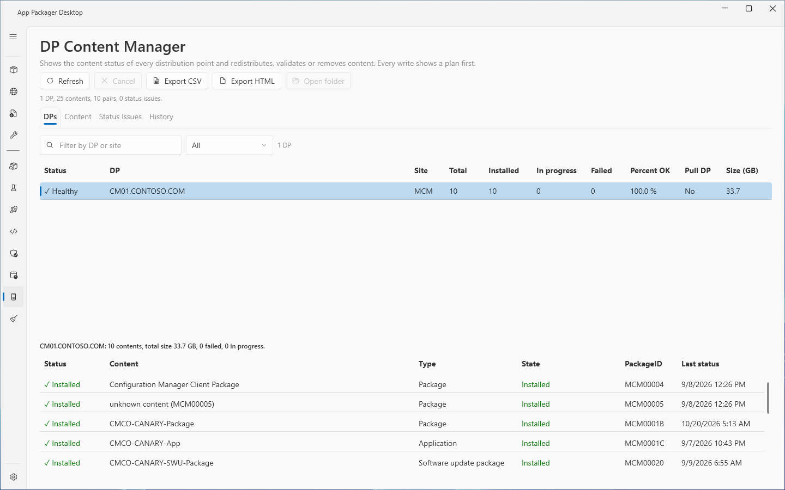
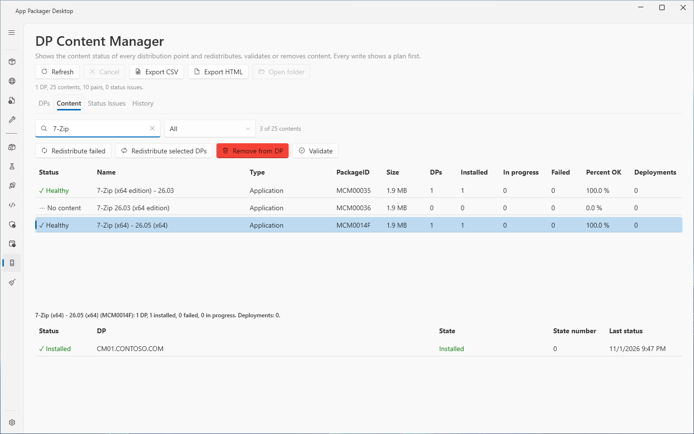
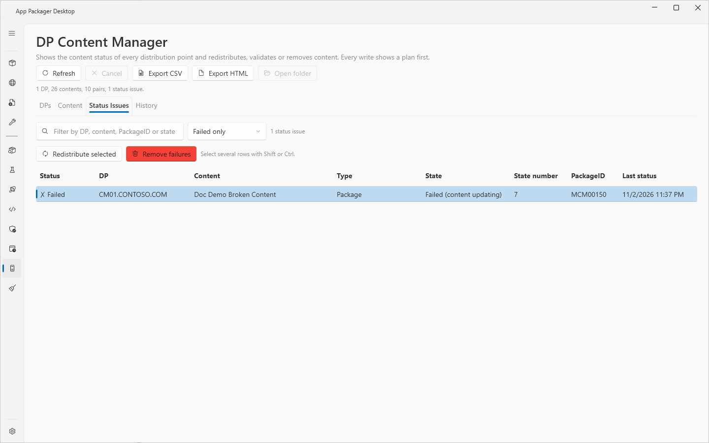
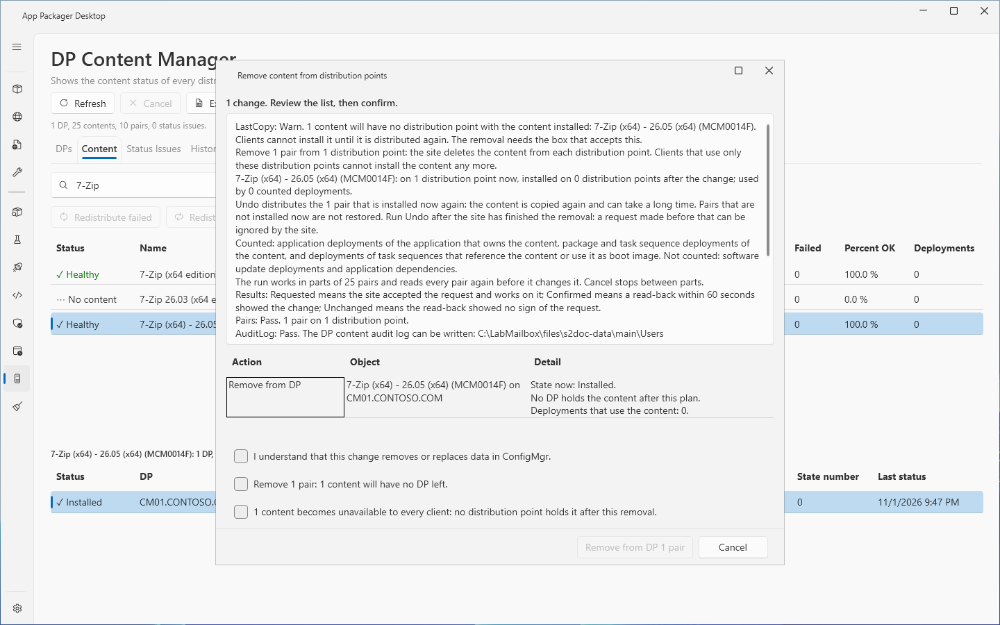
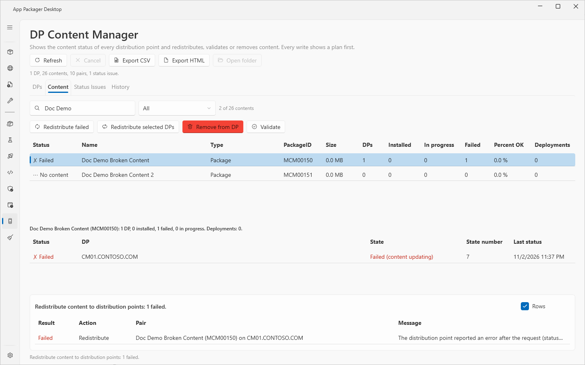
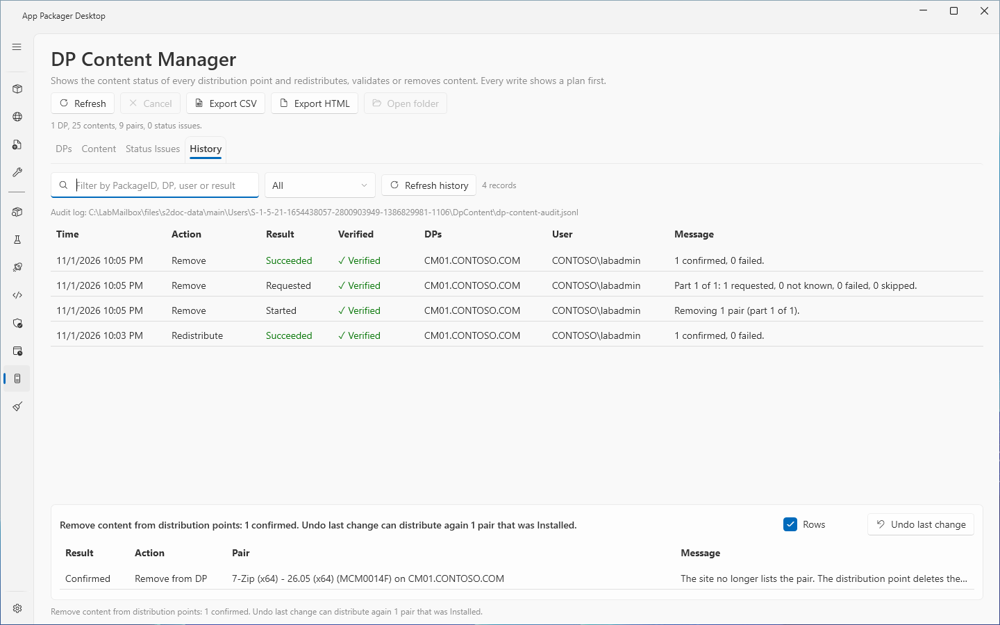

# DP Content Manager

## What it does

The DP Content Manager page shows which content is on which distribution point (DP), finds content that has a problem, and changes the content of DPs. It can redistribute content, validate content and remove content from DPs. It reads the site through the SMS Provider. It writes only after a plan that you confirm, and it records every write in an audit log.

## When to use it

- Use it to see the content status of every DP in one place.
- Use it to find the pairs of a DP and a content object that are not installed (the Status Issues tab).
- Use it to redistribute content that failed to install, or to validate content on DPs.
- Use it to remove content from DPs, and to undo that removal.
- Use it to review what the page changed (the History tab).

## Requirements

- ConfigMgr rights: a ConfigMgr security role with read rights on distribution points and content, and rights to distribute and remove content. A least-privilege role is not tested: all lab runs used a Full Administrator account.
- Local rights: the Windows account that started the app. The ConfigMgr console module must be on this computer. The page uses it through Windows PowerShell 5.1.
- Settings: select **ConfigMgr** under **Systems in use** in Settings. Enter **Site Code** and **Site Server / SMS Provider Host** under **ConfigMgr Site Settings** in Settings.
- The audit log folder must be writable before a removal. A removal does not start when the log cannot be written.

## Steps

### Read the distribution points

1. Select **DP Content Manager** in the sidebar. The page reads the DPs, the content and every status row by itself.
2. To read again, select **Refresh**. To stop a read, select **Cancel**.
3. On the **DPs** tab, enter text in the filter box, or select a status in the status list.
4. Select a DP. The grid below shows the content of the DP.

### Read the status of a content object

1. Open the **Content** tab.
2. Enter text to filter by name or PackageID. Select a content type in the type list.
3. Select a content object. The grid below shows its status on each DP.

### Find and fix problems

1. Open the **Status Issues** tab. It lists every pair that is not installed.
2. Select a state in the state list to show **Failed only** or **In progress only**.
3. Select one or more rows. Use Shift or Ctrl to select several rows.
4. Select **Redistribute selected** to copy the content to the DPs again.
5. Select **Remove failures** to remove the failed pairs. The button works on failed pairs only.
6. Follow [Run an action](#run-an-action).

### Run an action

1. Start the action with one of these buttons.
   - **Redistribute failed** on the **Content** tab: the failed pairs of the selected content.
   - **Redistribute selected DPs** on the **Content** tab: the DPs that you selected in the status list of the content.
   - **Validate** on the **Content** tab: the pairs of the selected content.
   - **Remove from DP** on the **Content** tab: the pairs of the selected content.
   - **Redistribute selected** and **Remove failures** on the **Status Issues** tab.
2. A pair window opens. Each row has an **Include** check box. Clear each pair that must not change. For **Remove from DP**, check each pair to remove. A removal starts with the pairs that you selected in the status list, or with no pair checked.
3. Use **Check shown** and **Clear** to set many check boxes. Press Space to check or clear the selected row.
4. Select **Continue to the plan**.
5. The page reads the current state of the checked pairs. A pair that changed on the site since you looked is left out, and the plan says why.
6. Read the plan. It lists every pair, the state now, the DPs that hold the content after the plan, and the deployments that use the content.
7. For a removal, select the check boxes of the plan (see [Confirmation boxes of a removal](#confirmation-boxes-of-a-removal)).
8. Select the action button, for example **Redistribute 3 pairs**. Select **Cancel** to change nothing.
9. Read the result panel under the tabs (see [Results](#results)).

### Undo the last removal

1. Select **Undo last change** in the result panel.
2. Read the plan. It distributes the removed content again to the DPs where it was **Installed**.
3. Select the action button.

### Review what the page changed

1. Open the **History** tab.
2. Enter text to filter by PackageID, DP, user or result. Select an action in the **Action** list.
3. Select a record to read its details.
4. Select **Refresh history** to read the audit log again.

### Export a report

1. Open the tab to export.
2. Select **Export CSV** or **Export HTML**. The report holds the rows that the filters show.
3. Select **Open folder** to open the folder of the last report.

## Options and settings of this page

### Tabs and columns

| Tab | Columns |
|---|---|
| **DPs** | **Status**, **DP**, **Site**, **Total**, **Installed**, **In progress**, **Failed**, **Percent OK**, **Pull DP**, **Size (GB)**. The grid below: **Status**, **Content**, **Type**, **State**, **PackageID**, **Last status**. |
| **Content** | **Status**, **Name**, **Type**, **PackageID**, **Size**, **DPs**, **Installed**, **In progress**, **Failed**, **Percent OK**, **Deployments**. The grid below: **Status**, **DP**, **State**, **State number**, **Last status**. |
| **Status Issues** | **Status**, **DP**, **Content**, **Type**, **State**, **State number**, **PackageID**, **Last status**. |
| **History** | **Time**, **Action**, **Result**, **Verified**, **DPs**, **User**, **Message**. |

### Filters

- **DPs** tab: text (DP or site) and status: **All**, **Healthy only**, **Has failures**, **Has in-progress**.
- **Content** tab: text (name or PackageID) and type: **All**, **Application**, **Package**, **Software update package**, **Boot image**, **OS image**, **Driver package**, **Task sequence**.
- **Status Issues** tab: text and state: **All**, **Failed only**, **In progress only**.
- Every grid sorts by any column.

### Confirmation boxes of a removal

A removal plan shows these boxes. Each box must be selected before the action button works.

1. **I understand that this change removes or replaces data in ConfigMgr.**
2. A box that names the number of pairs, for example "Remove 2 pairs from distribution points. Clients that use these DPs cannot get the content from them." If a content object would have no DP left, the box says so.
3. A third box appears when a content object would be left on no DP. It says that the content becomes unavailable to every client.

The service enforces the first two boxes and the third box when it applies. A removal without them is refused, whatever the page sends.

### Results

The site processes requests one after another and later. The page therefore shows what it read back.

| Result | Meaning |
|---|---|
| **Requested** | The site accepted the request. The read-back did not yet show the new state. |
| **Confirmed** | The read-back showed the new state. |
| **Unchanged** | The site accepted the request, but the state did not change. This happens, for example, when you distribute again right after a removal. Try again later. |
| **Failed** | The site refused the request or the pair failed. The result text says why. |
| **Skipped** | The page did not try the pair, for example because the pair changed, or because you cancelled the run. The result text says why. |

- The page reads the site again every 5 seconds for 60 seconds.
- Select **Rows** to show or hide the result of each pair under the summary.
- **Failed** shows when a pair has an error message in its last status, whatever its state number.

### Audit log

Every write adds records to `dp-content-audit.jsonl` in the `DpContent` folder of the data folder (`%LOCALAPPDATA%\AppPackager`). A removal writes a Started record before each part and a Finished record after it. The other actions write a Finished record. The records form a hash chain. The **History** tab marks each record **Verified** or **Not verified**. A record that was edited by hand, or a record after a broken line, shows **Not verified**. The tab reads the audit log only and makes no call to the site. The tab shows the newest 2,000 records. Older records stay in the file. If the file is larger than 16 MiB, the tab shows only the records in the last 16 MiB.

### Saved choices and files

- The page saves the tab, the filters and the sort of each grid in `settings.json`, key `DpContent`.
- Reports are in `%LOCALAPPDATA%\AppPackager\DpContent\Reports`. A formula in a cell is made safe in the CSV. The HTML report encodes all text.
- The page refuses a report folder that is a junction or a symbolic link.

## Limits

- A run holds at most 500 pairs. The service works in parts of 25 pairs.
- A load keeps at most 100,000 status rows. If the site holds more, the page says that the list is truncated and shows the count.
- An audit record holds at most 100 pairs. A report holds at most 500,000 rows.
- The read-back window is 60 seconds. A **Requested** result is not a **Confirmed** result.
- Before each part of a removal, the service reads the copies on other DPs again. If another process removed the last other copy during the run, that part and the later parts are skipped.
- **Undo last change** distributes the content again. It restores the pairs that were **Installed** before the removal. It does not restore task sequence pairs. Copying large content again can take a long time.
- The audit chain finds edits to single records. A process that runs under the same account can write a new chain that has no break. The chain does not stop that.
- The deployment counts cover the kinds of deployment that the plan names.
- The content type list offers seven types. The page also reads OS upgrade packages. It shows their type as `OsUpgradePackage`.
- The page makes no network call except to the SMS Provider through the ConfigMgr session.
- Lab status: six lab passes ran on CM01 with one distribution point (CM01.CONTOSO.COM). The checks covered the DPs, Content, Status Issues and History tabs, redistribute, validate, removal with the last-copy boxes, undo, cancel at a part boundary, stale pairs, a read-only audit log and a hand edit of the hash chain. The results came from the real site. Not tested: a second DP with overlapping names, a site with thousands of packages, and a custom security role.

## Troubleshooting

| Message | Cause | Fix |
|---|---|---|
| ConfigMgr is not in use. Select it under Systems in use in Settings. | **ConfigMgr** is off in Settings. | Select **ConfigMgr** under **Systems in use**. |
| Set the site code in Settings, ConfigMgr Site Settings. | **Site Code** is empty. | Enter the site code. |
| The distribution point content could not be read. The log has the details. | The read failed. | Check the site settings, then select **Refresh**. |
| The ConfigMgr console role needs read rights on distribution points and their content. | ConfigMgr denied the read. | Give the account a role with these rights. |
| The distribution point content was not read. Select Refresh first. | The page has no data. | Select **Refresh**. |
| A change is still running. Wait until it ends, then start the next one. | An earlier run has not ended. | Wait. |
| Select a content first. | No content row is selected. | Select a content row. |
| The selected content has no DP whose install failed. | **Redistribute failed** has no failed pair. | Select another content row. |
| Select one or more DPs in the status list of the content first. | No DP row is selected. | Select one or more DP rows. |
| Select one or more failed status issues first. Remove failures removes only failed pairs. | The selected rows are not failed. | Select failed rows. |
| The current state of the pairs could not be read. Nothing was changed. | The re-read failed. | Start the action again. |
| The selection changed while the current state was read. Nothing was changed. Start the action again. | You changed the selection during the re-read. | Start the action again. |
| Every pair changed since the list was read, so nothing is left to change. Select Refresh, then try again. | The site changed every pair. | Select **Refresh**. |
| a removal needs the second confirmation. Nothing was removed. | The removal ran without its boxes. | Select the boxes of the plan. |
| N content would have no distribution point with the content installed … Select the box that accepts this. Nothing was removed. | A removal would remove the last installed copy. | Select the third box, or check fewer pairs. |
| the audit log cannot be written, so nothing was removed. | The audit file is read-only or in a folder that denies access. | Fix the folder access, then start again. |
| The DP content reports folder is a junction or symbolic link. The report was not written. | The `Reports` folder is a link. | Replace the link with a normal folder. |
| The plan window was closed while the run was still working. The run continues in the background … | You closed the plan window during a run. | Wait until the run ends before you start another change. |
| The list has no rows to export. | The tab has no rows. | Select **Refresh**, then export. |

## Links

- [Deploy and manage content for Configuration Manager](https://learn.microsoft.com/intune/configmgr/core/servers/deploy/configure/deploy-and-manage-content): Explains how to distribute, update, redistribute and validate content.
- [Monitor content you distribute with Configuration Manager](https://learn.microsoft.com/intune/configmgr/core/servers/deploy/configure/monitor-content-you-have-distributed): Shows how to read the content status and the distribution point group status.
- [Install and configure distribution points in Configuration Manager](https://learn.microsoft.com/intune/configmgr/core/servers/deploy/configure/install-and-configure-distribution-points): Explains the distribution point settings, the groups and the content validation schedule.
- [Use a pull-distribution point with Configuration Manager](https://learn.microsoft.com/intune/configmgr/core/plan-design/hierarchy/use-a-pull-distribution-point): Explains how a pull distribution point gets content from its source distribution points.
- [Fundamental concepts for content management in Configuration Manager](https://learn.microsoft.com/intune/configmgr/core/plan-design/hierarchy/fundamental-concepts-for-content-management): Explains the accounts, the bandwidth controls and the other content concepts.
- [The content library in Configuration Manager](https://learn.microsoft.com/intune/configmgr/core/plan-design/hierarchy/the-content-library): Explains how the content library stores files on the site server and the distribution points.
