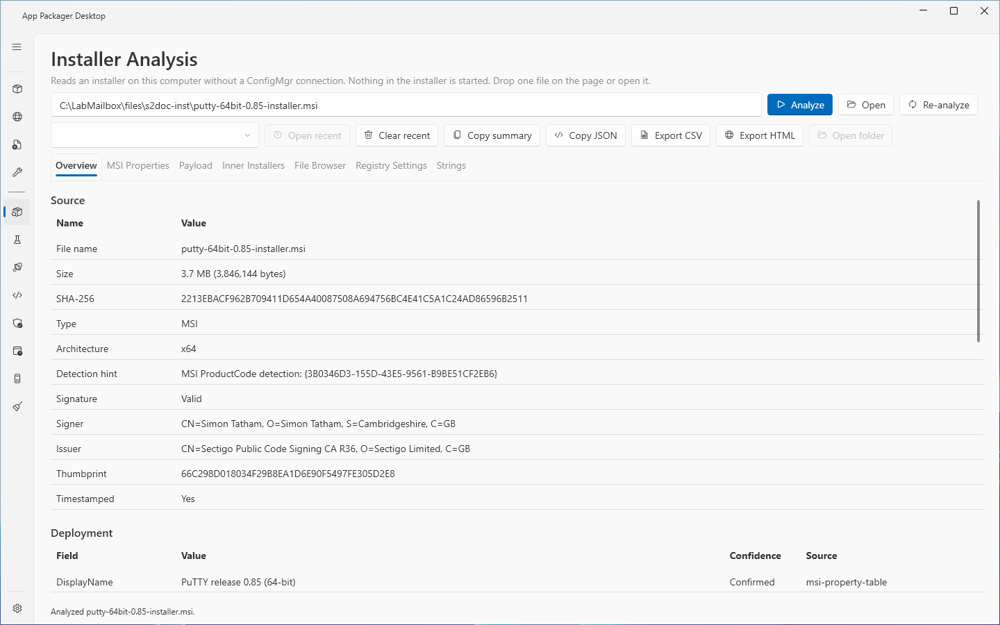
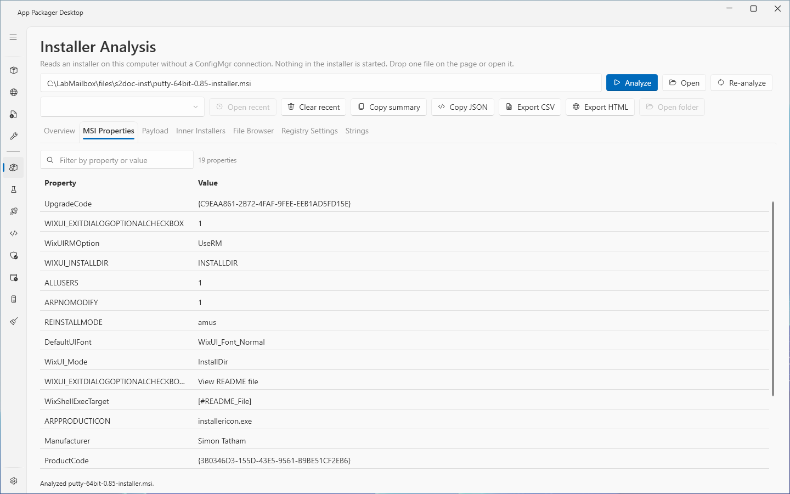
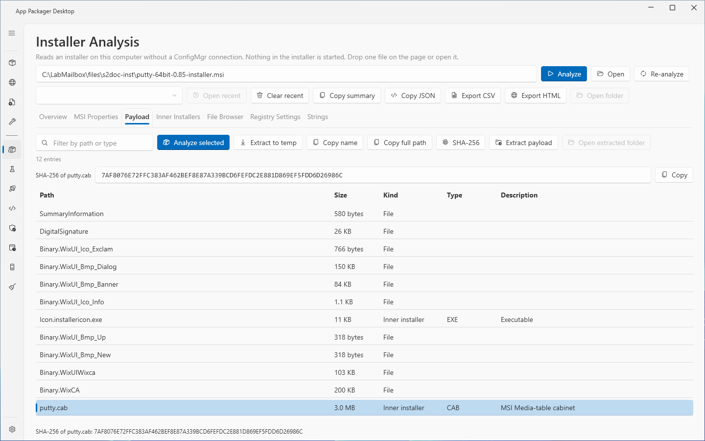
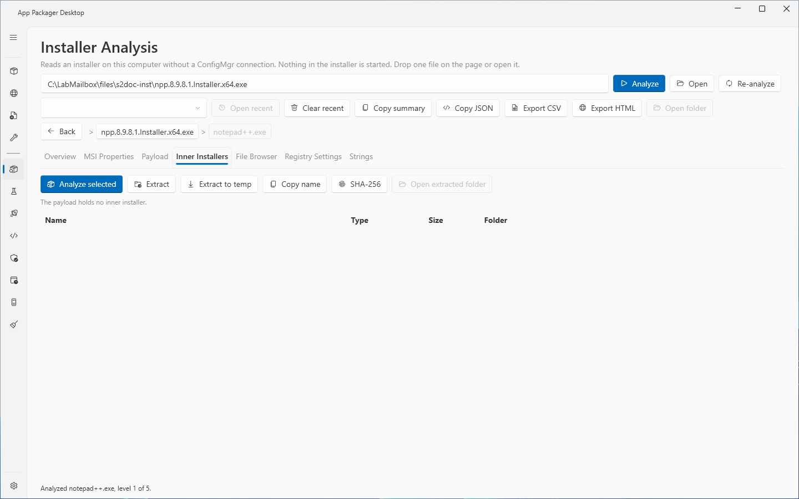
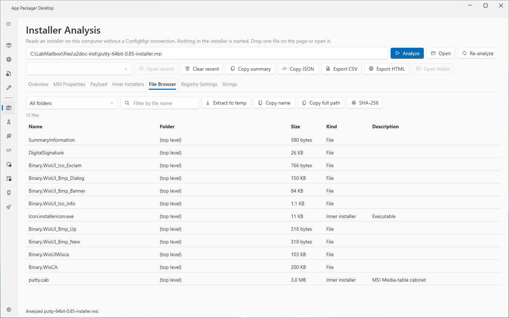
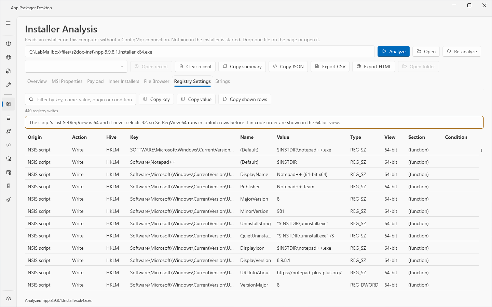
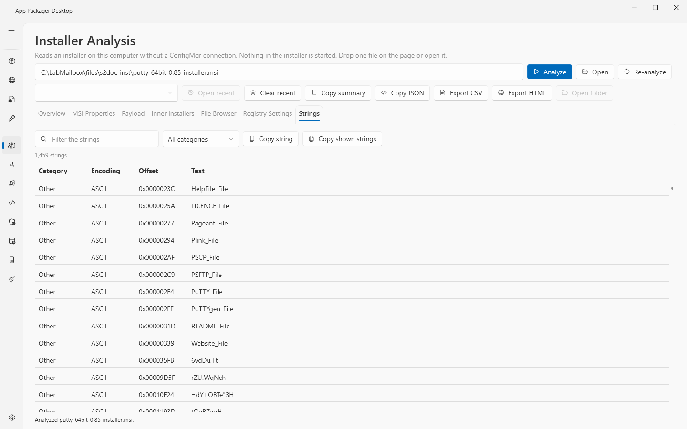

# Installer Analysis

## What it does

The Installer Analysis page reads a Windows installer file on this computer and reports the data that you need to package it: the installer type, the silent install and uninstall commands, the uninstall registry key, the files inside, the registry values the installer writes and the readable text in the file. It never starts the installer or any file taken out of it. It makes no ConfigMgr connection and no network request.

## When to use it

- Use it before you write the install command, the uninstall command or the detection method of an application.
- Use it to find the Add/Remove Programs key that an installer writes.
- Use it to look inside an installer that holds other installers.
- Use it to get the SHA-256 of an installer or of a file inside it.
- To package an installer, use [Add from file](../core/add-from-file.md). It runs the same analysis, shows each proposed value with an evidence level and saves a definition. [Add from web](../core/add-app.md) runs the same analysis on a downloaded installer. This page accepts more file types than Add from file.

## Requirements

- ConfigMgr rights: none.
- Local rights: the Windows account that started the app. No code in the page asks for elevated rights.
- Settings: none.
- 7-Zip, optional. The page needs 7-Zip to list and extract the payload of executable archives. The page does not extract with a 7-Zip older than 25.01. Analysis and listing still work with an older 7-Zip.

## Steps

### Analyze an installer

1. Select **Installer Analysis** in the sidebar.
2. Drop one file on the page, or enter a path in the path box and press Enter, or select **Open** and choose a file. **Analyze** analyzes the file in the path box.
3. Wait for the status line to show **Analyzed** and the file name. **Cancel** stops the analysis.
4. Read the **Overview** tab.

### Read the Overview tab

The **Overview** tab has these sections.

- **Source**: **File name**, **Size**, **SHA-256**, **Type**, **Architecture**, **Requested execution level** (executables), **Detection hint**, **Signature**, **Signer**, **Issuer**, **Thumbprint**, **Timestamped**.
- **Deployment**: the fields with the columns **Name**, **Value**, **Confidence** and **Source**. **Confirmed** means the page read the value from the installer. **Predicted** means the page worked it out, for example when the install folder is chosen at run time. Check a **Predicted** value before you use it in a detection method. This page shows only these two levels. [Add from file](../core/add-from-file.md#evidence-levels) adds **Manual** (you changed the value) and **No value**.
- **Install modes**: one row for each mode with the columns **Mode**, **Default**, **Switch**, **Install command**, **Install folder**, **Uninstall command**, **ARP key**, **Hive**, **View** and **Context**.
- **Detection after patches**: for a file that holds a base MSI and an MSP, the product code, version and registry key that the patched product writes. The page reads the version from the `UpdatedVersion` of the patch applicability XML (**Confirmed**). If the patch has no `UpdatedVersion`, the page reads a version in parentheses from the patch name, description, subject or title (**Predicted**). A patch with no `UpdatedVersion` can be a small update that keeps the `ProductVersion`. If no version is found, the note says so.
- **Package metadata**: facts that depend on the installer type.
- Notes: plain sentences that say what the page could not read, for example an encrypted Inno Setup header.

### Read the MSI properties

1. Open the **MSI Properties** tab.
2. Enter text in the filter box to find a property by name or value.

### List and extract the payload

1. Open the **Payload** tab. The page lists every file of the installer.
2. Select a row.
3. Select **SHA-256** to compute the hash of the row. Select **Copy** next to the hash to copy it. **Cancel** stops a long hash computation.
4. Select **Extract to temp** to extract the row to the temporary analysis folder.
5. Select **Extract payload** to write the files that the page can list and extract into a folder. The page does not write links or unsafe entries, and some payloads need 7-Zip (see Limits). Choose the target folder. The page writes the files into a new folder named `<file name> payload` inside it. If that name exists, the page adds a space and `(2)`, and so on.
6. Select **Open extracted folder** to open the temporary analysis folder.

### Analyze an installer inside the installer

1. Open the **Inner Installers** tab.
2. Select a row and select **Analyze selected**.
3. Read the breadcrumb above the tabs. It shows the levels.
4. Select **Back** to return to the installer that holds this one.
5. To copy an inner installer to a folder of your choice, select **Extract** and choose a folder.

### Browse the files

1. Open the **File Browser** tab.
2. Select a folder in the **Folder** list, or enter text in the file filter.
3. Use **Extract to temp**, **Copy name**, **Copy full path** or **SHA-256** on a selected row.

### Read the registry settings

1. Open the **Registry Settings** tab.
2. Enter text in the filter box to filter by key, name, value, origin or condition.
3. Select a row and select **Copy key** or **Copy value**. **Copy shown rows** copies every shown row as a tab-separated line.

### Read the strings

1. Open the **Strings** tab.
2. Select a **Category** and enter filter text.
3. Select **Copy string** or **Copy shown strings**.

### Copy or export the result

1. Select **Copy summary** to copy a text summary.
2. Select **Copy JSON** to copy the ConfigMgr digest.
3. Select **Export CSV** or **Export HTML** to write a report.
4. Select **Open folder** to open the folder of the last report.

### Open an earlier file

1. Select a path in the **Recent files** list.
2. Select **Open recent**. Select **Clear recent** to remove every path from the list.

## Options and settings of this page

### Buttons above the tabs

| Control | Effect |
|---|---|
| **Analyze** | Analyzes the file in the path box. |
| **Open** | Chooses an installer and analyzes it. |
| **Re-analyze** | Analyzes the opened installer again from the top level. |
| **Cancel** | Stops the running operation. |
| **Open recent**, **Clear recent** | Open a path from the list, or empty the list. |
| **Copy summary**, **Copy JSON** | Copy the result. |
| **Export CSV**, **Export HTML** | Write a report. |
| **Open folder** | Opens the folder of the last report. |
| **Back** | Returns to the installer that holds the current one. |

### Installer types

The page reads these types: NSIS, Inno Setup, InstallShield, WiX Burn, 7-Zip and WinRAR self-extracting archives, BitRock, Advanced Installer, MSI, MSP, MSIX and APPX packages and bundles, `.intunewin`, NuGet packages, Chocolatey packages, zip archives, PSAppDeployToolkit, Squirrel and Velopack.

### Tabs

| Tab | Columns and controls |
|---|---|
| **Overview** | See above. |
| **MSI Properties** | **Property** and **Value**. Filter box. |
| **Payload** | **Path**, **Size**, **Kind**, **Type**, **Description**. **Analyze selected**, **Extract to temp**, **Copy name**, **Copy full path**, **SHA-256**, **Extract payload**, **Open extracted folder**. |
| **Inner Installers** | **Name**, **Type**, **Size**, **Folder**. **Analyze selected**, **Extract**, **Extract to temp**, **Copy name**, **SHA-256**, **Open extracted folder**. |
| **File Browser** | **Name**, **Folder**, **Size**, **Kind**, **Description**. **Folder** list and file filter. |
| **Registry Settings** | **Origin**, **Action**, **Hive**, **Key**, **Name**, **Value**, **Type**, **View**, **Section**, **Condition**. The origin is the MSI Registry table, the NSIS script or the Inno Setup header. |
| **Strings** | **Category**, **Encoding**, **Offset**, **Text**. Categories are Url, Path, Registry, Command, Guid, Version and Other. Encodings are ASCII and UTF-16. |

### Limits of one analysis

| Limit | Value |
|---|---|
| File size | 8 GiB |
| Entries in one archive listing | 100,000 |
| Bytes extracted | 4 GiB |
| Levels of inner installers | 5 |
| Time for one analysis step | 5 minutes |
| Strings kept | 20,000 |
| Shortest string | 6 characters |
| Compression ratio (expanded to compressed) of an archive entry | 200 |
| Smallest 7-Zip version for extraction | 25.01 |
| Recent files kept | 10 |

### Saved choices and files

- The page saves the selected tab, the filters and the **Recent files** list in `settings.json`, key `InstallerAnalysis`, for the current Windows user. The page reads no recent file until you open it.
- Extracted files go to a private session folder under `%LOCALAPPDATA%\AppPackager\InstallerAnalysis\Temp`. The page removes the folder when you go back a level, when you leave the page, when the app closes and at the next start.
- Reports are in `%LOCALAPPDATA%\AppPackager\InstallerAnalysis\Reports`. A CSV cell that starts with `=`, `+`, `-`, `@`, a tab, a carriage return or a line feed is written as text. The HTML report encodes all text.
- The page refuses a report folder that is a junction or a symbolic link.

## Limits

- The page refuses a folder, several files and a shortcut. Open one installer file.
- A value is only as good as the installer allows. The predictions were checked against real installs in the lab: an NSIS, an Inno Setup, a BitRock and several MSI installers.
- The page does not fetch certificates from the network. A file whose intermediate certificate is not cached can show the signature status NotTrusted.
- An MSI without an `ALLUSERS` property writes its Add/Remove Programs key under HKLM, but Windows Installer registers the product for the installing account only. The page says so.
- The page cannot list or extract the payload of an Inno Setup installer. The **Overview** and **Registry Settings** tabs still read the Inno Setup header.
- The page does not decode some headers, for example an encrypted Inno Setup header or an NSIS header that uses bzip2. A note on the **Overview** tab says so.
- The page refuses entry names that leave the target folder (`..\`, absolute paths, device names, alternate data streams) and any link in the target path. A link in an archive is listed as a link and is never created.
- A limit stops an archive with too many entries, too much data or an extreme compression ratio before the page writes it.
- If a payload list was cancelled or failed, the export is refused and the status says why. If 7-Zip is missing, the HTML report says that the payload was not listed.
- The key material of an `.intunewin` file is never shown or exported.
- The page does not run the installer. A prediction of a command is not a test of the command.

## Troubleshooting

| Message | Cause | Fix |
|---|---|---|
| Enter the path of an installer, or press Open. | The path box is empty. | Enter a path, or select **Open**. |
| The path is not valid. | The text is not a valid path. | Correct the path. |
| The file … does not exist. | The file is missing. | Correct the path. |
| Drop one file at a time. | You dropped several files. | Drop one file. |
| A folder cannot be analyzed. Open one installer file. | The path is a folder. | Select a file. |
| A shortcut cannot be analyzed. Drop or open the installer file itself. | The path is a shortcut. | Select the installer file. |
| The file is larger than the analysis limit of … | The file is over 8 GiB. | The message states no fix. |
| The installer could not be analyzed. The log has the details. | The read failed. | The message states no fix. |
| The file could not be analyzed; it may be damaged or not an installer. | The file is damaged or is not an installer. | The message states no fix. |
| The analysis stopped at the time limit. | One step ran longer than 5 minutes. | The message states no fix. |
| 7-Zip is not installed; the payload of this installer type is listed with 7-Zip. Install 7-Zip to list and extract it. | The type needs 7-Zip. | Install 7-Zip 25.01 or newer. |
| 7-Zip … is older than …; extraction is refused. Install 7-Zip … or newer. | The 7-Zip version is below 25.01. | Install 7-Zip 25.01 or newer. |
| Inno Setup compresses its payload into the setup's own data streams, and 7-Zip has no Inno Setup support, so the payload is not listed or extracted. | The type is Inno Setup. | Use the **Overview** and **Registry Settings** tabs. |
| The drill-down limit of 5 levels is reached. Use Extract to copy the inner installer to a folder. | The depth limit is reached. | Select **Extract**, then open the copy. |
| Choose a folder outside the temporary analysis folder. | The target folder is inside the temporary folder. | Choose another folder. |
| The folder is a junction or a symbolic link. Choose a plain folder. | The target is a link. | Choose a normal folder. |
| The installer has no payload to extract. | The payload list is empty. | The message states no fix. |
| The text could not be copied. Another program holds the clipboard. | The clipboard is in use. | Try again. |

## Links

- [Installer Database](https://learn.microsoft.com/windows/win32/msi/installer-database): Explains the structure of an installer database.
- [Database Tables](https://learn.microsoft.com/windows/win32/msi/database-tables): Lists the tables of an installer database.
- [Property Reference](https://learn.microsoft.com/windows/win32/msi/property-reference): Lists the Windows Installer properties.
- [ProductCode property](https://learn.microsoft.com/windows/win32/msi/productcode): Describes the product code that identifies an installed product.
- [Frequently Asked Questions (FAQ)](https://www.7-zip.org/faq.html): Answers common questions about 7-Zip archives.
- [7z Format](https://www.7-zip.org/7z.html): Describes the 7z archive format.
