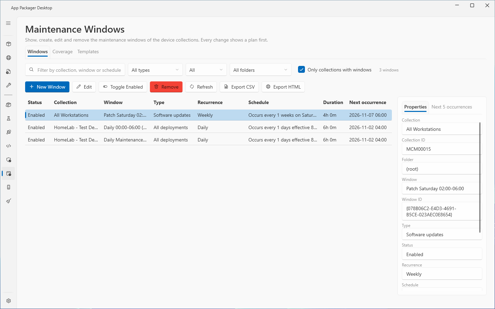
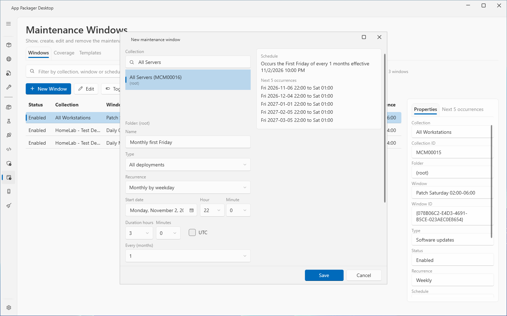
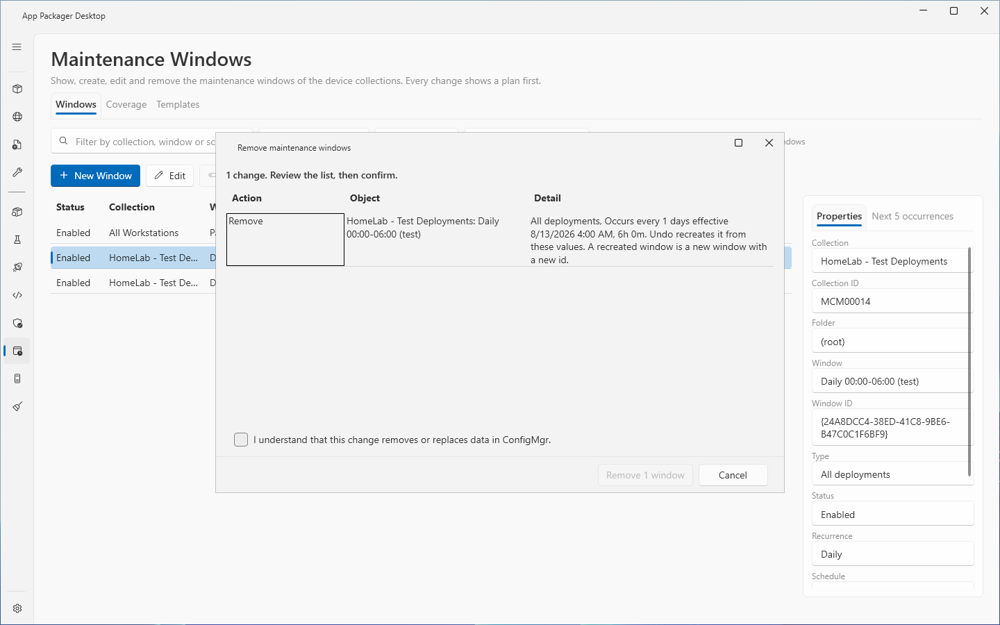
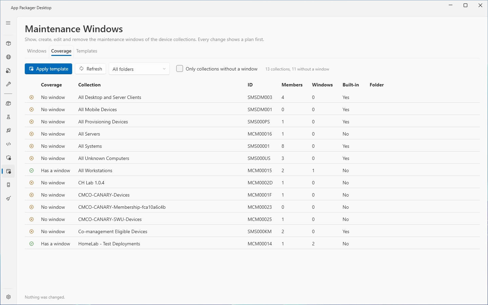
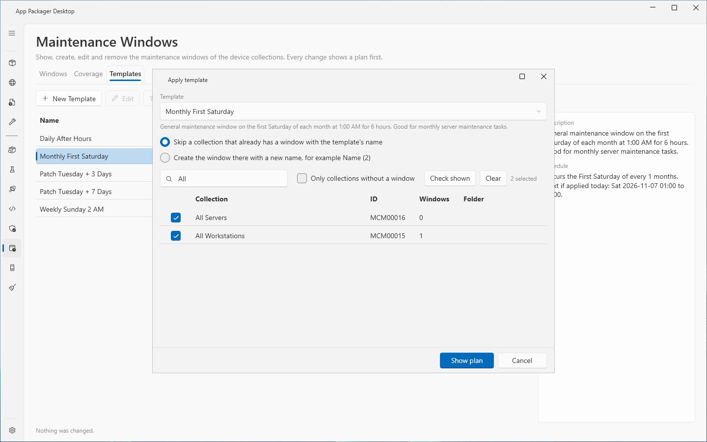
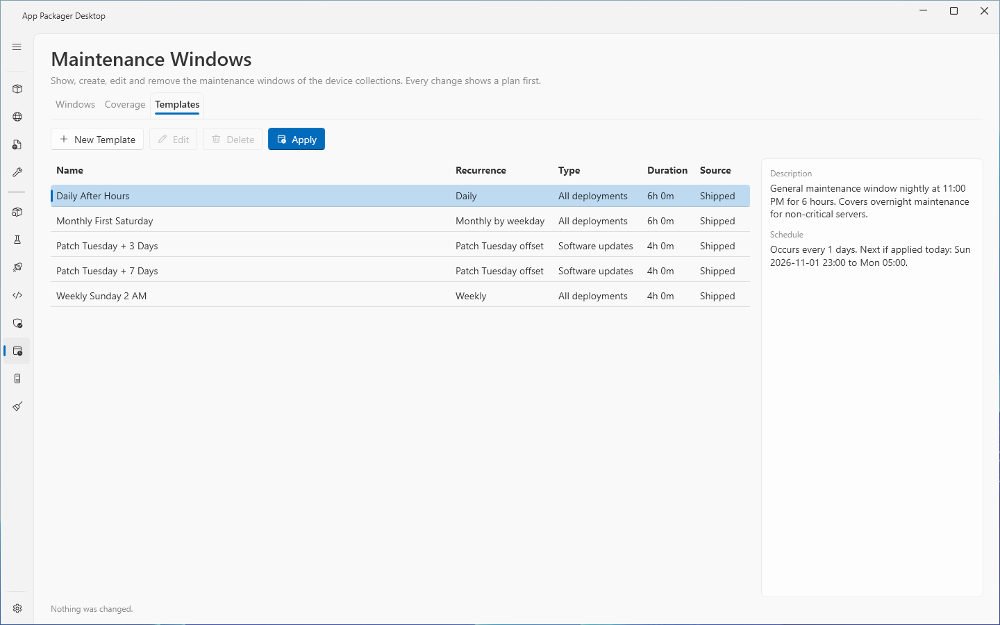

# Maintenance Windows

## What it does

The Maintenance Windows page shows, creates, edits, enables, disables and removes the maintenance windows of the ConfigMgr device collections. It also shows which collections have no window, and it creates windows from templates. Every change shows a plan first. Nothing changes until you read the plan and select the action button of the plan window.

## When to use it

- Use it to see all maintenance windows of the site in one list, with the next start time of each window.
- Use it to find device collections that have no maintenance window.
- Use it to give many collections the same window from a template.
- Use it to undo the last change you made on this page.

## Requirements

- ConfigMgr rights: a ConfigMgr security role with the Modify Collection Setting permission on the collection. A least-privilege role is not tested: all lab runs used a Full Administrator account.
- Local rights: the Windows account that started the app. The page uses the ConfigMgr console module on this computer through Windows PowerShell 5.1.
- Settings: select **ConfigMgr** under **Systems in use** in Settings. Enter **Site Code** and **Site Server / SMS Provider Host** under **ConfigMgr Site Settings** in Settings. If **ConfigMgr** is off or the site code is empty, the page shows a message and reads nothing.

## Steps

### Read the windows

1. Select **Maintenance Windows** in the sidebar. The page reads the collections and the windows by itself.
2. To read again, select **Refresh**. To stop a read, select **Cancel**.
3. To find a window, enter text in the filter box. The box filters by collection, window or schedule.
4. Select a window. The detail panel shows the tabs **Properties** and **Next 5 occurrences**.

### Create a window

1. On the **Windows** tab, select **New Window**.
2. In **Collection**, select one device collection. Use the filter box above the list if you need it.
3. In **Name**, enter the name of the window.
4. In **Description**, enter a description, if you need one.
5. In **Type**, select **All deployments**, **Software updates** or **Task sequences**.
6. In **Recurrence**, select the schedule kind. Fill the boxes that the editor shows for this kind (see [Schedule kinds](#schedule-kinds)).
7. Set **Start date**, **Hour** and **Minute**.
8. Set **Duration hours** and **Minutes**.
9. Select **UTC** if the window must start at the same moment on every client. Leave **UTC** off if the window follows the local time of each client.
10. Read the **Schedule** text and **Next 5 occurrences** in the editor.
11. Select **Save**. The plan window opens.
12. Read the plan. Select **Create window**.

The page creates the window enabled.

### Edit or rename a window

1. Select a window in the list.
2. Select **Edit**.
3. Change the values. To rename the window, change **Name**.
4. Select **Save**.
5. Read the plan. Select **Save changes** for an edit, or **Rename window** for a rename.

A rename creates the window with the new name first. The page removes the old window only after the new window exists. A renamed window has a new ID.

### Enable or disable windows

1. Select one or more windows. Use Shift or Ctrl to select several rows.
2. Select **Toggle Enabled**.
3. Read the plan. Select the action button, for example **Disable 2 windows**.

### Remove windows

1. Select one or more windows.
2. Select **Remove**.
3. Read the plan. The plan lists the exact windows.
4. Select the check box **I understand that this change removes or replaces data in ConfigMgr.**
5. Select the action button, for example **Remove 2 windows**.

### Undo the last change

1. Select **Undo last change** under the results.
2. Read the plan. An undo that removes or renames a window shows the same check box as a removal.
3. Select the action button, for example **Undo 1 change**.

Undo of a removal creates the window again with the same values and a new ID.

### Find collections without a window

1. Open the **Coverage** tab.
2. Select **Only collections without a window**.
3. Select one or more collections.
4. Select **Apply template**.

### Apply a template

1. Open the **Templates** tab, or open the **Coverage** tab and select collections.
2. Select a template and select **Apply**. On the **Coverage** tab, select **Apply template**.
3. In the **Apply template** dialog, select the **Template**.
4. Select what happens when a collection already has a window with the template name: **Skip a collection that already has a window with the template's name**, or **Create the window there with a new name, for example Name (2)**.
5. Select the collections. **Check shown** selects every collection that the filter shows. **Clear** clears every selection.
6. Select **Show plan**.
7. Read the plan. A skipped collection shows the action **Skip**.
8. Select the action button, for example **Create 2 windows**.

The page gives the new windows the effective date of today and enables them.

### Create, change or delete your own template

1. On the **Templates** tab, select **New Template**, or select a template and select **Edit**.
2. Fill the editor and select **Save template**.
3. To delete a template, select it and select **Delete**.

### Export a report

1. Select **Export CSV** or **Export HTML** on the **Windows** tab.
2. Read the path in the status line.

## Options and settings of this page

### Windows tab

| Control | Effect |
|---|---|
| Filter box | Filters by collection, window or schedule text. |
| **Type** | **All types**, **All deployments**, **Software updates**, **Task sequences**. |
| **Status** | **All**, **Enabled**, **Disabled**. |
| **Folder** | **All folders** or one collection folder. |
| **Only collections with windows** | Hides the collections that have no window. The default is on. |
| **New Window**, **Edit**, **Toggle Enabled**, **Remove** | Change windows through a plan. |
| **Refresh**, **Cancel** | Read again, stop the read. |
| **Export CSV**, **Export HTML** | Write a report of the shown windows. |

Grid columns: **Status**, **Collection**, **Window**, **Type**, **Recurrence**, **Schedule**, **Duration**, **Next occurrence**. The **Properties** tab also shows **Collection ID**, **Folder**, **Window ID**, **Start**, **Time** (UTC or local time of the client) and the description of the window, when a person wrote one.

### Schedule kinds

| Recurrence | Boxes | Range |
|---|---|---|
| One time | Start date, Hour, Minute | none |
| Daily | **Every (days)** | 1 to 31 |
| Weekly | **Every (weeks)**, **Day** | 1 to 4 weeks |
| Monthly by date | **Every (months)**, **Day of the month** | 1 to 12 months. The list has 1 to 31 and **Last day**. A month without that day has no occurrence. |
| Monthly by weekday | **Every (months)**, **Week of the month**, **Day**, **Days after that weekday** | **First**, **Second**, **Third**, **Fourth**, **Last**. Offset 0 to 7 days. |
| Patch Tuesday offset | **Every (months)**, **Days after Patch Tuesday (the second Tuesday)** | Offset -7 to 21 days. |

- The duration is 1 minute to 24 hours. The start date is in the years 1970 to 2033.
- The editor does not offer an end date. ConfigMgr stores no end date. The window recurs until you remove or disable it.

### Coverage tab

- Filter by folder. **Only collections without a window** shows the gaps.
- Columns: **Coverage** (**Has a window** or **No window**), **Collection**, **ID**, **Members**, **Windows**, **Built-in**, **Folder**.
- **Apply template** applies a template to the selected collections. The dialog does not offer built-in collections.

### Templates tab

- Columns: **Name**, **Recurrence**, **Type**, **Duration**, **Source**. The detail panel shows **Description** and **Schedule**.
- **New Template**, **Edit** and **Delete** change your own templates only. A shipped template cannot be changed or deleted.
- Five templates ship with the app:

| Template | Schedule |
|---|---|
| Daily After Hours | Every day at 23:00 for 6 hours. All deployments. |
| Monthly First Saturday | First Saturday of each month at 01:00 for 6 hours. All deployments. |
| Patch Tuesday + 3 Days | 3 days after Patch Tuesday at 02:00 for 4 hours. Software updates. |
| Patch Tuesday + 7 Days | 7 days after Patch Tuesday at 02:00 for 4 hours. Software updates. |
| Weekly Sunday 2 AM | Every Sunday at 02:00 for 4 hours. All deployments. |

### Plan window

- A plan lists the action, the object and the detail of each change.
- A plan for a removal shows a check box. Select the check box before you select the action button.
- During a run, **Cancel** stops the run after the current change. The changes already made stay. **Undo** reverses them.
- A change whose window another person changed after the plan was shown is skipped, and the result says so.

### Saved choices and files

- The page saves the selected tab, the filters and the editor size for the current Windows user in `settings.json`, key `MaintenanceWindows`.
- Your templates are `*.json` files in `%LOCALAPPDATA%\AppPackager\MaintenanceWindows\Templates`. Reports are in `...\MaintenanceWindows\Reports`.
- The page refuses a folder or a template file that is a junction or a symbolic link.
- Each completed run adds one line to the operation history. The line holds counts and no window names.

## Limits

- The page reads each schedule from the stored ConfigMgr schedule. A window with a schedule that the page cannot hold (for example an hourly interval, or several schedules in one window) is read-only. You can enable or disable it. You cannot edit, rename or remove it. Use the ConfigMgr console for it.
- A window with a duration over 24 hours, a weekly interval of 5 to 7 or a monthly interval of 13 to 15 is also read-only.
- A window that has its own description is refused for an edit, a rename or a removal when the ConfigMgr PowerShell module on this computer cannot write a window description. The message names the reason.
- ConfigMgr has no conditional write. The page checks the window again right before it writes, but a change made in the short time between the check and the write can be lost.
- Undo of a removal creates a new window with a new ID.
- If a rename creates the new window and the removal of the old window fails, both windows exist. The message says so. Select the old window and select **Remove**.
- The page lists device collections only.
- The page creates enabled windows only. Use **Toggle Enabled** to disable a window afterward.
- The page does not offer an end date, an hourly interval or several schedules in one window.

## Troubleshooting

| Message | Cause | Fix |
|---|---|---|
| ConfigMgr is not in use. Select it under Systems in use in Settings. | **ConfigMgr** is off in Settings. | Select **ConfigMgr** under **Systems in use**. |
| Set the site code in Settings, ConfigMgr Site Settings. | **Site Code** is empty. | Enter the site code. |
| The maintenance windows could not be read. The log has the details. | The read failed. | Check the site settings and the console on this computer, then select **Refresh**. |
| The account needs a ConfigMgr security role with the Modify Collection Setting permission on the collection. | ConfigMgr denied the change. | Give the account a role with this permission. |
| Refresh the list first. | The page has no data. | Select **Refresh**. |
| Nothing was changed. | You closed the plan without confirming. | Start the action again. |
| Enter a name. / Select a collection. / Select a start date. | The editor misses an input. | Fill the input. |
| The duration must be between 1 minute and 24 hours. | The duration is out of range. | Change the duration. |
| The collection … already has a window named …. | The name exists on the collection. | Use another name. |
| Collection … has more than one window named …, so the window to change is not certain. | Two windows have one name. | Refresh the list and select the window again. |
| ConfigMgr stores a schedule for this window that this page cannot show … | The window is read-only on this page. | Use the ConfigMgr console. |
| The window … on … changed after the plan was shown, so it was not changed. | Another person changed the window. | Refresh the list and try again. |
| Both windows exist on …: … was created, … was not removed. | A rename created the new window and the old window stayed. | Select the old window and select **Remove**. |
| ConfigMgr stores no end date for a maintenance window. Remove the end date. | A schedule has an end date. | Remove the end date. |
| The Maintenance Windows templates folder is a junction or symbolic link. The template was not saved or deleted. | The `Templates` folder is a link. | Replace the link with a normal folder. |
| Every selected collection already has a window named …. Nothing to change. | Every collection is skipped. | Select the option that creates a window with a new name, or select other collections. |

## Links

- [How to use maintenance windows in Configuration Manager](https://learn.microsoft.com/intune/configmgr/core/clients/manage/collections/use-maintenance-windows): Explains maintenance windows on device collections.
- [Service windows for site servers](https://learn.microsoft.com/intune/configmgr/core/servers/manage/service-windows): Explains service windows, which apply to site servers.
- [Introduction to collections in Configuration Manager](https://learn.microsoft.com/intune/configmgr/core/clients/manage/collections/introduction-to-collections): Explains the built-in and the custom collections.
