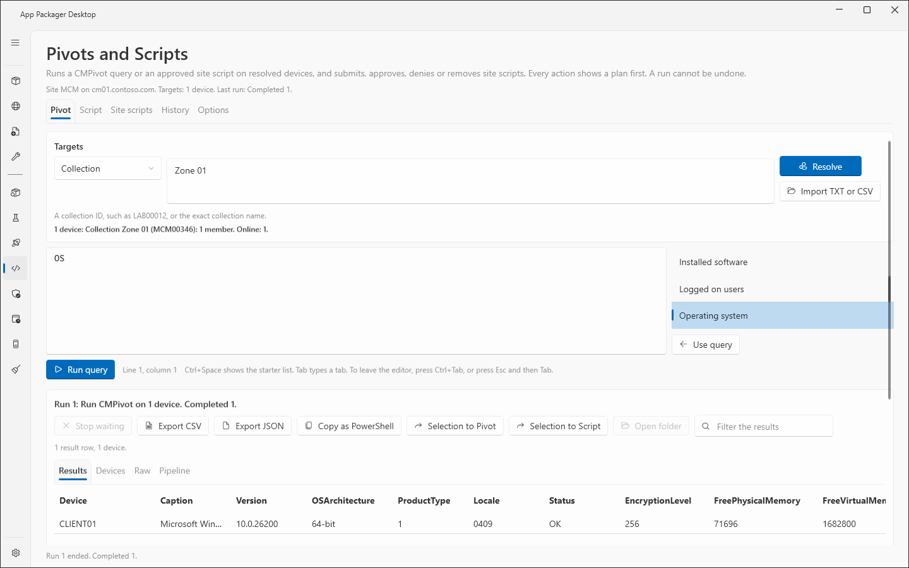
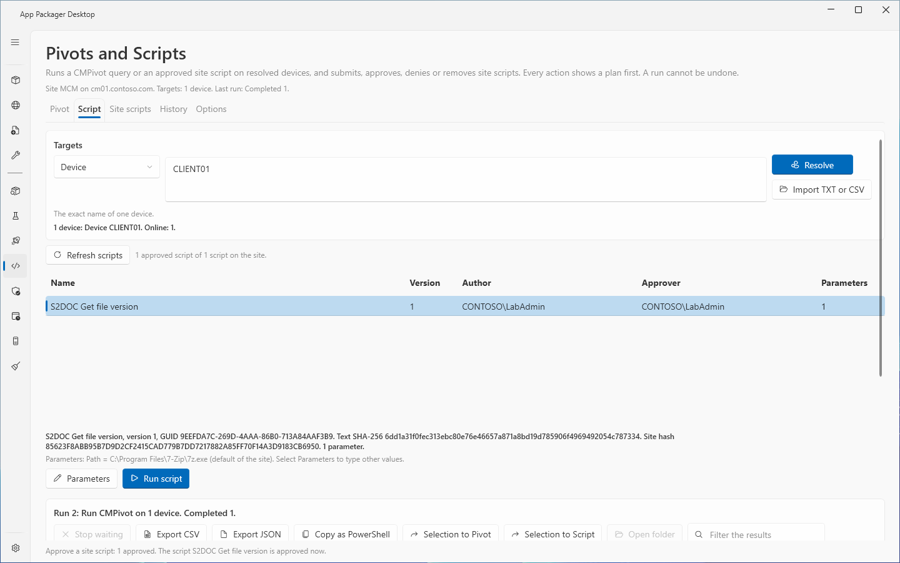
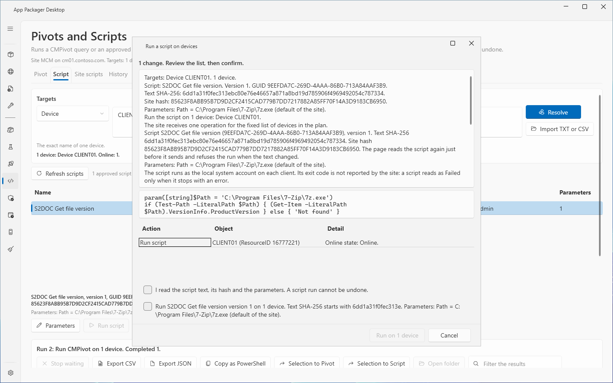
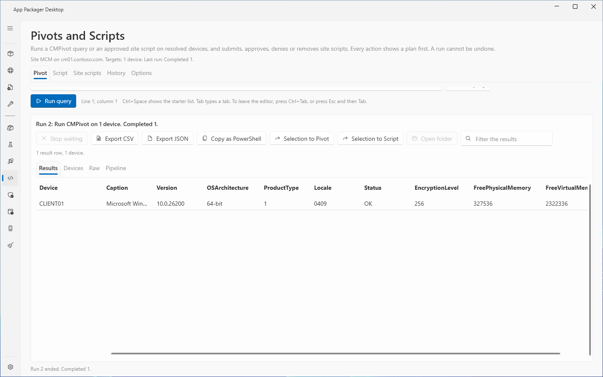

# Pivots and Scripts: run a query or a script on devices

## What it does

The **Pivots and Scripts** page runs a CMPivot query or an approved ConfigMgr script on client devices. It shows what each device returns. Every run shows a plan first. A run cannot be undone, because the clients run the code.

This page describes the **Pivot** tab, the **Script** tab, the targets and the results. The **Site scripts**, **History** and **Options** tabs are in [Pivots and Scripts: site scripts, history and options](pivots-site-scripts.md).

## When to use it

- You must read data from many devices now, for example the operating system, services or installed software. Use the **Pivot** tab.
- You must run a script that the site has approved. Use the **Script** tab.
- You must keep a record of who ran what, on which devices. The page writes an audit log for every run.

Do not use the page to run code on a device that has no ConfigMgr client. The run skips such a device.

## Requirements

| Item | Requirement |
|---|---|
| Settings | In Settings, under **Systems in use**, select **ConfigMgr**. Set **Site Code**. Set **Site Server / SMS Provider Host**. |
| Provider name | Enter the full name of the SMS Provider, the name that its certificate carries. |
| Certificate | The computer must trust the certificate of the SMS Provider. |
| Console | The ConfigMgr console must be installed on the computer. |
| ConfigMgr rights, query | Run CMPivot on the collection, and Read on Inventory Reports. |
| ConfigMgr rights, script | Run Script on the collection. For the actions of the **Site scripts** tab: Create, Approve or Delete on SMS Scripts. |
| Client settings | CMPivot and Run Scripts must be enabled on the clients. |

The rights are the texts that the page shows when the site refuses a call. The lab runs used a Full Administrator account. The page was not tested with a custom security role. The page makes no network call except to the SMS Provider.

## Steps: run a CMPivot query

1. Select **Pivots and Scripts** in the sidebar. Select the **Pivot** tab.
2. In **Targets**, select the target kind from the list: **Collection**, **Device**, **Wildcard pattern** or **List of names**.
3. Type the target in the box next to the list. For a collection, type the collection ID, for example `LAB00012`, or the exact collection name. For a device, type the exact device name. For a pattern, type a name with `*`, for example `WKS-*`. For a list, type one device name on each line.
4. To load a list from a file, select **Import TXT or CSV**. Select the file. The page sets the kind to **List of names**.
5. Select **Resolve**. The page reads the devices of the target with one bulk read.
6. Read the result line under the box. It shows the number of devices, how many are online, the names that match no device, and the number of devices without a ConfigMgr client.
7. Type the query in the query editor. To start from a sample, select a query in the **Query library** list and select **Use query**.
8. Select **Run query**. The page reads the targets again and opens the plan window.
9. Read the plan. The plan lists each device, the query text, and the checks.
10. Select the confirm button. Its text is **Run on** and the device count, for example **Run on 2 devices**. A query run has no confirmation box, unless the target reaches every device of the site (see [Confirmation boxes](#confirmation-boxes)).
11. Wait for the results. The page shows how many devices answered. Select **Stop waiting** to end the wait on the page.

## Steps: run an approved script

1. Select the **Script** tab. Resolve the targets as in steps 2 to 6 above.
2. Select **Refresh scripts** if the list is old. The list shows the approved scripts of the site.
3. Select a script in the list. The page reads the script text and its parameter definitions. The detail line shows the name, the version, the GUID, the two hashes and the number of parameters.
4. If the script has parameters, select **Parameters**. Type a value for each parameter. Select **OK**.
5. Select **Run script**. The page reads the script and the targets again and opens the plan window.
6. Read the script text, the hashes and the parameter values in the plan.
7. Select both confirmation boxes. Select the confirm button. Its text is **Run on** and the device count.
8. Wait for the results, as for a query.

## Confirmation boxes

| Run | Boxes in the plan window |
|---|---|
| Query | None. |
| Script | Two boxes. The first box reads: "I read the script text, its hash and the parameters. A script run cannot be undone." The second box names the script, its version, the device count, the start of the text hash and the parameter values. |
| Query or script, target reaches every device of the site | One more box: "This runs on every device of the site", followed by the target. |

A target reaches every device of the site when it is a built-in collection (an ID that starts with `SMS`) or when it holds every client of the site, for example the pattern `*`. The page shows a warning under **Resolve** for such a target. The service enforces the boxes. A run without them is refused.

The confirm button stays disabled until every box is selected.

## Results

After a run, the result area shows a headline, a progress line, and four tabs.

| Tab | Content |
|---|---|
| **Results** | One row for each result row of a device. The columns follow the query. |
| **Devices** | One row for each device. Columns: **Device**, **ResourceID**, **State**, **Online**, **Output**, **Message**. |
| **Raw** | The requests and the raw responses, with the HTTP status. |
| **Pipeline** | One row for each run of this page session. Columns: **Run**, **Action**, **Started**, **Targets**, **State**, **Results**. |

A device that did not answer shows as **No response** or **Timed out**. It never shows as a result.

The device states are **Sent**, **Running**, **Completed**, **Failed**, **Timed out**, **No response** and **Skipped**.

| Button | Effect |
|---|---|
| **Stop waiting** | Ends the wait on the page only. Clients that received the request still run it. |
| **Export CSV** | Saves the rows that the filter of the active tab shows. The notes go to a separate `.about.txt` file. |
| **Export JSON** | Saves the same rows as JSON. |
| **Copy as PowerShell** | Copies the shown rows as a PowerShell expression that gives them back as objects. |
| **Selection to Pivot** | Sets the devices of the selected rows as the targets of the **Pivot** tab. Resolve again before a run. |
| **Selection to Script** | Sets the devices of the selected rows as the targets of the **Script** tab. Resolve again before a run. |
| **Open folder** | Opens the folder of the last report. |
| **Filter the results** | A text box. It filters the rows of the active tab. |

Export works on the **Results**, **Devices** and **Pipeline** tabs. The **Raw** tab has no export. If no device answered, **Export CSV** and **Export JSON** on **Results** write no file. The status line says so.

## Options and settings of this page

The page saves these choices in `settings.json` under the key `PivotsScripts`: the selected tab, the selected result tab, the target kind, the library folder and the wait time. The page does not save the target text, the query text or parameter values.

The library folder and the wait time are set on the **Options** tab. See [Pivots and Scripts: site scripts, history and options](pivots-site-scripts.md#options).

Keyboard rules in the editors:

- **Ctrl+Space** shows the starter list at the caret.
- **Tab** types a tab character.
- **Ctrl+Tab** leaves the editor. **Esc** and then **Tab** also leaves the editor.

## Limits

- A run cannot be undone. A script that you stop waiting for still runs on the clients that received it.
- One run takes at most 2,000 client devices. The service refuses a larger plan when it prepares the plan and when it sends. The limit is a set limit. It is not a measured limit. The lab had four clients.
- A plan is valid for 30 minutes. A plan runs once. Then you prepare the plan again.
- A target read keeps at most 100,000 devices. A list target takes at most 50,000 names. A query has at most 16,384 characters. A parameter value has at most 1,024 characters.
- The page sends the run to the fixed list of devices that the plan shows. A device that joins a collection after the plan does not receive the code. If the collection has more members than the plan counted, the service refuses the run.
- The script is pinned to its hash. The client runs the planned text, or it returns no result. If the script changed during the send, the run shows **Partial** and the message says so.
- A script that ends with `exit 3` reads as a success, because ConfigMgr reports exit code 0 for it. Only a script that stops with an error reads as failed. Every script plan says this.
- The page does not cancel a send that has started.
- The page writes the session and a **Started** audit record before it sends. If either cannot be written, the page sends nothing. Each run ends with one **Finished** record. A run that the service refuses writes a **Refused** record.
- The session file holds the targets, the query or the script identity and hash, the parameter names and the raw responses. It holds no parameter value and no script text. The application log holds no script text, no query text and no parameter value.
- The audit chain finds edits to single records. A process that runs under the same account can write a new chain without a break.
- The lab (CM01, CLIENT01) ran queries and scripts on up to three devices. Larger runs are not tested.
- Lab reports: `PS-QUALIFICATION`, `PS-LAB-REPORT` to `PS-LAB4-REPORT`.

## Troubleshooting

| Message | Cause | Fix |
|---|---|---|
| ConfigMgr is not in use. Select it under Systems in use in Settings. | **ConfigMgr** is off in Settings. | Select **ConfigMgr** under **Systems in use**. |
| Set the site code in Settings, ConfigMgr Site Settings. | **Site Code** is empty. | Enter the site code. |
| Set the SMS Provider in Settings, ConfigMgr Site Settings. | **Site Server / SMS Provider Host** is empty. | Enter the provider name. |
| Select Resolve first. A run goes only to resolved targets. | The target text or kind changed after the last **Resolve**. | Select **Resolve**. |
| Type a collection, a device, a pattern or a list of names first. | The target box is empty. | Type a target. |
| The targets resolve to no device. Nothing can be sent. | No device matches, or no match has a ConfigMgr client. | Check the target. |
| Type a CMPivot query first. | The query editor is empty. | Type a query. |
| The script has a required parameter without a value. Select Parameters first. | A required parameter has no value. | Select **Parameters** and type the value. |
| The site parameter definitions of the script could not be read, so the script cannot run from this page. | The read of the definitions failed. | Select **Refresh scripts**. Select the script again. |
| The form changed while the script and the targets were read again. Nothing was sent. Start the action again. | You changed the form while the page prepared the plan. | Start the action again. |
| The page still waits for the results of the last run. | A wait runs. | Select **Stop waiting**, or wait until the wait ends. |
| The SMS Provider certificate does not carry the name (name). | The provider name in Settings is not the name in the certificate. | Enter the full name of the provider. |
| This computer does not trust the SMS Provider certificate. | The certificate chain is not trusted. | Trust the root of the certificate, or bind a PKI certificate to the administration service. |
| The administration service returned more data than the page reads. Narrow the query. | The response is larger than 64 MB. | Narrow the query. |
| the plan was used already | A plan runs once. | Prepare the plan again. |
| the plan is older than 30 minutes | The plan is too old. Nothing was sent. | Prepare the plan again. |
| Skipped: the script text on the site changed after the plan was made | Someone changed the script after the plan. Nothing was sent. | Prepare the plan again. |
| Skipped: the collection (ID) has 1 device that the plan does not hold | The collection grew after the plan. | Resolve and prepare the plan again. |

## Links

- [CMPivot for real-time data in Configuration Manager](https://learn.microsoft.com/intune/configmgr/core/servers/manage/cmpivot): Explains CMPivot, its permissions and its limits.
- [CMPivot overview](https://learn.microsoft.com/intune/configmgr/core/servers/manage/cmpivot-overview): Introduces the CMPivot entities and queries.
- [Create and run PowerShell scripts from the Configuration Manager console](https://learn.microsoft.com/intune/configmgr/apps/deploy-use/create-deploy-scripts): Explains script authors, approvers and runners, and how to run a script on a collection.
- [What is the administration service in Configuration Manager?](https://learn.microsoft.com/intune/configmgr/develop/adminservice/overview): Explains the administration service, the REST API of the SMS Provider.
- [Learn more about PowerShell script security](https://learn.microsoft.com/intune/configmgr/apps/deploy-use/learn-script-security): Explains the risks of PowerShell scripts and script parameters.
- [Troubleshoot CMPivot](https://learn.microsoft.com/intune/configmgr/core/servers/manage/cmpivot-tsg): Lists log files and fixes for CMPivot problems.
