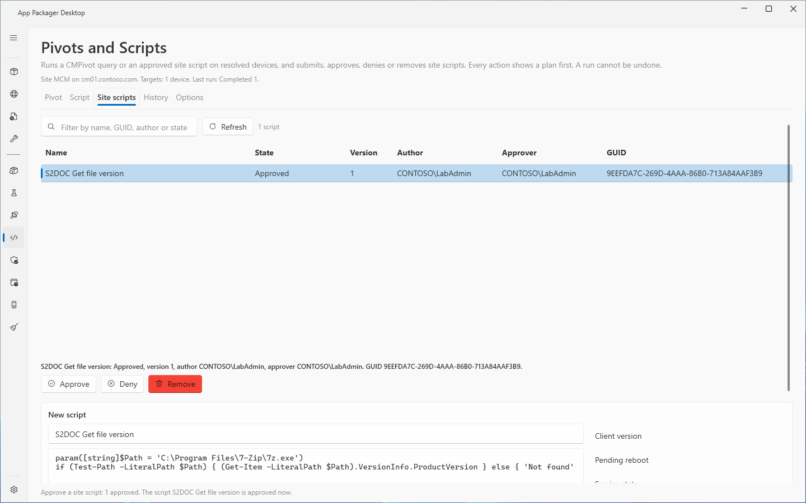
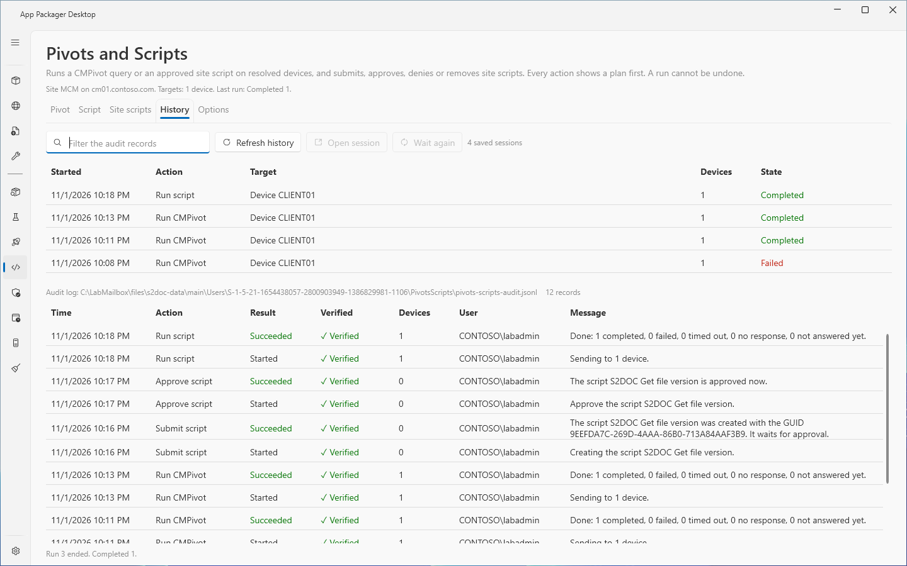
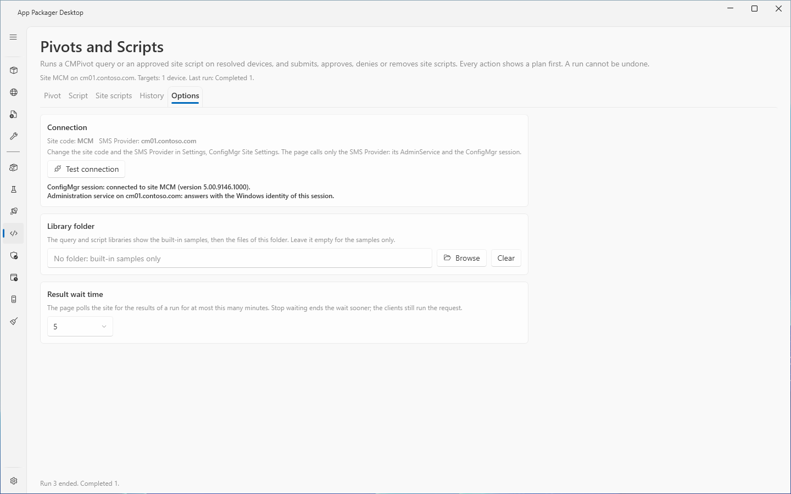

# Pivots and Scripts: site scripts, history and options

## What it does

This page describes three tabs of the **Pivots and Scripts** page.

- **Site scripts** lists the scripts on the site. You can check, submit, approve, deny and remove scripts.
- **History** lists the saved runs and the audit log. It opens a saved run again and reads its results again.
- **Options** tests the connection, sets a library folder and sets the wait time for results.

The **Pivot** and **Script** tabs and the results are in [Pivots and Scripts: run a query or a script on devices](pivots-and-scripts.md).

## When to use it

- You must add a script to the site so that an administrator can approve it.
- You must approve, decline or remove a script of the site.
- You must see who ran what, or read the results of an earlier run again.
- You must check that the page reaches the SMS Provider.

## Requirements

The requirements of the page are in [Pivots and Scripts: run a query or a script on devices](pivots-and-scripts.md#requirements). For the actions of the **Site scripts** tab, the account needs Create, Approve or Delete on SMS Scripts. The site refuses an action without the right, and the page shows the right that is missing.

The lab runs used a Full Administrator account. The page was not tested with a custom security role. **History** and the library need no connection to the site.

## Steps: submit a new script

1. Select the **Site scripts** tab.
2. In **New script**, type a name in the **Script name** box. The name has at most 200 characters.
3. Type the script text in the editor. To start from a sample, select a script in the **Script library** list and select **Use script**. If the name box is empty, the page fills it with the name of the sample.
4. Select **Check**. The page checks the syntax of the text. It does not run the script. The result line shows the syntax errors, or the parameters that the site will store.
5. Select **Submit**. The page opens the plan window.
6. Read the plan. It shows the script text and the parameter definitions that the site will store.
7. Select the confirm button. The site stores the script with the state **Waiting for approval**. The script cannot run until an administrator approves it.

If the site creates the script and a later step fails, a message shows the GUID of the script and a banner appears. Select **Remove created script** to remove only that script.

## Steps: approve, deny or remove a script

1. Select the **Site scripts** tab. Select **Refresh** if the list is old.
2. Select a script in the grid. The line under the grid shows its name, state, version, author, approver and GUID.
3. Select **Approve**, **Deny** or **Remove**.
4. For **Deny**, type the reason in the comment window and select **OK**. The site stores the comment with the script. Select **Cancel** to stop.
5. Read the plan. The plan shows the script text, the text hash and the site hash.
6. For **Remove**, select both confirmation boxes. The second box reads "Remove (name). Its run history goes with it."
7. Select the confirm button.

The page never approves a script by itself. The site setting "Script authors require additional script approver" decides whether the author of a script can approve it. The page reads this setting. It does not change it. If the setting is on and you are the author, the plan warns you, and the site refuses the decision. Another administrator with Approve on SMS Scripts must decide.

An approved script can run on clients from this page and from the console. A declined script cannot run. A declined script can be approved later.

## History

The **History** tab has two lists.

1. Select the **History** tab. The page reads the saved runs and the audit log from this computer. It makes no call to the site.
2. To filter the audit records, type text in the **Filter the audit records** box.
3. To read the files again, select **Refresh history**.
4. To open a saved run, select a row in the first list and select **Open session**. The page shows the run in the result tabs. The view is read only.
5. To read the results of a saved run again, select the row and select **Wait again**. The page reads the results for the wait time. It sends nothing to the clients. This also works after you restart the app.
6. To see the details of an audit record, select the record. The details show the verification, the target, the script GUID and hash, and the message.

| List | Columns |
|---|---|
| Saved sessions | **Started**, **Action**, **Target**, **Devices**, **State** |
| Audit records | **Time**, **Action**, **Result**, **Verified**, **Devices**, **User**, **Message** |

The audit log is a hash chain. The **Verified** column shows **Verified** or **Not verified** for each record. **Not verified** means that someone changed or added the record outside the page, or that the record was written before the chain. The details text then names the line where the chain breaks.

Each run has a **Started** record and one **Finished** record. If you close the app while the page waits for results, the page writes the **Finished** record with the result **Partial**. The clients still run the request. The session state reads **App closed, results not read**. Select **Wait again** to read the results.

## Options

Select the **Options** tab.

| Section | Control | Effect |
|---|---|---|
| **Connection** | **Test connection** | Asks the SMS Provider for its administration service. The result line says whether the session connected and whether the service answers with your Windows identity. |
| **Library folder** | Folder box, **Browse**, **Clear** | The query and script libraries show the built-in samples, then the files of this folder. Leave the box empty for the samples only. The default is no folder. |
| **Result wait time** | List | The time in minutes that the page reads the results of a run. The list offers 1, 2, 5, 10, 15, 30 and 60. The default is 5. |

The **Connection** section shows the site code and the provider. To change them, use Settings, **ConfigMgr Site Settings**.

**Stop waiting** ends the wait sooner. The clients still run the request.

### Library files

The built-in library has 7 sample queries and 4 sample scripts. A file in the library folder is a library item. A library file has at most 256 KB. The page reads at most 500 files of the folder.

## Files that the page writes

All files are in the data folder, `%LOCALAPPDATA%\AppPackager\PivotsScripts`.

| File or folder | Content |
|---|---|
| `pivots-scripts-audit.jsonl` | The audit log, a hash chain. |
| `Sessions\` | The saved runs. A session holds targets, the query or the script identity and hash, the parameter names and the raw responses. It holds no parameter value and no script text. |
| `Reports\` | The CSV and JSON exports. Each CSV has a `.about.txt` file with the view, the time, the row count and the filter. |

## Limits

- A removal cannot be undone. The run history of the script goes with it.
- The provider checks only that the script is approved when it receives the call. If an administrator changes the text and approves it again before the call, the client still runs the planned text or returns no result. A change between the last read and the call is reported after the send. The page does not prevent it. An approval or a denial that races with an edit shows **Partial**. The page does not undo it.
- The list read of the site holds no script text and no parameter definitions. The page reads them when you select a script. The **Parameters** column shows **Not read** until then.
- **Check** finds syntax errors only. It also refuses parameters of the types switch and bool, more than 10 parameters, and a default value with a single quote, because the site cannot store them.
- The page refuses parameter values with a single quote or a double quote, and values over 1,024 characters, because the site drops them or breaks on them.
- A script text has at most 262,144 characters.
- **History** shows the newest 2,000 audit records and the newest 500 saved sessions. Older records stay in the files.
- The audit chain finds edits to single records. A process that runs under the same account can write a new chain without a break.
- The wait time list offers 1 to 60 minutes. The service accepts 30 seconds to 60 minutes. The page offers no value below 1 minute.
- Lab reports: `PS-QUALIFICATION`, `PS-LAB-REPORT` to `PS-LAB4-REPORT`. The lab had four clients.

## Troubleshooting

| Message | Cause | Fix |
|---|---|---|
| Select a site script first. | No row is selected. | Select a row. |
| The script is already approved. | You selected **Approve** for an approved script. | None. |
| The script is already declined. | You selected **Deny** for a declined script. | None. |
| Type a name for the new script first. | **Script name** is empty. | Type a name. |
| Type or load the script text first. | The editor is empty. | Type a text, or select **Use script**. |
| The script name has more than 200 characters. | The name is too long. | Shorten the name. |
| The site refused to let the author approve the script. | The site setting "Script authors require additional script approver" is on. | Ask another administrator with Approve on SMS Scripts. |
| The site created the script (name), but a later step failed | **Submit** created the script and the step that stores the parameter definitions failed. | Select **Remove created script**. |
| The saved session holds no result. | The run was saved before it was sent and has no response. | None. |
| The saved session could not be read. The file is gone or damaged. | The session file is missing or damaged. | None. |
| The Pivots and Scripts audit log cannot be written | The audit file or its folder is read only or denies access. The page sends nothing. | Fix the permissions of the `PivotsScripts` folder. |
| The audit log could not be read. The log has the details. | The page could not read the audit file. | Check the file and select **Refresh history**. |
| Not verified (chain broken at line N) | The record, or an earlier record, changed outside the page. | Compare the file with a backup. |

## Links

- [Create and run PowerShell scripts from the Configuration Manager console](https://learn.microsoft.com/intune/configmgr/apps/deploy-use/create-deploy-scripts): Explains script authors, approvers and runners, and how to run a script on a collection.
- [Learn more about PowerShell script security](https://learn.microsoft.com/intune/configmgr/apps/deploy-use/learn-script-security): Explains the risks of PowerShell scripts and script parameters.
- [Fundamentals of role-based administration for Configuration Manager](https://learn.microsoft.com/intune/configmgr/core/understand/fundamentals-of-role-based-administration): Explains security roles, security scopes and collections for administrative users.
- [How to use the administration service in Configuration Manager](https://learn.microsoft.com/intune/configmgr/develop/adminservice/usage): Shows how to call the administration service.
