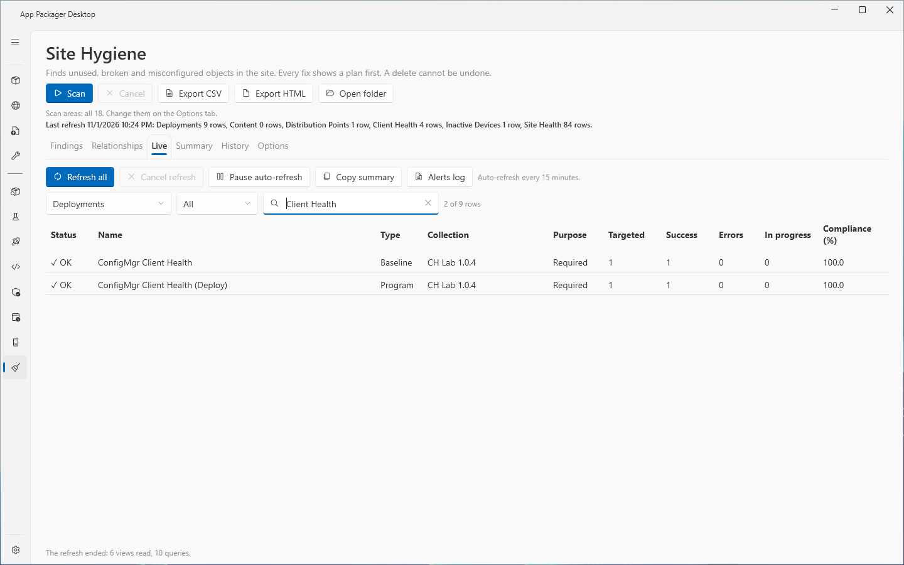
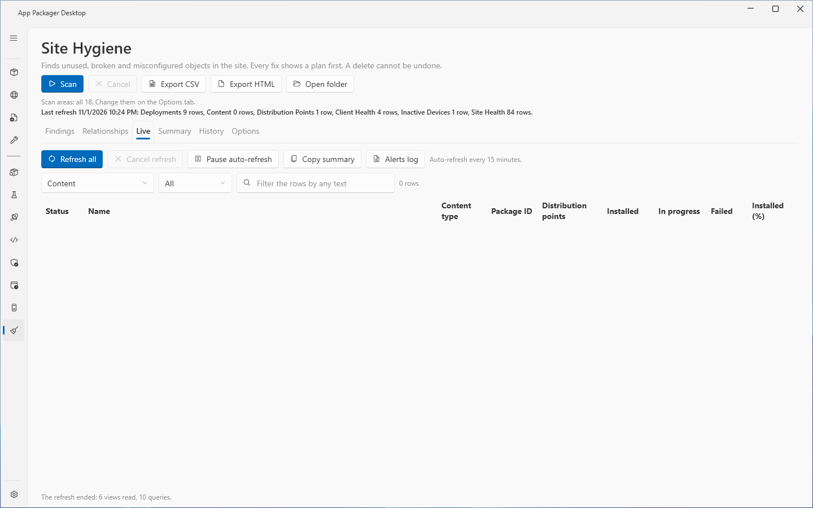
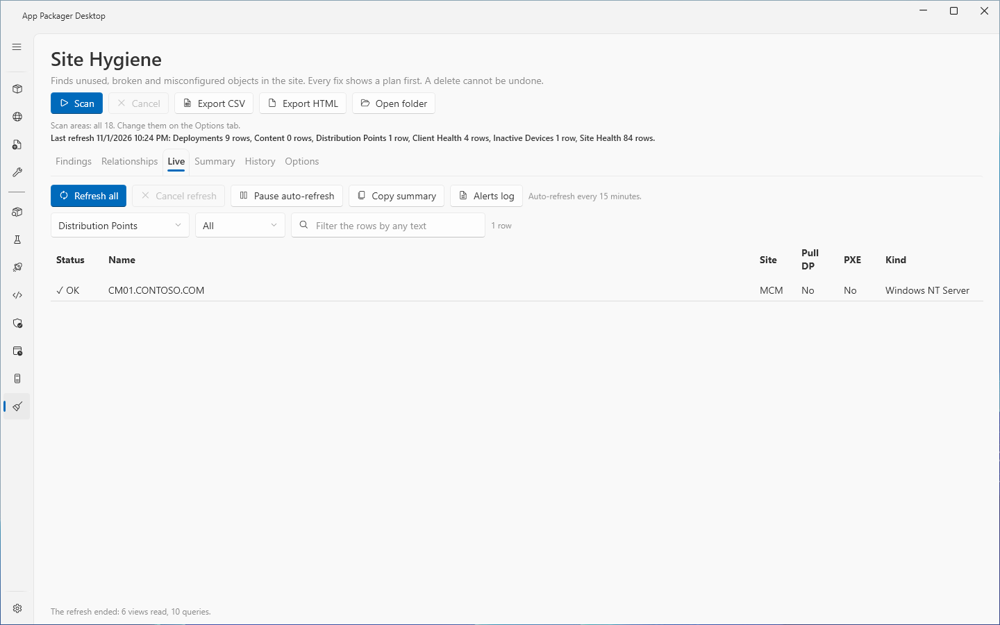
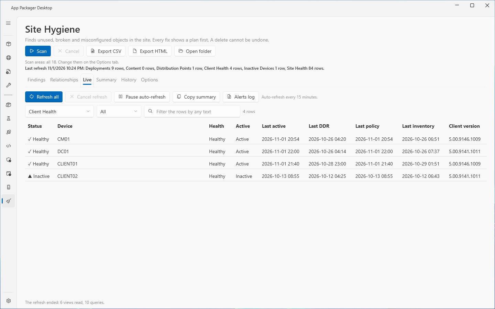
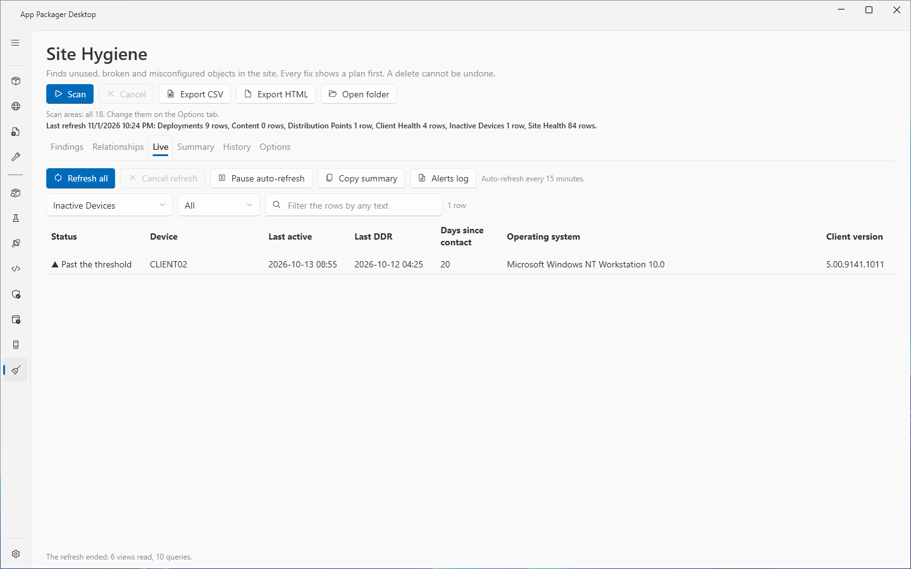
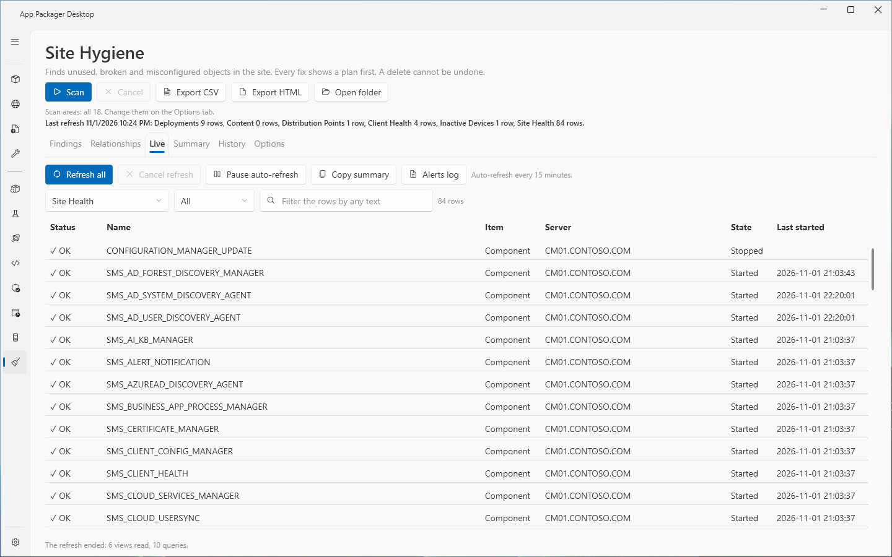
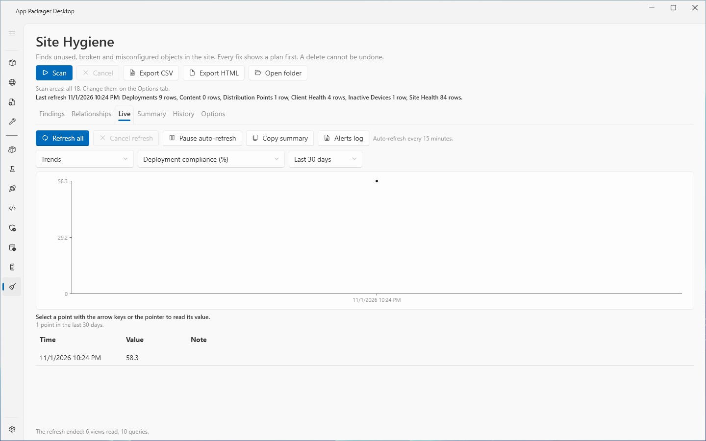
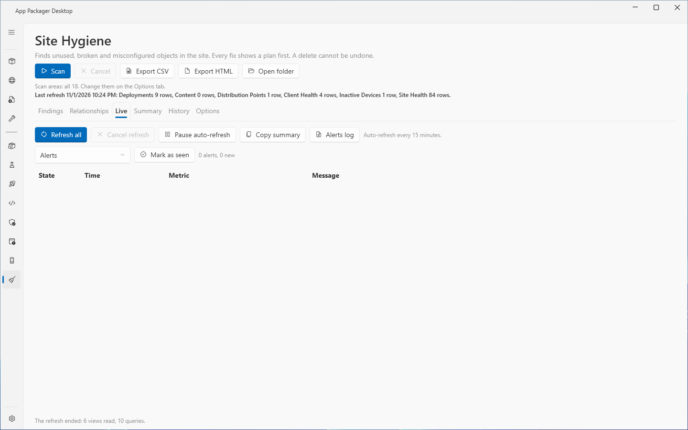
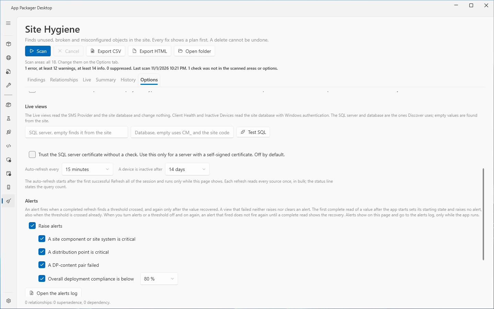
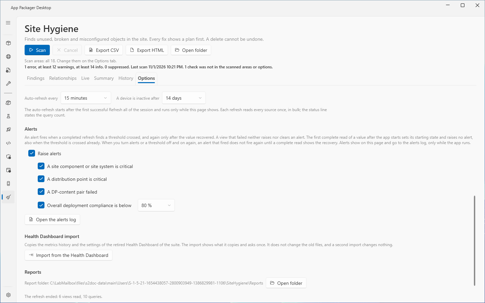

# Site Hygiene: live views, trends and alerts

## What it does

The **Live** tab of the **Site Hygiene** page reads current data from the site and shows six views: Deployments, Content, Distribution Points, Client Health, Inactive Devices and Site Health. It also draws **Trends** from a metrics history that each refresh extends, and raises **Alerts** when a value crosses a threshold. The Live views change nothing on the site.

The scan, the findings and the fixes are in [Site Hygiene: scan the site and fix findings](site-hygiene.md).

## When to use it

- You want a current view of deployment compliance, failed content on distribution points, client health and site component state.
- You want to see how a value changed over days. Use **Trends**.
- You want a message in the app when a critical state starts. Use **Alerts**.
- You want to move the data and the settings of the retired Health Dashboard into this page.

## Requirements

| Item | Requirement |
|---|---|
| Settings | In Settings, under **Systems in use**, select **ConfigMgr**. Set **Site Code**. |
| SMS Provider | **Deployments**, **Content**, **Distribution Points** and **Site Health** read through the SMS Provider. They need read rights on the objects. |
| Site database | **Client Health** and **Inactive Devices** read the site database. The account needs read rights on it (`db_datareader`). The page uses Windows authentication and a read-only connection. |
| SQL server | **Discovery SQL Server** and **Discovery Database** in Settings, or the SQL server and database boxes on the **Options** tab. If both are empty, the page finds them from the site definition on the SMS Provider. |

If no SQL server is found, the two database views show: "SQL is not set up. Enter the SQL Server of the site database in Options, or set the site code and SMS Provider so the SQL Server can be found." The four provider views still work.

The lab runs used a Full Administrator account. The page was not tested with a custom security role or a read-only database account.

## Steps: refresh the live views

1. Select **Site Hygiene** in the sidebar. Select the **Live** tab.
2. Select **Refresh all**. The page reads every view in bulk. The status line shows the progress. Select **Cancel refresh** to stop. The earlier result stays.
3. Read the summary line above the tabs: "Last refresh (time): ..." with the counts of each view.
4. Select a view in the **Live view** list.
5. To filter the rows, select a status in the status list (**All**, **OK**, **Warning**, **Failed**, **Not known**), or type text in the box **Filter the rows by any text**.
6. To keep the counts as text, select **Copy summary**.
7. To save the rows that you see, select **Export CSV** or **Export HTML** at the top of the page. **Open folder** opens the report folder.

The auto-refresh starts after the first successful **Refresh all** of the session. The line next to the buttons shows the interval. Select **Pause auto-refresh** to pause it. The button then reads **Resume auto-refresh**.

A view that failed or was cut shows **Not known**. It never shows zero.

## The views

The status of a row shows a symbol and a word: a check mark for OK, a triangle for Warning, a cross for Failed and a question mark for Not known. The word carries the meaning.

| View | Source | Columns |
|---|---|---|
| **Deployments** | SMS Provider | **Name**, **Type**, **Collection**, **Purpose**, **Targeted**, **Success**, **Errors**, **In progress**, **Compliance (%)** |
| **Content** | SMS Provider | **Name**, **Content type**, **Package ID**, **Distribution points**, **Installed**, **In progress**, **Failed**, **Installed (%)** |
| **Distribution Points** | SMS Provider | **Name**, **Site**, **Pull DP**, **PXE**, **Kind** |
| **Client Health** | Site database | **Device**, **Health**, **Active**, **Last active**, **Last DDR**, **Last policy**, **Last inventory**, **Client version** |
| **Inactive Devices** | Site database | **Device**, **Last active**, **Last DDR**, **Days since contact**, **Operating system**, **Client version** |
| **Site Health** | SMS Provider | **Name**, **Item**, **Server**, **State**, **Last started** |

Every grid also has a **Status** column.

| View | Status rules |
|---|---|
| **Deployments** | **Errors** (Failed) when the deployment has errors. **Nothing targeted** (Not known) when no device is targeted. **In progress** (Warning) when devices are in progress. **Below 95 %** (Warning) when compliance is below 95 percent. Otherwise **OK**. |
| **Content** | The view lists only content with a problem. The status is **Failed**, **In progress** (Warning) or **Unknown state** (Not known). |
| **Distribution Points** | The worst status of the server: **OK**, **Warning**, **Critical**, **Unknown**, or **No status**. |
| **Client Health** | **Unhealthy** (Failed), **Inactive** (Warning), **Healthy**, or **Not evaluated** (Not known). |
| **Inactive Devices** | **Past the threshold** (Warning). **Over 60 days** or **No contact on record** (Failed). |
| **Site Health** | **OK**, **Warning**, **Critical** or **Unknown**, for each component and each site system. |

**Client Health** lists the clients that are not obsolete and not decommissioned. A device is inactive after the number of days set under **Options**. The database times are UTC. The page shows them as local time.

## Trends

1. In the **Live view** list, select **Trends**.
2. In the **Metric** list, select a metric. The default is **Deployment compliance (%)**.
3. In the **Period** list, select **Last 7 days**, **Last 30 days**, **Last 90 days** or **Last 180 days**. The default is 30 days.
4. Read the chart. To read one value, select a point with the pointer, or use the arrow keys, Home and End on the focused chart. The line under the chart shows the value and the time.
5. The table below the chart lists the same points with the columns **Time**, **Value** and **Note**.

The metrics are: **Deployments**, **Deployments with errors**, **Deployment compliance (%)**, **Content with issues**, **Failed DP-content pairs**, **Distribution points**, **Distribution points critical**, **Distribution points warning**, **Healthy clients**, **Unhealthy clients**, **Inactive clients**, **Devices past the inactivity threshold**, **Site items OK**, **Site items warning** and **Site items critical**.

A missing point stays visible as a gap. The note **Not known before this point** marks a point after a gap. The chart shows at most 400 points. If the history holds more lines, the chart shows the mean of each time bucket.

## Metrics history

Each completed refresh adds one line to `metrics-history.csv` in `%LOCALAPPDATA%\AppPackager\SiteHygiene`. The file keeps 180 days. The page prunes it at most once a day. A view that failed writes empty cells for its metrics. The first column is `Timestamp`. The other columns are the 15 metrics above, named `DeploymentTotal`, `DeploymentFailed`, `CompliancePct`, `ContentIssues`, `ContentFailedPairs`, `DPTotal`, `DPOffline`, `DPDegraded`, `ClientHealthy`, `ClientUnhealthy`, `ClientInactive`, `InactiveDevices`, `SiteOK`, `SiteWarning` and `SiteCritical`. `Import-Csv` reads the file.

## Alerts

An alert fires when a completed refresh shows a value in breach, and the value was not in breach before. The alert rules are:

| Alert | Fires when |
|---|---|
| A site component or site system is critical | Site health shows at least one critical item. |
| A distribution point is critical | At least one distribution point is critical. |
| A DP-content pair failed | At least one DP-content pair failed. |
| Overall deployment compliance is below the floor | Overall compliance is below the floor you set. |

- The first complete read of a value after the app starts sets the starting state. It raises no alert, also when the value is in breach.
- A view that failed neither raises nor clears an alert.
- After a complete read shows the recovery, a later breach raises the alert again.
- Alerts show in the app and in the alerts log, only while the app runs. The page uses no Windows toast notification.

To read the alerts, select **Alerts** in the **Live view** list. The grid has the columns **State** (**New** or **Seen**), **Time**, **Metric** and **Message**. The list keeps the newest 500 alerts. **Mark as seen** marks every alert as seen. The alerts stay in the list.

While an alert is not seen, a banner shows on every tab of the page. The banner has the buttons **Show alerts** and **Mark as seen**.

The alerts log is `alerts.log` in `%LOCALAPPDATA%\AppPackager\SiteHygiene`. Each line has the time in UTC, the metric key and the message, separated by tabs. A message has at most 500 characters. When the file reaches 1 MiB, the page moves it to `alerts.1.log` and replaces the older copy. **Alerts log** opens the file. If no alert was logged, the status line says so.

## Options of the live views

Select the **Options** tab of the page. The sections **Live views**, **Alerts**, **Health Dashboard import** and **Reports** hold these settings.

| Setting | Effect | Default |
|---|---|---|
| **SQL server** box | The SQL server of the site database. Empty finds it from the site. The box is the same setting as **Discovery SQL Server** in Settings. | Empty |
| **Database** box | The database name. Empty uses `CM_` and the site code. Same setting as **Discovery Database**. | Empty |
| **Test SQL** | Connects to the site database and runs one read. The result shows under the boxes. | |
| Trust the SQL server certificate without a check | Use it only for a known self-signed certificate on a trusted network. It turns on SSL but disables the check of the server certificate, so it is unsafe on an untrusted network. | Off |
| **Auto-refresh every** | 5, 10, 15, 30, 60, 120, 240, 480, 720 or 1440 minutes. | 15 minutes |
| **A device is inactive after** | 7, 14, 21, 30, 45, 60, 90, 180 or 365 days. | 14 days |
| **Raise alerts** | Turns all alerts on or off. | On |
| **A site component or site system is critical** | Turns this alert on or off. | On |
| **A distribution point is critical** | Turns this alert on or off. | On |
| **A DP-content pair failed** | Turns this alert on or off. | On |
| **Overall deployment compliance is below** | Turns this alert on or off. The list next to it sets the floor: 50, 60, 70, 75, 80, 85, 90, 95, 98 or 99 percent. | On, 80 % |
| **Open the alerts log** | Opens `alerts.log`. | |

The auto-refresh runs only while the page shows. It never starts a refresh while another one runs. From two failed refreshes in a row, the wait is 2 times the interval. It doubles with each further failure, up to 8 times the interval and at most 24 hours. The line next to the buttons states the wait. Each refresh reads every source once, in bulk. The status line states the query count.

The page saves these settings in `settings.json` under the keys `SiteHygieneLive` and `SiteHygiene`. The page shows the nearest value of the lists if a stored value is not in a list.

## Import from the retired Health Dashboard

On the first visit with no metrics history, the page looks for a retired Health Dashboard folder. If it finds files to import, a banner offers the import. The banner has the buttons **Not now** and **Import**. **Not now** hides the offer. The import stays on the **Options** tab as **Import from the Health Dashboard**.

1. Select **Import** (or **Import from the Health Dashboard** on the **Options** tab).
2. Read the window. It lists the folder, the files, the number of metrics history rows and each setting that the import fills.
3. Select **Import** to copy. Select **Cancel** to copy nothing.

The import reads the files `SiteHygiene.prefs.json` and `MECMHealthDash.prefs.json` and the metrics history of the old folder. It fills only settings that were never set on this page. It never moves, changes or deletes the old files. A second import changes nothing. The importer refuses corrupt files, files without known columns, and files or folders that are links. The size limit of a settings file is 1 MiB. The size limit of a history file is 32 MiB.

## Limits

- A refresh reads at most 100,000 deployments, 1,000,000 DP-content pairs, 10,000 distribution points, 50,000 site rows and 200,000 database rows. A read that reaches its cap is cut, and the counts of that view are **Not known**.
- The database connection waits 30 seconds to connect. A database command waits 120 seconds. A provider read waits 10 minutes. The search for the site database on the SMS Provider waits 120 seconds.
- The sources of **Client Health** and **Inactive Devices** are the views `v_CH_ClientSummary` and `v_R_System` of the site database.
- The page sends only SELECT statements. The read-only intent of the connection is a keyword. It is not a permission.
- Alerts fire only while the app runs. Polling stops when you leave the page.
- The first complete value after the app starts raises no alert.
- The lab had one distribution point and four clients. Scale is covered by stub tests only.
- The **Content** view was empty in the lab. It was tested with fixtures, and the empty view was not rechecked in the real window.
- Lab reports: `SH2-QUALIFICATION`, `SH2-LAB-REPORT` to `SH2-LAB4-REPORT`.

## Troubleshooting

| Message | Cause | Fix |
|---|---|---|
| No Live refresh yet. Select Refresh all to read the site. | No refresh ran in this session. | Select **Refresh all**. |
| This view was not read yet. Select Refresh all. | You selected a view that the last refresh did not read. | Select **Refresh all**. |
| A refresh is running. Wait until it ends, or select Cancel refresh. | A refresh runs. | Wait, or select **Cancel refresh**. |
| The refresh could not read the site. The earlier result stays. | A read failed. | Read the application log. |
| The settings changed during the refresh, so its result was discarded. | You changed the site or the provider during a refresh. | Select **Refresh all**. |
| SQL is not set up. Enter the SQL Server of the site database in Options, or set the site code and SMS Provider so the SQL Server can be found. | No SQL server is known. | Enter the SQL server on the **Options** tab. |
| The ConfigMgr session is connected to another site or SMS Provider than the settings name. Refresh again. | The settings changed after the connection. | Select **Refresh all**. |
| The SMS Provider did not answer the search for the site database in time. Refresh again, or enter the SQL Server in Options. | The search took longer than 120 seconds. | Select **Refresh all**, or enter the SQL server. |
| The read was cut at (N) rows, so the counts of this view are not known. | A read reached its cap. | None. The counts stay **Not known**. |
| A distribution point pair has a state that is not known. The counts of this view are not known. | The site reports a pair state that the page does not map. | None. |
| The Health Dashboard import found nothing to copy. | The old folder holds nothing new. | None. |
| The alerts log could not be opened. | The file cannot be opened. | Check the file in the data folder. |
| No alert was logged yet. | The alerts log does not exist. | None. |

## Links

- [How to monitor clients in Configuration Manager](https://learn.microsoft.com/intune/configmgr/core/clients/manage/monitor-clients): Explains the client online status, the client activity and the client check.
- [Monitor content you distribute with Configuration Manager](https://learn.microsoft.com/intune/configmgr/core/servers/deploy/configure/monitor-content-you-have-distributed): Shows how to read the content status and the distribution point group status.
- [Use the status system in Configuration Manager](https://learn.microsoft.com/intune/configmgr/core/servers/manage/use-status-system): Explains the status system and the status messages.
- [Client health checks](https://learn.microsoft.com/intune/configmgr/core/clients/manage/client-health-checks): Lists the checks of the client health evaluation.
