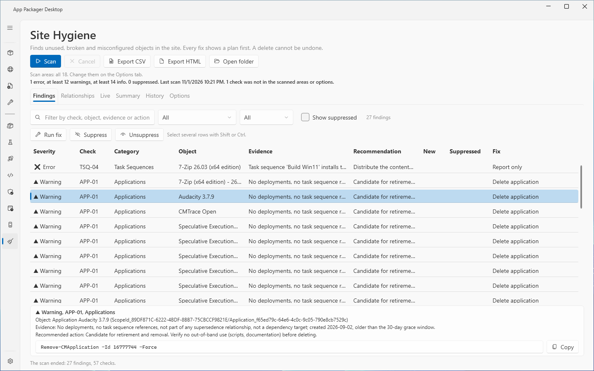
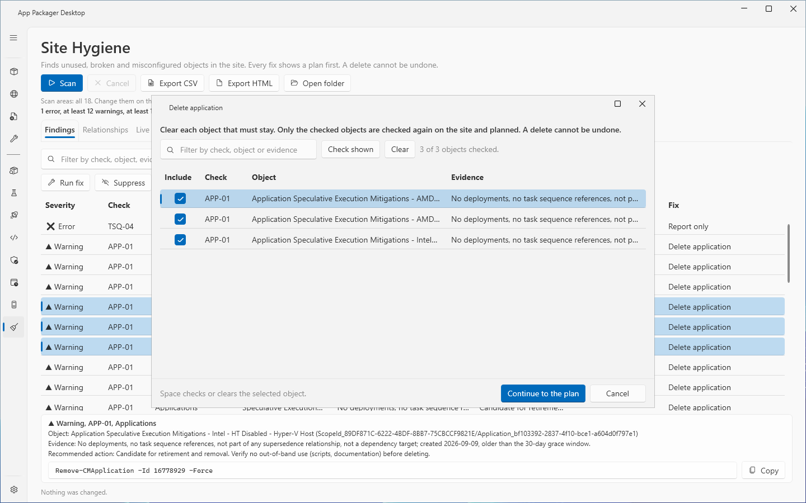
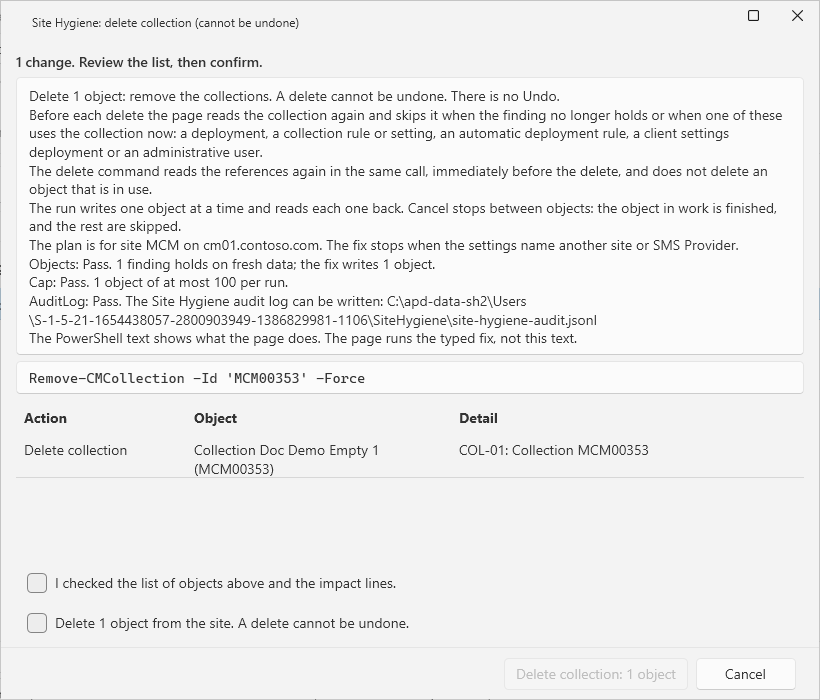
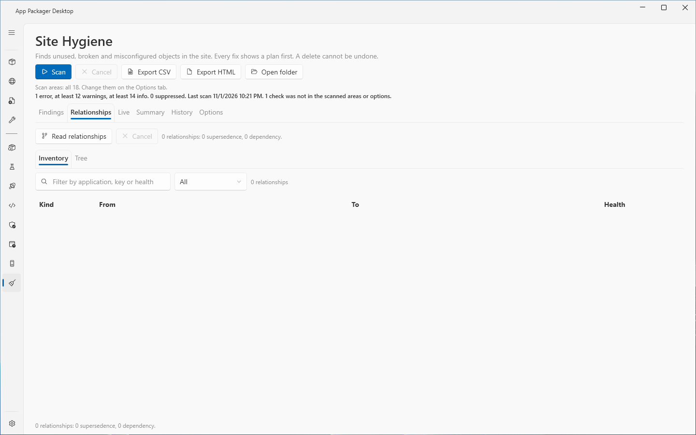
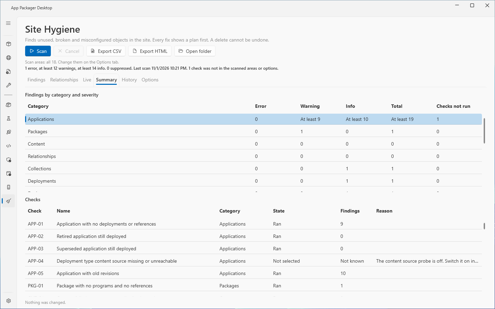
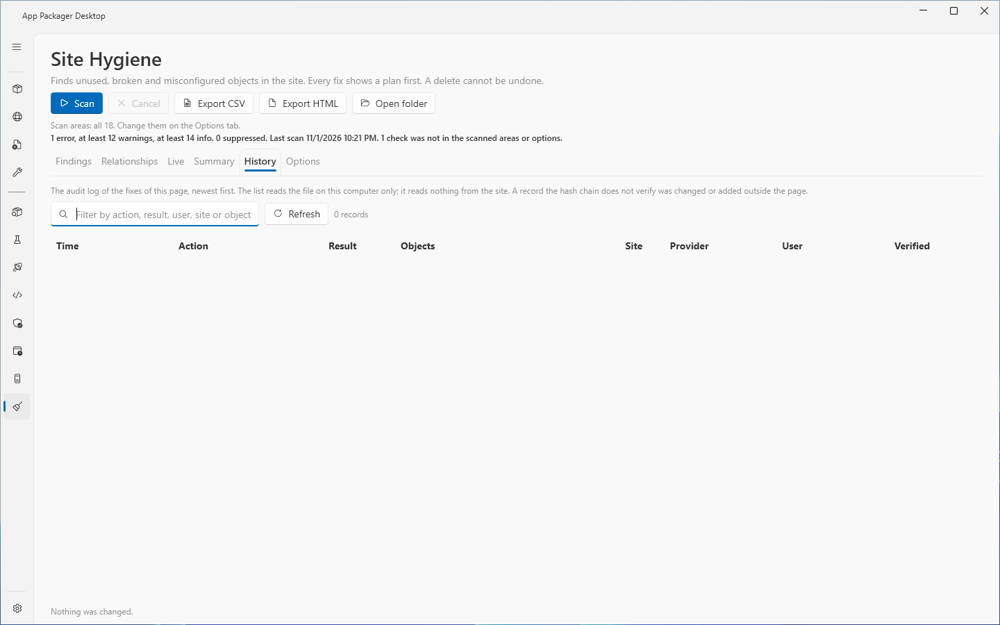
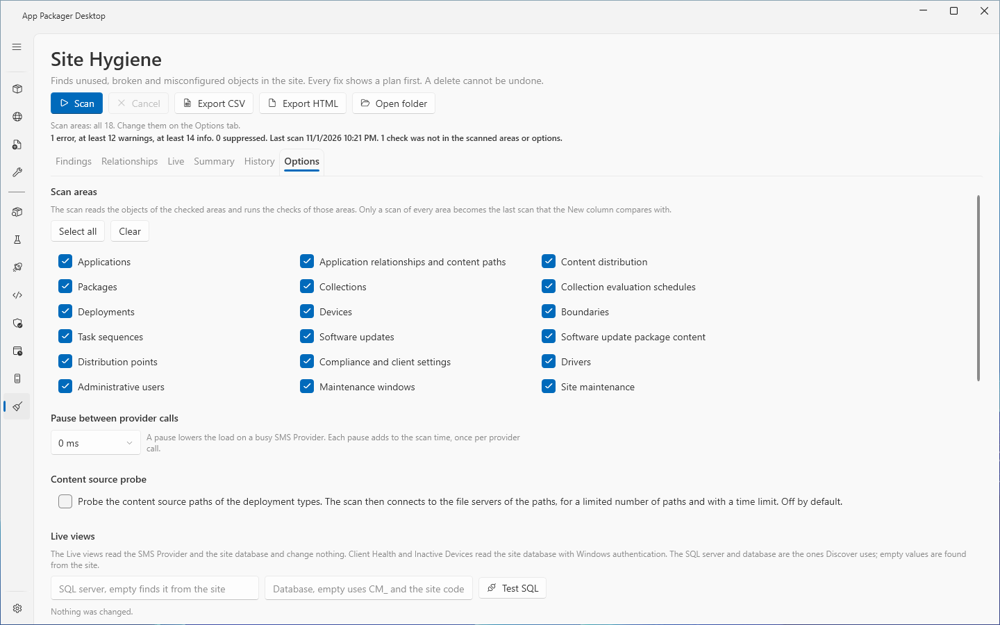

# Site Hygiene: scan the site and fix findings

## What it does

The **Site Hygiene** page scans a ConfigMgr site for unused, broken and misconfigured objects. It shows each finding with its evidence and a recommendation. It can fix a finding with a typed change. The scan changes nothing. **A fix deletes or changes objects on the site. Most deletes cannot be undone.**

This page describes the scan, the **Findings**, **Relationships**, **Summary** and **History** tabs, the fixes, and the scan settings on the **Options** tab. The **Live** tab, trends, alerts and the Live settings are in [Site Hygiene: live views, trends and alerts](site-hygiene-live.md). The list of the 57 checks is in [Site Hygiene checks](../reference/site-hygiene-checks.md).

## When to use it

- You want to find old applications, empty packages, unused collections, broken supersedence chains and similar clutter.
- You want to see what changed since the last scan. The **New** column marks new findings.
- You want to remove an unused object with a plan, an audit record and a check of the object before each write.

Do not use a fix on a production site without a backup of the site. Restore from a backup if you removed the wrong object.

## Requirements

| Item | Requirement |
|---|---|
| Settings | In Settings, under **Systems in use**, select **ConfigMgr**. Set **Site Code**. Set **Site Server / SMS Provider Host** unless this computer is the SMS Provider. |
| Console | The ConfigMgr console must be installed on the computer. |
| ConfigMgr rights, scan | Read rights on the objects that the selected areas read. |
| ConfigMgr rights, fix | The right to delete or change the object. |

The lab runs used a Full Administrator account. The page was not tested with a custom security role. The scan reads through the SMS Provider only. If a read fails or the page cuts it at its cap, the checks that need it do not run, and the **Summary** tab names them.

## Steps: scan the site

1. Select **Site Hygiene** in the sidebar. The first visit shows the stored last scan, marked as stored, without a call to the site. If no scan is stored, the page shows "No scan result yet. Select Scan to read the site."
2. To limit the scan, select the **Options** tab. Clear the scan areas that you do not need. See [Scan areas](#options-of-the-scan).
3. Select **Scan**. The progress line shows the step. Select **Cancel** to stop after the current step. The earlier result stays.
4. Read the summary line above the tabs. It shows the number of errors, warnings and info findings, the number of suppressed findings, the time of the scan, and the number of checks that did not run.
5. Select the **Findings** tab. Select a row to see the details under the grid: the object, the evidence, the recommendation, the fix note and the PowerShell text of the fix.

A scan of every area, with every check run, becomes the stored last scan. The **New** column of the next scan compares with it. A scan of some areas, a cut read or a check that did not run is not stored. The summary line says so.

## Findings

Columns: **Severity**, **Check**, **Category**, **Object**, **Evidence**, **Recommendation**, **New**, **Suppressed**, **Fix**.

- The severity shows **Error**, **Warning** or **Info**.
- **New** shows "New" for a finding that the last stored scan of the same site and provider did not have.
- **Fix** shows the name of the fix, or **Report only**. For **Report only**, the page does not run a fix. The detail text gives the reason. You fix the object in the ConfigMgr console. **Run fix** is then disabled, and a hint next to the buttons says why.

Filters: a text box (**Filter by check, object, evidence or action**), a **Category** list, a **Severity** list and the box **Show suppressed**. Select several rows with Shift or Ctrl.

**Suppress** hides the selected findings. The page asks for a comment. A suppression holds the check ID, the object key, the site and the provider. **Unsuppress** shows them again. **Show suppressed** lists the hidden findings in the grid.

**Copy** copies the PowerShell text of the fix of the selected finding. The page runs the typed fix, not this text.

## Steps: fix findings

1. On the **Findings** tab, select one or more findings. All selected findings must have the same fix.
2. Select **Run fix**. The page checks each finding again on the site.
3. If you selected more than one finding, a list opens. Clear each object that must stay. For a delete the text reads: "Clear each object that must stay. Only the checked objects are checked again on the site and planned. A delete cannot be undone." Use **Check shown** and **Clear** to change many rows. Select **Continue to the plan**.
4. The plan window opens. Read the object list, the notes and the **Equivalent PowerShell** text. The notes show the impact and the checks of the prepared change.
5. For a delete, select both confirmation boxes. The first reads: "I checked the list of objects above and the impact lines." The second reads: "Delete N objects from the site. A delete cannot be undone." A change plan has no box.
6. Select the confirm button. Its text is the fix name and the object count, for example **Delete package: 2 objects**.
7. Read the result. The result card **Results of the last fix** lists each object with **Result**, **Fix**, **Object** and **Message**. Open the card to see the rows.

The result of an object is **Done**, **Unchanged**, **Failed** or **Skipped**. **Done** means that the read-back showed the change. If the write ran but the read-back failed, the result is **Failed** and says so. **Cancel** in the plan window finishes the object in progress and skips the rest.

### Fix kinds

| Fix (as the **Fix** column shows it) | What the page does |
|---|---|
| Delete application | Removes the application. |
| Delete deployment | Removes application deployments by their unique ID. |
| Delete old revisions | Removes old revisions of an application. It never removes the latest revision. |
| Delete package, Delete boot image, Delete driver package | Removes the object. |
| Delete collection | Removes the collection. |
| Delete device | Removes the device record. |
| Delete deployment rule | Removes an auto deployment rule. |
| Delete maintenance window | Removes one window by its ID. |
| Change refresh type | Sets the refresh type of a collection (Continuous or Manual, as the check requires). |
| Change application | Sets the `AutoInstall` option of an application to true. This creates a new revision of the application. |
| Change maintenance task | Turns on a site maintenance task. |
| Run deployment rule | Runs an auto deployment rule. |

The checks that assign each fix are in [Site Hygiene checks](../reference/site-hygiene-checks.md).

## Safety rules of a fix

- The service reads the object again on fresh data when it prepares the plan, and again immediately before each write. If the finding no longer holds, the service skips the object and gives the reason.
- Before a delete, the same site command reads what uses the object. The service refuses a collection when a deployment, an auto deployment rule, a client settings deployment, a collection rule or an administrative scope uses it. It refuses an application when a task sequence uses it. It refuses a driver package while a task sequence has an Auto Apply Drivers step. It never deletes a device with a client heartbeat inside the inactivity window.
- A run takes at most 100 deletes or 200 changes. A plan is valid for 15 minutes and runs once. The plan is tied to the site and the provider. If the connection changes before you confirm, the service refuses the run.
- The page writes a **Started** audit record before the first change. If the log cannot be written, the page changes nothing. Each run ends with one **Finished** record. If that record cannot be written, the result says so and names the log.
- The page never runs script text. It runs the typed operation. A test checks that the PowerShell text of the plan is what the service runs.

## Relationships, Summary and History

**Relationships.** Select **Read relationships**. The page reads every supersedence and dependency between applications. **Cancel** stops the read. The **Inventory** list has the columns **Kind**, **From**, **To** and **Health**. Filter it by text or by kind (**All**, **Supersedes**, **Depends on**). The **Tree** list shows the chains, marks a circular chain, and works from the keyboard.

**Summary.** The first grid, **Findings by category and severity**, has the columns **Category**, **Error**, **Warning**, **Info**, **Total** and **Checks not run**. The second grid, **Checks**, has the columns **Check**, **Name**, **Category**, **State**, **Findings** and **Reason**. A count shows "At least N", or "Not known" for zero, when a check of that category and severity did not run. The check states are **Ran**, **Not run**, **Not selected**, **Needs the site database** and **Failed**. A check that did not run never shows "no findings".

**History.** The list shows every fix of this page, from its own audit log, newest first. Columns: **Time**, **Action**, **Result**, **Objects**, **Site**, **Provider**, **User**, **Verified**. Filter by action, result, user, site or object. **Refresh** reads the file again. The page reads the local file and makes no call to the site. The detail box lists the objects of the selected record. **Verified** shows "Verified" or "Not verified". A record that the hash chain does not verify was changed or added outside the page.

**Export CSV** and **Export HTML** save the rows that the filters of the active tab show. They work on the **Findings**, **Relationships**, **Live**, **Summary** and **History** tabs. The file names the filter, the suppressed findings that are hidden, and the checks that did not run. The CSV starts with the column row. The notes go to a separate `.about.txt` file. **Open folder** opens the report folder.

## Options of the scan

Select the **Options** tab.

| Setting | Effect | Default |
|---|---|---|
| Scan areas, **Select all**, **Clear** | The scan reads the objects of the checked areas and runs the checks of those areas. | All 18 areas |
| **Pause between provider calls** | A pause of 0, 50, 100, 250, 500 or 1000 ms lowers the load on a busy SMS Provider. Each pause adds to the scan time, once for each provider call. | 0 ms |
| **Content source probe** | The scan connects to the file servers of the content source paths of the deployment types, for a limited number of paths and with a time limit. | Off |

The 18 scan areas are: Applications; Application relationships and content paths; Content distribution; Packages; Collections; Collection evaluation schedules; Deployments; Devices; Boundaries; Task sequences; Software updates; Software update package content; Distribution points; Compliance and client settings; Drivers; Administrative users; Maintenance windows; Site maintenance.

With the content source probe off, check APP-04 is **Not selected**. The probe reads at most 200 paths with a time limit of 3 seconds for each path.

The **Options** tab also holds the Live settings. They are in [Site Hygiene: live views, trends and alerts](site-hygiene-live.md#options-of-the-live-views).

The page saves its choices in `settings.json` under the key `SiteHygiene`. It writes these files in `%LOCALAPPDATA%\AppPackager\SiteHygiene`: `site-hygiene-audit.jsonl`, `suppressions.json`, `last-scan.json` and the folder `Reports`.

## Limits

- A delete cannot be undone. Restore from a backup of the site if you removed the wrong object.
- A scan is a snapshot. The fix reads the object again, but the site can change between that read and the write. ConfigMgr has no conditional write.
- The site updates some flags late. An application can read as deployed, and can count a dependent task sequence, for some minutes after the last deployment or the task sequence is removed. The page then skips or refuses the delete and says why.
- The site does not list the task sequence steps of a boot image that is used only for media or PXE. A boot image plan says so.
- The page caps the task sequences that it reads. When the read is cut, the checks that need it do not run.
- The scan makes at most 2,000 reads for single objects. The page caps a read of one object type at 200,000 rows by default.
- The audit record lists at most 100 objects. A suppression comment has at most 500 characters. A report has at most 500,000 rows. **History** shows the newest 2,000 records. Older records stay in the file.
- The audit chain finds edits to single records. A process that runs under the same account can write a new chain without a break.
- The lab had one distribution point and four clients. Scale is covered by stub tests only. The lab ran every fix kind of the table on throwaway objects and read each change back.
- Lab reports: `SH-QUALIFICATION`, `SH-LAB-REPORT` to `SH-LAB8-REPORT`.

## Troubleshooting

| Message | Cause | Fix |
|---|---|---|
| Select at least one scan area on the Options tab. | All areas are cleared. | Check at least one area. |
| Nothing was scanned yet. Select Scan first. | No result is shown. | Select **Scan**. |
| The scan could not read the site. The earlier result stays. The log has the details. | A read failed. | Check the site code and the provider in Settings. Read the application log. |
| The site settings changed during the scan, so its result was discarded. Scan again. | You changed the site or the provider during a scan. | Select **Scan**. |
| Select one or more findings first. | **Run fix** with no selection. | Select findings. |
| The selected findings have no typed fix. They are for report only. | The page does not fix these findings. | Use the recommended action in the ConfigMgr console. |
| The selected findings need different fixes: (names). | The selection mixes fix kinds. | Filter to one fix, select the findings, then select **Run fix**. |
| The selected findings are suppressed. Select Unsuppress before a fix. | All selected findings are suppressed. | Select **Unsuppress**. |
| The findings could not be checked again on the site. Nothing was changed. | The check before the plan failed. | Read the application log. Start the fix again. |
| No finding of the plan still holds: the objects changed since the scan. | The objects changed. | Select **Scan**. |
| The plan cannot run. Nothing was changed. | A check of the plan failed. The message names the check. | Read the message. Prepare the plan again. |
| the plan is older than 15 minutes. Prepare it again on fresh data. | The plan is too old. | Select **Run fix** again. |
| the connection changed since the plan | The settings name another site or provider now. | Prepare the plan again. |
| The audit log is not complete: the Finished record of the last fix is missing. | The page could not write the Finished record. | Check the permissions of the audit log folder. |
| Skipped: (reason) | The service left out an object, for example because a reference exists. | Read the reason. |
| The relationships were not read. Select Read relationships. | You exported or opened relationships before the read. | Select **Read relationships**. |

## Links

- [Maintenance tasks for Configuration Manager](https://learn.microsoft.com/intune/configmgr/core/servers/manage/maintenance-tasks): Explains the site maintenance tasks.
- [Reference for maintenance tasks in Configuration Manager](https://learn.microsoft.com/intune/configmgr/core/servers/manage/reference-for-maintenance-tasks): Lists each maintenance task with its settings.
- [Use the status system in Configuration Manager](https://learn.microsoft.com/intune/configmgr/core/servers/manage/use-status-system): Explains the status system and the status messages.
- [Client health checks](https://learn.microsoft.com/intune/configmgr/core/clients/manage/client-health-checks): Lists the checks of the client health evaluation.
- [Revise and supersede applications in Configuration Manager](https://learn.microsoft.com/intune/configmgr/apps/deploy-use/revise-and-supersede-applications): Explains application revisions and supersedence relationships.
- [Plan for the SMS Provider](https://learn.microsoft.com/intune/configmgr/core/plan-design/hierarchy/plan-for-the-sms-provider): Explains the SMS Provider role.
